

  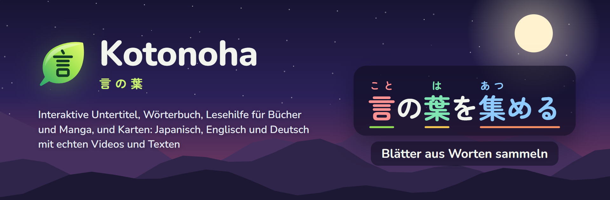

<h3 align="center">Japanisch und Englisch lernen mit dem, was man ohnehin schaut und liest.</h3>

  Interaktive Untertitel über den eigenen Videos, ein Wortfenster, das jedes Wort in seinem Satz versteht, Lesehilfe für Bücher, PDFs und Manga und Karten für Anki. Alles im Browser, kostenlos und quelloffen.

  
  
  
  

  
  
  
  
  
  

  <a href="https://github.com/Eliam4510/kotonoha/releases/latest"><b>Herunterladen</b></a> ·
  <a href="#installation">Installation</a> ·
  <a href="docs/de/guide.md">Anleitung</a> ·
  <a href="docs/de/features.md">Alle Funktionen</a> ·
  <a href="CHANGELOG.md">Neuigkeiten</a> ·
  <a href="CONTRIBUTING.md">Mitwirken</a>

## Was Kotonoha ist

Kotonoha (言の葉, „Blätter aus Worten“) ist eine Erweiterung für Chrome und Edge, die das, was man ohnehin schaut und liest, in Lernmaterial verwandelt: Serien und Videos auf YouTube oder Netflix, Artikel, Chats, Bücher und Manga. Jedes Wort zeigt seine Lesung und wie gut es bekannt ist, und ein Tippen darauf öffnet ein Wortfenster mit seiner Definition, seiner Bedeutung in genau diesem Satz und einer Schaltfläche, die daraus eine Karte macht.

Alles läuft auf dem eigenen Rechner. Wörterbuch, Textanalyse, Transkription und Texterkennung auf Buchseiten verlassen den Browser nicht. Claude von Anthropic kommt nur ins Spiel, wenn eine Erklärung oder Übersetzung angefordert wird, und jede Anfrage wird mit ihren Kosten verzeichnet.

<table>
  <tr><td><b>Schauen</b></td><td>Untertitel mit Furigana, Tonhöhenakzent und dem Stand jedes Wortes auf YouTube, Netflix, Disney+, Crunchyroll, Prime Video und in eigenen Dateien.</td></tr>
  <tr><td><b>Lesen</b></td><td>Jede Webseite, alles Kopierte und Bücher als EPUB, PDF und Manga, auch eingescannte oder als Bilderordner.</td></tr>
  <tr><td><b>Behalten</b></td><td>Karten mit einem Klick, mit Ton und Bild der Szene, für Anki oder die eingebaute Wiederholung.</td></tr>
  <tr><td><b>Sprachen</b></td><td>Gelernt wird Japanisch, Englisch oder Deutsch. Die Oberfläche gibt es auf Deutsch, Englisch, Spanisch, Chinesisch, Koreanisch und Japanisch.</td></tr>
</table>

## So lernt man mit Kotonoha

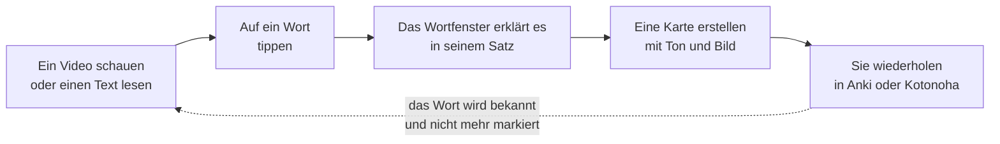

Jedes als bekannt markierte Wort wird überall nicht mehr hervorgehoben, und das Verständnis jedes Videos oder Textes steigt mit ihm.

## Rundgang

### Untertitel, die sich wirklich lesen lassen

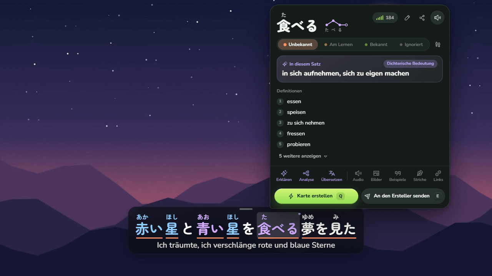

Über dem Player erscheinen die Untertitel mit Furigana, einer Farbe je Tonhöhenakzent und einer Unterstreichung für den Stand jedes Wortes: neu, am Lernen oder bekannt. Beim Überfahren öffnet sich das Wortfenster mit dem Wörterbuch, ganz ohne Kosten. Claude ergänzt die Bedeutung des Wortes in diesem Satz, auch wenn sie bildlich oder dichterisch ist, wie bei dem 食べる im Bild.

- `Q` erstellt eine Karte mit dem Satz, seinem Ton und dem Videobild, direkt in Anki oder in die eingebaute Wiederholung.
- `A` und `D` springen zwischen den Zeilen, `S` wiederholt die aktuelle. Der Untertitel-Navigator (`G`) zeigt alle, mit Filtern und Lesezeichen.
- Untertitel werden in die eigene Sprache übersetzt, und automatisch erzeugte werden mit dem Titel und dem ganzen Skript als Kontext korrigiert.
- Videos ohne Untertitel werden auf dem eigenen Rechner transkribiert, auf der Grafikkarte: 30 Minuten Video in etwa einer Minute.

### Jede Webseite

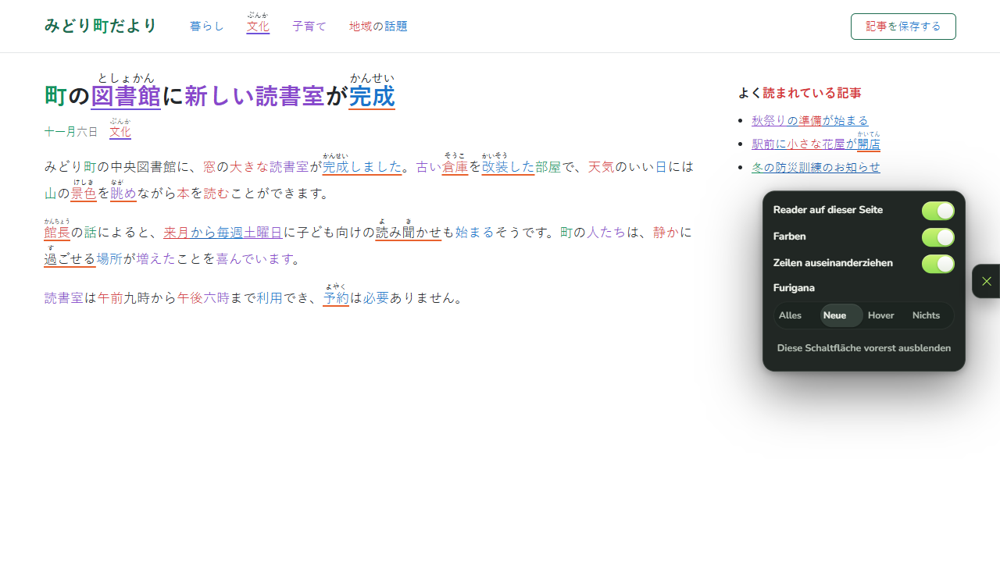

Auf Nachrichtenseiten, Blogs, Wikis oder in einem Chat wie dem von Claude bekommt japanischer Text dieselben Farben und Furigana, und ein Klick auf ein Wort öffnet sein Wortfenster. Der Inhalt der Seite bleibt unverändert: Links und Schaltflächen funktionieren weiter, und mit React gebaute Seiten merken nichts. Getestet auf rund dreißig echten Websites.

### Bücher, PDFs und Manga

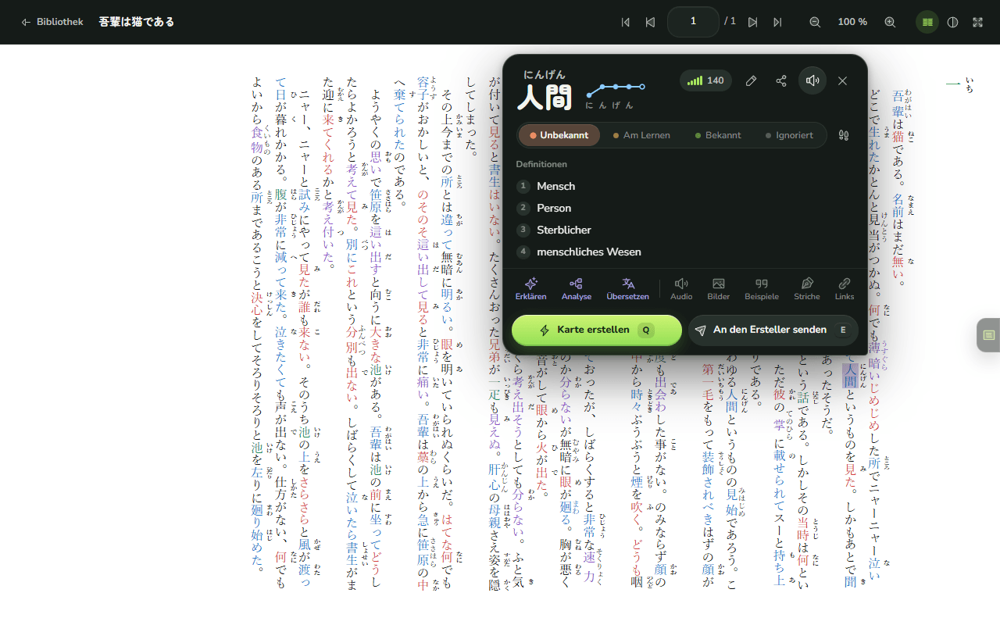

Die **Lesehilfe** ist ein vollständiger Betrachter wie ein PDF-Reader: Zoom, Doppelseiten, fortlaufendes Scrollen, Inhaltsverzeichnis, Miniaturen und die Seite, an der jedes Buch zuletzt aufgeschlagen war. Ein Text-EPUB wie ein Roman behält sein eigenes Layout, seine Ruby und seine vertikale Schrift, mit dem Seiten-Reader darüber: Farben, Furigana und Wortfenster wie im Web. Ein PDF, das Text enthält, lässt sich sofort Wort für Wort lesen. Manga in Bilderordnern werden durch Auswahl des Ordners importiert: Jeder Band wird ein Buch, mit der Titelseite vorn und den Farbdoppelseiten im Ganzen. Das Regal ordnet die Bücher in Sammlungen, etwa eine Reihe mit ihren Bänden, mit Titelbild und Beschreibung, und zeigt, wie viel von jedem Buch und jeder Sammlung gelesen ist. Im Betrachter lassen sich Seiten markieren, Text mit Kommentar hervorheben oder unterstreichen und Notizen auf der Seite hinterlassen, wie in einem PDF-Reader. Ein Wort lässt sich im ganzen Buch suchen, jede Seite als Text mit der Lesehilfe lesen, und Claude kann den von der Texterkennung gelesenen Text prüfen, indem es ihn mit dem Seitenbild vergleicht.

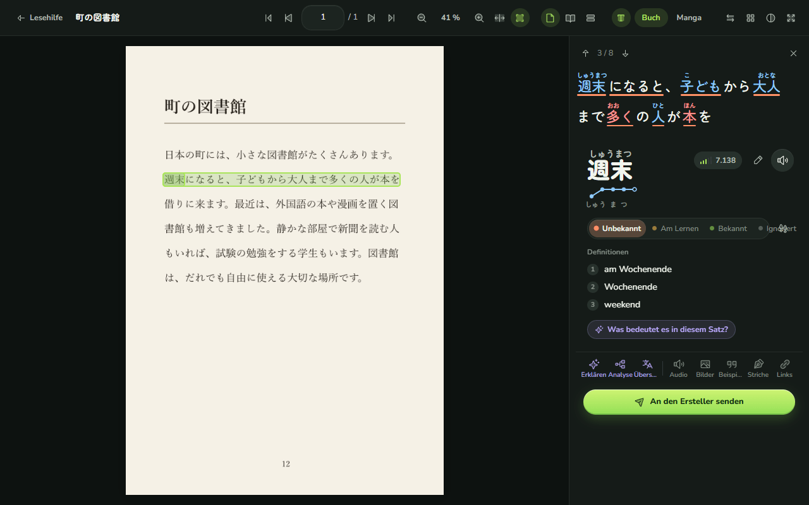

Seiten, die Bilder sind, wie Manga, eingescannte Bücher und viele PDFs, werden mit Texterkennung (OCR) auf dem eigenen Rechner und der Grafikkarte gelesen. Es gibt einen Modus für gedruckte Bücher und einen für Manga, der vertikale Sprechblasen liest, ohne Furigana mit dem Text zu verwechseln. Ein Tippen auf ein Wort der Seite öffnet seine Zeile mit Furigana und sein Wortfenster. Jede Seite wird nur einmal gelesen und gespeichert.

### Ein Notizbuch zum Schreiben und Lesen

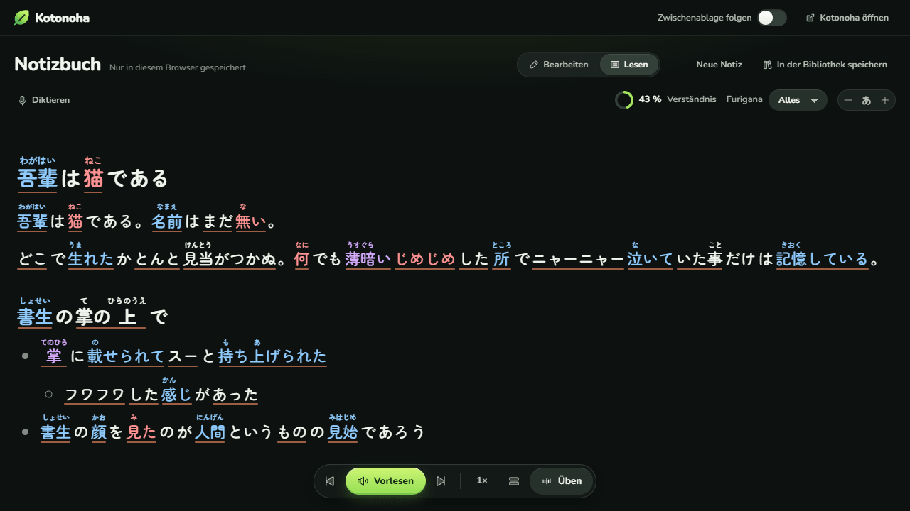

Das **Notizbuch** ist eine Seite über die ganze Breite, um Text in der Lernsprache mit Überschriften, Listen und Zitaten zu schreiben und einzufügen und ihn analysiert und mit Furigana zu lesen. **Ordnen** gibt einem am Stück eingefügten Text Struktur, ohne seine Wörter zu ändern, und jede Notiz wird in der Bibliothek gespeichert. Es liest in der gewählten Geschwindigkeit vor, am Stück, Satz für Satz oder einen Satz wiederholend, und jeder markierte Teil lässt sich anhören oder üben. Man kann ihm auch diktieren: Was man ins Mikrofon sagt, wird auf dem Rechner transkribiert und kommt als weiterer Absatz hinzu, mit seiner Aufnahme. Es öffnet sich außerdem in einem normalen Tab, in der geteilten Ansicht neben der gelesenen Seite, und sammelt, was man irgendwo kopiert.

### Der Akzent, laut gesprochen

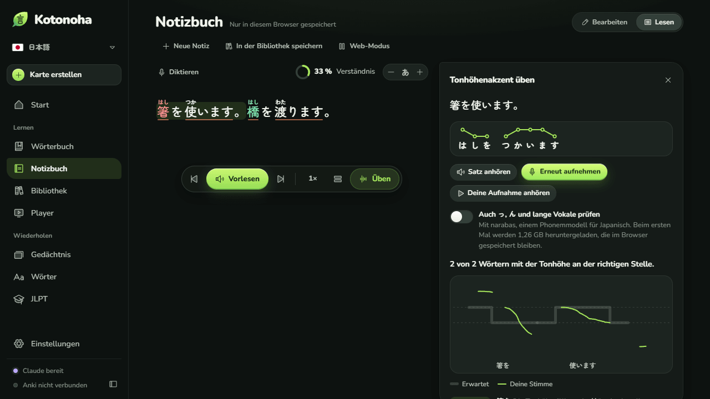

**Üben** zeigt den Akzent jedes Worts im Satz. Man liest ihn laut vor, und Kotonoha legt die Tonhöhenkurve der Stimme über die erwartete, sagt, bei welchen Wörtern die Tonhöhe an der falschen Stelle fällt, zeigt lange Pausen an und auf Wunsch auch fehlende oder überzählige っ, ん und lange Vokale. Die Tonhöhe wird im Browser gemessen und die Aufnahme auf dem Rechner transkribiert, ohne ihn zu verlassen. Sind AivisSpeech oder VOICEVOX geöffnet, liest die Modellstimme jeden Satz mit dem Akzent aus dem Wörterbuch, kostenlos und ebenfalls ohne den Rechner zu verlassen.

### Wie jedes Kanji geschrieben wird

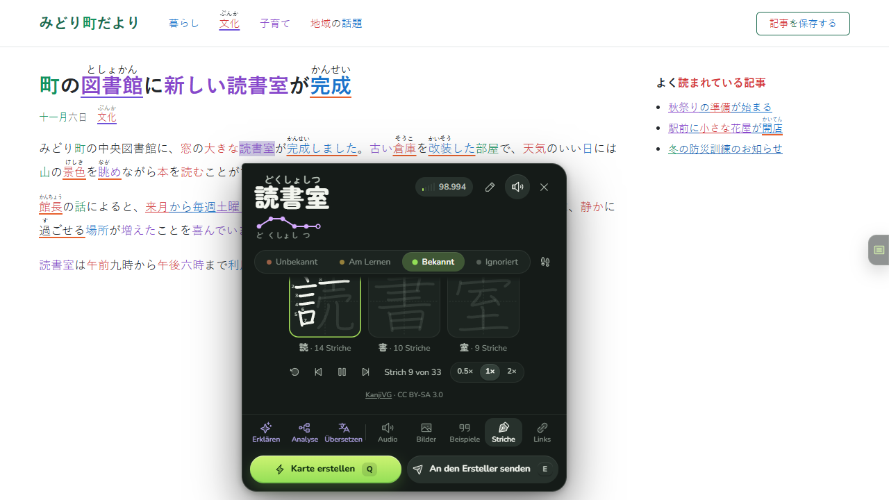

Das Wortfenster zeigt die Strichfolge jedes Kanji im Wort, Strich für Strich und in Schleife, mit ihren Nummern, und darunter die Wörter, die du mit demselben Kanji schon kennst.

### Teilen, was man findet

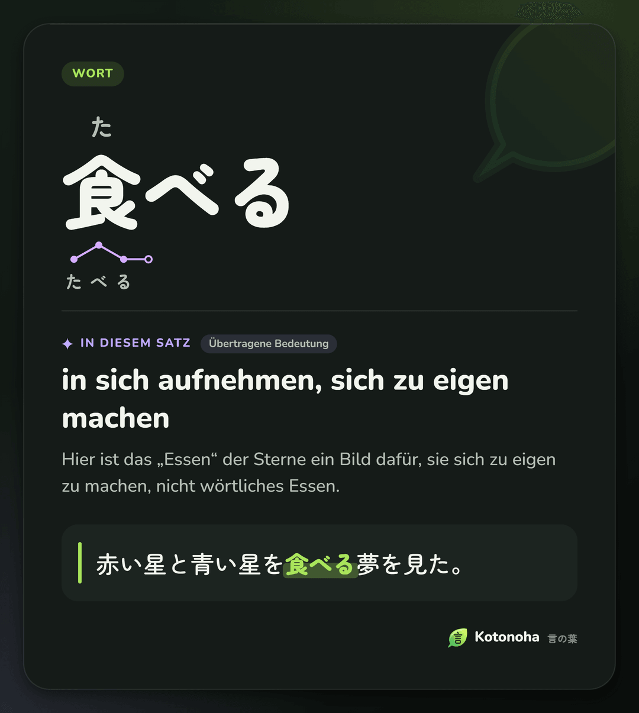

**Als Bild teilen** im Wortfenster macht aus einem Wort oder einem Grammatikpunkt eine Karte mit seiner Bedeutung in diesem Satz und dem Satz, in dem es vorkam, und legt sie in die Zwischenablage, um sie mit Strg+V in jeden Chat einzufügen. Es gibt sie in Tinte oder Papier, wie die Designs.

### Das JLPT, Stufe für Stufe

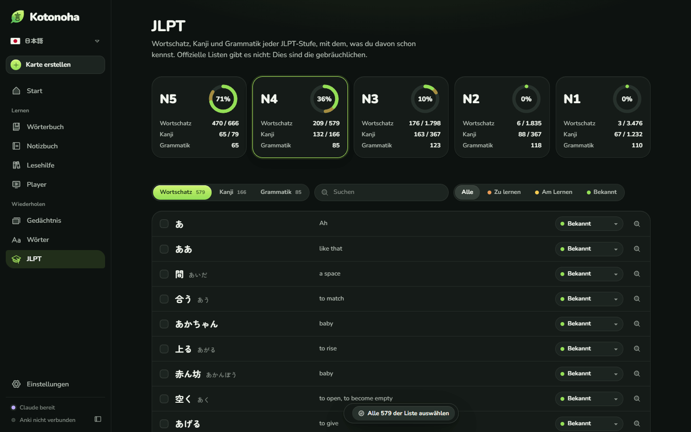

Die Ansicht **JLPT** vereint Wortschatz, Kanji und Grammatik jeder Stufe von N5 bis N1 und zeigt, wie viel davon du schon kennst, anhand der beim Sehen und Lesen markierten Wörter. Bekannte Wörter werden auf einmal markiert, jedes Kanji zeigt seine Striche und die Wörter, die es enthalten, und jeder Grammatikpunkt die gesehenen Sätze, in denen er vorkam.

### Ein Wörterbuch zum Erkunden

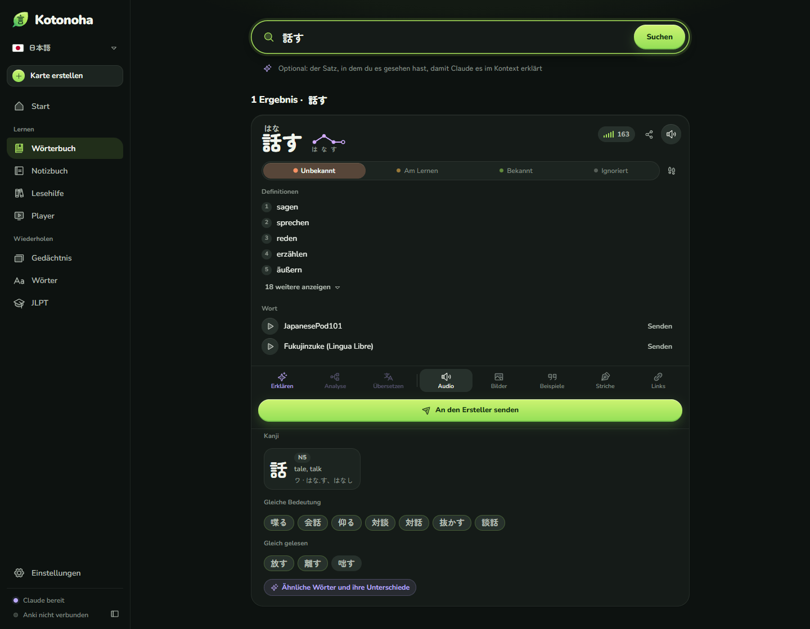

Das Wörterbuch sucht auch nach Bedeutung, etwa „Hund“ → 犬, und findet Grammatik nach Form oder Sinn. Unter jedem Wort stehen seine Kanji mit Stufe; **Gleiche Bedeutung** mit den gebräuchlichen Wörtern derselben Bedeutung, etwa 喋る oder 会話 für 話す; und die gleich gelesenen, etwa 離す und 放す. Auf Wunsch erklärt Claude die Unterschiede. Die Startseite versammelt Lautmalereien, Sprichwörter, Ausdrücke aus vier Kanji sowie literarische, umgangssprachliche und höfliche Wörter.

### Auch Englisch

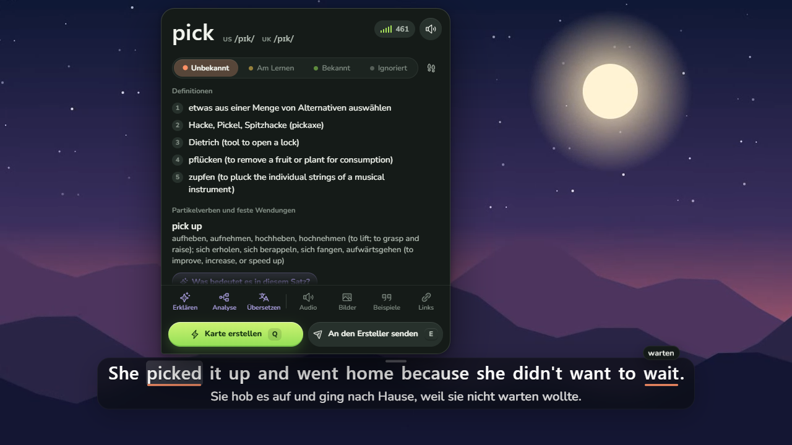

Für Englisch zeigt das Wortfenster die amerikanische und britische Aussprache in IPA, findet Partikelverben auch dann, wenn sie getrennt stehen, wie *picked it up*, und nennt das Wort, von dem jede unregelmäßige Form stammt. Die Wörterbücher stammen aus Wiktionary, auf Deutsch. Comics werden Sprechblase für Sprechblase gelesen, von links nach rechts, und Sätze klingen mit neuronalen Stimmen auf dem eigenen Rechner: Kokoro auf Englisch und Piper auf Deutsch. Jede Sprache behält ihre eigenen Wörter, Karten und Einstellungen, und der Wechsel braucht einen Klick.

### Außerdem

- **Grammatik, die du schon kannst.** Jeder Punkt wird als neu, im Lernen oder gelernt markiert; gelernte Punkte werden unter Untertiteln nicht mehr markiert, jeder Punkt merkt sich, in welchen Videos er vorkam, und lässt sich aus Anki importieren oder in eine Multiple-Choice-Karte verwandeln.
- **Diktat und Nachsprechen.** Der Diktat-Modus blendet die Zeile aus, pausiert am Ende und vergleicht, was du schreibst, mit dem Gesagten; mit `P` lässt sich jeder Untertitel laut üben.
- **Wie Englisch wirklich klingt.** Das Wortfenster zeigt den Satz so, wie er beim zusammenhängenden Sprechen klingt: *going to* → *gonna*, *meet you* → *meechu*, *turn off* → *tur‿noff*, mit Erklärung zu jedem Fall.
- **Immersionsstunden.** Die Startseite zählt die Zeit, in der du die Lernsprache hörst und liest, mit deiner Serie von Tagen in Folge.
- **Die Kosten im Blick.** Die Startseite zeigt, was Claude in diesem Monat gekostet hat, nach Tagen, Modellen und Aufgaben, mit einem Monatslimit. Nichts wird zweimal bezahlt: Jede Antwort wird gespeichert. Die [Kostenstudie](docs/de/costs.md) nennt gemessene Zahlen.
- **Eingebaute Wiederholung.** Mit dem FSRS-Algorithmus, für alle, die Anki nicht nutzen.
- **Eigene Dateien.** Ein Player für Videos auf dem Rechner, mit den Untertiteln aus einer MKV-Datei.
- **Nach Maß.** Farben für Farbenblindheit und hohen Kontrast, Lesungen in Kana oder Rōmaji, änderbare Tastenkürzel und Seiten, auf denen die Erweiterung ruht.

## Was ohne Claude geht und was Claude ergänzt

Kotonoha funktioniert ohne jeden Schlüssel. Ein optionaler Claude-Schlüssel ergänzt, was ein Sprachmodell braucht.

| Ohne Schlüssel, kostenlos | Mit einem Claude-Schlüssel, nach Verbrauch |
|---|---|
| Untertitel mit Furigana, Tonhöhenakzent und Wortstand | Die Bedeutung eines Wortes in seinem Satz |
| Wörterbuch, Wortfenster, Strichfolge und Aussprache | Erklärungen zu Wörtern, Sätzen und Grammatik |
| Seiten-Reader, Notizbuch und Lesehilfe mit OCR | Übersetzung und Korrektur von Untertiteln |
| Transkription auf dem eigenen Rechner | Prüfung der Furigana-Lesungen |
| Karten für Anki und eingebaute Wiederholung | Geschichten passend zum Niveau |

Normale Nutzung kostet wenige Cent im Monat. Der Schlüssel wird nur im Browser gespeichert. Aufgabe für Aufgabe lassen sich statt Claude auch OpenRouter, DeepSeek, OpenAI oder ein Modell auf dem eigenen Rechner mit LM Studio oder Ollama nutzen.

## Installation

Voraussetzung: Chrome oder Edge ab Version 120.

1. `kotonoha-<version>-extension.zip` aus der [neuesten Version](https://github.com/Eliam4510/kotonoha/releases/latest) herunterladen und an einem dauerhaften Ort entpacken.
2. `chrome://extensions` oder `edge://extensions` öffnen und den **Entwicklermodus** einschalten.
3. **Entpackte Erweiterung laden** wählen und den Ordner `kotonoha` auswählen.

Unter Windows geht es auch mit dem Helfer: `kotonoha-<version>-ayudante.zip` enthält `Instalar.cmd`, das per Doppelklick den Helfer installiert und, wenn es Kotonoha nicht findet, auch die Erweiterung, mit fester Kennung. Danach fehlen nur noch die Schritte 2 und 3.

Beim ersten Start fragt eine Begrüßung nach der eigenen Sprache, der Lernsprache und dem Niveau und installiert die Wörterbücher. Zum Aktualisieren genügt es, die neue Version über die alte zu entpacken: Die Erweiterung lädt sich selbst neu. Gibt es eine neue Version, zeigt Kotonoha das auf der Startseite an, und mit installiertem Helfer spielt **Jetzt aktualisieren** sie mit einem Klick ein. Die [Anleitung](docs/de/guide.md) erklärt jede Funktion, [CONTRIBUTING.md](CONTRIBUTING.md) das Erstellen aus dem Quellcode.

## Wichtige Tastenkürzel

| Kürzel | Aktion |
|---|---|
| `Q` | Karte aus dem Satz erstellen |
| `E` | An den Ersteller senden |
| `1` bis `4` | Wort markieren: unbekannt, verfolgt, bekannt, ignoriert |
| `A`, `D` und `S` | Vorheriger Satz, nächster Satz und wiederholen |
| `G` | Untertitel-Navigator |
| `Alt+Shift+K` | Kotonoha-Fenster öffnen |

Alle Kürzel über dem Video lassen sich ändern und funktionieren mit jedem Tastaturlayout.

## Datenschutz

- Daten und Claude-Schlüssel werden nur im Browser gespeichert. Es gibt keinen eigenen Server und keine Nutzungsstatistik. Die [Datenschutzerklärung](docs/privacidad.md#english) nennt, was an welchen Dienst gesendet wird.
- Transkribierter Ton und erkannte Seiten verlassen den Rechner nicht.
- Claude erhält nur, was eine Anfrage braucht: den Satz, das Untertitelskript und den Titel.
- Wörterbücher und Modelle werden einmal heruntergeladen, von GitHub und Hugging Face. Die [Hinweise](docs/de/notices.md) nennen jede Quelle.

## Architektur

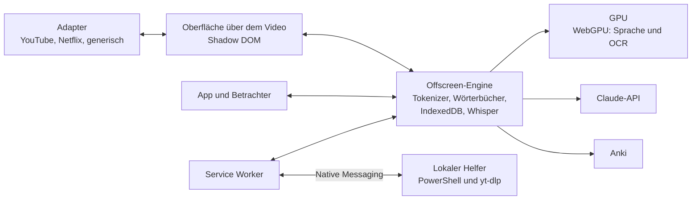

TypeScript, Preact, Dexie und esbuild, mit ONNX Runtime und Transformers.js auf WebGPU für Sprache und OCR. Jeder Teil, die technischen Entscheidungen und die Leistungsmessungen stehen in [docs/de/architecture.md](docs/de/architecture.md). Über 750 Unit-Tests decken die Logik ab, End-to-End-Tests die wichtigsten Abläufe mit echtem Edge und der GPU; [CONTRIBUTING.md](CONTRIBUTING.md) erklärt, wie sie laufen.

## Projektstand

Jede Version erscheint mit ihren Tests und ihrer Dokumentation in sechs Sprachen; die [Neuigkeiten](CHANGELOG.md) fassen sie zusammen. YouTube und Englisch wurden zusätzlich von Hand in einer echten Sitzung geprüft. Die Übersetzungen der Oberfläche entstanden mit Hilfe von KI und wurden noch nicht muttersprachlich geprüft: Korrekturen sind willkommen.

## Lizenz und Danksagungen

Der Code steht unter der [MIT-Lizenz](LICENSE). Komponenten Dritter, die bei der Nutzung heruntergeladenen Daten und die Bedingungen für einen verantwortungsvollen Gebrauch stehen in den [Hinweisen](docs/de/notices.md).

- Wörterbücher: [JMdict](https://www.edrdg.org/jmdict/j_jmdict.html) (EDRDG), [Kanjium](https://github.com/mifunetoshiro/kanjium) und [JPDB](https://jpdb.io); für Englisch und Deutsch [Wiktionary](https://www.wiktionary.org) über [wiktionary-to-yomitan](https://github.com/yomidevs/wiktionary-to-yomitan) und [kaikki.org](https://kaikki.org).
- Sprache: [Whisper large-v3-turbo](https://huggingface.co/onnx-community/whisper-large-v3-turbo), Haas-ja und Parakeet, mit [Transformers.js](https://github.com/huggingface/transformers.js).
- Texterkennung: [PP-OCRv5 und PP-OCRv6](https://github.com/PaddlePaddle/PaddleOCR), [manga-ocr](https://github.com/kha-white/manga-ocr) und ein [Sprechblasen-Detektor](https://huggingface.co/ogkalu/comic-text-and-bubble-detector).
- Strichfolge: [KanjiVG](https://kanjivg.tagaini.net), von Ulrich Apel, CC BY-SA 3.0.
- Symbole: [Phosphor](https://phosphoricons.com). Schriften: [Zen Maru Gothic](https://fonts.google.com/specimen/Zen+Maru+Gothic) und [Nunito](https://fonts.google.com/specimen/Nunito).

Der Name stammt aus dem Vorwort des *Kokin Wakashū* (um 905): Die Dichtung Japans hat das menschliche Herz zum Samen, und aus ihm sprießen unzählige Blätter aus Worten.

Ein unabhängiges Projekt, ohne Verbindung zu den genannten Diensten.
