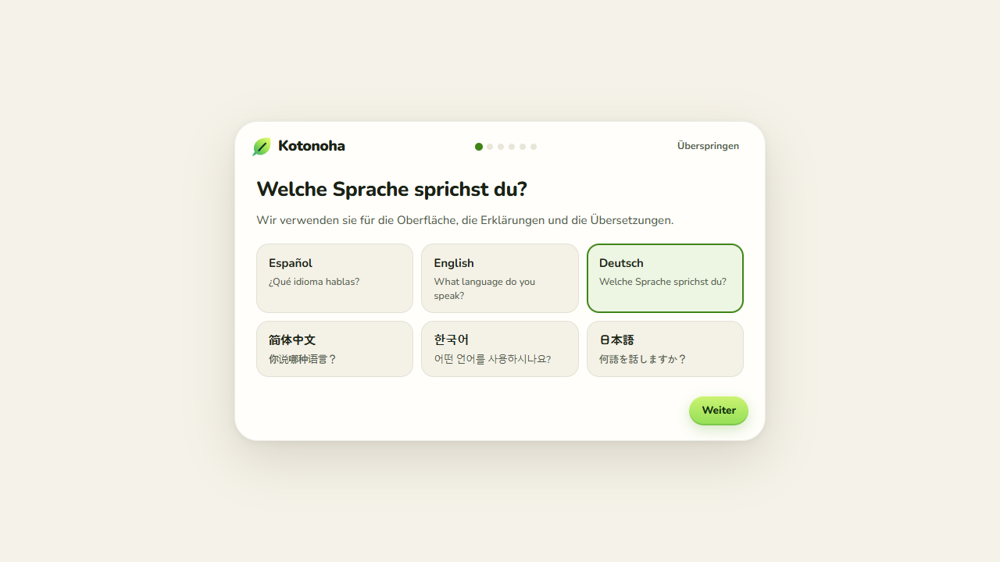
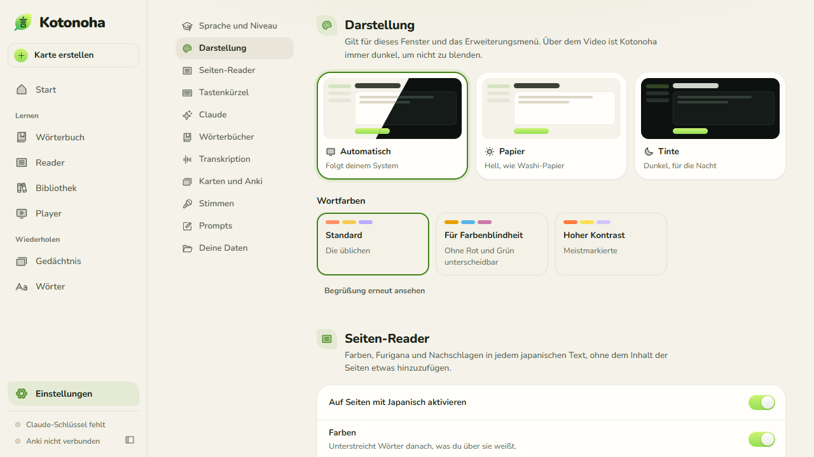
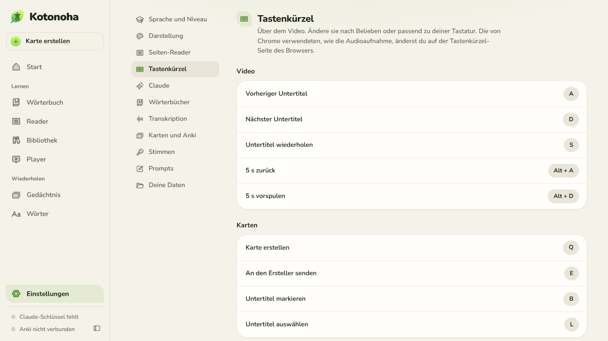
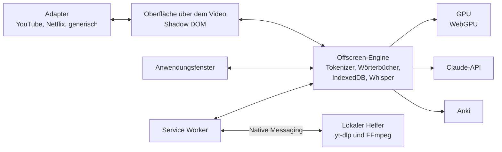

<p align="center">
  
</p>

<p align="center">
  
  
  
  
  <a href="LICENSE"></a>
</p>

<p align="center">
  <a href="README.md"></a>
  <a href="README.en.md"></a>
  <a href="README.de.md"></a>
  <a href="README.zh.md"></a>
  <a href="README.ko.md"></a>
  <a href="README.ja.md"></a>
</p>

<p align="center">
  
  <a href="https://github.com/Eliam4510/kotonoha/actions/workflows/ci.yml"></a>
  
  
  
</p>

<p align="center">
  <b>Browser-Erweiterung, um Japanisch mit echten Videos und Texten zu lernen.</b>
</p>

<p align="center">
  <a href="#installation">Installation</a> ·
  <a href="docs/de/guide.md">Anleitung</a> ·
  <a href="docs/de/features.md">Funktionen</a> ·
  <a href="docs/de/architecture.md">Architektur</a> ·
  <a href="docs/de/costs.md">Kosten</a> ·
  <a href="docs/de/notices.md">Hinweise</a>
</p>

<p align="center">
  
</p>

## Beschreibung

Kotonoha (言の葉, „Blätter aus Worten“) legt interaktive Untertitel über YouTube, Netflix und andere Player. Jedes Wort zeigt seine Furigana, seinen Tonhöhenakzent und wie gut es bekannt ist, und beim Überfahren mit der Maus öffnet sich sein Wörterbucheintrag, ganz ohne Kosten. Eine Schaltfläche fragt Claude, was es in genau diesem Satz bedeutet. Dazu kommen ein Wörterbuch, das Erstellen von Karten für Anki oder eine eingebaute Wiederholung sowie Erklärungen im Kontext über die Claude-API. Auf jeder Webseite färbt die Erweiterung japanischen Text, ergänzt Furigana und schlägt Wörter mit einem Klick nach, auch in Chats wie dem von Claude, ohne die Seite zu zerstören. Sie funktioniert auch mit Texten, EPUB-Büchern und eigenen Videodateien. Die Oberfläche gibt es auf Spanisch, Englisch, Deutsch, Chinesisch, Koreanisch und Japanisch.

Der Name stammt aus dem Vorwort des *Kokin Wakashū* (um 905): Die Dichtung Japans hat das menschliche Herz zum Samen, und aus ihm sprießen unzählige Blätter aus Worten.

## Funktionen

<table>
  <tr>
    <td width="33%" align="center"></td>
    <td width="33%" align="center"></td>
    <td width="33%" align="center"></td>
  </tr>
  <tr>
    <td valign="top"><b>Untertitel zum wirklichen Lesen</b><br>Furigana, Farben nach Tonhöhenakzent, Unterstreichung nach Lernstand und JLPT-Grammatikpunkte, dazu ein geschätzter Verständnisgrad für jedes Video.</td>
    <td valign="top"><b>Erst das Wörterbuch, Claude auf Wunsch</b><br>Das Wortfenster öffnet sich mit dem Wörterbuch. Eine Schaltfläche fragt Claude nach der wirklichen Bedeutung des Wortes in diesem Satz, auch bei übertragenem und literarischem Gebrauch. Claude prüft außerdem die Furigana-Lesungen, während das Video läuft.</td>
    <td valign="top"><b>Untertitel-Navigator</b><br>Alle Zeilen im Blick, mit Filtern, Markierungen, Mehrfachauswahl und Synchronisierung mit einer oder zwei Markierungen. Korrigierte Zeilen behalten ihren Originaltext.</td>
  </tr>
  <tr>
    <td width="33%" align="center"></td>
    <td width="33%" align="center"></td>
    <td width="33%" align="center"></td>
  </tr>
  <tr>
    <td valign="top"><b>Übersetzen und korrigieren mit Claude</b><br>Übersetzung in die Hilfssprache, beginnend bei dem Abschnitt, der gerade läuft. Automatische Korrektur der Homophone in generierten Untertiteln, mit Titel und Gesamttext als Kontext und ohne Rückfragen.</td>
    <td valign="top"><b>SRT hin und zurück</b><br>Import und Export auf jeder Website: SRT, VTT, ASS und TTML. Importiertes bleibt für diesen Titel gespeichert, und japanische Netflix-Untertitel bleiben erhalten, auch wenn eine andere Region sie nicht anbietet.</td>
    <td valign="top"><b>Lokale Transkription</b><br>Whisper auf der Grafikkarte über WebGPU, ohne dass das Audio den Computer verlässt: 30 Minuten Video in etwa 5, ohne den Desktop auszubremsen. Es arbeitet in Abschnitten mit Pausen und erholt sich, wenn der Treiber neu startet.</td>
  </tr>
  <tr>
    <td width="33%" align="center"></td>
    <td width="33%" align="center"></td>
    <td width="33%" align="center"></td>
  </tr>
  <tr>
    <td valign="top"><b>Die Kosten im Blick</b><br>Die Startseite zeigt die Ausgaben für Claude in diesem Monat, mit einem Diagramm nach Tagen und Modellen, den Aufgaben und einem Protokoll jeder Anfrage mit ihren Tokens. Die <a href="docs/de/costs.md">Kostenstudie</a> nennt gemessene Zahlen.</td>
    <td valign="top"><b>Nichts wird zweimal bezahlt</b><br>Jede Antwort wird pro Wort und Satz gespeichert. Das Hin und Her zwischen Wörtern kostet nichts, und eine unterbrochene Antwort wird zu Ende geführt und gespeichert, statt verloren zu gehen.</td>
    <td valign="top"><b>Untertitel, wo man sie möchte</b><br>Sie lassen sich von jedem Punkt aus in die gewünschte Höhe und Seite ziehen, mit Magneten zur Mitte und zum Ursprungsplatz. Sie wechseln die Zeile ohne Flackern und folgen dem Video beim Scrollen der Seite.</td>
  </tr>
  <tr>
    <td width="33%" align="center"></td>
    <td width="33%" align="center"></td>
    <td width="33%" align="center"></td>
  </tr>
  <tr>
    <td valign="top"><b>Eine vollständige Anwendung</b><br>Startseite, Wörterbuch mit konjugierten Formen, Wortübersicht nach Status, Niveaubewertung, Einstellungen pro Aufgabe und bearbeitbare Prompts. Helles und dunkles Design.</td>
    <td valign="top"><b>Karten mit einem Klick</b><br>Mit Audio und Einzelbild des Videos, direkt an Anki über AnkiConnect oder an die eingebaute Wiederholung mit FSRS.</td>
    <td valign="top"><b>Mehr als Video</b><br>Textleser, EPUB-Bibliothek, Geschichten passend zum Niveau und ein Player für eigene Dateien mit MKV-Untertiteln.</td>
  </tr>
  <tr>
    <td width="33%" align="center"></td>
    <td width="33%" align="center"></td>
    <td width="33%" align="center"></td>
  </tr>
  <tr>
    <td valign="top"><b>Jede Seite, ohne sie zu zerstören</b><br>Farben und Furigana auf dem Japanisch von Nachrichten, Artikeln und Blogs. Ein Klick auf ein Wort öffnet sein Wortfenster; bei Links und Schaltflächen genügt es, die Maus darauf ruhen zu lassen. Dem Inhalt der Seite wird nichts hinzugefügt: Berührt wird höchstens der Zeilenabstand, wo Furigana nicht passt, und das lässt sich abschalten.</td>
    <td valign="top"><b>Wie es geschrieben wird</b><br>Das Wortfenster zeigt die Striche jedes Kanji des Wortes, einzeln und in einer Schleife, mit ihren Nummern. Es lässt sich anhalten und Schritt für Schritt durchgehen. Jedes Kanji wird einmal heruntergeladen und bleibt gespeichert.</td>
    <td valign="top"><b>Reader in einem Tab</b><br>Der Reader öffnet sich auch in einem normalen Tab, für die geteilte Ansicht des Browsers, sogar direkt neben der gerade angezeigten Seite. Er kann der Zwischenablage folgen: Was man kopiert, erscheint dort.</td>
  </tr>
  <tr>
    <td width="33%" align="center"></td>
    <td width="33%" align="center"></td>
    <td width="33%" align="center"></td>
  </tr>
  <tr>
    <td valign="top"><b>In sechs Sprachen</b><br>Oberfläche auf Spanisch, Englisch, Deutsch, Chinesisch, Koreanisch und Japanisch. Eine Begrüßung fragt nach Sprache und Niveau und schlägt Passendes vor. Erklärungen von Claude gibt es auch auf Portugiesisch und Französisch.</td>
    <td valign="top"><b>Nach Maß</b><br>Farben für Farbenblindheit und hohen Kontrast, Lesungen in Kana oder Rōmaji, ein monatliches Kostenlimit und Websites, auf denen nichts geschehen soll. Von null bis N1.</td>
    <td valign="top"><b>Kürzel nach Wunsch</b><br>Alle Kürzel über dem Video lassen sich ändern, und sie funktionieren mit jeder Tastaturbelegung, auch bei aktivierter japanischer Eingabe.</td>
  </tr>
</table>

Die vollständige Liste, mit der Art der Überprüfung jeder Funktion, steht in [docs/de/features.md](docs/de/features.md).

## Installation

Voraussetzung: Chrome oder Edge 120 oder neuer.

### Kompilierte Version

1. `kotonoha-<version>-extension.zip` unter [Releases](https://github.com/Eliam4510/kotonoha/releases/latest) herunterladen.
2. An einem dauerhaften Ort entpacken. Es entsteht der Ordner `kotonoha`. Der Browser leitet aus diesem Pfad die Kennung der Erweiterung ab und speichert damit die Daten: Den Ordner zu verschieben heißt, von vorn zu beginnen.
3. `chrome://extensions` oder `edge://extensions` öffnen.
4. Den Entwicklermodus aktivieren.
5. „Entpackte Erweiterung laden“ wählen und den Ordner `kotonoha` angeben.

Zum Aktualisieren genügt es, die neue Version am selben Ort über die alte zu entpacken: Die Erweiterung erkennt das und lädt sich in weniger als einer Minute selbst neu, außer wenn gerade eine Arbeit läuft. Offene Tabs weisen darauf hin, dass sie neu geladen werden müssen.

Wird bereits eine Kopie aus einem anderen Ordner verwendet, sollte diese nicht gleichzeitig geladen werden: Beide würden auf denselben Seiten arbeiten.

### Aus dem Quellcode

Zusätzlich wird Node.js 22 oder neuer benötigt.

```bash
git clone https://github.com/Eliam4510/kotonoha.git
```

```bash
cd kotonoha
```

```bash
npm install
```

```bash
npm run build
```

Anschließend wird der Ordner `dist` wie oben geladen. Beim erneuten Kompilieren erkennt die Erweiterung die Änderung und lädt sich selbst neu. Eine Kopie vor Version 0.1.1 kann das nicht: Dort muss einmal „Neu laden“ gedrückt werden.

## Erste Schritte

Beim ersten Mal öffnet sich eine Begrüßung, die nach Sprache und Niveau fragt und Folgendes vorschlägt:

1. Die Wörterbücher installieren: JMdict in der eigenen Sprache oder auf Englisch, falls es noch keines gibt, mit Tonhöhenakzent und Häufigkeit.
2. Einen Claude-API-Schlüssel hinzufügen, der nur im Browser gespeichert wird. Das ist optional: Ohne ihn funktionieren Untertitel, Wörterbuch, Farben, Karten und Whisper.
3. Wählen, wohin die Karten gehen: in die eingebaute Wiederholung oder zu Anki über das Add-on AnkiConnect.

All das lässt sich überspringen und später unter **Einstellungen** im Fenster der Erweiterung (`Alt+Shift+K`) ändern.

Danach erscheint beim Öffnen eines Videos mit japanischen Untertiteln die Kotonoha-Leiste, und auf jeder Seite mit japanischem Text erscheinen Farben und Furigana. Die [Anleitung](docs/de/guide.md) erklärt den Rest.

### Helfer zum Transkribieren von Internetvideos

Er ist optional. Ohne ihn lässt sich ein Internetvideo nur während der Wiedergabe transkribieren. Mit ihm wird es vollständig transkribiert, ohne es abzuspielen. Es ist ein lokales Programm mit [yt-dlp](https://github.com/yt-dlp/yt-dlp) und FFmpeg, das nur die Erweiterung aufrufen kann. Es benötigt Python und FFmpeg unter Windows und wird bei Netflix nie verwendet.

```bash
powershell -ExecutionPolicy Bypass -File herramientas\ayudante\instalar.ps1
```

Bei der kompilierten Version wird er separat als `kotonoha-<version>-ayudante.zip` heruntergeladen. Dessen Datei `LEEME.txt` erklärt die Installation, bei der die Kennung der Erweiterung mit `-Extension` anzugeben ist.

## Wichtigste Tastenkürzel

| Kürzel | Aktion |
|---|---|
| `Q`, `Alt+Q` | Karte mit einem Klick erstellen |
| `E` | An den Karten-Ersteller senden |
| `N` | Zum nächsten unbekannten Wort gehen |
| `1` bis `4` | Wort markieren: unbekannt, verfolgt, bekannt, ignoriert |
| `A`, `D` | Vorheriger und nächster Satz |
| `S` | Satz wiederholen |
| `G` | Untertitel-Navigator |
| `Alt+Shift+M` | Audioaufnahme erlauben |
| Klick auf ein Wort | Es nachschlagen, auf jeder Seite mit japanischem Text |

## Leistung der Transkription

Gemessen mit einer Radeon RX 9060 XT mit 16 GB, 16 GB RAM, einem 4K-Monitor mit 60 Hz und echten Videos.

| Messgröße | Ergebnis |
|---|---|
| Geschwindigkeit im automatischen Modus | 30 Minuten Video in etwa 5 Minuten, das 6,1- bis 6,4-Fache der Echtzeit |
| Zeichenfehler bei 126 echten Sätzen | 8,8 % |
| Zwei Stunden Audio am Stück | 19,7 Minuten, ohne Treiber-Neustarts und ohne wachsenden Speicher |
| Flüssigkeit des Desktops während der Transkription | 99. Perzentil von 17,5 ms, keine Bilder über 33 ms |
| Video in 1080p während der Transkription | 0 von 749 Bildern verloren |

Die vollständigen Tabellen, einschließlich des Genauigkeitsvergleichs der Modelle, stehen in [docs/de/architecture.md](docs/de/architecture.md#referenzmessungen).

## Architektur



Die Einzelheiten jedes Teils und der technischen Entscheidungen stehen in [docs/de/architecture.md](docs/de/architecture.md).

## Entwicklung

```bash
npm run dev
```

```bash
npm test
```

```bash
npm run typecheck
```

```bash
npm run paquete
```

Der letzte Befehl kompiliert und legt in `release/` die ZIP-Dateien der Erweiterung und des Helfers mit ihren SHA-256-Summen ab, bereit zur Veröffentlichung.

| Test | Was geprüft wird |
|---|---|
| `npm test` | Die reine Logik in `src/nucleo` und dass die Übersetzungstabellen vollständig sind |
| `node herramientas/idiomas.mjs` | Was in jeder Sprache fehlt oder übrig ist |
| `node pruebas/lector.mjs` | Der Seiten-Reader in den schwierigen Fällen: Nichts bewegt sich, Klick, Links, Karussells, Akkordeons, live eintreffender Text, Shadow Trees und eine scrollende Box wie in einem Chat |
| `node pruebas/lector-real.mjs` | Der Reader auf rund dreißig öffentlichen Websites, mit einem Screenshot von jeder |
| `node pruebas/trazos-web.mjs` | Die Strichfolge mit echten Daten, der Reader im Tab, die Zwischenablage und die geteilte Ansicht |
| `node pruebas/e2e.mjs` | Die Erweiterung von Anfang bis Ende in Edge |
| `node pruebas/subtitulos.mjs` | Übersetzen, korrigieren, exportieren und importieren, auf Seiten, die Netflix und YouTube nachahmen, mit einer simulierten Claude-API |
| `node pruebas/experiencia.mjs` | Was über dem Video wahrnehmbar ist, Bild für Bild: Flackern, Zittern und Ziehen. Außerdem zählt der Test die Anfragen an Claude und prüft das Kostenprotokoll |
| `node pruebas/capturas.mjs` | Geht alle Bildschirme durch und speichert Screenshots |
| `node pruebas/tarjetas.mjs audio.wav` | Simuliertes Anki, Gedächtnis und Aufnahme |
| `node pruebas/sin-gpu.mjs` | Was die Oberfläche ohne Hardwarebeschleunigung kostet: Prozessor und verlorene Bilder |
| `node pruebas/captura-real.mjs` | Der Karten-Ersteller mit der echten Aufnahme eines Tabs: aus welchem Abschnitt das Audio stammt und was im Bild erscheint. Benötigt einen sichtbaren Browser und ist sehr leise |
| `node pruebas/medios.mjs audio.wav` | ffmpeg.wasm mit einer MKV-Datei mit mehreren Spuren |
| `node pruebas/ayudante.mjs video.mp4` | Der lokale Helfer, mit Download vom eigenen Computer |
| `node pruebas/ayudante-navegador.mjs video.mp4` | Der ganze Weg des Helfers, vom Bereich bis zu Whisper auf der GPU |
| `node pruebas/whisper-comparar.mjs corpus` | Genauigkeit der Modelle mit echten Sätzen |
| `node pruebas/whisper-carga.mjs video.mp4 pruebas/sonda-escritorio.ps1 turbo 0.75 9999` | Echte Geschwindigkeit und Flüssigkeit des Desktops |
| `node pruebas/whisper-larga.mjs turbo 120 60 audio.pcm` | Zwei Stunden am Stück, um Verschlechterungen zu erkennen |
| `node pruebas/whisper-recuperacion.mjs audio.pcm` | Verlust der GPU: warten, weitermachen und beim zweiten Ausfall anhalten |

Die Browsertests verwenden eine Kompilierung mit fester Kennung, die mit `KK_SALIDA=.dist-subs node build.mjs` erstellt wird. Das Testvideo wird mit `node pruebas/fixtures/generar-video.mjs` erzeugt.

## Projektstand

Version 0.3.0 ist die aktuelle. Die automatischen Tests decken die Hauptabläufe mit echtem Edge, mit Whisper auf einer echten GPU und mit Simulatoren für die Claude-API und AnkiConnect ab. Videoseiten liefern einem automatisierten Browser keine Untertitel, daher werden YouTube und Netflix auf Seiten getestet, die die Struktur ihres Players nachahmen. YouTube wurde zusätzlich von Hand mit einer echten Sitzung geprüft; eine längere Validierung steht noch aus. Der Seiten-Reader wurde auf rund dreißig echten öffentlichen Websites mit einem automatisierten Browser ausprobiert, ohne Anmeldung. Die Übersetzungen der Oberfläche und dieser Dokumentation wurden mit KI-Unterstützung geschrieben und noch nicht von Muttersprachlern geprüft.

## Datenschutz

- Der Claude-API-Schlüssel und alle Daten werden nur im Browser gespeichert.
- Das von Whisper transkribierte Audio verlässt den Computer nicht. Ebenso wenig das Audio der Karten und das Einzelbild, außer sie werden an Anki gesendet.
- An die Claude-API werden nur die für jede Aufgabe nötigen Texte gesendet: der Satz, das Skript der Untertitel und der Titel des Videos.
- Suchen nach Audio und Bildern von Wörtern gehen direkt an JapanesePod101, Wikimedia Commons und Openverse, und die Striche jedes Kanji werden bei jsDelivr angefragt.
- **Zwischenablage folgen** liest nur bei eingeschalteter Option und sichtbarem Tab, und das Gelesene verlässt den Computer nicht.
- Die Erweiterung hat keinen eigenen Server und erhebt keine Nutzungsstatistiken.

## Lizenz und Danksagung

Der Code wird unter der [MIT-Lizenz](LICENSE) veröffentlicht. Die Komponenten von Dritten, die bei der Nutzung heruntergeladenen Daten und die Bedingungen für verantwortungsvolle Nutzung stehen in [docs/de/notices.md](docs/de/notices.md).

- Wörterbücher: [JMdict](https://www.edrdg.org/jmdict/j_jmdict.html) (EDRDG), [Kanjium](https://github.com/mifunetoshiro/kanjium) und [JPDB](https://jpdb.io), im Yomitan-Format.
- Transkription: [Whisper large-v3-turbo](https://huggingface.co/onnx-community/whisper-large-v3-turbo) mit [Transformers.js](https://github.com/huggingface/transformers.js).
- Strichfolge: [KanjiVG](https://kanjivg.tagaini.net) von Ulrich Apel, CC BY-SA 3.0.
- Symbole: [Phosphor](https://phosphoricons.com). Schriften: [Zen Maru Gothic](https://fonts.google.com/specimen/Zen+Maru+Gothic) und [Nunito](https://fonts.google.com/specimen/Nunito).
