

  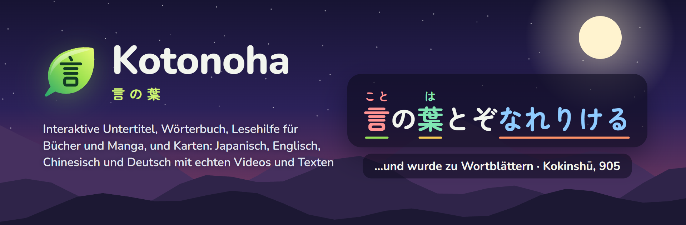

<h3 align="center">Japanisch und Englisch lernen mit dem, was man ohnehin schaut, liest und singt.</h3>

  Interaktive Untertitel über Serien und Videos, Liedtexte Vers für Vers, Manga und eingescannte Bücher mit OCR gelesen, ein Wortfenster, das jedes Wort in seinem Satz versteht, und Karten für Anki. Sprache, OCR und Textanalyse laufen auf dem eigenen Rechner, auf der Grafikkarte. Kostenlos und quelloffen.

  
  
  

  
  
  
  

  
  
  
  
  
  

  <a href="https://github.com/Eliam4510/kotonoha/releases/latest"><b>Herunterladen</b></a> ·
  <a href="#installation">Installation</a> ·
  <a href="docs/de/guide.md">Anleitung</a> ·
  <a href="docs/de/features.md">Alle Funktionen</a> ·
  <a href="#unter-der-haube">Unter der Haube</a> ·
  <a href="CHANGELOG.md">Neuigkeiten</a> ·
  <a href="CONTRIBUTING.md">Mitwirken</a>

## Was Kotonoha ist

Kotonoha (言の葉, „Blätter aus Worten“) ist eine Erweiterung für Chrome und Edge, die das, was man ohnehin schaut, liest und hört, in Lernmaterial verwandelt: Serien und Videos auf YouTube, Netflix oder Bilibili, Lieder, Artikel, Chats, Bücher und Manga. Jedes Wort zeigt seine Lesung und wie gut es bekannt ist, und ein Tippen darauf öffnet ein Wortfenster mit seiner Definition, seiner Bedeutung in genau diesem Satz und einer Schaltfläche, die daraus eine Karte macht.

Alles läuft auf dem eigenen Rechner. Wörterbuch, Textanalyse, Transkription und Texterkennung auf Buchseiten verlassen den Browser nicht. Claude von Anthropic kommt nur ins Spiel, wenn eine Erklärung oder Übersetzung angefordert wird, und jede Anfrage wird mit ihren Kosten verzeichnet.

<table>
  <tr><td><b>Schauen</b></td><td>Untertitel mit Furigana, Tonhöhenakzent und dem Stand jedes Wortes auf YouTube, Netflix, Bilibili und in eigenen Dateien.</td></tr>
  <tr><td><b>Singen</b></td><td>Der Text eines Liedes, so eingefügt, wie er ist, erscheint Vers für Vers, während gesungen wird, wie beim Karaoke.</td></tr>
  <tr><td><b>Lesen</b></td><td>Jede Webseite, alles Kopierte und Bücher als EPUB, PDF und Manga, auch eingescannte oder als Bilderordner: Der Text jeder Seite wird auf dem eigenen Rechner erkannt.</td></tr>
  <tr><td><b>Sprechen</b></td><td>Man liest laut vor, und Kotonoha vergleicht die Stimme mit dem Tonhöhenakzent jedes Wortes oder, auf Chinesisch, mit den Tönen.</td></tr>
  <tr><td><b>Behalten</b></td><td>Karten mit einem Klick, mit Ton und Bild der Szene, für Anki oder die eingebaute Wiederholung.</td></tr>
  <tr><td><b>Sprachen</b></td><td>Gelernt wird Japanisch, Englisch, Chinesisch oder Deutsch. Die Oberfläche gibt es auf Deutsch, Englisch, Spanisch, Chinesisch, Koreanisch und Japanisch.</td></tr>
</table>

## So lernt man mit Kotonoha

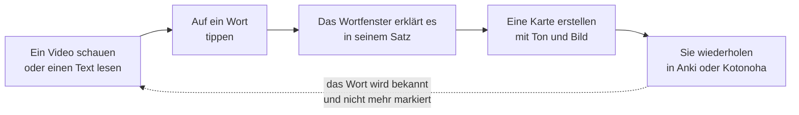

Jedes als bekannt markierte Wort wird überall nicht mehr hervorgehoben, und das Verständnis jedes Videos oder Textes steigt mit ihm.

## Rundgang

### Untertitel, die sich wirklich lesen lassen

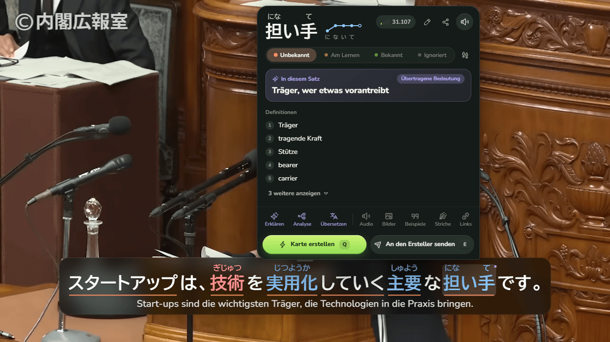

Video: [„第221回国会における高市内閣総理大臣施政方針演説“](https://www.youtube.com/watch?v=alk-cIHwTIU) (YouTube-Kanal des japanischen Premierministeramts), mit dem offiziellen Text und seiner englischen Übersetzung ([首相官邸ホームページ](https://www.kantei.go.jp/jp/105/statement/2026/0220shiseihoshin.html)), unter der [Public Data License 1.0](https://www.digital.go.jp/resources/open_data/public_data_license_v1.0), kompatibel mit CC BY 4.0; bearbeitet mit den Untertiteln und Wortfenstern von Kotonoha. Dasselbe Video zeigen das Diktat, die Grammatik und die Karte.

Über dem Player erscheinen die Untertitel mit Furigana, einer Farbe je Tonhöhenakzent und einer Unterstreichung für den Stand jedes Wortes: neu, am Lernen oder bekannt. Beim Überfahren öffnet sich das Wortfenster mit dem Wörterbuch, ganz ohne Kosten. Claude ergänzt die Bedeutung des Wortes in diesem Satz, auch wenn sie bildlich oder dichterisch ist, wie bei dem 担い手 im Bild: nicht jemand, der eine Last auf den Schultern trägt, sondern wer die Aufgabe vorantreibt.

- `Q` erstellt eine Karte mit dem Satz, seinem Ton und dem Videobild, direkt in Anki oder in die eingebaute Wiederholung.
- `A` und `D` springen zwischen den Zeilen, `S` wiederholt die aktuelle. Der Untertitel-Navigator (`G`) zeigt alle, mit Filtern und Lesezeichen.
- Untertitel werden in die eigene Sprache übersetzt, und automatisch erzeugte werden mit dem Titel und dem ganzen Skript als Kontext korrigiert.
- Videos ohne Untertitel werden auf dem eigenen Rechner transkribiert, auf der Grafikkarte: 30 Minuten Video in etwa einer Minute.

### Deine Lieder, wie beim Karaoke

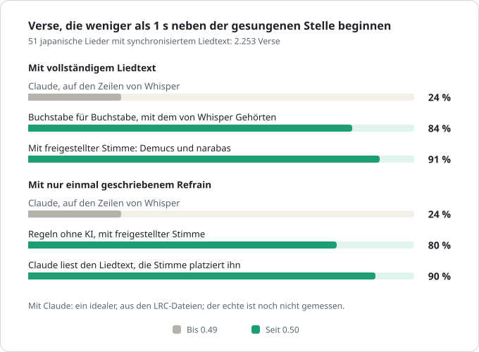

Man fügt den Text eines Liedes unter **Liedtext** im Bereich **KI-Untertitel** ein, und jeder Vers erscheint, während er gesungen wird, über dem Musikvideo oder im **Player**. Es sind Untertitel wie alle anderen: mit Furigana, Farben und Wortfenster, sie lassen sich übersetzen, und jeder Vers kann zur Karte werden.

Schwierig ist der genaue Moment, und Kotonoha trifft ihn, indem es die Arbeit aufteilt, alles auf dem eigenen Rechner:

1. **Whisper Turbo** hört das Lied und sagt grob, was wann zu hören ist.
2. **Demucs** trennt auf der Grafikkarte die Stimme von den Instrumenten: ein vierminütiges Lied in etwa 20 Sekunden.
3. Der Liedtext wird **Buchstabe für Buchstabe** mit dem von Whisper Gehörten abgeglichen, und jeder Vers bekommt einen Bereich von einigen Sekunden.
4. **narabas**, ein Phonemmodell, sagt alle 20 ms, welchem Phonem der Klang ähnelt, und eine **erzwungene Ausrichtung** (Forced Alignment) geht in jedem Bereich die Phoneme des Textes der Reihe nach durch: Jeder Vers beginnt dort, wo sein erstes Phonem erklingt.

Whisper muss erraten, was gesungen wird; Kotonoha weiß es schon, denn es hat den Text, und sucht nur, wo er erklingt. Deshalb beginnt die Hälfte der Verse weniger als 0,16 s neben der gesungenen Stelle. Bis Version 0.49 kamen die Zeiten aus den Zeilen von Whisper, und selbst mit einem Claude ohne Fehler lag die Hälfte fast 3 s daneben.

Liedtexte aus dem Internet sind selten vollständig: der Refrain nur einmal geschrieben, „(サビ繰り返し)“, „[Chorus]“, „×2“, Begleitstimmen in Klammern. Kotonoha entfaltet sie so, wie sie gesungen werden, und mit **Claude den Liedtext lesen lassen** liest Claude den ganzen Text und sagt, was in welcher Reihenfolge gesungen wird. Die Zeiten setzt nicht Claude, sondern die Stimme. Was kein Modell versteht, lässt sich mit **Zeiten markieren** von Hand setzen, mit der Leertaste.

Die Stimme platziert japanische Liedtexte; in den anderen Sprachen wird der Text Buchstabe für Buchstabe mit dem von Whisper Gehörten abgeglichen. Gemessen mit 51 japanischen Liedern und ihrem synchronisierten Text (2253 Verse): [wie es funktioniert und wie gemessen wurde](docs/de/architecture.md#liedtexte).

### Deine Videos und Audios

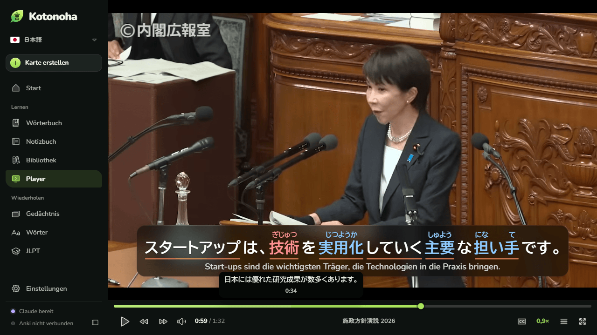

Dasselbe Video von „第221回国会における高市内閣総理大臣施政方針演説“, als eigene Datei geöffnet.

Der **Player** öffnet eigene Videos und Audiodateien, oder einen ganzen Ordner als Wiedergabeliste, mit den Untertiteln jeder Folge; die, deren Name eine andere Sprache nennt, werden zur Übersetzung. Er hat eigene Steuerelemente: Geschwindigkeit, Lautstärke, Sprünge von Zeile zu Zeile und, wenn du über die Zeitleiste fährst, den Satz, der in diesem Moment gesagt wird. Im Vollbild bleiben die Untertitel da. Er merkt sich, wo du bei jeder Datei aufgehört hast, und **Weiterschauen** öffnet sie mit einem Klick wieder. Podcasts und Hörbücher ohne Untertitel transkribiert Whisper auf deinem Rechner.

### Jede Webseite

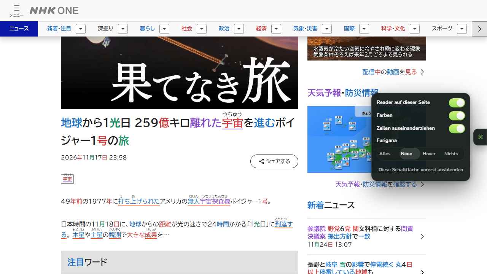

Nachricht: [„地球から1光日 259億キロ離れた宇宙を進むボイジャー1号の旅“](https://news.web.nhk/newsweb/na/nd-20261116de76380), NHK ONE (17. November 2026; Illustration: NASA/JPL-Caltech). Gezeigt, um den Seitenleser zu veranschaulichen; die Rechte liegen bei NHK.

Auf Nachrichtenseiten, Blogs, Wikis oder in einem Chat wie dem von Claude bekommt japanischer Text dieselben Farben und Furigana, und ein Klick auf ein Wort öffnet sein Wortfenster. Der Inhalt der Seite bleibt unverändert: Links und Schaltflächen funktionieren weiter, und mit React gebaute Seiten merken nichts. Getestet auf rund dreißig echten Websites.

### Bücher, PDFs und Manga

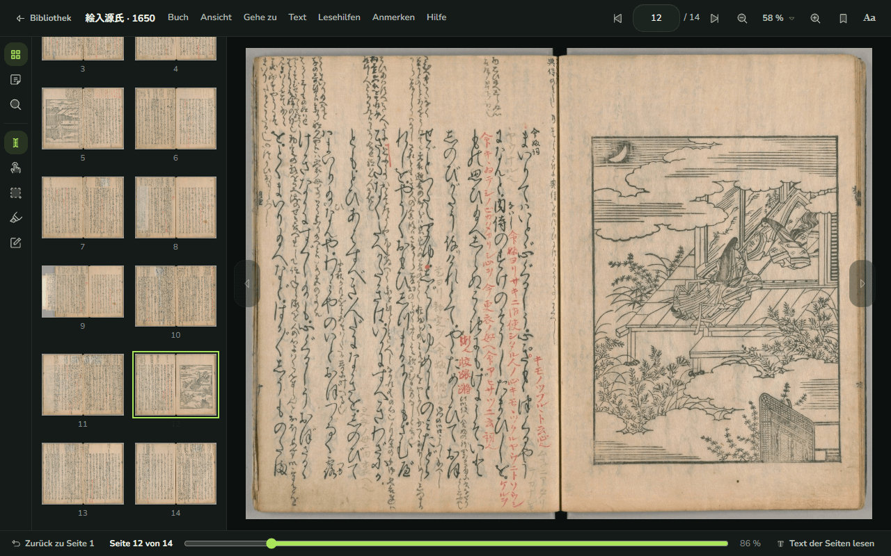

『源氏物語』 (Die Geschichte vom Prinzen Genji), illustrierte Ausgabe von 1650 (Keian 3), Band 1, in der [Nationalen Parlamentsbibliothek](https://dl.ndl.go.jp/pid/2579509) (gemeinfrei).

Die **Bibliothek** ist ein vollständiger Betrachter wie ein PDF-Reader: Zoom, Doppelseiten, fortlaufendes Scrollen, Inhaltsverzeichnis, Miniaturen und die Seite, an der jedes Buch zuletzt aufgeschlagen war. Seine Befehle stehen in benannten Menüs, und Strg+K findet jeden, wenn man eintippt, was er tut; dazu gibt es eine Hand, einen Textmarker und einen Lesemodus, der nur die Seite lässt. Auf der Seite selbst kann jedes Wort sein Furigana und die Unterstreichung seines Status tragen, die Übersetzung eines Satzes erscheint wie ein Untertitel darunter, man kann dem Satz folgend vorlesen lassen, und die nachgeschlagenen Wörter werden zu Karten mit einem Ausschnitt der Seite. Ein auf der Seite gezogener Bereich wird eigens mit der Texterkennung gelesen, und Text-EPUBs und die Texte der Bibliothek werden im selben Betrachter mit denselben Menüs gelesen. Ein Text-EPUB wie ein Roman behält sein eigenes Layout, seine Ruby und seine vertikale Schrift, mit dem Seiten-Reader darüber: Farben, Furigana und Wortfenster wie im Web. Ein PDF, das Text enthält, lässt sich sofort Wort für Wort lesen. Manga in Bilderordnern werden durch Auswahl des Ordners importiert: Jeder Band wird ein Buch, mit der Titelseite vorn und den Farbdoppelseiten im Ganzen. Das Regal ordnet die Bücher in Sammlungen, etwa eine Reihe mit ihren Bänden, mit Titelbild und Beschreibung, und zeigt, wie viel von jedem Buch und jeder Sammlung gelesen ist. Im Betrachter lassen sich Seiten markieren, Text mit Kommentar hervorheben oder unterstreichen und Notizen auf der Seite hinterlassen, wie in einem PDF-Reader. Ein Wort lässt sich im ganzen Buch suchen, jede Seite als Text mit der Lesehilfe lesen, und Claude kann den von der Texterkennung gelesenen Text prüfen, indem es ihn mit dem Seitenbild vergleicht.

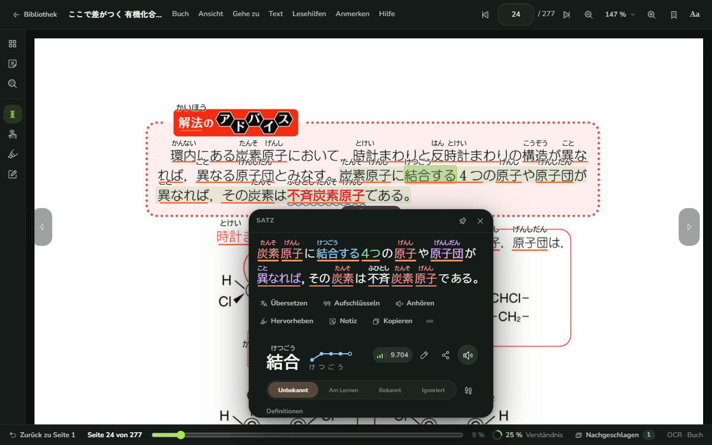

Seiten, die Bilder sind, wie Manga, eingescannte Bücher und viele PDFs, werden mit Texterkennung (OCR) auf dem eigenen Rechner und der Grafikkarte gelesen. Es gibt einen Modus für gedruckte Bücher und einen für Manga, der vertikale Sprechblasen liest, ohne Furigana mit dem Text zu verwechseln. Ein Tippen auf ein Wort der Seite öffnet seinen ganzen Satz in einem schwebenden Fenster, mit Furigana und seinem Wortfenster, ohne zu verdecken, was noch zu lesen ist, und durch Ziehen wählt man jedes Stück aus, um es zu übersetzen oder erklären zu lassen. Jede Seite wird nur einmal gelesen und gespeichert. Mit **PDF mit Text exportieren** wird das Buch zu einem PDF mit diesem Text unsichtbar darüber, durchsuchbar und kopierbar in jedem PDF-Reader; für Scans mit geringer Auflösung hat der Viewer **Schärfe**.

Es ist kein gewöhnliches OCR. In Büchern liest PP-OCRv6 die Zeilen, die PP-OCRv5 findet, hält gedruckte Furigana vom Text getrennt und liest zweispaltige Seiten Spalte für Spalte; in einem eingescannten PDF liest es das Originalbild in seiner eigenen Auflösung, nicht die auf dem Bildschirm gezeichnete Seite: 0,2 % Zeichenfehler bei Chemiebüchern, gescannt mit 180 dpi. Im Manga findet ein Detektor die Sprechblasen, und manga-ocr liest sie in der Reihenfolge der Panels, ohne Wasserzeichen und Seitenzahlen.

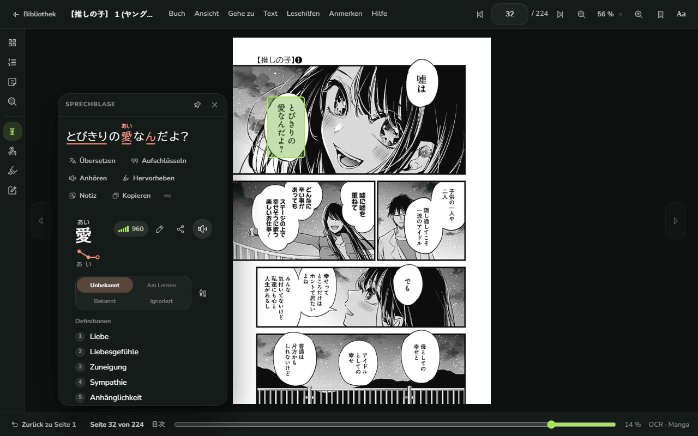

Beispielseiten: 『改訂版 ここで差がつく 有機化合物の構造決定問題の要点・演習』 von Yoshikazu Nishimura und Takatomo Kurosawa (KADOKAWA, 2024) und 【推しの子】 (Oshi no Ko) Band 1 von Aka Akasaka und Mengo Yokoyari (Shueisha, 2020). Von jedem Werk wird eine einzige Seite gezeigt, um den Betrachter zu veranschaulichen; alle Rechte liegen bei den Autoren und Verlagen.

### Der Wortschatz eines Buchs, bevor du es liest

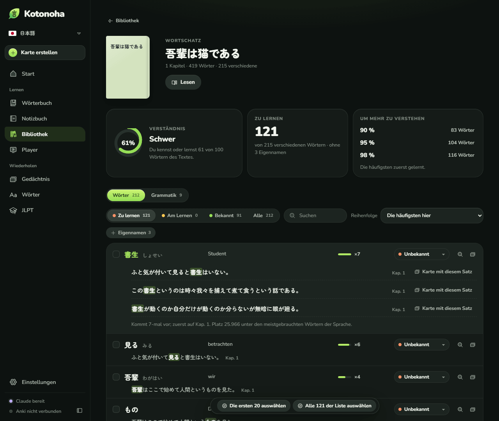

『源氏物語』 (Die Geschichte vom Prinzen Genji), Kapitel 「桐壺」, in der Fassung von Yosano Akiko, aus dem [Aozora Bunko](https://www.aozora.gr.jp/cards/000052/card5016.html) (gemeinfrei).

Jedes Buch und jede Sammlung hat ihren **Wortschatz**: alle Wörter, gezählt, die häufigsten zuerst, mit Lesung, Glosse, JLPT-Stufe und ihrem besten Satz aus dem Buch. Oben steht, wie viel du schon verstehst und wie viele Wörter dir für 90, 95 oder 98 % fehlen. Die Wörter werden gleich dort als bekannt oder am Lernen markiert, und die ausgewählten gehen auf einmal ins Gedächtnis oder nach Anki, mit ihrem Satz aus dem Buch. Das geht mit Romanen, PDFs, Texten und mit der Texterkennung gelesenem Manga; in einer Reihe zeigt jeder Band, wie viele neue Wörter er bringt. Auch die Grammatik des Buchs ist da, Punkt für Punkt.

### Ein Notizbuch zum Schreiben und Lesen

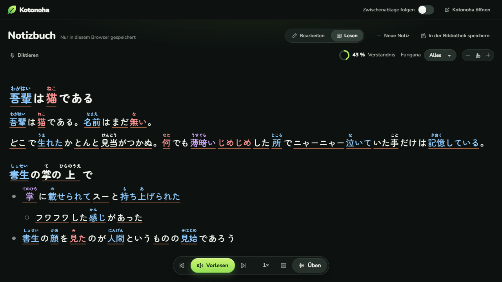

Das **Notizbuch** ist eine Seite über die ganze Breite, um Text in der Lernsprache mit Überschriften, Listen und Zitaten zu schreiben und einzufügen und ihn analysiert und mit Furigana zu lesen. **Ordnen** gibt einem am Stück eingefügten Text Struktur, ohne seine Wörter zu ändern, und jede Notiz wird in der Bibliothek gespeichert. Es liest in der gewählten Geschwindigkeit vor, am Stück, Satz für Satz oder einen Satz wiederholend, und jeder markierte Teil lässt sich anhören oder üben. Man kann ihm auch diktieren: Was man ins Mikrofon sagt, wird auf dem Rechner transkribiert und kommt als weiterer Absatz hinzu, mit seiner Aufnahme. Es öffnet sich außerdem in einem normalen Tab, in der geteilten Ansicht neben der gelesenen Seite, und sammelt, was man irgendwo kopiert.

### Der Akzent, laut gesprochen

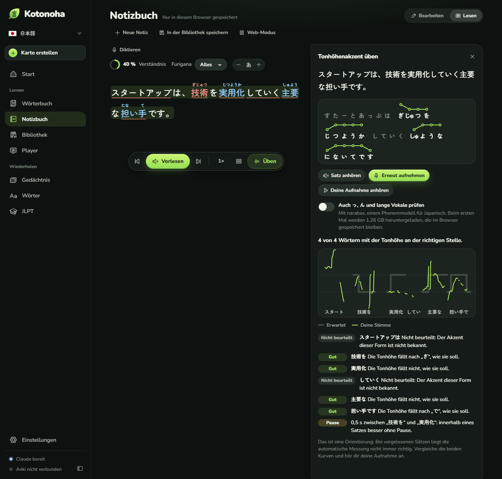

Die Stimme stammt aus derselben Rede im japanischen Parlament (Premierministeramt, PDL 1.0), aus dem Video geschnitten und anstelle der eigenen Aufnahme verwendet.

**Üben** zeigt den Akzent jedes Worts im Satz. Man liest ihn laut vor, und Kotonoha legt die Tonhöhenkurve der Stimme über die erwartete, sagt, bei welchen Wörtern die Tonhöhe an der falschen Stelle fällt, zeigt lange Pausen an und auf Wunsch auch fehlende oder überzählige っ, ん und lange Vokale. Die Tonhöhe wird im Browser gemessen und die Aufnahme auf dem Rechner transkribiert, ohne ihn zu verlassen. Die Modellstimme liest jeden Satz mit dem Akzent aus dem Wörterbuch, kostenlos und ebenfalls ohne den Rechner zu verlassen: mit den Stimmen von AivisHub, die direkt in Kotonoha installiert werden, oder mit geöffnetem AivisSpeech oder VOICEVOX.

### Diktat

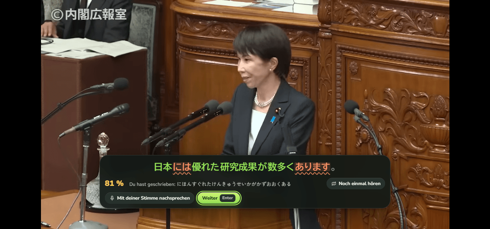

Der **Diktat**-Modus blendet die Zeile beim Abspielen aus, pausiert an ihrem Ende und fragt, was du gehört hast. Beim Prüfen wird jeder Teil grün, wenn du ihn verstanden hast, gelb, wenn nur halb, oder unterstrichen, wenn er fehlte, mit einer Bewertung der Zeile. Im Japanischen wird die Lesung verglichen, Kana zu tippen genügt also. **Mit deiner Stimme nachsprechen** öffnet die Akzentübung mit genau dieser Zeile, und `P` tut das mit jedem Untertitel.

### Grammatik, die du schon kannst

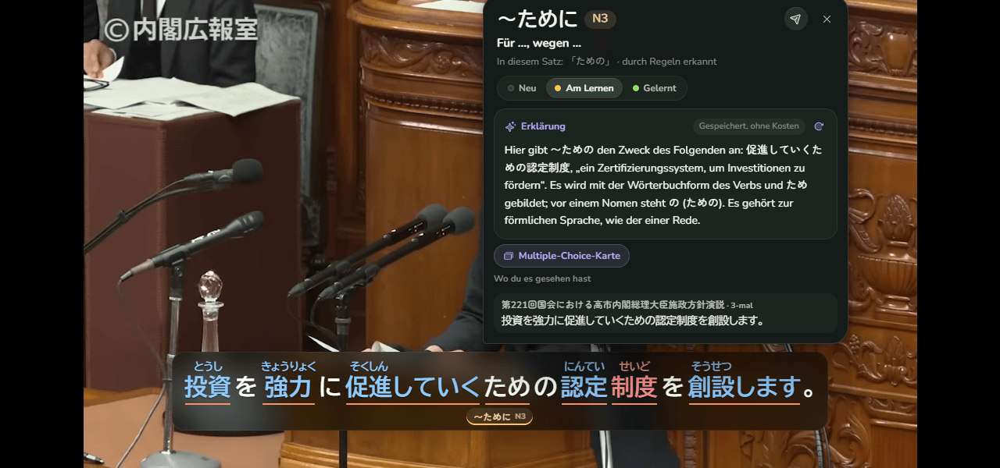

Unter jedem Untertitel stehen die Grammatikpunkte der Zeile mit ihrer JLPT-Stufe. Ein Tippen öffnet die Blase: was der Punkt bedeutet, Claudes Erklärung für genau diese Zeile und wo du ihn schon gesehen hast. Jeder Punkt wird als **Neu**, **Am Lernen** oder **Gelernt** markiert; was du lernst, bekommt einen gelben Strich, und Gelerntes wird nicht mehr hervorgehoben. Bereits Bekanntes lässt sich aus Anki importieren, und **Multiple-Choice-Karte** bereitet eine Karte mit drei leicht verwechselbaren Antworten vor.

### Wie jedes Kanji geschrieben wird

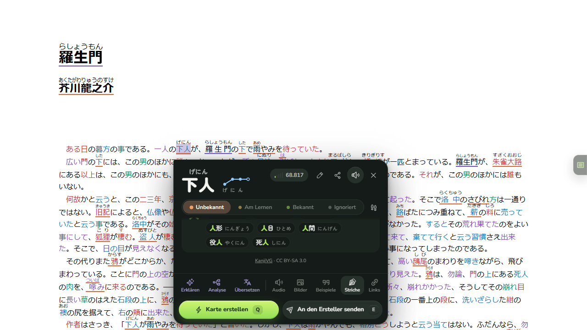

Das Wortfenster zeigt die Strichfolge jedes Kanji im Wort, Strich für Strich und in Schleife, mit ihren Nummern, und darunter die Wörter, die du mit demselben Kanji schon kennst.

### Teilen, was man findet

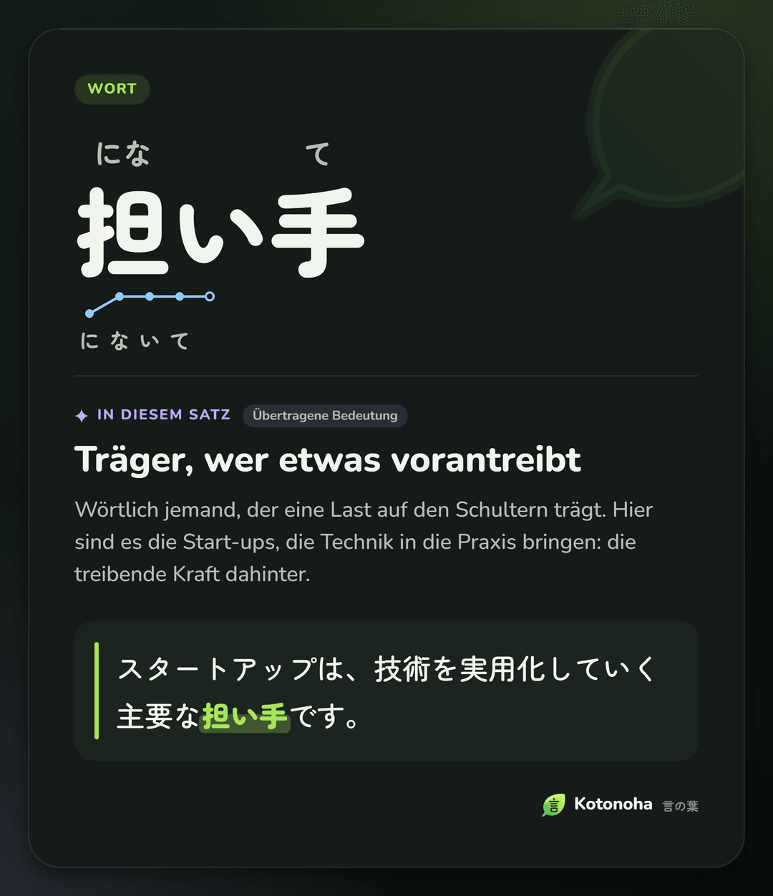

**Als Bild teilen** im Wortfenster macht aus einem Wort oder einem Grammatikpunkt eine Karte mit seiner Bedeutung in diesem Satz und dem Satz, in dem es vorkam, und legt sie in die Zwischenablage, um sie mit Strg+V in jeden Chat einzufügen. Es gibt sie in Tinte oder Papier, wie die Designs.

### Das JLPT, Stufe für Stufe

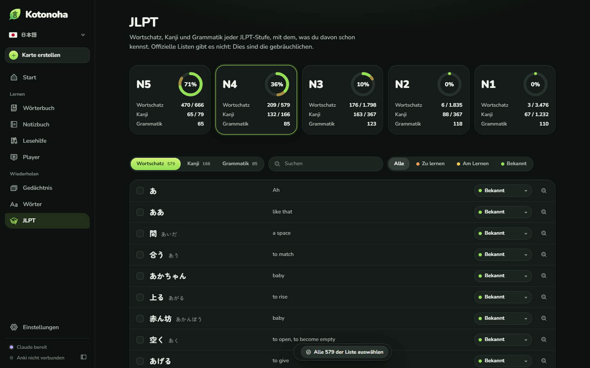

Die Ansicht **JLPT** vereint Wortschatz, Kanji und Grammatik jeder Stufe von N5 bis N1 und zeigt, wie viel davon du schon kennst, anhand der beim Sehen und Lesen markierten Wörter. Bekannte Wörter werden auf einmal markiert, jedes Kanji zeigt seine Striche und die Wörter, die es enthalten, und jeder Grammatikpunkt die gesehenen Sätze, in denen er vorkam.

### Ein vollständiges Wörterbuch

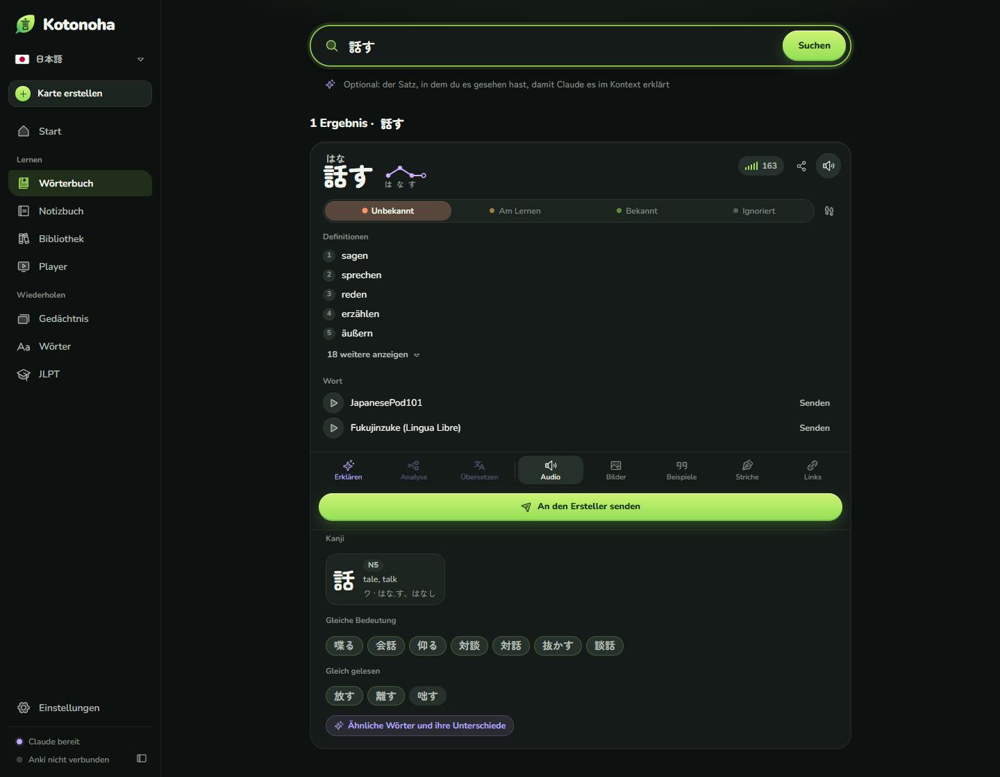

Das Wörterbuch nutzt das ganze Fenster: auf der einen Seite die Ergebnisliste; in der Mitte das Wort, groß, mit der Lesung darüber und jeder Bedeutung mit ihrer Wortart; auf der anderen Seite seine Kanji, seine Gegenteile, die gebräuchlichen Wörter gleicher Bedeutung, etwa 喋る oder 会話 für 話す, und die gleich gelesenen. Darunter stehen die Sätze aus deinen Videos, in denen es vorkam, mit der Minute und einem Knopf, um zu dieser Stelle zurückzukehren. Es sucht auch nach Bedeutung, etwa „Hund“ → 犬, und findet Grammatik nach Form oder Sinn. Die Startseite versammelt Lautmalereien, Sprichwörter, Ausdrücke aus vier Kanji sowie literarische, umgangssprachliche und höfliche Wörter. Größe und Schrift lassen sich auf der Seite selbst ändern.

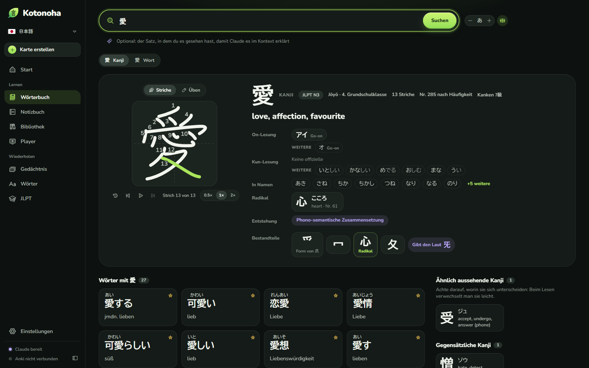

Ein einzelnes Kanji hat seine eigene Seite: wie es geschrieben wird, Strich für Strich; seine Bedeutung; alle Lesungen, auch die seltenen und die Namenslesungen, mit der Epoche, aus der jede stammt; sein Radikal und seine Bestandteile, mit dem Teil, der den Laut gibt, und den Kanji, die ihn teilen; die Wörter, die du damit schon kennst, die häufigsten, die es enthalten, und die, die nicht wie ihre Kanji gelesen werden, etwa 今日; ähnlich aussehende Kanji, Gegensätze und alte Formen; und wie es gedruckt und von Hand aussieht.

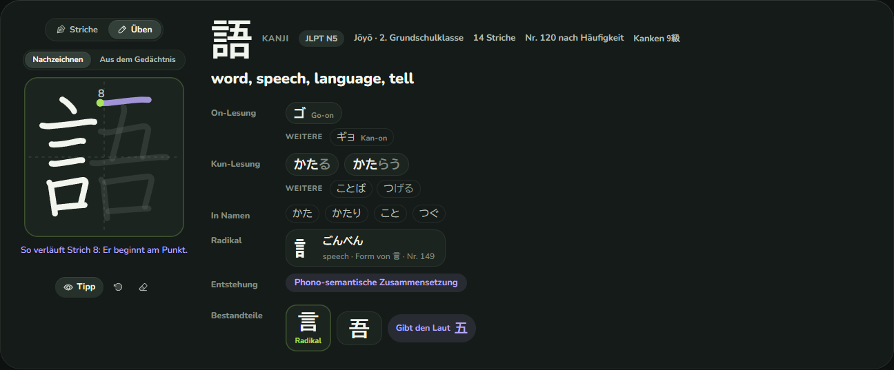

Und geübt wird gleich dort: Man schreibt mit Maus, Stift oder Finger, nachzeichnend oder aus dem Gedächtnis, und jeder Strich wird beim Loslassen geprüft. Stimmt die Richtung nicht oder ist es ein anderer der fehlenden Striche, wird das gesagt, und mit **Tipp** zeichnet sich der Strich von selbst.

### Auch Englisch

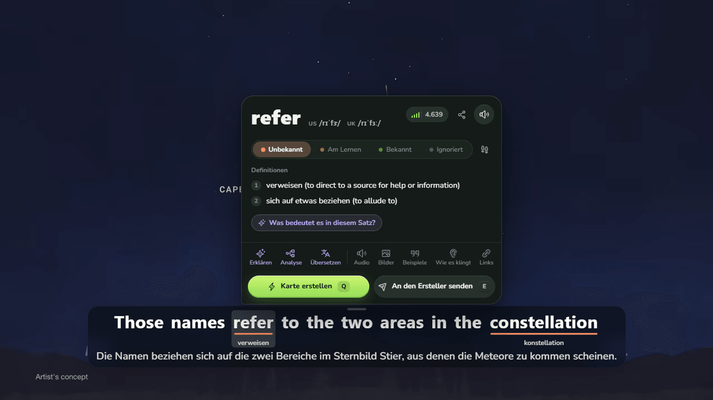

Video und Untertitel: [„What’s Up: November 2026 Skywatching Tips from NASA“](https://www.youtube.com/watch?v=PN-iD6VTmyc), NASA/JPL-Caltech (gemeinfrei).

Für Englisch zeigt das Wortfenster die amerikanische und britische Aussprache in IPA, findet Partikelverben auch dann, wenn sie getrennt stehen, wie *picked it up*, und nennt das Wort, von dem jede unregelmäßige Form stammt. Die Wörterbücher stammen aus Wiktionary, auf Deutsch. Comics werden Sprechblase für Sprechblase gelesen, von links nach rechts, und Sätze klingen mit neuronalen Stimmen auf dem eigenen Rechner: Kokoro auf Englisch und Piper auf Deutsch. Jede Sprache behält ihre eigenen Wörter, Karten und Einstellungen, und der Wechsel braucht einen Klick.

### Auch Chinesisch

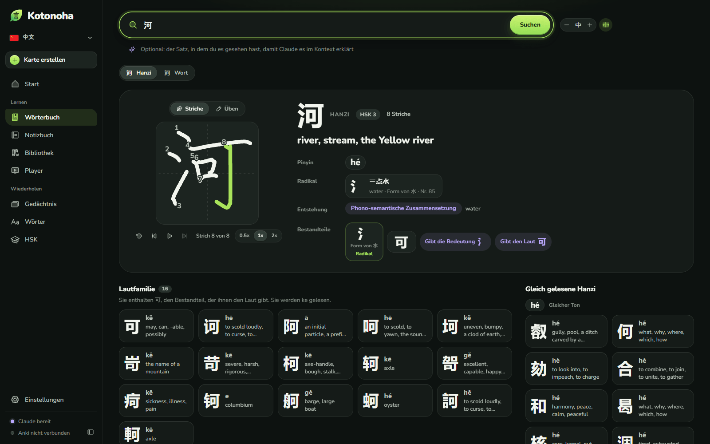

Auf Chinesisch werden die Wörter von selbst getrennt, auch ohne Leerzeichen im Text, und das Pinyin steht über jedem Zeichen, mit dem Ton des Wörterbuchs und, wenn ein Zeichen mehrere Lesungen hat (长, cháng oder zhǎng), der des Satzes. Das Wörterbuch ist CC-CEDICT, davor die kurzen Übersetzungen von Wiktionary, wenn es sie in deiner Sprache gibt, und gesucht wird in Schriftzeichen oder in Pinyin, mit oder ohne Töne. Gelernt werden vereinfachte Schriftzeichen: Hat ein Video nur Untertitel in traditionellen, erscheinen sie in vereinfachten. Die Niveaus sind die des HSK 3.0, mit eigenem Bildschirm: Wortschatz, Hanzi und Grammatik jeder Stufe des Lehrplans von 2025. Die Suche nach einem einzelnen Hanzi öffnet seine Seite, mit Radikal, Bestandteilen, Entstehung und Strichfolge, die man wie bei den Kanji übt. Jede Silbe trägt die Farbe ihres Tons; **Wie es klingt** in der Wortkarte zeigt, wie sich die Töne beim Sprechen ändern (一, 不, zwei dritte Töne hintereinander), und **Üben** vergleicht deine Stimme Silbe für Silbe mit der Form jedes Tons, ohne Sprachmodelle.

### Außerdem

- **Wie Englisch wirklich klingt.** Das Wortfenster zeigt den Satz so, wie er beim zusammenhängenden Sprechen klingt: *going to* → *gonna*, *meet you* → *meechu*, *turn off* → *tur‿noff*, mit Erklärung zu jedem Fall.
- **Immersionsstunden.** Die Startseite zählt die Zeit, in der du die Lernsprache hörst und liest, mit deiner Serie von Tagen in Folge.
- **Die Kosten im Blick.** Die Startseite zeigt, was Claude in diesem Monat gekostet hat, nach Tagen, Modellen und Aufgaben, mit einem Monatslimit. Nichts wird zweimal bezahlt: Jede Antwort wird gespeichert. Die [Kostenstudie](docs/de/costs.md) nennt gemessene Zahlen.
- **Eingebaute Wiederholung.** Mit dem FSRS-Algorithmus, für alle, die Anki nicht nutzen: Rückgängig, Bearbeiten und Aussetzen beim Wiederholen, ein Tageslimit für neue Karten, alle Karten im Blick und der Fortschritt mit Serie und Diagrammen.
- **Eigene Dateien.** Ein Player für Videos auf dem Rechner, mit den Untertiteln aus einer MKV-Datei.
- **Nach Maß.** Farben für Farbenblindheit und hohen Kontrast, Lesungen in Kana oder Rōmaji, änderbare Tastenkürzel und Seiten, auf denen die Erweiterung ruht.

## Unter der Haube

Das Rechenintensive läuft auf dem eigenen Rechner, mit WebGPU und ONNX Runtime: kein eigener Server, kein Konto. Jedes Teil wurde mit echtem Material gegen die Alternativen gemessen und dann ausgewählt, und die Zahlen lassen sich mit den Skripten im Repository nachvollziehen.

| Was es tut | Womit | Gemessen |
|---|---|---|
| Transkribiert, was keine Untertitel hat | Haas-ja, Parakeet und Whisper Turbo, mit Transformers.js | 30 Minuten Video in etwa einer Minute; bei gesprochenem Japanisch 3 % Fehler gegenüber 9 % bei Whisper Turbo |
| Platziert den Text eines Liedes | Demucs stellt die Stimme frei, und narabas setzt mit einer eigenen erzwungenen Ausrichtung über seinem CTC jedes Phonem an seine Stelle | Die Hälfte der Verse weniger als 0,16 s neben der gesungenen Stelle; mit den Zeiten von Whisper fast 3 s daneben |
| Erkennt, wo gesungen wird | YAMNet, auf dem Prozessor, damit die GPU Whisper bleibt | Trennt Gesang von Instrumentalem mit einer AUC von 0,9 |
| Liest eingescannte Bücher | PP-OCRv5 findet die Zeilen und PP-OCRv6 liest sie, mit Furigana und Spalten getrennt | 0,2 % Zeichenfehler bei Chemiebüchern, gescannt mit 180 dpi |
| Liest Manga | Ein Sprechblasen-Detektor und manga-ocr, in der Reihenfolge der Panels | 2,8 % Fehler auf 18 Seiten aus fünf Serien |
| Liest vor | Stimmen von AivisHub auf WebGPU, mit yomi, einem OpenJTalk in TypeScript | Die Tonhöhe jeder More stimmt zu 92 % mit AivisSpeech überein |
| Zählt den Wortschatz eines Buchs | Kuromoji und die Wörterbücher, in IndexedDB | Ein ganzer Roman, etwa 135 000 Wörter, in etwa vier Sekunden |
| Prüft alles | Vitest, und Playwright mit echtem Edge und der Grafikkarte | Über 1500 Unit-Tests und über 40 End-to-End-Durchläufe |

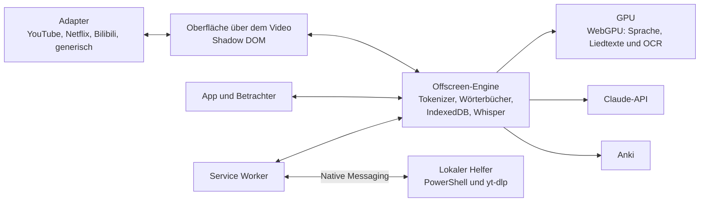

TypeScript, Preact, Dexie und esbuild, mit ONNX Runtime und Transformers.js auf WebGPU. Jeder Teil, die technischen Entscheidungen und wie jede Zahl gemessen wurde, stehen in [docs/de/architecture.md](docs/de/architecture.md); wie die Tests laufen, erklärt [CONTRIBUTING.md](CONTRIBUTING.md).

## Was ohne Claude geht und was Claude ergänzt

Kotonoha funktioniert ohne jeden Schlüssel. Ein optionaler Claude-Schlüssel ergänzt, was ein Sprachmodell braucht.

| Ohne Schlüssel, kostenlos | Mit einem Claude-Schlüssel, nach Verbrauch |
|---|---|
| Untertitel mit Furigana, Tonhöhenakzent und Wortstand | Die Bedeutung eines Wortes in seinem Satz |
| Wörterbuch, Wortfenster, Strichfolge und Aussprache | Erklärungen zu Wörtern, Sätzen und Grammatik |
| Seiten-Reader, Notizbuch und Bibliothek mit OCR | Übersetzung und Korrektur von Untertiteln |
| Transkription auf dem eigenen Rechner | Prüfung der Furigana-Lesungen |
| Karten für Anki und eingebaute Wiederholung | Geschichten passend zum Niveau |
| Liedtexte, mit der Stimme platziert | Liedtexte mit Markierungen und Wiederholungen, von Claude gelesen |

Normale Nutzung kostet wenige Cent im Monat. Der Schlüssel wird nur im Browser gespeichert. Aufgabe für Aufgabe lassen sich statt Claude auch OpenRouter, DeepSeek, OpenAI oder ein Modell auf dem eigenen Rechner mit LM Studio oder Ollama nutzen.

## Installation

Voraussetzung: Chrome oder Edge ab Version 120. Transkription, Liedtexte und Texterkennung laufen auf der Grafikkarte und sind mit einer dedizierten schneller; ohne sie funktionieren sie auch, nur langsamer.

1. `kotonoha-<version>-extension.zip` aus der [neuesten Version](https://github.com/Eliam4510/kotonoha/releases/latest) herunterladen und an einem dauerhaften Ort entpacken.
2. `chrome://extensions` oder `edge://extensions` öffnen und den **Entwicklermodus** einschalten.
3. **Entpackte Erweiterung laden** wählen und den Ordner `kotonoha` auswählen.

Unter Windows geht es auch mit dem Helfer: `kotonoha-<version>-ayudante.zip` enthält `Instalar.cmd`, das per Doppelklick den Helfer installiert und, wenn es Kotonoha nicht findet, auch die Erweiterung, mit fester Kennung. Danach fehlen nur noch die Schritte 2 und 3.

Beim ersten Start fragt eine Begrüßung nach der eigenen Sprache, der Lernsprache und dem Niveau, installiert die Wörterbücher und zeigt, wie gut jeder Teil auf dem Computer laufen wird. Zum Aktualisieren genügt es, die neue Version über die alte zu entpacken: Die Erweiterung lädt sich selbst neu. Gibt es eine neue Version, zeigt Kotonoha das auf der Startseite an, und mit installiertem Helfer spielt **Jetzt aktualisieren** sie mit einem Klick ein. Die [Anleitung](docs/de/guide.md) erklärt jede Funktion, [CONTRIBUTING.md](CONTRIBUTING.md) das Erstellen aus dem Quellcode.

## Wichtige Tastenkürzel

| Kürzel | Aktion |
|---|---|
| `Q` | Karte aus dem Satz erstellen |
| `E` | An den Ersteller senden |
| `1` bis `4` | Wort markieren: unbekannt, verfolgt, bekannt, ignoriert |
| `A`, `D` und `S` | Vorheriger Satz, nächster Satz und wiederholen |
| `G` | Untertitel-Navigator |
| `Alt+Shift+K` | Kotonoha-Fenster öffnen |

Alle Kürzel über dem Video lassen sich ändern und funktionieren mit jedem Tastaturlayout.

## Datenschutz

- Daten und Claude-Schlüssel werden nur im Browser gespeichert. Es gibt keinen eigenen Server und keine Nutzungsstatistik. Die [Datenschutzerklärung](docs/privacidad.md#english) nennt, was an welchen Dienst gesendet wird.
- Transkribierter Ton und erkannte Seiten verlassen den Rechner nicht.
- Claude erhält nur, was eine Anfrage braucht: den Satz, das Untertitelskript und den Titel.
- Wörterbücher und Modelle werden einmal heruntergeladen, von GitHub und Hugging Face. Die [Hinweise](docs/de/notices.md) nennen jede Quelle.

## Projektstand

Jede Version erscheint mit ihren Tests und ihrer Dokumentation in sechs Sprachen; die [Neuigkeiten](CHANGELOG.md) fassen sie zusammen. Genutzt und getestet wird es in Chrome und Edge, unter Windows. YouTube und Englisch wurden zusätzlich von Hand in einer echten Sitzung geprüft. Die Übersetzungen der Oberfläche entstanden mit Hilfe von KI und wurden noch nicht muttersprachlich geprüft: Korrekturen sind willkommen.

## Lizenz und Danksagungen

Der Code steht unter der [MIT-Lizenz](LICENSE). Komponenten Dritter, die bei der Nutzung heruntergeladenen Daten und die Bedingungen für einen verantwortungsvollen Gebrauch stehen in den [Hinweisen](docs/de/notices.md).

- Wörterbücher: [JMdict](https://www.edrdg.org/jmdict/j_jmdict.html) und KANJIDIC (EDRDG), [Kanjium](https://github.com/mifunetoshiro/kanjium) und [JPDB](https://jpdb.io); für Englisch und Deutsch [Wiktionary](https://www.wiktionary.org) über [wiktionary-to-yomitan](https://github.com/yomidevs/wiktionary-to-yomitan) und [kaikki.org](https://kaikki.org); für Chinesisch [CC-CEDICT](https://www.mdbg.net/chinese/dictionary?page=cc-cedict) über [cc-cedict-yomitan](https://github.com/MarvNC/cc-cedict-yomitan).
- Sprache: [Whisper large-v3-turbo](https://huggingface.co/onnx-community/whisper-large-v3-turbo), Haas-ja und Parakeet, mit [Transformers.js](https://github.com/huggingface/transformers.js).
- Lieder: [Demucs](https://github.com/facebookresearch/demucs) (htdemucs), von Meta, in der [ONNX-Umwandlung von timcsy](https://huggingface.co/timcsy/demucs-web-onnx); [narabas](https://github.com/darashi/narabas), von darashi, und [YAMNet](https://github.com/tensorflow/models/tree/master/research/audioset/yamnet), von Google.
- Texterkennung: [PP-OCRv5 und PP-OCRv6](https://github.com/PaddlePaddle/PaddleOCR), [manga-ocr](https://github.com/kha-white/manga-ocr) und ein [Sprechblasen-Detektor](https://huggingface.co/ogkalu/comic-text-and-bubble-detector).
- Strichfolge: [KanjiVG](https://kanjivg.tagaini.net), von Ulrich Apel, CC BY-SA 3.0; für Chinesisch [Hanzi Writer](https://github.com/chanind/hanzi-writer-data), aus [Make Me a Hanzi](https://github.com/skishore/makemeahanzi), Arphic Public License.
- Bildinhalte: eine Rede im japanischen Parlament vom Premierministeramt (PDL 1.0), ein NASA-Video, das illustrierte 『源氏物語』 von 1650 aus der Nationalen Parlamentsbibliothek, 『源氏物語』 in der Fassung von Yosano Akiko und 『羅生門』 aus dem Aozora Bunko und der Anfang von 『吾輩は猫である』, alle gemeinfrei außer der Rede. Eine Nachricht von NHK ONE und die Seiten aus zwei Büchern tragen ihren Nachweis unter dem Bild.
- Symbole: [Phosphor](https://phosphoricons.com). Schriften: [Zen Maru Gothic](https://fonts.google.com/specimen/Zen+Maru+Gothic) und [Nunito](https://fonts.google.com/specimen/Nunito).

Der Name stammt aus dem Vorwort des *Kokin Wakashū* (um 905): Die Dichtung Japans hat das menschliche Herz zum Samen, und aus ihm sprießen unzählige Blätter aus Worten.

Ein unabhängiges Projekt, ohne Verbindung zu den genannten Diensten.
