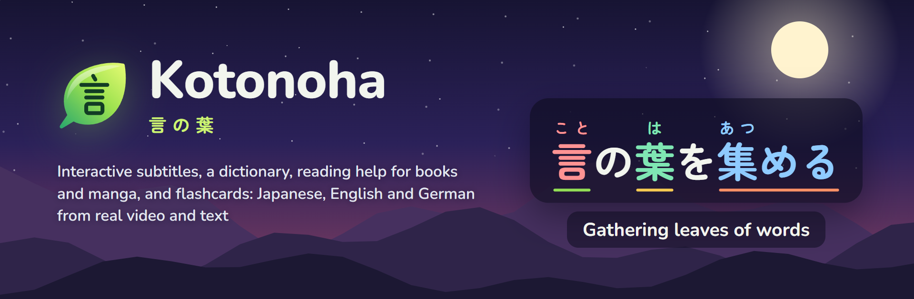
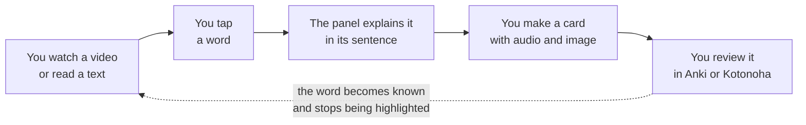
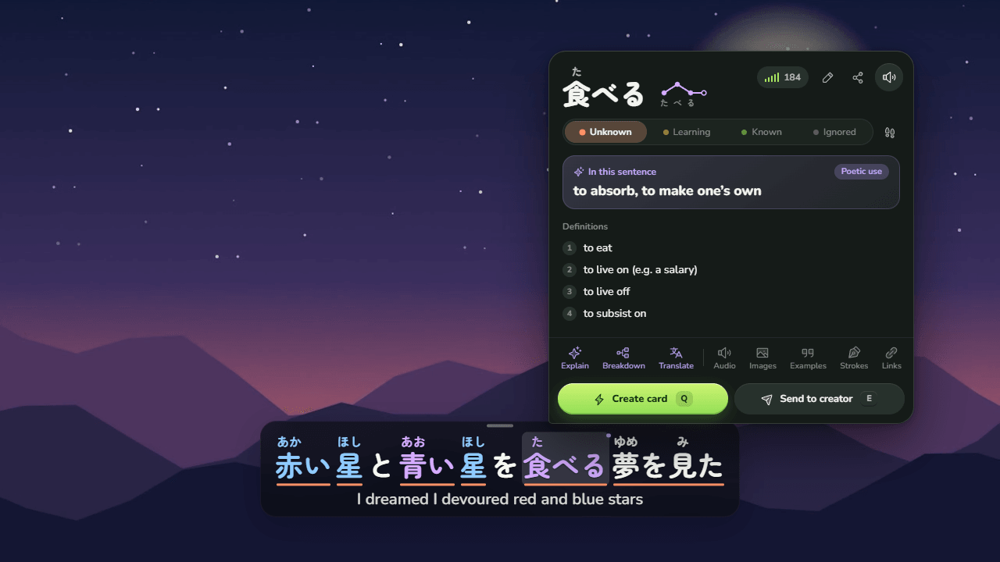
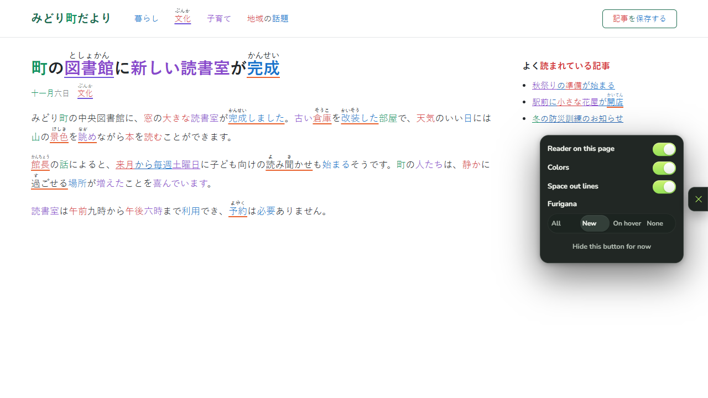
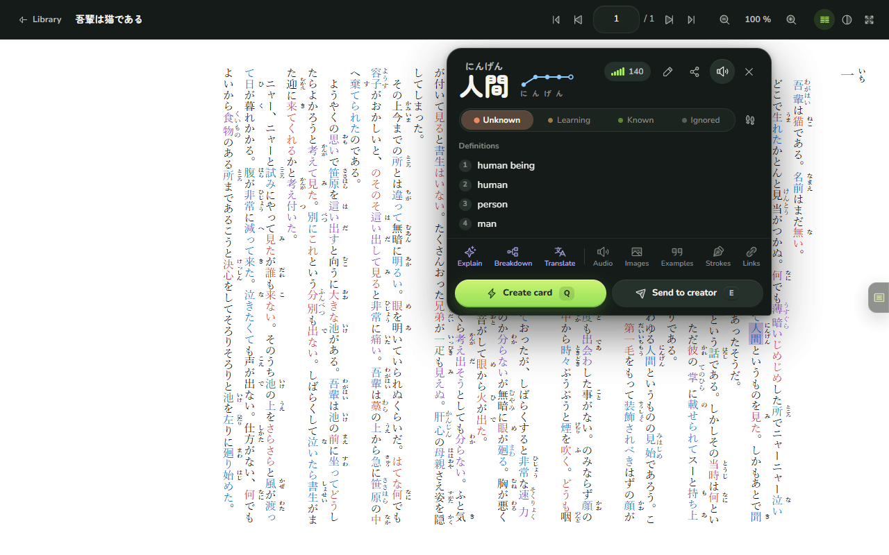
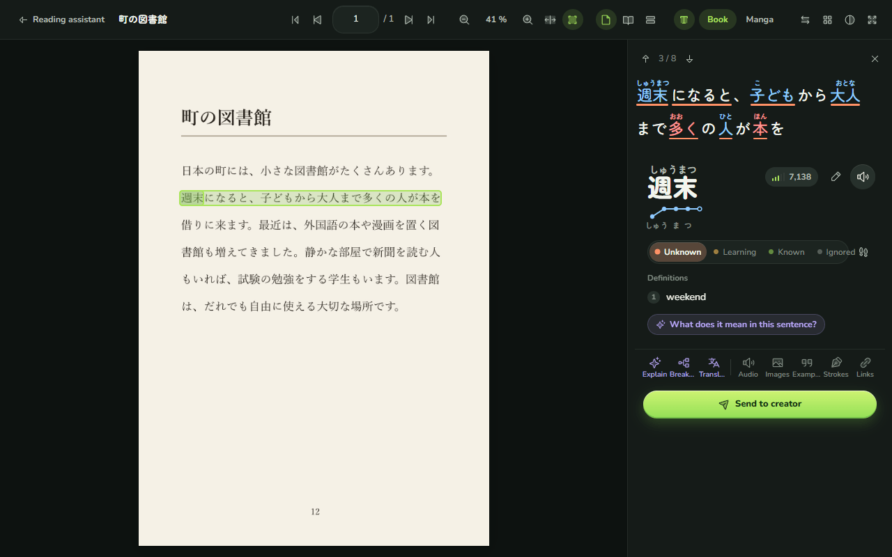
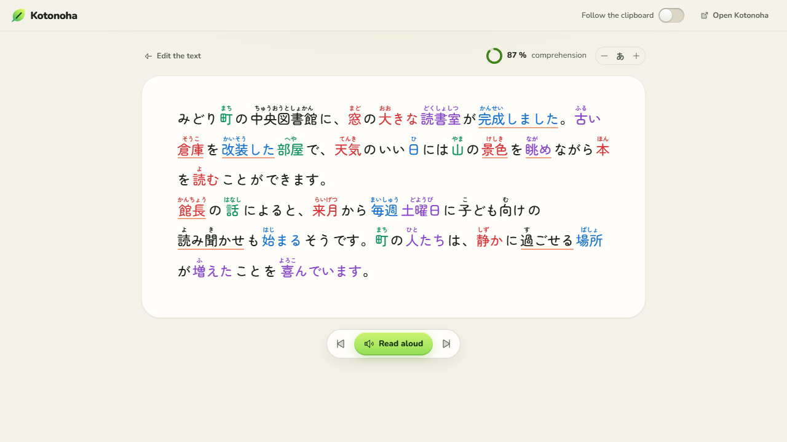
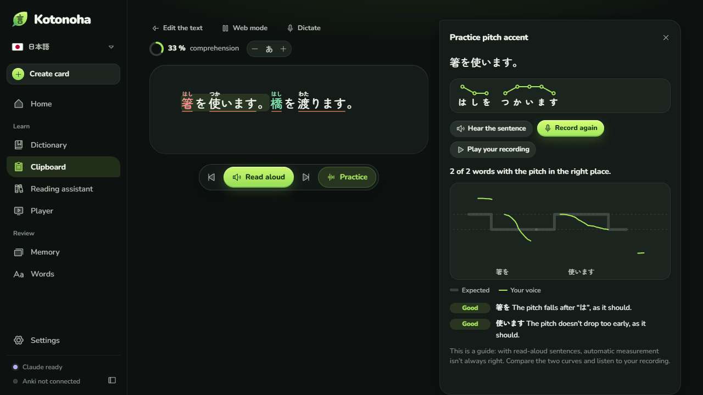
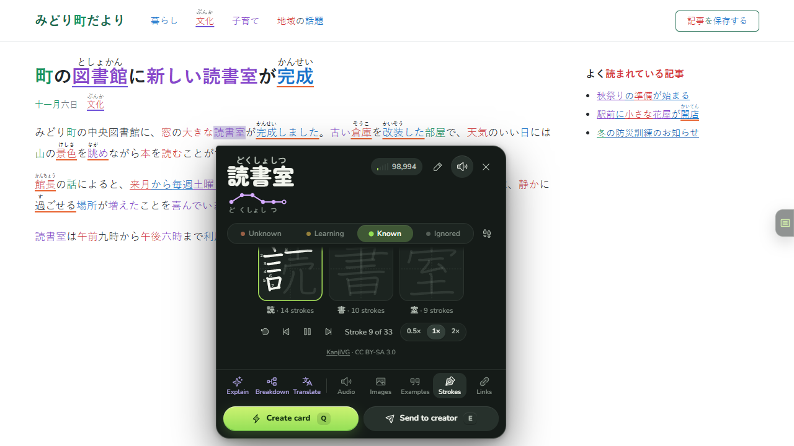
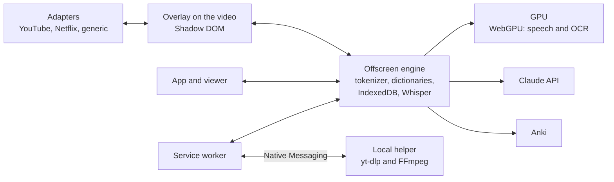

  

<h3 align="center">Learn Japanese from what you already watch and read.</h3>

  Interactive subtitles on your videos, a word panel that understands each word in its sentence, reading help for books, PDFs and manga, and flashcards for Anki. All in your browser, free and open source.

  
  
  
  

  
  
  
  
  
  

  <a href="https://github.com/Eliam4510/kotonoha/releases/latest"><b>Download</b></a> ·
  <a href="#installation">Installation</a> ·
  <a href="docs/guide.md">User guide</a> ·
  <a href="docs/features.md">All features</a> ·
  <a href="CHANGELOG.md">What’s new</a> ·
  <a href="CONTRIBUTING.md">Contributing</a>

## What Kotonoha is

Kotonoha (言の葉, “leaves of words”) is an extension for Chrome and Edge that turns what you already watch and read into study material: series and YouTube or Netflix videos, articles, chats, books and manga. Every word shows its reading and how well you know it, and tapping it opens a panel with its definition, its meaning in that exact sentence and a button that makes a flashcard.

It runs on your own computer. The dictionary, the text analysis, speech transcription and text recognition on book pages never leave the browser. Claude, by Anthropic, steps in only when you ask for an explanation or a translation, and every request is logged with its cost.

<table>
  <tr><td><b>Watch</b></td><td>Subtitles with furigana, pitch accent and the state of every word on YouTube, Netflix, Disney+, Crunchyroll, Prime Video and your own files.</td></tr>
  <tr><td><b>Read</b></td><td>Any web page, whatever you copy, and EPUB, PDF and manga books, scanned ones and image folders included.</td></tr>
  <tr><td><b>Remember</b></td><td>One-click flashcards with the audio and image of the scene, for Anki or the built-in review.</td></tr>
  <tr><td><b>Languages</b></td><td>Study Japanese, English or German. The interface is in English, Spanish, German, Chinese, Korean and Japanese.</td></tr>
</table>

## How you learn with Kotonoha

Every word you mark as known stops being highlighted everywhere, and the comprehension score of each video or text rises with it.

## Tour

### Subtitles you can actually read

Subtitles appear over the player with furigana, a colour for each pitch accent and an underline for the state of each word: new, learning or known. Hovering opens the word panel with the dictionary, at no cost. Claude adds the meaning of the word in that sentence, even when it is figurative or poetic, like the 食べる in the image.

- `Q` creates a card with the sentence, its audio and the video frame, straight into Anki or the built-in review.
- `A` and `D` move between lines and `S` repeats the current one. The subtitle navigator (`G`) shows them all, with filters and bookmarks.
- Subtitles are translated into your language, and auto-generated ones are corrected using the title and the whole script as context.
- Videos without subtitles are transcribed on your own computer, on the graphics card: 30 minutes of video in about a minute.

### Any web page

On news sites, blogs, wikis or in a chat such as Claude’s, Japanese text gets the same colours and furigana, and clicking a word opens its panel. The page content is never changed: links and buttons keep working, and sites built with React notice nothing. It has been tested on about thirty real sites.

### Books, PDFs and manga

The **Reading assistant** is a complete viewer, like a PDF reader: zoom, two-page spreads, continuous scrolling, table of contents, thumbnails and the page where you left each book. A text EPUB, such as a novel, keeps its own formatting, ruby and vertical writing, with the page reader on top: colours, furigana and word panels, as on the web. A PDF that contains text can be read word by word right away. Manga that comes in image folders is imported by choosing the folder: each volume becomes a book, with its cover first and its colour spreads whole. The shelf groups books into collections, such as a series with its volumes, each with its cover and a description, and shows how much of each book and each collection has been read. In the viewer, pages can be bookmarked, text highlighted or underlined with a comment, and notes left on the page, as in a PDF reader. A word can be searched for in the whole book, each page can be read as text with the reading help, and Claude can review the text read by OCR by comparing it with the page image.

Pages that are images, such as manga, scanned books and many PDFs, are read with on-device text recognition (OCR) on the graphics card. There is a mode for printed books and another for manga, which reads vertical speech bubbles without mistaking furigana for text. Tapping a word on the page opens its line with furigana and its word panel. Each page is read only once and saved.

### What you copy, with its structure

The **Clipboard** collects what you copy anywhere and shows it with its paragraphs, headings, lists and tables, analysed and with furigana. It opens in a normal tab, also in the browser’s split view next to the page you are reading, and reads the text aloud. You can also dictate to it: what you say into the microphone is transcribed on your computer and added as a new paragraph, with its recording to play again.

### Pitch accent, out loud

**Practice** shows the accent of each word in the sentence. You read it aloud and Kotonoha lays the pitch curve of your voice over the expected one, says which words have the fall in the wrong place and points out long pauses. The pitch is measured in the browser and the recording is transcribed on your computer, without leaving it. With AivisSpeech or VOICEVOX open, the model voice reads each sentence with the dictionary’s accent, for free and also without leaving your computer.

### How each kanji is written

The word panel shows the stroke order of every kanji in the word, one stroke at a time and on a loop, with their numbers.

### German too

The same tools work for German: the word panel tells you which word each conjugated or declined form comes from, such as *ging* from *gehen* or *Häuser* from *Haus*, finds separable verbs even when the particle sits at the end of the sentence, and gives the pronunciation in IPA. Its dictionaries come from Wiktionary, and German speech is transcribed by Parakeet. Speakers of other languages can study English the same way. Each language keeps its own words, cards and settings, and switching takes one click.

### And also

- **Costs in plain sight.** The home screen shows what Claude has cost this month, by day, model and task, with a monthly cap. Nothing is paid for twice: every answer is saved. The [cost study](docs/costs.md) gives measured figures.
- **Built-in review.** With the FSRS algorithm, for those who do not use Anki.
- **Your own files.** A player for videos on your computer, with the subtitles inside an MKV.
- **Made to measure.** Colour-blind and high-contrast palettes, readings in kana or rōmaji, rebindable shortcuts and sites where it stays off.

## What works without Claude, and what Claude adds

Kotonoha works without any key. An optional Claude key adds what needs a language model.

| Without a key, free | With a Claude key, pay as you go |
|---|---|
| Subtitles with furigana, pitch accent and word states | The meaning of a word in its sentence |
| Dictionary, word panel, stroke order and pronunciation | Explanations of words, sentences and grammar |
| Page reader, Clipboard and Reading assistant with OCR | Subtitle translation and correction |
| On-device speech transcription | Review of furigana readings |
| Cards for Anki and the built-in review | Stories written for your level |

Normal use costs cents a month. The key is stored only in your browser. Task by task, OpenRouter, DeepSeek, OpenAI or a model on your own computer through LM Studio or Ollama can be used instead of Claude.

## Installation

Requirement: Chrome or Edge 120 or later.

1. Download `kotonoha-<version>-extension.zip` from the [latest release](https://github.com/Eliam4510/kotonoha/releases/latest) and unzip it somewhere permanent.
2. Open `chrome://extensions` or `edge://extensions` and turn on **Developer mode**.
3. Click **Load unpacked** and choose the `kotonoha` folder.

On first run a welcome screen asks for your language, the one you want to study and your level, and installs the dictionaries. To update, unzip the new version over the old one: the extension reloads by itself. When there is a new version, Kotonoha says so on Home. The [user guide](docs/guide.md) explains every feature, and [CONTRIBUTING.md](CONTRIBUTING.md) explains how to build it from source.

## Main shortcuts

| Shortcut | Action |
|---|---|
| `Q` | Create a card from the sentence |
| `E` | Send to the creator |
| `1` to `4` | Mark the word: unknown, tracked, known, ignored |
| `A`, `D` and `S` | Previous sentence, next sentence and repeat |
| `G` | Subtitle navigator |
| `Alt+Shift+K` | Open the Kotonoha window |

Every shortcut over the video can be changed, and they work with any keyboard layout.

## Privacy

- Your data and your Claude key are stored only in the browser. There is no server and no usage tracking.
- Transcribed audio and recognised pages never leave your computer.
- Claude receives only what each request needs: the sentence, the subtitle script and the title.
- Dictionaries and models are downloaded once, from GitHub and Hugging Face. [AVISOS.md](AVISOS.md#english) lists every source.

## Architecture

TypeScript, Preact, Dexie and esbuild, with ONNX Runtime and Transformers.js on WebGPU for speech and OCR. Each part, the technical decisions and the performance measurements are described in [docs/architecture.md](docs/architecture.md). More than 750 unit tests cover the logic, and end-to-end tests cover the main flows with real Edge and the GPU; [CONTRIBUTING.md](CONTRIBUTING.md) explains how to run them.

## Project status

Each release ships with its tests and its documentation in six languages; [What’s new](CHANGELOG.md) summarises them. YouTube and English have also been checked by hand with a real session. The interface translations were written with the help of AI and have not yet had a native review: corrections are welcome.

## License and credits

The code is released under the [MIT license](LICENSE). Third-party components, the data downloaded during use and the terms of responsible use are detailed in [AVISOS.md](AVISOS.md#english).

- Dictionaries: [JMdict](https://www.edrdg.org/jmdict/j_jmdict.html) (EDRDG), [Kanjium](https://github.com/mifunetoshiro/kanjium) and [JPDB](https://jpdb.io); for English and German, [Wiktionary](https://www.wiktionary.org) through [wiktionary-to-yomitan](https://github.com/yomidevs/wiktionary-to-yomitan) and [kaikki.org](https://kaikki.org).
- Speech: [Whisper large-v3-turbo](https://huggingface.co/onnx-community/whisper-large-v3-turbo), Haas-ja and Parakeet, with [Transformers.js](https://github.com/huggingface/transformers.js).
- Text recognition: [PP-OCRv5 and PP-OCRv6](https://github.com/PaddlePaddle/PaddleOCR), [manga-ocr](https://github.com/kha-white/manga-ocr) and a [speech bubble detector](https://huggingface.co/ogkalu/comic-text-and-bubble-detector).
- Stroke order: [KanjiVG](https://kanjivg.tagaini.net), by Ulrich Apel, CC BY-SA 3.0.
- Icons: [Phosphor](https://phosphoricons.com). Typefaces: [Zen Maru Gothic](https://fonts.google.com/specimen/Zen+Maru+Gothic) and [Nunito](https://fonts.google.com/specimen/Nunito).

The name comes from the preface of the *Kokin Wakashū* (c. 905): Japanese poetry takes the human heart as its seed, and from it grow countless leaves of words.

An independent project, not affiliated with any of the services mentioned.
