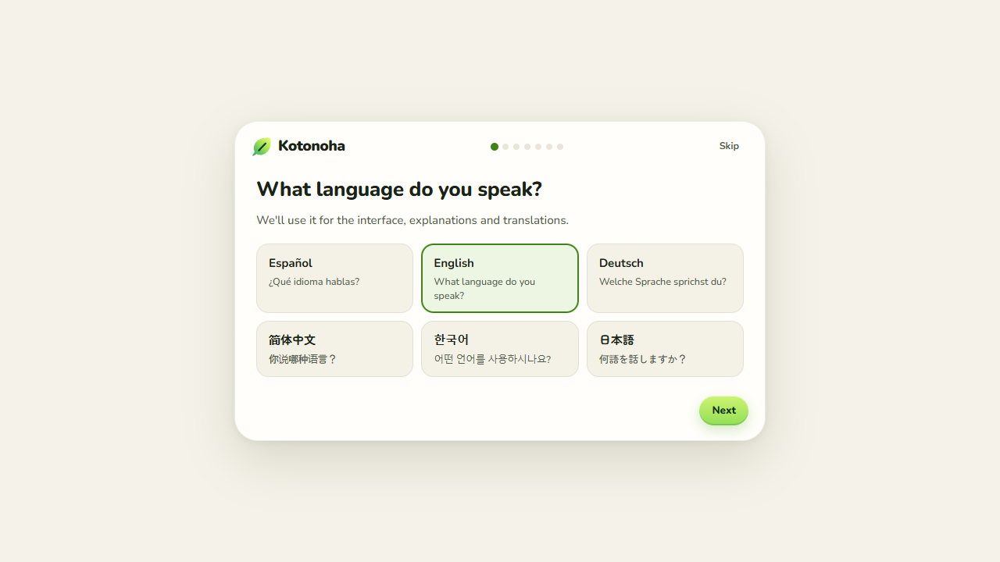
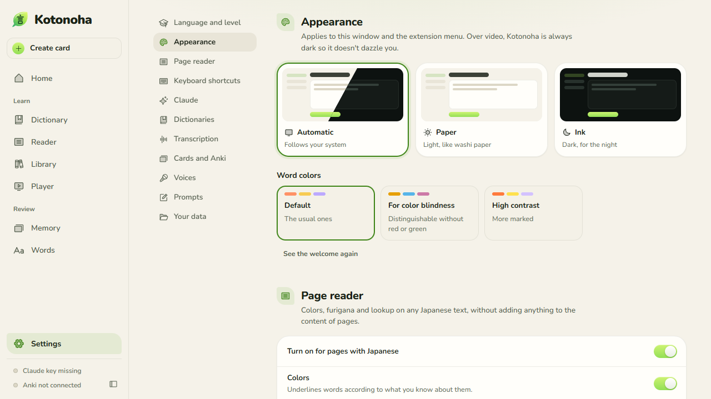
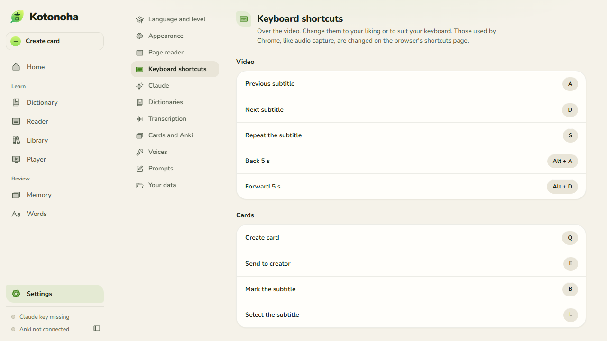
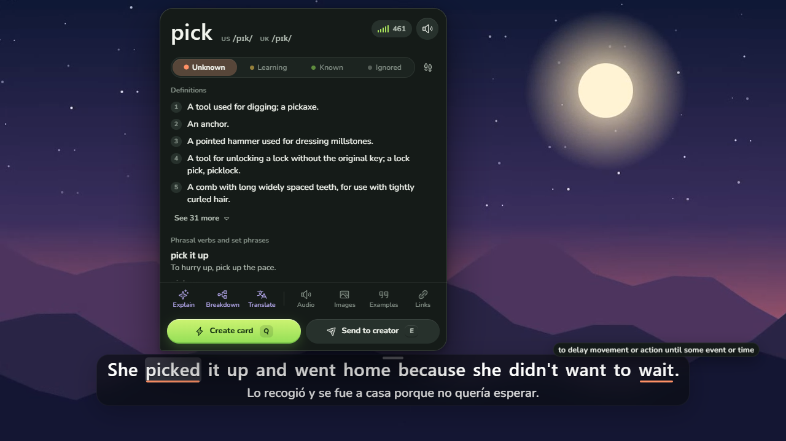
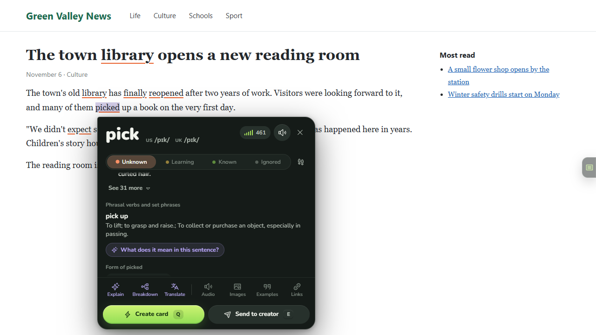
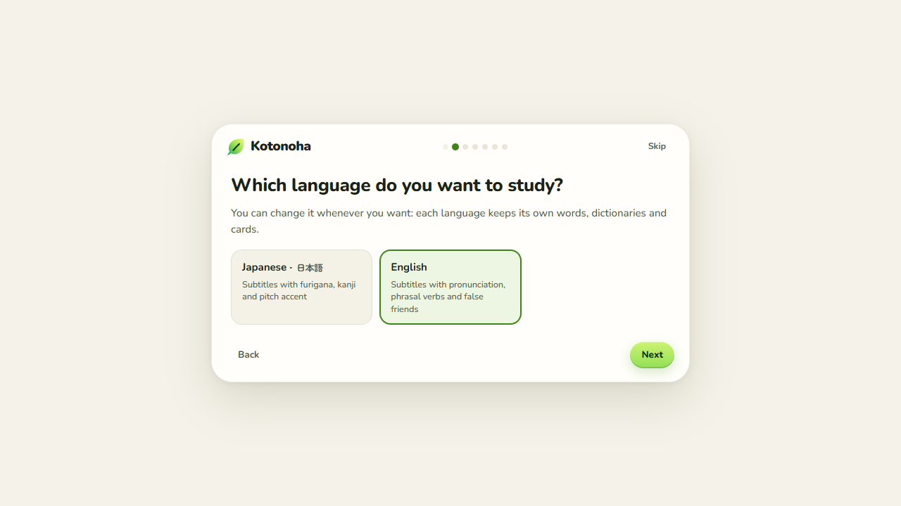
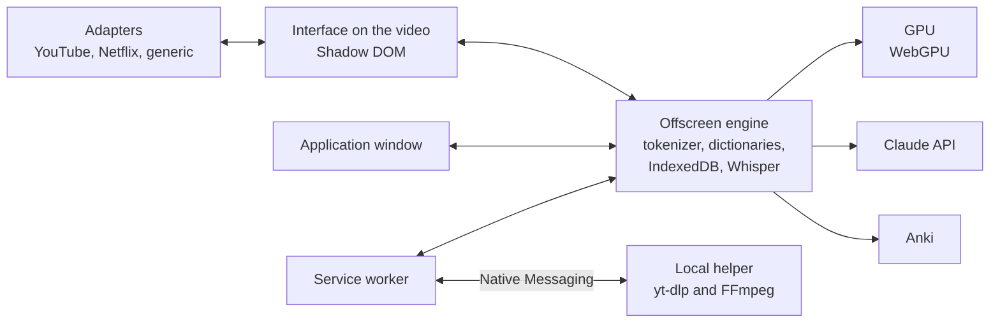

<p align="center">
  
</p>

<p align="center">
  
  
  
  
  <a href="LICENSE"></a>
</p>

<p align="center">
  <a href="README.md"></a>
  <a href="README.en.md"></a>
  <a href="README.de.md"></a>
  <a href="README.zh.md"></a>
  <a href="README.ko.md"></a>
  <a href="README.ja.md"></a>
</p>

<p align="center">
  
  <a href="https://github.com/Eliam4510/kotonoha/actions/workflows/ci.yml"></a>
  
  
  
  
</p>

<p align="center">
  <b>A browser extension for learning Japanese, English and German from real video and text.</b>
</p>

<p align="center">
  <a href="#installation">Installation</a> ·
  <a href="docs/guide.md">User guide</a> ·
  <a href="docs/features.md">Features</a> ·
  <a href="docs/architecture.md">Architecture</a> ·
  <a href="docs/costs.md">Costs</a> ·
  <a href="AVISOS.md#english">Notices</a>
</p>

<p align="center">
  
</p>

## Overview

Kotonoha (言の葉, "leaves of words") overlays interactive subtitles on YouTube, Netflix and other players. Each word shows its furigana, its pitch accent and how well it is known, and hovering over it opens its dictionary entry at no cost. A button asks Claude what it means in that specific sentence. The extension adds a dictionary, flashcard creation for Anki or a built-in review, and explanations in context generated with the Claude API. On any web page it colors Japanese text, adds furigana and looks up words with a click, in chats like Claude's too, without breaking the page. It also works with texts, EPUB books and local video files.

Since version 0.4.0 English can be studied too: the word panel gives American and British pronunciation in IPA, finds phrasal verbs even when they are split, and says which word each irregular form comes from. The dictionaries come from Wiktionary, in the interface language. Each language keeps its own words, dictionaries, cards and settings, and switching between them takes one click.

Since 0.5.0, German too: the word panel says which word each conjugated or declined form comes from, such as *ging* from *gehen* or *Häuser* from *Haus*, finds separable verbs even when the particle sits at the end of the sentence, and gives the pronunciation in IPA. Its dictionaries also come from Wiktionary, and German speech is transcribed by Parakeet.

The name comes from the preface of the *Kokin Wakashū* (c. 905): the poetry of Japan has the human heart for its seed, and from it grow countless leaves of words.

The interface is available in Spanish, English, German, Chinese, Korean and Japanese. Claude's explanations can also be requested in Portuguese, French or simple Japanese, and subtitles can be translated into any of them except Japanese.

## Features

<table>
  <tr>
    <td width="33%" align="center"></td>
    <td width="33%" align="center"></td>
    <td width="33%" align="center"></td>
  </tr>
  <tr>
    <td valign="top"><b>Subtitles made for reading</b><br>Furigana, pitch accent colors, learning status underlines and JLPT grammar points, with an estimated comprehension percentage for each video.</td>
    <td valign="top"><b>Dictionary first, Claude on request</b><br>The word panel opens with the dictionary. A button asks Claude for the word's real meaning in that sentence, including figurative and literary use. It also reviews furigana readings as the video plays.</td>
    <td valign="top"><b>Subtitle navigator</b><br>Every line in view, with filters, bookmarks, multiple selection and synchronization with one or two marks. Corrected lines keep their original text.</td>
  </tr>
  <tr>
    <td width="33%" align="center"></td>
    <td width="33%" align="center"></td>
    <td width="33%" align="center"></td>
  </tr>
  <tr>
    <td valign="top"><b>Translation and correction with Claude</b><br>Translation into the support language, starting with the part being watched. Automatic correction of homophones in generated subtitles, using the title and the full text as context, without asking anything.</td>
    <td valign="top"><b>SRT both ways</b><br>Import and export on any site: SRT, VTT, ASS and TTML. Imported files stay saved for that title, and Japanese subtitles from Netflix are kept even if another region does not offer them.</td>
    <td valign="top"><b>Local transcription</b><br>Haas-ja for Japanese speech, Parakeet for English and German speech and Whisper for songs, on the graphics card through WebGPU, with audio staying on the computer: 30 minutes of video in about a minute with Haas-ja or Parakeet, and in about 5 with Whisper, without making the desktop stutter. It works in chunks with rest periods and recovers if the driver restarts. Paste a song's lyrics and Claude places them on Whisper's timing.</td>
  </tr>
  <tr>
    <td width="33%" align="center"></td>
    <td width="33%" align="center"></td>
    <td width="33%" align="center"></td>
  </tr>
  <tr>
    <td valign="top"><b>Spending in plain sight</b><br>The home screen shows what this month has cost in Claude, with a chart by day and model, the tasks it went to and a log of every request with its tokens. The <a href="docs/costs.md">cost study</a> gives measured figures.</td>
    <td valign="top"><b>Nothing is paid for twice</b><br>Every answer is stored by word and sentence. Moving between words costs nothing, and an interrupted answer is finished and stored instead of being lost.</td>
    <td valign="top"><b>Subtitles wherever you want them</b><br>Drag them from anywhere to the height and side you prefer, with magnets at the center and at their usual place. Lines change without flicker and stay with the video when the page scrolls.</td>
  </tr>
  <tr>
    <td width="33%" align="center"></td>
    <td width="33%" align="center"></td>
    <td width="33%" align="center"></td>
  </tr>
  <tr>
    <td valign="top"><b>A complete application</b><br>Home, a dictionary that understands conjugated forms, a word explorer by status, level assessment, per-task settings and editable prompts. Light and dark themes.</td>
    <td valign="top"><b>One-click flashcards</b><br>With the audio and frame from the video, straight to Anki through AnkiConnect or to the built-in FSRS review.</td>
    <td valign="top"><b>Beyond video</b><br>A text reader, an EPUB library, stories matched to the user's level and a local file player with MKV subtitles.</td>
  </tr>
  <tr>
    <td width="33%" align="center"></td>
    <td width="33%" align="center"></td>
    <td width="33%" align="center"></td>
  </tr>
  <tr>
    <td valign="top"><b>Any page, without breaking it</b><br>Colors and furigana on the Japanese of news sites, articles and blogs. Clicking a word opens its word panel; on links and buttons, resting the pointer on it is enough. Nothing is added to the page's content: the only thing it may touch is line spacing where furigana does not fit, and that can be turned off.</td>
    <td valign="top"><b>How it is written</b><br>The card shows the strokes of each kanji in the word, one by one and in a loop, with their numbers. It can be paused and stepped through. Each kanji is downloaded once and stays stored.</td>
    <td valign="top"><b>Reader in a tab</b><br>The reader also opens in a regular tab, for the browser's split view, even right next to the page being viewed. It can follow the clipboard: what you copy appears there.</td>
  </tr>
  <tr>
    <td width="33%" align="center"></td>
    <td width="33%" align="center"></td>
    <td width="33%" align="center"></td>
  </tr>
  <tr>
    <td valign="top"><b>In six languages</b><br>An interface in Spanish, English, German, Chinese, Korean and Japanese. A welcome screen asks for the language and level, and suggests what fits. Claude's explanations can also be requested in Portuguese and French.</td>
    <td valign="top"><b>Made to fit</b><br>Colors for color blindness and high contrast, readings in kana or rōmaji, a monthly spending limit and sites to leave alone. From absolute beginner to N1.</td>
    <td valign="top"><b>Shortcuts of choice</b><br>Those over the video can all be changed, and work with any keyboard layout, even with Japanese input on.</td>
  </tr>
  <tr>
    <td width="33%" align="center"></td>
    <td width="33%" align="center"></td>
    <td width="33%" align="center"></td>
  </tr>
  <tr>
    <td valign="top"><b>English too</b><br>American and British pronunciation in IPA, grammar from A1 to C2 and Wiktionary dictionaries in the interface language. Whisper, Claude and flashcards work just as they do with Japanese.</td>
    <td valign="top"><b>Phrasal verbs</b><br>The panel finds <i>pick up</i> even when the sentence says <i>picked it up</i>, and explains where <i>went</i> comes from. The page reader starts off, because English is almost everywhere, and is turned on from the extension menu.</td>
    <td valign="top"><b>Each language on its own</b><br>It is chosen in the welcome screen, in Settings or in the extension menu. Each language keeps its words, dictionaries, cards and settings, and going back to another finds everything where it was.</td>
  </tr>
</table>

The full list, with how each feature was verified, is in [docs/features.md](docs/features.md).

## Installation

Requirement: Chrome or Edge 120 or later.

### Compiled version

1. Download `kotonoha-<version>-extension.zip` from [Releases](https://github.com/Eliam4510/kotonoha/releases/latest).
2. Unzip it somewhere permanent. It creates the `kotonoha` folder. The browser derives the extension ID from that path and stores the data under it, so moving the folder means starting from scratch.
3. Open `chrome://extensions` or `edge://extensions`.
4. Enable developer mode.
5. Click "Load unpacked" and choose the `kotonoha` folder.

To update, simply unzip the new version in the same place, over the previous one: the extension detects it and reloads by itself in under a minute, unless it has work in progress. Open tabs warn that they need reloading.

If a copy loaded from another folder is already in use, this one should not be loaded alongside it: both would act on the same pages.

### From source

This also requires Node.js 22 or later.

```bash
git clone https://github.com/Eliam4510/kotonoha.git
```

```bash
cd kotonoha
```

```bash
npm install
```

```bash
npm run build
```

Then load the `dist` folder as in the steps above. After rebuilding, the extension detects the change and reloads by itself. A copy older than version 0.1.1 cannot do this: it needs "Reload" to be clicked once.

## Getting started

The first time, a welcome screen asks for the language, the one to study and the level, and suggests:

1. Installing the dictionaries. For Japanese, JMdict in the chosen language, or in English if there is none yet, with pitch accent and frequency. For English and German, Wiktionary in the chosen language, with pronunciation and frequency; German adds German–English, which says which word each form comes from.
2. Adding a Claude API key, which is stored only in the browser. This is optional: subtitles, the dictionary, colors, flashcards and Whisper work without it.
3. Choosing where cards go: the built-in review, or Anki through the AnkiConnect add-on.

All of this can be skipped and changed later under **Settings**, in the extension window (`Alt+Shift+K`).

With that, opening a video with subtitles in the language being studied brings up the Kotonoha bar. Any page with Japanese text shows colors and furigana; for English and German, the reader must first be turned on from the extension menu. The [user guide](docs/guide.md) explains the rest.

### Helper for transcribing online videos

This is optional. Without it, an online video can only be transcribed while it plays. With it, the whole video is transcribed without playing it. It is a local program using [yt-dlp](https://github.com/yt-dlp/yt-dlp) and FFmpeg that only the extension can call. It requires Python and FFmpeg on Windows, and it is never used on Netflix.

```bash
powershell -ExecutionPolicy Bypass -File herramientas\ayudante\instalar.ps1
```

With the compiled version it is downloaded separately, in `kotonoha-<version>-ayudante.zip`. Its `LEEME.txt` file explains the installation, where the extension ID must be given with `-Extension`.

## Main shortcuts

| Shortcut | Action |
|---|---|
| `Q`, `Alt+Q` | Create a card in one click |
| `E` | Send to the card creator |
| `N` | Go to the next unknown word |
| `1` to `4` | Mark the word: unknown, tracked, known, ignored |
| `A`, `D` | Previous and next sentence |
| `S` | Repeat the sentence |
| `G` | Subtitle navigator |
| `Alt+Shift+M` | Allow audio capture |
| Click on a word | Look it up, on any page with text in the language being studied |

## Transcription performance

Measured with a Radeon RX 9060 XT 16 GB, 16 GB of RAM, a 4K 60 Hz monitor and real videos.

| Measure | Result |
|---|---|
| Speed in automatic mode | 30 minutes of video in about a minute with Haas-ja or Parakeet, and in about 5 minutes with Whisper Turbo, 6.1 to 6.4 times real time |
| Character error rate, on 126 real sentences | 8.8 % |
| Two hours of audio in a row | 19.7 minutes, with no driver restarts and no memory growth |
| Desktop smoothness during transcription | 99th percentile of 17.5 ms, no frames over 33 ms |
| 1080p video during transcription | 0 dropped frames out of 749 |

The full tables, including the accuracy comparison between models, are in [docs/architecture.md](docs/architecture.md#reference-measurements).

## Architecture



The details of each part and of the technical decisions are in [docs/architecture.md](docs/architecture.md).

## Development

```bash
npm run dev
```

```bash
npm test
```

```bash
npm run typecheck
```

```bash
npm run paquete
```

The last one builds and leaves the extension and helper ZIP files in `release/`, with their SHA-256 sums, ready to publish.

| Test | What it checks |
|---|---|
| `npm test` | The pure logic in `src/nucleo`, and that the translation tables are complete |
| `node herramientas/idiomas.mjs` | What is missing or left over in each language |
| `node pruebas/lector.mjs` | The page reader with the hard cases: nothing moves, clicks, links, carousels, accordions, live text, shadow trees and a scrolling box like a chat's |
| `node pruebas/lector-real.mjs` | The reader on about thirty public sites, with a screenshot of each. With `KK_LENGUA=en`, on English sites |
| `node pruebas/trazos-web.mjs` | Stroke order with real data, the reader in its tab, the clipboard and split view |
| `node pruebas/ingles.mjs` | Studying English from start to finish: choosing the language, installing the dictionaries, a video, a page, and going back to Japanese with nothing mixed up |
| `node pruebas/ingles-whisper.mjs voice.wav` | Whisper in English on the GPU, with Claude's correction simulated |
| `node pruebas/aleman.mjs` | Studying German from start to finish with the real dictionaries: choosing the language, installing them, analysis, a video, a page, and back to Japanese |
| `node pruebas/letra.mjs voice.wav` | Placing lyrics on a transcription's timing: with an automatic track, and with Whisper on the GPU if a voice sample is given |
| `node pruebas/modelos-guardados.mjs` | The saved models list: the space each one takes, and that deleting one does not break another that shares its files |
| `node pruebas/modelos-voz.mjs voice.wav` | Which model transcribes what: Haas-ja for Japanese speech, Whisper Turbo for songs, and a manual choice |
| `node pruebas/ingles-grande.mjs` | The largest dictionary on a clean profile: installing it, starting with it, looking words up and removing it. Downloads about 110 MB |
| `node pruebas/e2e.mjs` | The extension end to end in Edge |
| `node pruebas/subtitulos.mjs` | Translating, correcting, exporting and importing, on pages imitating Netflix and YouTube with a simulated Claude API |
| `node pruebas/experiencia.mjs` | What is perceived on top of the video, frame by frame: flicker, jitter and dragging. It also counts requests to Claude and checks the spending log |
| `node pruebas/capturas.mjs` | Goes through every screen and saves screenshots |
| `node pruebas/tarjetas.mjs audio.wav` | Simulated Anki, memory and recording |
| `node pruebas/sin-gpu.mjs` | What the interface costs without hardware acceleration: CPU and dropped frames |
| `node pruebas/captura-real.mjs` | The card creator with real tab capture: which stretch the audio comes from and what the image shows. It needs a visible browser and plays very quietly |
| `node pruebas/medios.mjs audio.wav` | ffmpeg.wasm with a multi-track MKV |
| `node pruebas/ayudante.mjs video.mp4` | The local helper, downloading from the same computer |
| `node pruebas/ayudante-navegador.mjs video.mp4` | The helper's whole path, from the panel to Whisper on the GPU |
| `node pruebas/whisper-comparar.mjs corpus` | Model accuracy on real sentences |
| `node pruebas/whisper-carga.mjs video.mp4 pruebas/sonda-escritorio.ps1 turbo 0.75 9999` | Real speed and desktop smoothness |
| `node pruebas/whisper-larga.mjs turbo 120 60 audio.pcm` | Two hours in a row, to detect degradation |
| `node pruebas/whisper-recuperacion.mjs audio.pcm` | GPU loss: wait, continue and stop on a second failure |

Browser tests use a build with a fixed identifier, created with `KK_SALIDA=.dist-subs node build.mjs`. The test video is generated with `node pruebas/fixtures/generar-video.mjs`. Code, identifiers and comments are in Spanish.

## Project status

Version 0.5.0 is the current one. Automated tests cover the main flows with a real Edge, with Whisper on a real GPU and with simulators for the Claude API and AnkiConnect. Video sites do not serve subtitles to an automated browser, so YouTube and Netflix are tested on pages imitating their player's structure. YouTube has also been checked by hand with a real session, while extended validation is still pending. The page reader has been tried on about thirty real public sites with an automated browser, without signing in. The interface translations were written with AI assistance and have not yet had a native review. English has been tested with real dictionaries and a synthetic voice on the GPU, on pages that imitate YouTube, with the page reader on 16 real public sites, and by hand with a real session on YouTube: automatic captions corrected by Claude, explanations and the lyrics of a song. German has been tested with the real Wiktionary dictionaries, on pages that imitate YouTube and with the page reader, and its transcription with a real recording; not yet with a real session on a video site.

## Privacy

- The Claude API key and all data are stored only in the browser.
- The audio Whisper transcribes never leaves the computer. Neither does card audio or the video frame, unless sent to Anki.
- Only the text each task needs is sent to the Claude API: the sentence, the subtitle script and the video title. If a song's lyrics are pasted, those lyrics too.
- Word audio and image lookups go directly to JapanesePod101, Wikimedia Commons and Openverse, and the strokes of each kanji are requested from jsDelivr.
- Dictionaries are downloaded only once: the Japanese ones and the English and German frequency lists from GitHub, and the English and German ones from Hugging Face. For English and German, word audio comes from Wikimedia Commons and Lingua Libre.
- **Follow the clipboard** only reads with the option on and the tab in view, and what it reads stays on the computer.
- The extension has no server of its own and collects no usage statistics.

## License and credits

The code is released under the [MIT license](LICENSE). Third-party components, the data downloaded during use and the terms for responsible use are detailed in [AVISOS.md](AVISOS.md#english).

- Dictionaries: [JMdict](https://www.edrdg.org/jmdict/j_jmdict.html) (EDRDG), [Kanjium](https://github.com/mifunetoshiro/kanjium) and [JPDB](https://jpdb.io), in Yomitan format.
- English and German: definitions and pronunciation from [Wiktionary](https://www.wiktionary.org), prepared by [wiktionary-to-yomitan](https://github.com/yomidevs/wiktionary-to-yomitan) and [kaikki.org](https://kaikki.org); frequency from [FrequencyWords](https://github.com/hermitdave/FrequencyWords); English analysis with [wink-nlp](https://github.com/winkjs/wink-nlp).
- Transcription: [Whisper large-v3-turbo](https://huggingface.co/onnx-community/whisper-large-v3-turbo) with [Transformers.js](https://github.com/huggingface/transformers.js).
- Stroke order: [KanjiVG](https://kanjivg.tagaini.net), by Ulrich Apel, CC BY-SA 3.0.
- Icons: [Phosphor](https://phosphoricons.com). Typography: [Zen Maru Gothic](https://fonts.google.com/specimen/Zen+Maru+Gothic) and [Nunito](https://fonts.google.com/specimen/Nunito).

An independent project, not affiliated with the services mentioned.
