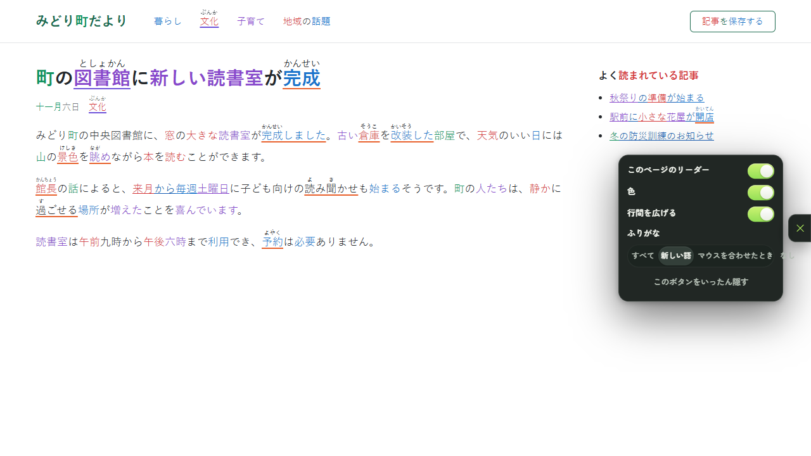
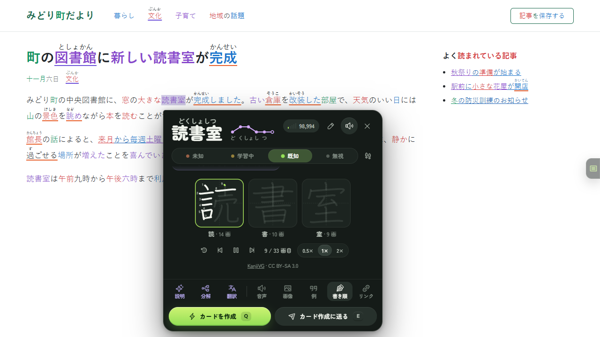
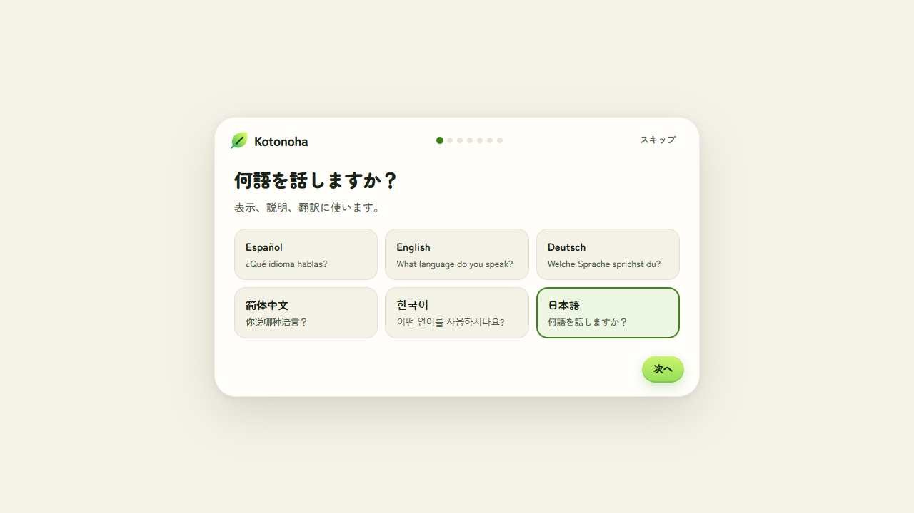
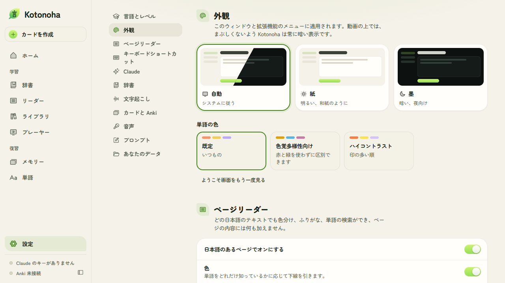
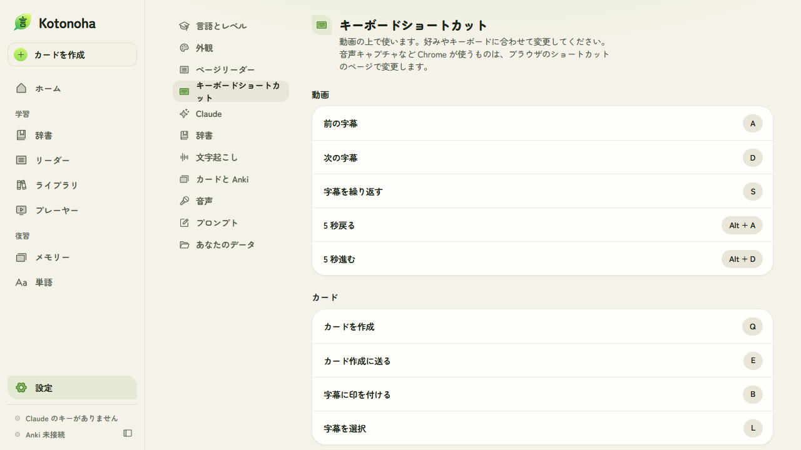
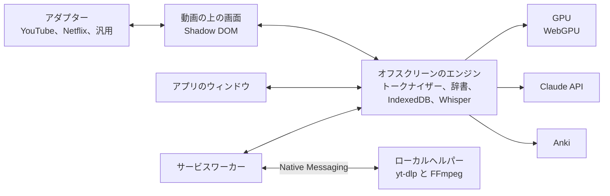

<p align="center">
  
</p>

<p align="center">
  
  
  
  
  <a href="LICENSE"></a>
</p>

<p align="center">
  <a href="README.md"></a>
  <a href="README.en.md"></a>
  <a href="README.de.md"></a>
  <a href="README.zh.md"></a>
  <a href="README.ko.md"></a>
  <a href="README.ja.md"></a>
</p>

<p align="center">
  
  <a href="https://github.com/Eliam4510/kotonoha/actions/workflows/ci.yml"></a>
  
  
  
  
</p>

<p align="center">
  <b>本物の動画と文章で日本語、英語、ドイツ語を学ぶためのブラウザ拡張機能です。</b>
</p>

<p align="center">
  <a href="#インストール">インストール</a> ·
  <a href="docs/ja/guide.md">使い方</a> ·
  <a href="docs/ja/features.md">機能</a> ·
  <a href="docs/ja/architecture.md">アーキテクチャ</a> ·
  <a href="docs/ja/costs.md">費用</a> ·
  <a href="docs/ja/notices.md">告知</a>
</p>

<p align="center">
  
</p>

## 概要

Kotonoha（言の葉）は、YouTube、Netflix などのプレーヤーにインタラクティブな字幕を重ねて表示します。各単語にはふりがな、ピッチアクセント、どれだけ知っているかが示され、マウスを合わせると費用なしで辞書の項目が開きます。ボタンひとつで、その文での意味を Claude に尋ねられます。さらに、辞書、Anki または内蔵の復習向けのカード作成、Claude API による文脈に沿った説明を備えています。どのウェブページでも、Claude のようなチャットでも、ページを壊さずに日本語のテキストを色分けし、ふりがなを付け、クリックひとつで単語を調べられます。テキスト、EPUB の本、手元の動画ファイルにも対応します。表示言語はスペイン語、英語、ドイツ語、中国語、韓国語、日本語です。

バージョン 0.4.0 からは英語も学べます。単語パネルにはアメリカ英語とイギリス英語の発音が IPA で示され、句動詞は離れていても見つかり、不規則形がどの単語から来ているかもわかります。辞書は Wiktionary のもので、表示言語に合わせて使えます。言語ごとに単語、辞書、カード、設定を別々に保存し、クリックひとつで切り替えられます。

バージョン 0.5.0 からはドイツ語も学べます。単語パネルには活用形や格変化形がどの単語から来ているかが示され（*ging* は *gehen*、*Häuser* は *Haus*）、分離動詞は前つづりが文末にあっても見つかり、発音は IPA で示されます。辞書は同じく Wiktionary のもので、ドイツ語の話し声は Parakeet が文字起こしします。

名前は『古今和歌集』仮名序（905 年頃）に由来します。「やまとうたは、人の心を種として、万の言の葉とぞなれりける」。

## 機能

<table>
  <tr>
    <td width="33%" align="center"></td>
    <td width="33%" align="center"></td>
    <td width="33%" align="center"></td>
  </tr>
  <tr>
    <td valign="top"><b>本当に読むための字幕</b><br>ふりがな、ピッチアクセント別の色、学習状態別の下線、JLPT の文法ポイントに加え、動画ごとの推定理解度を表示します。</td>
    <td valign="top"><b>まず辞書、必要なら Claude</b><br>単語パネルは辞書で開きます。ボタンを押すと、比喩や文学的な用法も含め、その文での本当の意味を Claude に尋ねられます。動画の進行に合わせて、ふりがなの読み方も確認します。</td>
    <td valign="top"><b>字幕ナビ</b><br>すべての行を見渡し、フィルター、印、複数選択、1 つまたは 2 つの印による同期が使えます。修正された行は元の文を保持します。</td>
  </tr>
  <tr>
    <td width="33%" align="center"></td>
    <td width="33%" align="center"></td>
    <td width="33%" align="center"></td>
  </tr>
  <tr>
    <td valign="top"><b>Claude で翻訳と修正</b><br>今見ている部分から補助言語に翻訳します。タイトルと全文を文脈にして、自動生成字幕の同音異義語を確認なしで直します。</td>
    <td valign="top"><b>SRT の読み込みと書き出し</b><br>どのサイトでも SRT、VTT、ASS、TTML を読み込み、書き出せます。読み込んだ字幕はタイトルごとに保存され、Netflix の日本語字幕は他の地域で提供されなくても残ります。</td>
    <td valign="top"><b>ローカルの文字起こし</b><br>日本語の話し声には Haas-ja、英語とドイツ語の話し声には Parakeet、歌には Whisper を、WebGPU でグラフィックカード上で動かし、音声はパソコンの外に出ません。30 分の動画を Haas-ja か Parakeet なら約 1 分、Whisper なら約 5 分で処理し、デスクトップは重くなりません。区切りごとに休み、ドライバーが再起動しても復旧します。曲の歌詞を貼り付けると、Claude が Whisper のタイミングに配置します。</td>
  </tr>
  <tr>
    <td width="33%" align="center"></td>
    <td width="33%" align="center"></td>
    <td width="33%" align="center"></td>
  </tr>
  <tr>
    <td valign="top"><b>費用が見える</b><br>ホーム画面に今月の Claude の費用、日別・モデル別のグラフ、作業の内訳、トークン付きのリクエスト記録を表示します。<a href="docs/ja/costs.md">費用の調査</a>に実測値があります。</td>
    <td valign="top"><b>二重に払わない</b><br>回答は単語と文ごとに保存されます。単語を行き来しても費用はかからず、中断した回答も最後まで受け取って保存するので失われません。</td>
    <td valign="top"><b>字幕を好きな場所に</b><br>どこからでもドラッグして好きな高さと位置に動かせ、中央と元の位置に吸い付きます。ちらつかずに行が切り替わり、ページをスクロールすると動画についていきます。</td>
  </tr>
  <tr>
    <td width="33%" align="center"></td>
    <td width="33%" align="center"></td>
    <td width="33%" align="center"></td>
  </tr>
  <tr>
    <td valign="top"><b>完全なアプリ</b><br>ホーム、活用形がわかる辞書、状態別の単語一覧、レベル評価、作業ごとの設定、編集できるプロンプト。明るいテーマと暗いテーマ。</td>
    <td valign="top"><b>ワンクリックでカード</b><br>動画の音声と画面を付けて、AnkiConnect で Anki へ、または FSRS を使う内蔵の復習へ直接送ります。</td>
    <td valign="top"><b>動画だけでなく</b><br>コピーした内容の構成を保つクリップボード、EPUB の本のための読書アシスト、レベルに合わせた物語、MKV の字幕に対応した手元のファイルのプレーヤー。</td>
  </tr>
  <tr>
    <td width="33%" align="center"></td>
    <td width="33%" align="center"></td>
    <td width="33%" align="center"></td>
  </tr>
  <tr>
    <td valign="top"><b>どのページも、壊さずに</b><br>ニュース、記事、ブログの日本語に色分けとふりがなを表示します。単語をクリックすると単語パネルが開き、リンクやボタンではマウスを合わせるだけです。ページの内容には何も加えません。触れるのはふりがなが収まらない箇所の行間だけで、それもオフにできます。</td>
    <td valign="top"><b>書き方</b><br>単語パネルが、単語の各漢字の画を番号付きで 1 画ずつ繰り返し見せます。一時停止して 1 画ずつ進められます。各漢字は一度ダウンロードすると保存されます。</td>
    <td valign="top"><b>タブで使えるクリップボード</b><br>クリップボードは通常のタブでも開けるので、ブラウザの分割表示に使え、今見ているページのすぐ横にも開けます。システムのクリップボードを追うこともでき、コピーした内容が段落、見出し、リスト、表とともにそこに現れます。</td>
  </tr>
  <tr>
    <td width="33%" align="center"></td>
    <td width="33%" align="center"></td>
    <td width="33%" align="center"></td>
  </tr>
  <tr>
    <td valign="top"><b>6 つの言語で</b><br>表示言語はスペイン語、英語、ドイツ語、中国語、韓国語、日本語です。ようこそ画面が言語とレベルを尋ね、合うものを提案します。Claude の説明はポルトガル語とフランス語でも頼めます。</td>
    <td valign="top"><b>好みに合わせて</b><br>色覚多様性向けとハイコントラストの配色、かなまたはローマ字の読み方、月間の費用の上限、動作させないサイト。ゼロから N1 まで。</td>
    <td valign="top"><b>好みのショートカット</b><br>動画の上のショートカットはすべて変更でき、どのキーボード配列でも、日本語入力がオンでも動作します。</td>
  </tr>
  <tr>
    <td width="33%" align="center"></td>
    <td width="33%" align="center"></td>
    <td width="33%" align="center"></td>
  </tr>
  <tr>
    <td valign="top"><b>英語も</b><br>アメリカ英語とイギリス英語の IPA 発音、A1 から C2 までの文法、表示言語の Wiktionary 辞書を備えています。Whisper、Claude、カードは日本語と同じように使えます。</td>
    <td valign="top"><b>句動詞</b><br>文が <i>picked it up</i> となっていてもパネルは <i>pick up</i> を見つけ、<i>went</i> がどの単語から来ているかも説明します。英語はほとんどどこにでもあるので、ページリーダーは最初はオフで、拡張機能のメニューからオンにします。</td>
    <td valign="top"><b>言語ごとに別々</b><br>ようこそ画面、設定、拡張機能のメニューで選びます。言語ごとに単語、辞書、カード、設定を別々に保存し、戻っても何も変わりません。</td>
  </tr>
</table>

全機能の一覧と各機能の確認方法は [docs/ja/features.md](docs/ja/features.md) にあります。

## インストール

必要なもの：Chrome または Edge 120 以降。

### コンパイル済みの版

1. [Releases](https://github.com/Eliam4510/kotonoha/releases/latest) から `kotonoha-<バージョン>-extension.zip` をダウンロードします。
2. 動かさない場所に展開します。`kotonoha` フォルダができます。ブラウザはこのパスから拡張機能の識別子を決め、それでデータを保存するので、移動するとゼロからやり直すのと同じです。
3. `chrome://extensions` または `edge://extensions` を開きます。
4. デベロッパーモードをオンにします。
5. 「パッケージ化されていない拡張機能を読み込む」を押し、`kotonoha` フォルダを選びます。

更新するときは、新しい版を同じ場所に上書きで展開するだけです。拡張機能が検知し、作業中でなければ 1 分以内に自動で再読み込みします。開いているタブは再読み込みが必要だと知らせます。

別のフォルダから読み込んだコピーをすでに使っている場合は、同時に読み込まないでください。両方が同じページで動いてしまいます。

### ソースコードから

さらに Node.js 22 以降が必要です。

```bash
git clone https://github.com/Eliam4510/kotonoha.git
```

```bash
cd kotonoha
```

```bash
npm install
```

```bash
npm run build
```

その後、上の手順で `dist` フォルダを読み込みます。再度コンパイルすると、拡張機能が変更を検知して自動で再読み込みします。0.1.1 より前のコピーではできないので、「再読み込み」を一度押す必要があります。

## はじめに

最初にようこそ画面が開き、言語、勉強する言語、レベルを尋ねて、次のことを提案します。

1. 辞書のインストール。日本語は自分の言語の JMdict（まだなければ英語版）、ピッチアクセント、頻度。英語とドイツ語は自分の言語の Wiktionary、発音、頻度。ドイツ語には、各形がどの単語から来ているかがわかるドイツ語–英語の辞書が加わります。
2. Claude の API キーの追加。ブラウザにのみ保存されます。任意で、なくても字幕、辞書、色分け、カード、Whisper は使えます。
3. カードの保存先の選択：内蔵の復習、または AnkiConnect アドオン経由の Anki。

すべてスキップでき、あとで拡張機能のウィンドウ（`Alt+Shift+K`）の**設定**で変更できます。

これで、勉強する言語の字幕がある動画を開くと Kotonoha のバーが表示されます。日本語のあるページには色分けとふりがなが表示され、英語とドイツ語の場合は先に拡張機能のメニューからリーダーをオンにします。詳しくは[使い方](docs/ja/guide.md)をご覧ください。

### ネット動画を文字起こしするヘルパー

任意です。なければ、ネット動画は再生中にしか文字起こしできません。あれば、再生せずに丸ごと文字起こしできます。[yt-dlp](https://github.com/yt-dlp/yt-dlp) と FFmpeg を使うローカルプログラムで、拡張機能だけが呼び出せます。Windows で Python と FFmpeg が必要で、Netflix には決して使いません。

```bash
powershell -ExecutionPolicy Bypass -File herramientas\ayudante\instalar.ps1
```

コンパイル済みの版では `kotonoha-<バージョン>-ayudante.zip` として別にダウンロードします。中の `LEEME.txt` にインストール方法があり、`-Extension` で拡張機能の識別子を指定します。

## 主なショートカット

| ショートカット | 操作 |
|---|---|
| `Q`、`Alt+Q` | ワンクリックでカード作成 |
| `E` | カード作成に送る |
| `N` | 次の未知語へ |
| `1`〜`4` | 単語に印を付ける：未知、追跡、既知、無視 |
| `A`、`D` | 前の文と次の文 |
| `S` | 文を繰り返す |
| `G` | 字幕ナビ |
| `Alt+Shift+M` | 音声キャプチャを許可 |
| 単語をクリック | 勉強する言語のテキストがあるページで調べる |

## 文字起こしの性能

16 GB の Radeon RX 9060 XT、16 GB の RAM、60 Hz の 4K モニター、実際の動画で測定しました。

| 項目 | 結果 |
|---|---|
| 自動モードの速度 | 30 分の動画を Haas-ja か Parakeet なら約 1 分、Whisper Turbo なら約 5 分、実時間の 6.1〜6.4 倍 |
| 実際の文 126 件の文字誤り率 | 8.8% |
| 連続 2 時間の音声 | 19.7 分、ドライバーの再起動なし、メモリの増加なし |
| 文字起こし中のデスクトップの滑らかさ | 99 パーセンタイルで 17.5 ms、33 ms を超えるフレームなし |
| 文字起こし中の 1080p 動画 | 749 フレーム中 0 フレーム欠落 |

モデルの精度比較を含む詳しい表は [docs/ja/architecture.md](docs/ja/architecture.md#参考測定) にあります。

## アーキテクチャ



各部分と技術的な判断の詳細は [docs/ja/architecture.md](docs/ja/architecture.md) にあります。

## 開発

```bash
npm run dev
```

```bash
npm test
```

```bash
npm run typecheck
```

```bash
npm run paquete
```

最後のコマンドはコンパイルして、`release/` に拡張機能とヘルパーの ZIP と SHA-256 の合計を作ります。そのまま公開できます。

| テスト | 確認内容 |
|---|---|
| `npm test` | `src/nucleo` の純粋なロジックと、翻訳表がそろっていること |
| `node herramientas/idiomas.mjs` | 言語ごとの不足と余分 |
| `node pruebas/lector.mjs` | ページリーダーの難しい場合：何も動かないこと、クリック、リンク、カルーセル、アコーディオン、届き続けるテキスト、シャドウツリー、チャットのようなスクロールするボックス |
| `node pruebas/lector-real.mjs` | 約 30 の公開サイトでのリーダー、各サイトのスクリーンショット付き。`KK_LENGUA=en` を付けると英語のサイトで実行します |
| `node pruebas/trazos-web.mjs` | 実データの書き順、タブのクリップボード、コピーや貼り付けをしたテキストと取り込んだ EPUB の構成、分割表示 |
| `node pruebas/ingles.mjs` | 英語の学習を最初から最後まで：言語の選択、辞書のインストール、動画、ページ、そして何も混ざらずに日本語に戻ること |
| `node pruebas/ingles-whisper.mjs voice.wav` | GPU での英語の Whisper と、シミュレートした Claude の修正 |
| `node pruebas/aleman.mjs` | 実際の辞書でドイツ語を最初から最後まで：言語の選択、辞書のインストール、解析、動画、ページ、日本語へ戻る |
| `node pruebas/letra.mjs voice.wav` | 歌詞を文字起こしのタイミングに配置：自動トラックで、音声サンプルがあれば GPU の Whisper で |
| `node pruebas/modelos-guardados.mjs` | 保存済みモデルの一覧：それぞれの使用容量と、1 つ削除してもファイルを共有する別のモデルが壊れないこと |
| `node pruebas/modelos-voz.mjs voice.wav` | どのモデルが何を文字起こしするか：日本語の話し声は Haas-ja、歌は Whisper Turbo、手動で選んだモデル |
| `node pruebas/ingles-grande.mjs` | 最も大きな辞書を空のプロファイルで：インストール、入れたままの起動、検索、削除。約 110 MB をダウンロードします |
| `node pruebas/e2e.mjs` | Edge での拡張機能全体 |
| `node pruebas/subtitulos.mjs` | Netflix と YouTube を模したページと模擬 Claude API での翻訳、修正、書き出し、読み込み |
| `node pruebas/experiencia.mjs` | 動画の上で感じられるものをフレームごとに：ちらつき、揺れ、ドラッグ。Claude へのリクエスト数と費用の記録も確認 |
| `node pruebas/capturas.mjs` | すべての画面を回ってスクリーンショットを保存 |
| `node pruebas/tarjetas.mjs audio.wav` | 模擬 Anki、メモリー、録音 |
| `node pruebas/sin-gpu.mjs` | ハードウェアアクセラレーションなしでの画面の負荷：プロセッサとフレーム欠落 |
| `node pruebas/captura-real.mjs` | タブの実際のキャプチャを使うカード作成：音声がどの区間か、画像に何が映るか。表示されたブラウザが必要で、音はごく小さいです |
| `node pruebas/medios.mjs audio.wav` | 複数トラックの MKV と ffmpeg.wasm |
| `node pruebas/ayudante.mjs video.mp4` | ローカルヘルパー、手元からのダウンロード |
| `node pruebas/ayudante-navegador.mjs video.mp4` | パネルから GPU の Whisper までのヘルパーの全行程 |
| `node pruebas/whisper-comparar.mjs corpus` | 実際の文でのモデルの精度 |
| `node pruebas/whisper-carga.mjs video.mp4 pruebas/sonda-escritorio.ps1 turbo 0.75 9999` | 実際の速度とデスクトップの滑らかさ |
| `node pruebas/whisper-larga.mjs turbo 120 60 audio.pcm` | 劣化を見つけるための連続 2 時間 |
| `node pruebas/whisper-recuperacion.mjs audio.pcm` | GPU の喪失：待機、続行、2 回目の失敗で停止 |

ブラウザのテストは識別子を固定したビルドを使い、`KK_SALIDA=.dist-subs node build.mjs` で作ります。テスト動画は `node pruebas/fixtures/generar-video.mjs` で生成します。

## プロジェクトの状況

現在のバージョンは 0.6.0 です。自動テストは、実際の Edge、実際の GPU 上の Whisper、Claude API と AnkiConnect の模擬サーバーで主な流れを確認しています。動画サイトは自動操作のブラウザに字幕を提供しないので、YouTube と Netflix はプレーヤーの構造を模したページでテストします。YouTube は実際のセッションでも手動で確認しましたが、長期の検証はこれからです。ページリーダーは自動操作のブラウザで、ログインせずに約 30 の実際の公開サイトで試しました。画面とこの文書の翻訳は AI の助けで書かれたもので、ネイティブによる確認はまだです。 英語は実際の辞書と GPU 上の合成音声を使い、YouTube を模したページでテストし、ページリーダーは実際の公開サイト 16 か所でテストし、YouTube の実際のセッションでも手作業で確認しました。Claude が直した自動字幕、解説、歌の歌詞です。ドイツ語は Wiktionary の実際の辞書を使い、YouTube を模したページとページリーダーでテストし、文字起こしは実際の録音でテストし、YouTube でも手作業で確認しました。動画からの言語の切り替え、動画の字幕と自動字幕、Claude による修正です。

## プライバシー

- Claude の API キーとすべてのデータはブラウザにのみ保存されます。
- Whisper が文字起こしする音声はパソコンの外に出ません。カードの音声と画面も、Anki に送らない限り同様です。
- Claude API には作業に必要なテキストだけを送ります：文、字幕の台本、動画のタイトル。曲の歌詞を貼り付けた場合は、その歌詞も送信します。
- 単語の音声と画像の検索は JapanesePod101、Wikimedia Commons、Openverse に直接送られ、各漢字の画は jsDelivr に要求します。
- 辞書のダウンロードは一度だけです。日本語の辞書と英語・ドイツ語の頻度表は GitHub から、英語・ドイツ語の辞書は Hugging Face から取得します。英語とドイツ語の単語の音声は Wikimedia Commons と Lingua Libre から取得します。
- **クリップボードを追う**は、オプションがオンでタブが表示されている間だけ読み取り、読み取った内容はパソコンの外に出ません。
- 拡張機能に独自のサーバーはなく、利用統計も集めません。

## ライセンスとクレジット

コードは [MIT ライセンス](LICENSE)で公開しています。第三者のコンポーネント、利用時にダウンロードするデータ、責任ある利用の条件は [docs/ja/notices.md](docs/ja/notices.md) にあります。

- 辞書：[JMdict](https://www.edrdg.org/jmdict/j_jmdict.html)（EDRDG）、[Kanjium](https://github.com/mifunetoshiro/kanjium)、[JPDB](https://jpdb.io)、Yomitan 形式。
- 英語とドイツ語：定義と発音は [Wiktionary](https://www.wiktionary.org)、整形は [wiktionary-to-yomitan](https://github.com/yomidevs/wiktionary-to-yomitan) と [kaikki.org](https://kaikki.org)、頻度は [FrequencyWords](https://github.com/hermitdave/FrequencyWords)、英語の解析は [wink-nlp](https://github.com/winkjs/wink-nlp)。
- 文字起こし：[Whisper large-v3-turbo](https://huggingface.co/onnx-community/whisper-large-v3-turbo) と [Transformers.js](https://github.com/huggingface/transformers.js)。
- 書き順：[KanjiVG](https://kanjivg.tagaini.net)、Ulrich Apel、CC BY-SA 3.0。
- アイコン：[Phosphor](https://phosphoricons.com)。フォント：[Zen Maru Gothic](https://fonts.google.com/specimen/Zen+Maru+Gothic)、[Nunito](https://fonts.google.com/specimen/Nunito)。
