

  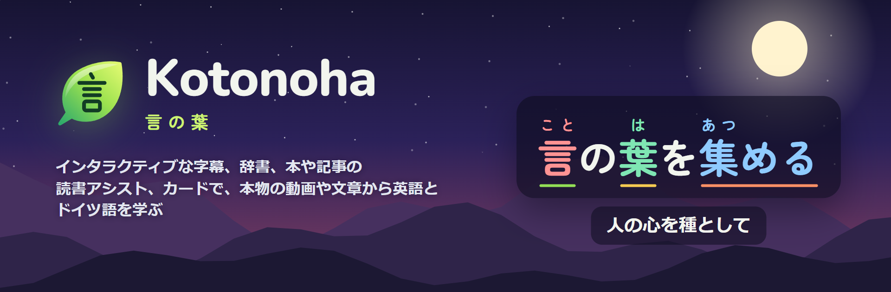

<h3 align="center">いつも見ている動画や記事で、英語を学ぶ。</h3>

  動画に重ねるインタラクティブな字幕、文の中での意味までわかる単語パネル、本・PDF・スキャンしたページのライブラリ、そして Anki 用のカード。すべてブラウザーの中で動く、無料のオープンソースです。

  
  
  
  

  
  
  
  
  
  

  <a href="https://github.com/Eliam4510/kotonoha/releases/latest"><b>ダウンロード</b></a> ·
  <a href="#インストール">インストール</a> ·
  <a href="docs/ja/guide.md">使い方</a> ·
  <a href="docs/ja/features.md">すべての機能</a> ·
  <a href="CHANGELOG.md">更新情報</a> ·
  <a href="CONTRIBUTING.md">開発に参加する</a>

## Kotonoha とは

Kotonoha（言の葉）は Chrome と Edge の拡張機能です。YouTube や Netflix のドラマと動画、記事、チャット、本など、ふだん見たり読んだりしているものを英語の教材に変えます。どの単語にも発音記号とその単語をどのくらい知っているかが表示され、タップするとその単語の意味、その文での具体的な意味、カードを作るボタンを備えた単語パネルが開きます。

すべてが自分のパソコンの中で動きます。辞書、文の解析、音声の文字起こし、本のページの文字認識はブラウザーの外に出ません。Anthropic の Claude は、解説や翻訳を頼んだときだけ使われ、リクエストごとに費用が記録されます。

<table>
  <tr><td><b>見る</b></td><td>YouTube、Netflix、Disney+、Crunchyroll、Prime Video、手元の動画ファイルで、単語ごとの学習状態がわかる英語字幕。</td></tr>
  <tr><td><b>読む</b></td><td>あらゆるウェブページ、コピーした文章、EPUB や PDF の本、画像フォルダーの漫画。スキャンしたページも読めます。</td></tr>
  <tr><td><b>覚える</b></td><td>場面の音声と画像付きのカードをワンクリックで作成し、Anki または内蔵の復習へ。</td></tr>
  <tr><td><b>言語</b></td><td>英語とドイツ語を学べます。表示言語は日本語、英語、スペイン語、ドイツ語、中国語、韓国語です。</td></tr>
</table>

## Kotonoha での学び方

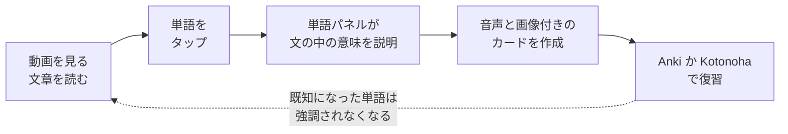

既知にした単語はどこでも強調されなくなり、動画や文章ごとの理解度もそのぶん上がります。

## 主な機能

### 英語の字幕を、ちゃんと読めるように

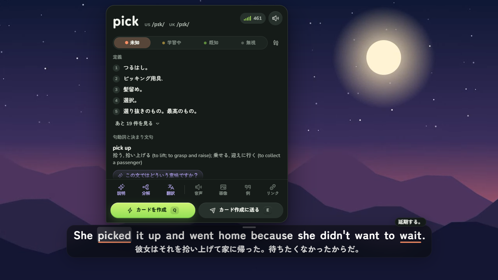

プレーヤーの上に、単語ごとに学習状態（未知・学習中・既知）を示す下線付きの英語字幕が表示されます。マウスを合わせると辞書入りの単語パネルが費用なしで開きます。アメリカ英語とイギリス英語の発音を IPA で示し、*picked it up* のように離れていても句動詞の *pick up* を見つけ、*went* のような不規則形がどの単語から来ているかも教えてくれます。辞書は Wiktionary のもので、意味は日本語で表示されます。

- `Q` で、その文と音声、動画の画面からカードを作り、Anki か内蔵の復習へ直接送ります。
- `A` と `D` で前後の台詞に移動し、`S` で今の台詞を繰り返します。字幕ナビ（`G`）は全台詞をフィルターやブックマークと一緒に表示します。
- 字幕は日本語に翻訳でき、自動生成の字幕はタイトルと台本全体を文脈にして修正されます。
- 字幕のない動画は、自分のパソコンのグラフィックボードで文字起こしできます。英語の話し声は Parakeet が、30 分の動画を約 1 分で書き起こします。

### どんなウェブページでも

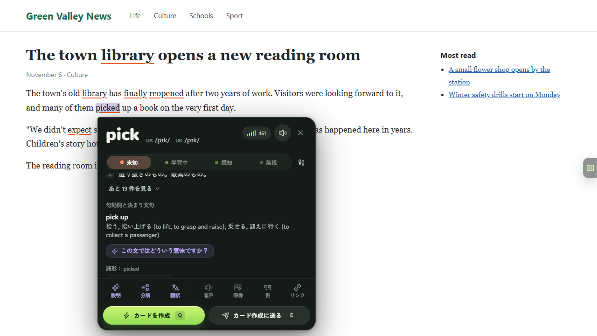

ニュース、ブログ、Wikipedia、Claude のようなチャットでも、英語の文章に同じ色分けが付き、単語をクリックすると単語パネルが開きます。ページの内容は書き換えません。リンクやボタンはそのまま使え、React で作られたサイトも影響を受けません。英語はどこにでもあるので、ページリーダーは最初はオフになっていて、拡張機能のメニューからオンにします。

### 本、PDF、スキャンしたページ

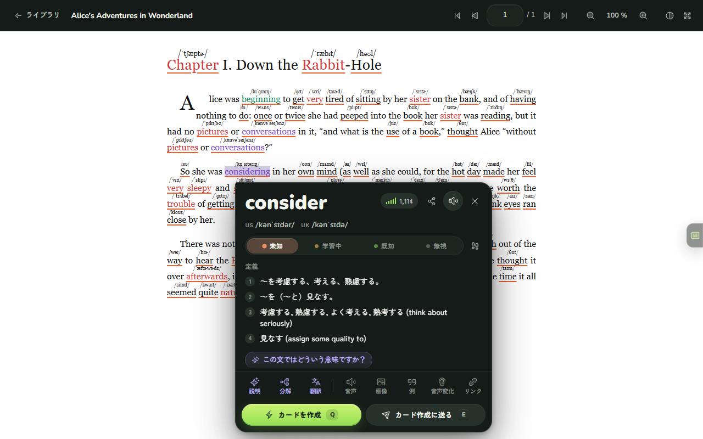

**ライブラリ**は、PDF リーダーのような本格的なビューアーです。拡大・縮小、見開き、連続スクロール、目次、サムネイルに加え、本ごとに読んでいたページを覚えています。小説のようなテキストの EPUB は、元のレイアウトのまま表示され、その上にページリーダーが重なります。ウェブと同じように、色分け、発音記号、単語パネルが使えます。テキストを含む PDF は、そのまま単語ごとに読めます。画像フォルダーの漫画はフォルダーを選ぶだけで読み込め、巻ごとに1冊の本になり、表紙が先頭に、カラーの見開きはそのまま表示されます。本棚では、シリーズとその各巻のように本をコレクションにまとめて表紙と説明を付けられ、本ごと・コレクションごとにどこまで読んだかが分かります。ビューアーでは PDF リーダーのように、ページにしおりを挟み、文字にハイライトや下線を引いてコメントを付け、ページにメモを貼れます。本全体から単語を検索し、各ページを読書支援付きの文字で読めるほか、文字認識が読み取った文字を Claude がページの画像と照らし合わせて確認できます。

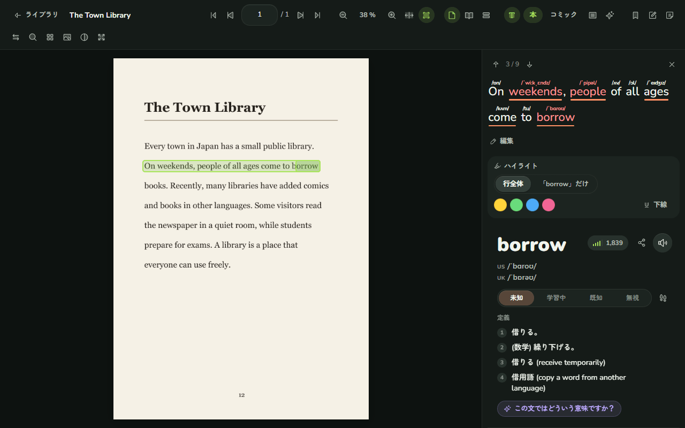

スキャンした本や多くの PDF のように画像でできたページは、自分のパソコンのグラフィックボードで文字認識（OCR）をして読みます。ページ上の単語をタップすると、その行と単語パネルが開きます。各ページは一度だけ読み取り、保存されます。

### 書いて読むためのノート

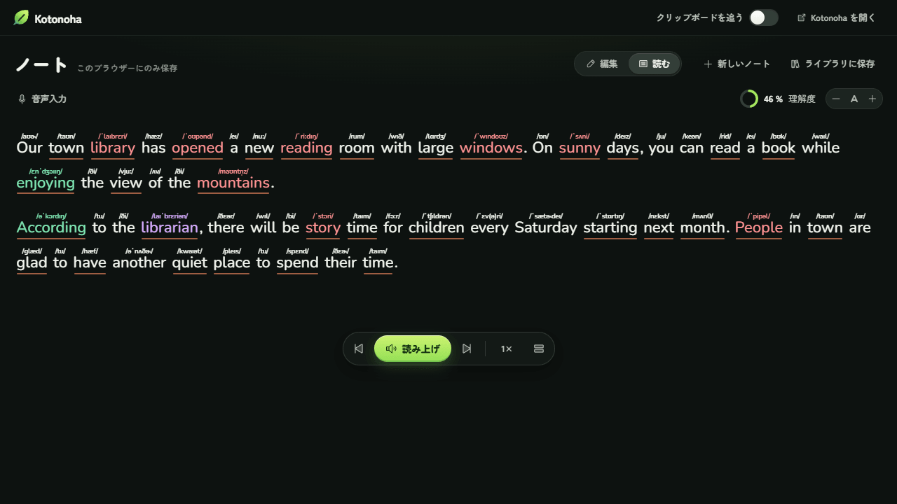

**ノート**は画面の幅いっぱいのページで、学んでいる言語の文章を見出し、箇条書き、引用付きで書いたり貼り付けたりでき、解析済みでふりがな付きで読めます。**整理**は、ひと続きで貼り付けた文章に言葉を変えずに構造を付け、ノートはどれもライブラリに保存されます。好きな速さで、続けて、一文ずつ、または一文を繰り返して読み上げ、選択した部分はどこでも聞いたり練習したりできます。音声入力もできます。マイクに話した内容はパソコン上で文字起こしされ、録音と一緒に新しい段落として入ります。通常のタブでも開けるので、分割表示で読んでいるページの横に置き、どこでコピーした文章も集められます。

### 見つけた言葉を共有する

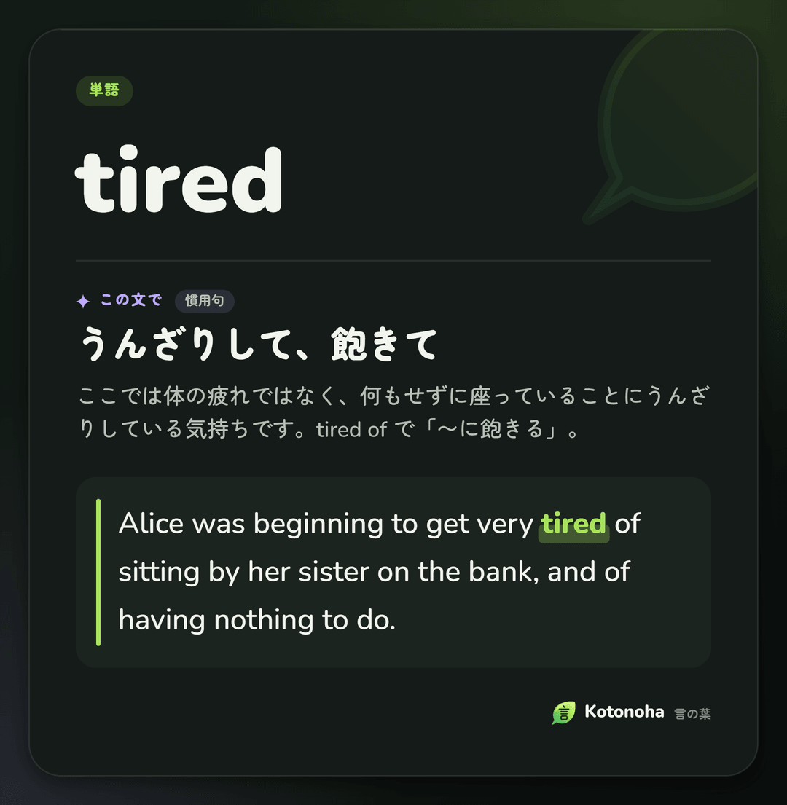

単語パネルの**画像で共有**は、単語や文法の項目を、その文での意味と出てきた文を載せたカードにして、クリップボードに入れておきます。どのチャットにも Ctrl+V で貼り付けられます。カードはテーマと同じく、墨と紙の 2 種類です。

### 続けて話したときの音

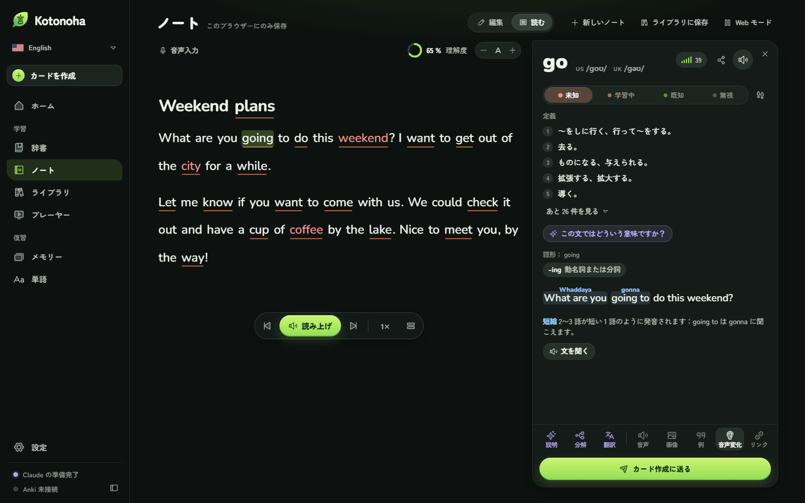

単語パネルの**音声変化**タブは、英語の文を続けて話したときにどう聞こえるかを、変わる部分の上に書いて示します。*going to* が *gonna* に、*meet you* が *meechu* に、*turn off* が *tur‿noff* になるような短縮、弱形、連結、t・d と you の融合、アメリカ英語の柔らかい t を、それぞれの説明付きで表示します。規則で計算するので、すぐに表示され、費用もかかりません。

### ドイツ語も

同じ道具がドイツ語でも使えます。単語パネルは、*ging* が *gehen* から、*Häuser* が *Haus* から来ているように、活用形や格変化形の元の単語を示し、前つづりが文末にある分離動詞も見つけ、発音を IPA で表示します。辞書は Wiktionary のもので、ドイツ語の話し声は Parakeet が書き起こします。コミックは吹き出しごとに左から右へ読み、文はこのパソコンのニューラル音声が読み上げます。英語は Kokoro、ドイツ語は Piper です。言語ごとに単語、カード、設定を別々に保存し、ワンクリックで切り替えられます。

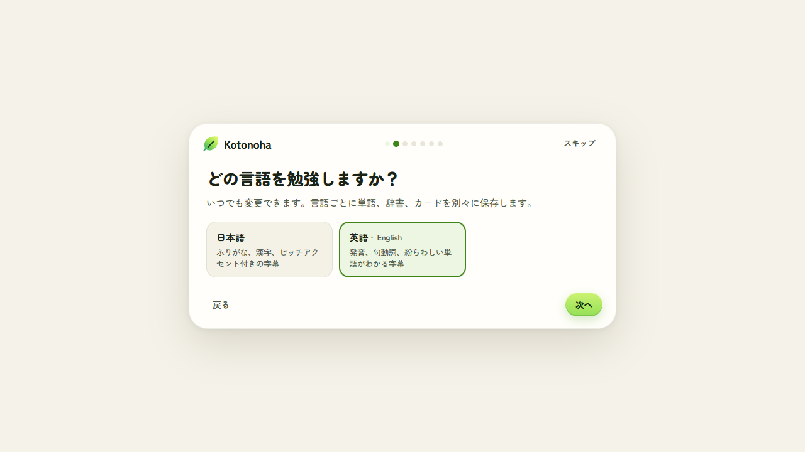

なお、日本語を学ぶ人のための機能（ふりがな、ピッチアクセント、漢字の筆順、マンガの文字認識など）もあり、ほかの言語の README で紹介しています。

### そのほか

- **探検できる辞書。** 日本語を学ぶ人向けに、意味からの検索（「dog」→ 犬）、形や意味からの文法検索、単語ごとの漢字、同義語、同音異義語、オノマトペやことわざ、四字熟語の一覧があります。
- **もう知っている文法。** 日本語を学ぶ人向けに、文法項目を未習・学習中・習得済みに分け、習得済みは字幕で示さず、出てきた動画を記録します。Anki からの取り込みや選択式カードの作成もできます。
- **ディクテーションとリピート。** ディクテーションモードは文を隠して文末で止まり、書いた内容を実際のせりふと比べます。`P` でどの字幕も声に出して練習できます。
- **イマージョン時間。** 学んでいる言語で聞いたり読んだりした時間と連続日数を、ホームで数えます。
- **費用がひと目でわかる。** ホーム画面に今月の Claude の費用が日別、モデル別、作業別に表示され、月の上限も設定できます。同じ答えに二度払わないよう、答えはすべて保存されます。[費用の調査](docs/ja/costs.md)に実測値があります。
- **内蔵の復習。** Anki を使わない人のための、FSRS アルゴリズムによる復習。
- **手元のファイル。** パソコンの動画を再生し、MKV に入っている字幕も読み込みます。
- **自分好みに。** 色覚多様性に配慮した配色や高コントラスト、変更できるショートカット、動作させないサイトの指定。

## Claude なしでできること、Claude で増えること

Kotonoha はキーがなくても使えます。任意で Claude のキーを入れると、言語モデルが必要な機能が加わります。

| キーなし、無料 | Claude のキーあり、使った分だけ |
|---|---|
| 学習状態がわかる字幕 | 文の中での単語の意味 |
| 辞書、単語パネル、IPA の発音 | 単語、文、文法の解説 |
| ページリーダー、ノート、OCR 付きのライブラリ | 字幕の翻訳と修正 |
| 自分のパソコンでの音声の文字起こし | 歌詞をタイミングに合わせる |
| Anki 用のカードと内蔵の復習 | レベルに合わせた読み物 |

ふつうの使い方なら、費用は月に数セントです。キーはブラウザーの中だけに保存されます。作業ごとに、Claude の代わりに OpenRouter、DeepSeek、OpenAI、または LM Studio や Ollama で自分のパソコンのモデルを使うこともできます。

## インストール

必要なもの：Chrome または Edge のバージョン 120 以降。

1. [最新バージョン](https://github.com/Eliam4510/kotonoha/releases/latest)から `kotonoha-<バージョン>-extension.zip` をダウンロードし、ずっと置いておく場所に展開します。
2. `chrome://extensions` または `edge://extensions` を開き、**デベロッパー モード**をオンにします。
3. **パッケージ化されていない拡張機能を読み込む**を押し、`kotonoha` フォルダーを選びます。

Windows ではヘルパーから始めることもできます。`kotonoha-<バージョン>-ayudante.zip` の `Instalar.cmd` をダブルクリックするとヘルパーがインストールされ、Kotonoha が見つからなければ拡張機能も固定の識別子でインストールされます。あとは手順 2 と 3 だけです。

初回はウェルカム画面で、表示言語、学ぶ言語、レベルを選ぶと辞書がインストールされます。更新するときは、新しいバージョンを前のものの上に展開するだけで、拡張機能が自動で再読み込みされます。新しいバージョンが出ると Kotonoha がホームでお知らせし、ヘルパーがあれば**今すぐ更新**でワンクリックで入れ替わります。[使い方](docs/ja/guide.md)ですべての機能を、[CONTRIBUTING.md](CONTRIBUTING.md) でソースからのビルド方法を説明しています。

## 主なショートカット

| ショートカット | 操作 |
|---|---|
| `Q` | その文でカードを作成 |
| `E` | カード作成に送る |
| `1`〜`4` | 単語を記録：未知、追跡、既知、無視 |
| `A`、`D`、`S` | 前の文、次の文、繰り返し |
| `G` | 字幕ナビ |
| `Alt+Shift+K` | Kotonoha のウィンドウを開く |

動画の上のショートカットはすべて変更でき、どのキーボード配列でも、日本語入力がオンでも動きます。

## プライバシー

- データと Claude のキーはブラウザーの中だけに保存されます。独自のサーバーも、利用状況の収集もありません。各サービスに何を送るかは[プライバシーポリシー](docs/privacidad.md#english)にあります。
- 文字起こしした音声と読み取ったページは、パソコンの外に出ません。
- Claude に送るのは、リクエストに必要なものだけです。文、字幕の台本、タイトルです。
- 辞書とモデルは GitHub と Hugging Face から一度だけダウンロードします。すべての出典は[告知](docs/ja/notices.md)にあります。

## アーキテクチャ

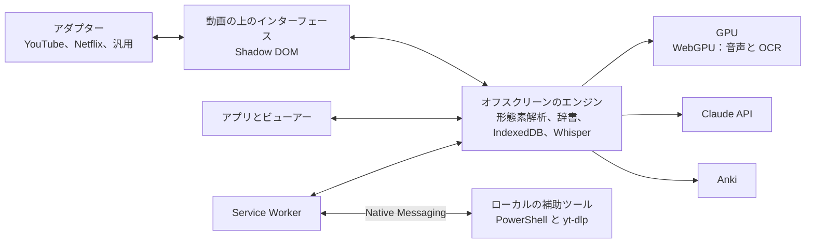

TypeScript、Preact、Dexie、esbuild で作られ、音声と OCR には WebGPU 上の ONNX Runtime と Transformers.js を使っています。各部分、技術的な判断、性能の測定は [docs/ja/architecture.md](docs/ja/architecture.md) にあります。750 を超える単体テストが中心のロジックを、エンドツーエンドのテストが実際の Edge と GPU で主な流れを確かめています。実行方法は [CONTRIBUTING.md](CONTRIBUTING.md) にあります。

## プロジェクトの状況

どのバージョンもテストと 6 言語のドキュメントとともに公開され、[更新情報](CHANGELOG.md)にまとめています。YouTube と英語は、実際のセッションで手作業でも確認しました。表示言語の翻訳は AI の助けを借りて書いたもので、まだネイティブのチェックを受けていません。修正の提案を歓迎します。

## ライセンスとクレジット

コードは [MIT ライセンス](LICENSE)で公開しています。サードパーティのコンポーネント、利用時にダウンロードするデータ、責任ある利用の条件は[告知](docs/ja/notices.md)に記載しています。

- 辞書：英語とドイツ語は [Wiktionary](https://www.wiktionary.org)（[wiktionary-to-yomitan](https://github.com/yomidevs/wiktionary-to-yomitan) と [kaikki.org](https://kaikki.org) による整形）、頻度は [FrequencyWords](https://github.com/hermitdave/FrequencyWords)、英語の解析は [wink-nlp](https://github.com/winkjs/wink-nlp)。日本語は [JMdict](https://www.edrdg.org/jmdict/j_jmdict.html)（EDRDG）、[Kanjium](https://github.com/mifunetoshiro/kanjium)、[JPDB](https://jpdb.io)。
- 音声：[Whisper large-v3-turbo](https://huggingface.co/onnx-community/whisper-large-v3-turbo)、Haas-ja、Parakeet と [Transformers.js](https://github.com/huggingface/transformers.js)。
- 文字認識：[PP-OCRv5 と PP-OCRv6](https://github.com/PaddlePaddle/PaddleOCR)、[manga-ocr](https://github.com/kha-white/manga-ocr)、[吹き出し検出モデル](https://huggingface.co/ogkalu/comic-text-and-bubble-detector)。
- アイコン：[Phosphor](https://phosphoricons.com)。フォント：[Zen Maru Gothic](https://fonts.google.com/specimen/Zen+Maru+Gothic)、[Nunito](https://fonts.google.com/specimen/Nunito)。

名前は『古今和歌集』仮名序（905 年頃）に由来します。「やまとうたは、人の心を種として、万の言の葉とぞなれりける」。

独立したプロジェクトであり、文中のどのサービスとも提携していません。
