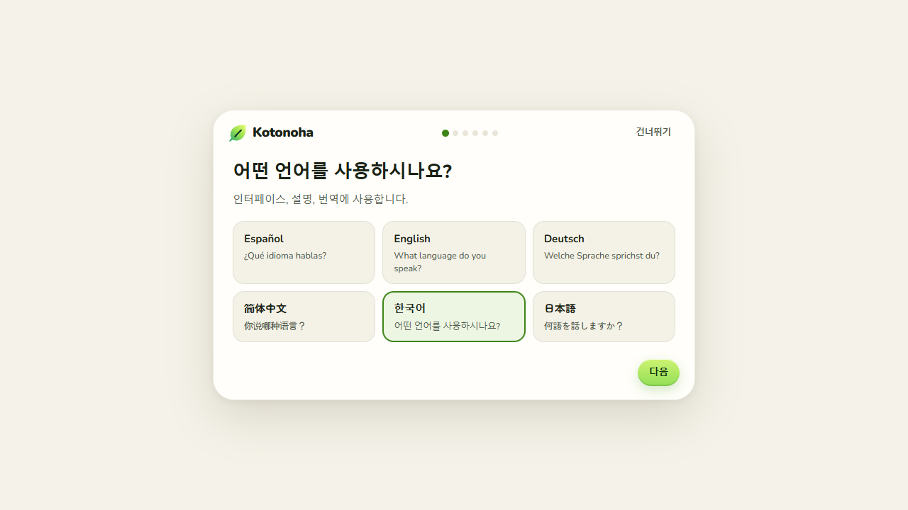
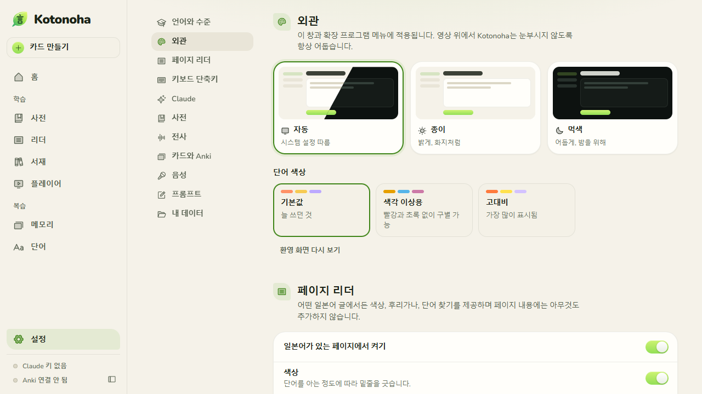
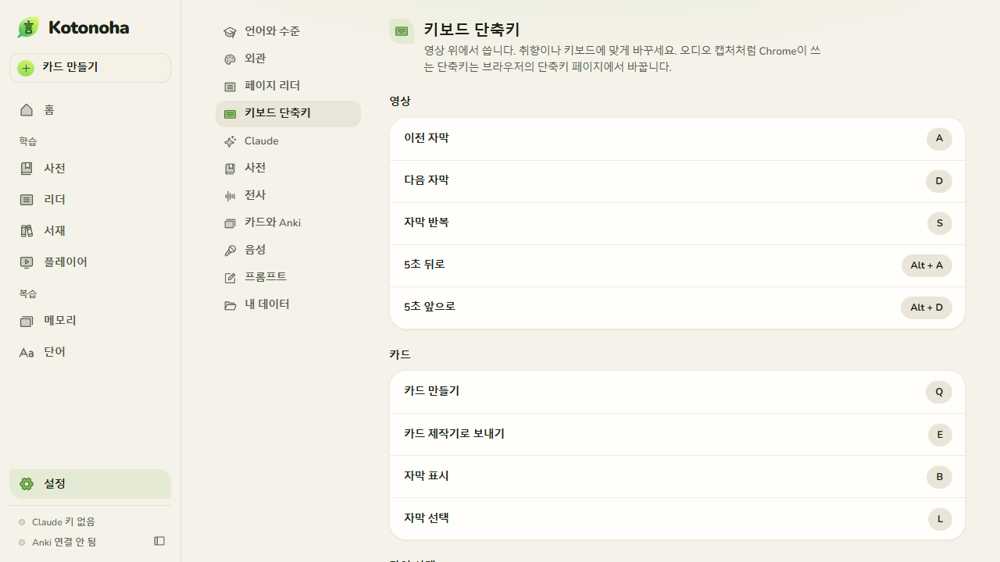
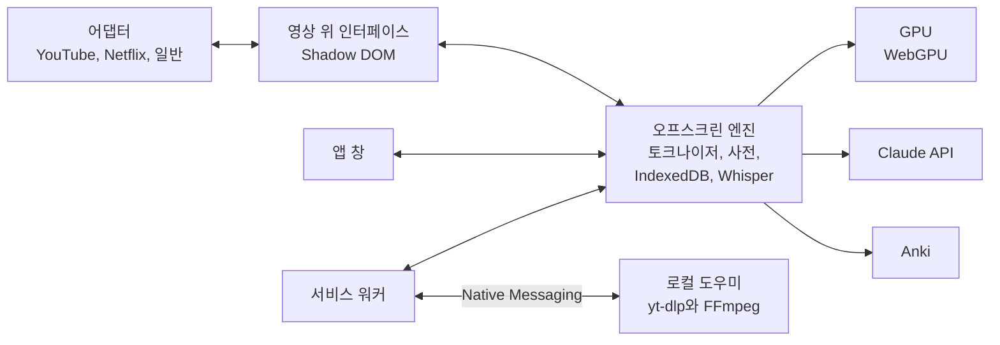

<p align="center">
  
</p>

<p align="center">
  
  
  
  
  <a href="LICENSE"></a>
</p>

<p align="center">
  <a href="README.md"></a>
  <a href="README.en.md"></a>
  <a href="README.de.md"></a>
  <a href="README.zh.md"></a>
  <a href="README.ko.md"></a>
  <a href="README.ja.md"></a>
</p>

<p align="center">
  
  <a href="https://github.com/Eliam4510/kotonoha/actions/workflows/ci.yml"></a>
  
  
  
</p>

<p align="center">
  <b>실제 영상과 글로 일본어를 배우는 브라우저 확장 프로그램입니다.</b>
</p>

<p align="center">
  <a href="#설치">설치</a> ·
  <a href="docs/ko/guide.md">사용 안내</a> ·
  <a href="docs/ko/features.md">기능</a> ·
  <a href="docs/ko/architecture.md">아키텍처</a> ·
  <a href="docs/ko/costs.md">비용</a> ·
  <a href="docs/ko/notices.md">고지</a>
</p>

<p align="center">
  
</p>

## 소개

Kotonoha(言の葉, ‘말의 잎’)는 YouTube, Netflix 및 다른 플레이어 위에 대화형 자막을 겹쳐 표시합니다. 각 단어에는 후리가나, 고저 악센트, 아는 정도가 표시되고, 마우스를 올리면 비용 없이 사전 항목이 열립니다. 버튼 하나로 그 문장에서 어떤 뜻인지 Claude에게 물어볼 수 있습니다. 사전, Anki 또는 내장 복습용 카드 제작, Claude API로 생성하는 맥락별 설명도 제공합니다. 어떤 웹 페이지에서든, Claude 같은 채팅에서도, 페이지를 망가뜨리지 않고 일본어 글에 색을 입히고 후리가나를 달며 클릭 한 번으로 단어를 찾아봅니다. 글, EPUB 책, 내 영상 파일에서도 작동합니다. 인터페이스는 스페인어, 영어, 독일어, 중국어, 한국어, 일본어로 제공됩니다.

이름은 『고킨와카슈』 서문(905년경)에서 왔습니다. 일본의 시가는 사람의 마음을 씨앗으로 삼아, 거기서 수많은 말의 잎이 돋아난다는 구절입니다.

## 기능

<table>
  <tr>
    <td width="33%" align="center"></td>
    <td width="33%" align="center"></td>
    <td width="33%" align="center"></td>
  </tr>
  <tr>
    <td valign="top"><b>제대로 읽기 위한 자막</b><br>후리가나, 고저 악센트별 색상, 학습 상태별 밑줄, JLPT 문법 포인트를 제공하며 영상마다 예상 이해도를 보여 줍니다.</td>
    <td valign="top"><b>사전이 먼저, Claude는 필요할 때</b><br>단어 패널은 사전으로 열립니다. 버튼을 누르면 Claude가 그 문장에서의 실제 뜻을 비유적·문학적 용법까지 알려 줍니다. 영상이 진행되는 동안 후리가나 읽는 법도 검토합니다.</td>
    <td valign="top"><b>자막 탐색기</b><br>모든 줄을 한눈에 보고, 필터, 표시, 다중 선택, 표시 한두 개로 하는 동기화를 사용할 수 있습니다. 수정된 줄은 원문을 보존합니다.</td>
  </tr>
  <tr>
    <td width="33%" align="center"></td>
    <td width="33%" align="center"></td>
    <td width="33%" align="center"></td>
  </tr>
  <tr>
    <td valign="top"><b>Claude로 번역하고 수정</b><br>지금 보고 있는 구간부터 보조 언어로 번역합니다. 제목과 전체 텍스트를 맥락으로 삼아 생성된 자막의 동음이의어를 묻지 않고 자동으로 고칩니다.</td>
    <td valign="top"><b>SRT 가져오기와 내보내기</b><br>어느 사이트에서든 SRT, VTT, ASS, TTML을 가져오고 내보냅니다. 가져온 자막은 해당 제목에 저장되고, Netflix 일본어 자막은 다른 지역에서 제공하지 않아도 유지됩니다.</td>
    <td valign="top"><b>로컬 전사</b><br>WebGPU로 그래픽 카드에서 Whisper를 실행하며 오디오는 컴퓨터 밖으로 나가지 않습니다. 30분 영상을 약 5분에 처리하고 바탕 화면이 버벅이지 않습니다. 구간별로 쉬면서 작업하고 드라이버가 다시 시작되어도 복구합니다.</td>
  </tr>
  <tr>
    <td width="33%" align="center"></td>
    <td width="33%" align="center"></td>
    <td width="33%" align="center"></td>
  </tr>
  <tr>
    <td valign="top"><b>비용을 한눈에</b><br>홈 화면에 이번 달 Claude 비용, 일별·모델별 차트, 작업별 내역, 요청별 토큰 기록이 표시됩니다. <a href="docs/ko/costs.md">비용 연구</a>에 측정값이 있습니다.</td>
    <td valign="top"><b>두 번 내지 않습니다</b><br>답변은 단어와 문장별로 저장됩니다. 단어를 오가도 비용이 들지 않으며, 중단된 답변도 끝까지 받아 저장하므로 사라지지 않습니다.</td>
    <td valign="top"><b>원하는 곳에 자막을</b><br>어느 지점에서든 끌어서 원하는 높이와 위치로 옮기며, 중앙과 제자리에 자석처럼 붙습니다. 깜박임 없이 줄이 바뀌고 페이지를 스크롤하면 영상을 따라갑니다.</td>
  </tr>
  <tr>
    <td width="33%" align="center"></td>
    <td width="33%" align="center"></td>
    <td width="33%" align="center"></td>
  </tr>
  <tr>
    <td valign="top"><b>완전한 앱</b><br>홈, 활용형을 이해하는 사전, 상태별 단어 탐색기, 수준 평가, 작업별 설정, 편집 가능한 프롬프트. 밝은 테마와 어두운 테마.</td>
    <td valign="top"><b>클릭 한 번으로 카드</b><br>영상의 오디오와 화면을 담아 AnkiConnect로 Anki에 보내거나 FSRS를 쓰는 내장 복습에 저장합니다.</td>
    <td valign="top"><b>영상 그 너머</b><br>글 리더, EPUB 서재, 수준에 맞춘 이야기, MKV 자막을 지원하는 내 파일 플레이어.</td>
  </tr>
  <tr>
    <td width="33%" align="center"></td>
    <td width="33%" align="center"></td>
    <td width="33%" align="center"></td>
  </tr>
  <tr>
    <td valign="top"><b>어떤 페이지든 망가뜨리지 않고</b><br>뉴스, 기사, 블로그의 일본어에 색상과 후리가나를 표시합니다. 단어를 클릭하면 단어 패널이 열리고, 링크와 버튼에서는 마우스를 올려 두면 됩니다. 페이지 내용에 아무것도 추가하지 않습니다. 건드리는 것은 후리가나가 들어가지 않는 곳의 줄 간격뿐이며, 이것도 끌 수 있습니다.</td>
    <td valign="top"><b>쓰는 법</b><br>단어 패널이 단어에 있는 각 한자의 획을 번호와 함께 하나씩 반복해서 보여 줍니다. 일시정지하고 한 획씩 넘길 수 있습니다. 한자마다 한 번만 내려받아 저장합니다.</td>
    <td valign="top"><b>탭에서 쓰는 리더</b><br>리더를 일반 탭에서도 열 수 있어 브라우저의 분할 화면에 쓸 수 있고, 지금 보고 있는 페이지 바로 옆에 열 수도 있습니다. 클립보드를 따라갈 수 있어 복사한 내용이 거기에 나타납니다.</td>
  </tr>
  <tr>
    <td width="33%" align="center"></td>
    <td width="33%" align="center"></td>
    <td width="33%" align="center"></td>
  </tr>
  <tr>
    <td valign="top"><b>6개 언어로</b><br>인터페이스는 스페인어, 영어, 독일어, 중국어, 한국어, 일본어로 제공됩니다. 환영 화면에서 언어와 수준을 묻고 알맞은 것을 제안합니다. Claude의 설명은 포르투갈어와 프랑스어로도 요청할 수 있습니다.</td>
    <td valign="top"><b>필요에 맞게</b><br>색각 이상용·고대비 색상, 가나 또는 로마자 읽는 법, 월 비용 한도, 작동하지 않을 사이트. 입문부터 N1까지.</td>
    <td valign="top"><b>원하는 단축키</b><br>영상 위 단축키는 모두 바꿀 수 있고, 어떤 키보드 배열에서도, 일본어 입력을 켠 상태에서도 작동합니다.</td>
  </tr>
</table>

전체 목록과 각 기능의 검증 방법은 [docs/ko/features.md](docs/ko/features.md)에 있습니다.

## 설치

요구 사항: Chrome 또는 Edge 120 이상.

### 컴파일된 버전

1. [Releases](https://github.com/Eliam4510/kotonoha/releases/latest)에서 `kotonoha-<버전>-extension.zip`을 내려받습니다.
2. 계속 둘 위치에 압축을 풉니다. `kotonoha` 폴더가 만들어집니다. 브라우저는 이 경로로 확장 프로그램의 식별자를 정하고 그 식별자로 데이터를 저장하므로, 위치를 옮기면 처음부터 시작하는 것과 같습니다.
3. `chrome://extensions` 또는 `edge://extensions`를 엽니다.
4. 개발자 모드를 켭니다.
5. ‘압축해제된 확장 프로그램 로드’를 누르고 `kotonoha` 폴더를 선택합니다.

업데이트할 때는 새 버전을 같은 위치에 덮어써서 압축을 풀면 됩니다. 확장 프로그램이 이를 감지해 1분 안에 스스로 다시 로드합니다(작업 중이 아닐 때). 열려 있는 탭은 새로고침이 필요하다고 알려 줍니다.

다른 폴더에서 로드한 복사본을 이미 쓰고 있다면 이 복사본을 함께 로드하지 마세요. 둘 다 같은 페이지에서 작동합니다.

### 소스 코드에서

Node.js 22 이상이 추가로 필요합니다.

```bash
git clone https://github.com/Eliam4510/kotonoha.git
```

```bash
cd kotonoha
```

```bash
npm install
```

```bash
npm run build
```

그런 다음 위 단계처럼 `dist` 폴더를 로드합니다. 다시 컴파일하면 확장 프로그램이 변경을 감지해 스스로 다시 로드합니다. 0.1.1 이전 복사본은 그렇게 하지 못하므로 ‘새로고침’을 한 번 눌러야 합니다.

## 시작하기

처음에는 환영 화면이 열려 언어와 수준을 묻고 다음을 제안합니다.

1. 사전 설치: 내 언어의 JMdict(아직 없으면 영어판), 고저 악센트, 빈도.
2. Claude API 키 추가. 브라우저에만 저장됩니다. 선택 사항이며, 키가 없어도 자막, 사전, 색상, 카드, Whisper는 작동합니다.
3. 카드 저장 위치 선택: 내장 복습 또는 AnkiConnect 부가 기능을 통한 Anki.

모두 건너뛸 수 있고 나중에 확장 프로그램 창(`Alt+Shift+K`)의 **설정**에서 바꿀 수 있습니다.

이후 일본어 자막이 있는 영상을 열면 Kotonoha 바가 나타나고, 일본어 글이 있는 페이지에는 색상과 후리가나가 나타납니다. 나머지는 [사용 안내](docs/ko/guide.md)를 참고하세요.

### 인터넷 영상 전사용 도우미

선택 사항입니다. 없으면 인터넷 영상은 재생하는 동안에만 전사할 수 있습니다. 있으면 재생하지 않고 전체를 전사합니다. [yt-dlp](https://github.com/yt-dlp/yt-dlp)와 FFmpeg를 쓰는 로컬 프로그램으로, 확장 프로그램만 호출할 수 있습니다. Windows에서 Python과 FFmpeg가 필요하며 Netflix에서는 사용하지 않습니다.

```bash
powershell -ExecutionPolicy Bypass -File herramientas\ayudante\instalar.ps1
```

컴파일된 버전에서는 `kotonoha-<버전>-ayudante.zip`으로 따로 내려받습니다. 그 안의 `LEEME.txt`가 설치 방법을 설명하며, `-Extension`으로 확장 프로그램의 식별자를 지정해야 합니다.

## 주요 단축키

| 단축키 | 동작 |
|---|---|
| `Q`, `Alt+Q` | 클릭 한 번으로 카드 만들기 |
| `E` | 카드 제작기로 보내기 |
| `N` | 다음 모르는 단어로 이동 |
| `1`~`4` | 단어 표시: 모르는 단어, 추적, 아는 단어, 무시 |
| `A`, `D` | 이전 문장과 다음 문장 |
| `S` | 문장 반복 |
| `G` | 자막 탐색기 |
| `Alt+Shift+M` | 오디오 캡처 허용 |
| 단어 클릭 | 일본어 글이 있는 페이지에서 찾아보기 |

## 전사 성능

16GB Radeon RX 9060 XT, 16GB RAM, 60Hz 4K 모니터와 실제 영상으로 측정했습니다.

| 항목 | 결과 |
|---|---|
| 자동 모드 속도 | 30분 영상에 약 5분, 실시간의 6.1~6.4배 |
| 실제 문장 126개의 문자 오류율 | 8.8% |
| 연속 2시간 오디오 | 19.7분, 드라이버 재시작 없음, 메모리 증가 없음 |
| 전사 중 바탕 화면 부드러움 | 99번째 백분위수 17.5ms, 33ms 초과 프레임 없음 |
| 전사 중 1080p 영상 | 749프레임 중 0프레임 손실 |

모델 간 정확도 비교를 포함한 전체 표는 [docs/ko/architecture.md](docs/ko/architecture.md#참고-측정값)에 있습니다.

## 아키텍처



각 부분과 기술적 결정의 자세한 내용은 [docs/ko/architecture.md](docs/ko/architecture.md)에 있습니다.

## 개발

```bash
npm run dev
```

```bash
npm test
```

```bash
npm run typecheck
```

```bash
npm run paquete
```

마지막 명령은 컴파일한 뒤 `release/`에 확장 프로그램과 도우미의 ZIP 파일과 SHA-256 합계를 만들어 바로 배포할 수 있게 합니다.

| 테스트 | 확인 내용 |
|---|---|
| `npm test` | `src/nucleo`의 순수 로직과 번역 표의 완전성 |
| `node herramientas/idiomas.mjs` | 언어별로 빠졌거나 남는 내용 |
| `node pruebas/lector.mjs` | 페이지 리더의 어려운 경우: 움직임 없음, 클릭, 링크, 캐러셀, 아코디언, 실시간 텍스트, 섀도 트리, 채팅 같은 스크롤 상자 |
| `node pruebas/lector-real.mjs` | 약 30개 공개 사이트에서의 리더, 사이트별 스크린샷 |
| `node pruebas/trazos-web.mjs` | 실제 데이터의 획순, 탭의 리더, 클립보드, 분할 화면 |
| `node pruebas/e2e.mjs` | Edge에서 확장 프로그램 전체 흐름 |
| `node pruebas/subtitulos.mjs` | Netflix와 YouTube를 흉내 낸 페이지와 모의 Claude API로 번역, 수정, 내보내기, 가져오기 |
| `node pruebas/experiencia.mjs` | 영상 위에서 느껴지는 것을 프레임별로: 깜박임, 떨림, 끌림. Claude 요청 수와 비용 기록도 확인 |
| `node pruebas/capturas.mjs` | 모든 화면을 돌며 스크린샷 저장 |
| `node pruebas/tarjetas.mjs audio.wav` | 모의 Anki, 메모리, 녹음 |
| `node pruebas/sin-gpu.mjs` | 하드웨어 가속 없이 인터페이스에 드는 비용: 프로세서와 프레임 손실 |
| `node pruebas/captura-real.mjs` | 실제 탭 캡처를 쓰는 카드 제작기: 오디오가 어느 구간인지, 이미지에 무엇이 나오는지. 보이는 브라우저가 필요하고 소리가 아주 작습니다 |
| `node pruebas/medios.mjs audio.wav` | 여러 트랙의 MKV와 ffmpeg.wasm |
| `node pruebas/ayudante.mjs video.mp4` | 로컬 도우미, 내 컴퓨터에서 내려받기 |
| `node pruebas/ayudante-navegador.mjs video.mp4` | 패널부터 GPU의 Whisper까지 도우미의 전체 과정 |
| `node pruebas/whisper-comparar.mjs corpus` | 실제 문장으로 모델 정확도 비교 |
| `node pruebas/whisper-carga.mjs video.mp4 pruebas/sonda-escritorio.ps1 turbo 0.75 9999` | 실제 속도와 바탕 화면 부드러움 |
| `node pruebas/whisper-larga.mjs turbo 120 60 audio.pcm` | 저하를 찾기 위한 연속 2시간 |
| `node pruebas/whisper-recuperacion.mjs audio.pcm` | GPU 손실: 대기, 계속, 두 번째 실패 시 중지 |

브라우저 테스트는 식별자가 고정된 빌드를 쓰며 `KK_SALIDA=.dist-subs node build.mjs`로 만듭니다. 테스트 영상은 `node pruebas/fixtures/generar-video.mjs`로 생성합니다.

## 프로젝트 상태

현재 버전은 0.3.0입니다. 자동 테스트는 실제 Edge, 실제 GPU의 Whisper, Claude API와 AnkiConnect 모의 서버로 주요 흐름을 다룹니다. 영상 사이트는 자동화된 브라우저에 자막을 제공하지 않으므로 YouTube와 Netflix는 플레이어 구조를 흉내 낸 페이지에서 테스트합니다. YouTube는 실제 세션으로 직접 확인했고, 장기 검증은 아직 남아 있습니다. 페이지 리더는 자동화된 브라우저로 로그인 없이 실제 공개 사이트 약 30곳에서 시험했습니다. 인터페이스와 이 문서의 번역은 AI의 도움으로 작성했으며 아직 원어민 검토를 받지 않았습니다.

## 개인정보

- Claude API 키와 모든 데이터는 브라우저에만 저장됩니다.
- Whisper가 전사하는 오디오는 컴퓨터 밖으로 나가지 않습니다. 카드의 오디오와 화면도 Anki로 보내지 않는 한 마찬가지입니다.
- Claude API에는 작업에 필요한 텍스트만 보냅니다: 문장, 자막 대본, 영상 제목.
- 단어의 오디오와 이미지 검색은 JapanesePod101, Wikimedia Commons, Openverse로 직접 전달되고, 한자별 획은 jsDelivr에 요청합니다.
- **클립보드 따라가기**는 옵션이 켜져 있고 탭이 보일 때만 읽으며, 읽은 내용은 컴퓨터 밖으로 나가지 않습니다.
- 확장 프로그램에는 자체 서버가 없고 사용 통계를 수집하지 않습니다.

## 라이선스와 크레딧

코드는 [MIT 라이선스](LICENSE)로 공개됩니다. 서드파티 구성 요소, 사용 중 내려받는 데이터, 책임 있는 사용 조건은 [docs/ko/notices.md](docs/ko/notices.md)에 있습니다.

- 사전: [JMdict](https://www.edrdg.org/jmdict/j_jmdict.html)(EDRDG), [Kanjium](https://github.com/mifunetoshiro/kanjium), [JPDB](https://jpdb.io), Yomitan 형식.
- 전사: [Whisper large-v3-turbo](https://huggingface.co/onnx-community/whisper-large-v3-turbo)와 [Transformers.js](https://github.com/huggingface/transformers.js).
- 획순: [KanjiVG](https://kanjivg.tagaini.net), Ulrich Apel, CC BY-SA 3.0.
- 아이콘: [Phosphor](https://phosphoricons.com). 글꼴: [Zen Maru Gothic](https://fonts.google.com/specimen/Zen+Maru+Gothic), [Nunito](https://fonts.google.com/specimen/Nunito).
