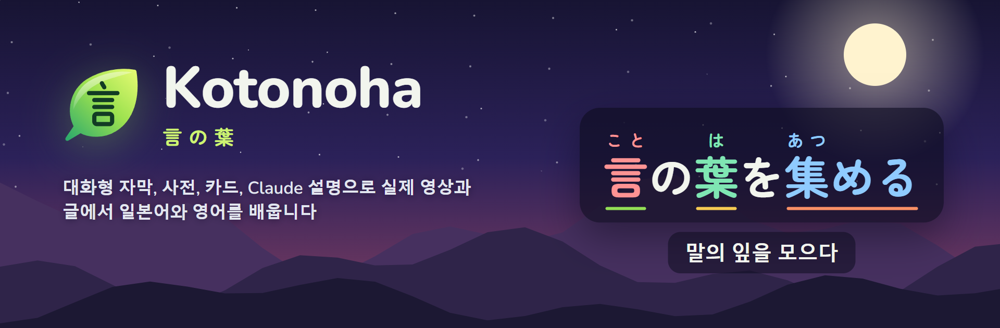
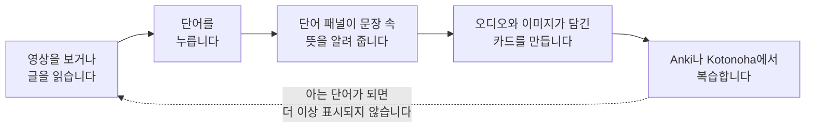
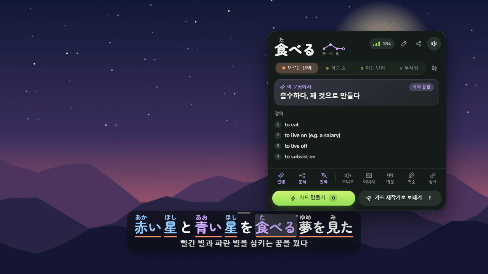
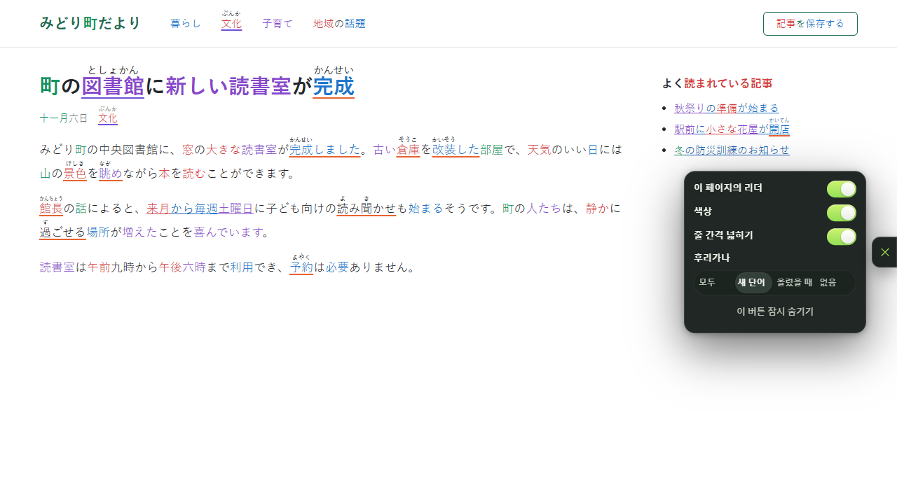
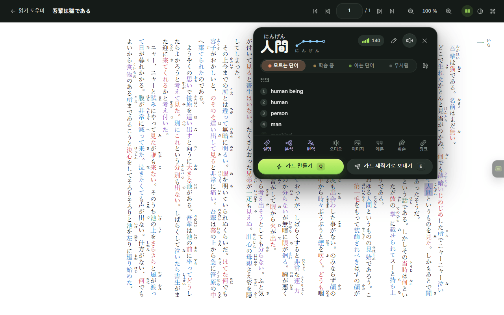
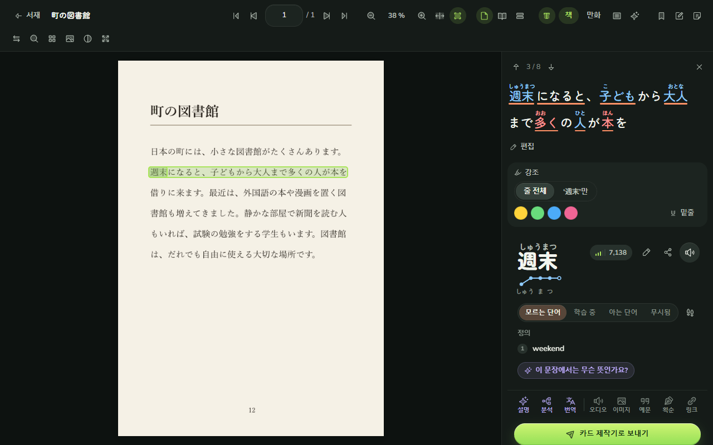
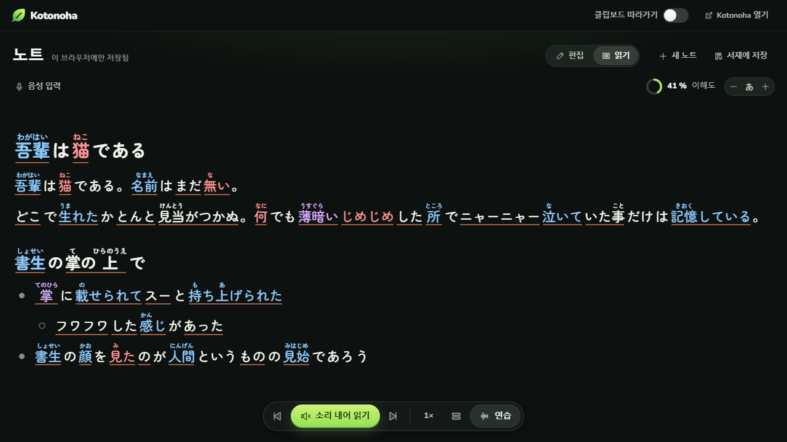
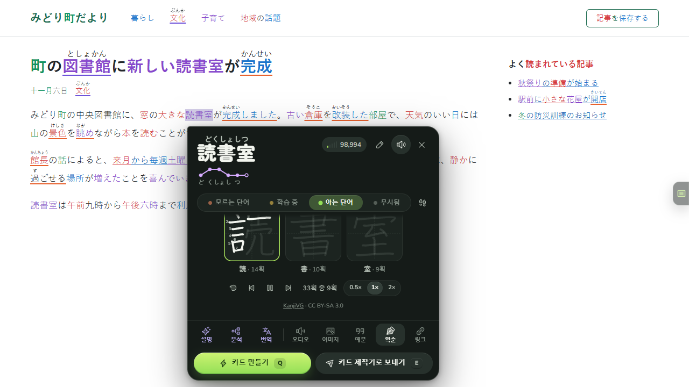
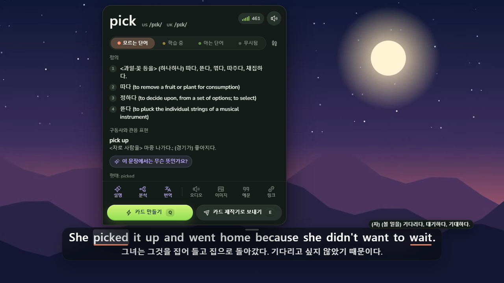
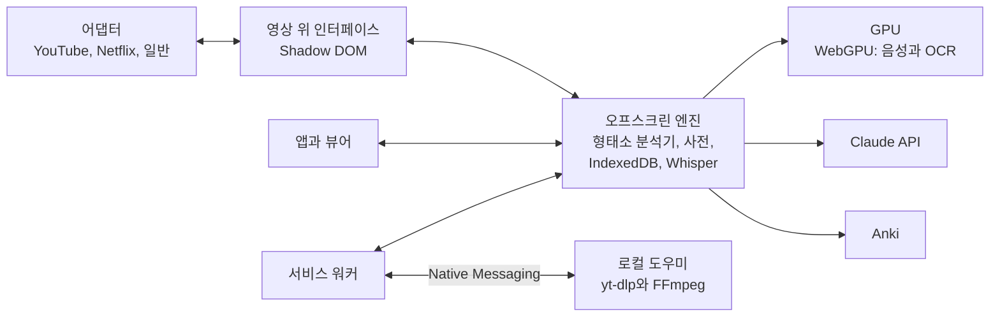

  

<h3 align="center">늘 보고 읽는 콘텐츠로 일본어와 영어를 배우세요.</h3>

  영상 위의 대화형 자막, 문장 속 뜻까지 알려 주는 단어 패널, 책·PDF·만화를 위한 읽기 도우미, 그리고 Anki용 카드. 모두 브라우저 안에서, 무료 오픈 소스로 동작합니다.

  
  
  
  

  
  
  
  
  
  

  <a href="https://github.com/Eliam4510/kotonoha/releases/latest"><b>다운로드</b></a> ·
  <a href="#설치">설치</a> ·
  <a href="docs/ko/guide.md">사용 안내</a> ·
  <a href="docs/ko/features.md">전체 기능</a> ·
  <a href="CHANGELOG.md">새로운 기능</a> ·
  <a href="CONTRIBUTING.md">기여하기</a>

## Kotonoha란

Kotonoha(言の葉, '말의 잎')는 Chrome과 Edge용 확장 프로그램으로, 이미 보고 읽는 것을 학습 자료로 바꿔 줍니다. YouTube와 Netflix의 드라마와 영상, 기사, 채팅, 책과 만화까지요. 모든 단어에 읽는 법과 얼마나 알고 있는지가 표시되고, 단어를 누르면 뜻, 바로 그 문장에서의 의미, 카드를 만드는 버튼이 담긴 패널이 열립니다.

모든 것이 내 컴퓨터에서 실행됩니다. 사전, 텍스트 분석, 음성 받아쓰기, 책 페이지의 문자 인식은 브라우저 밖으로 나가지 않습니다. Anthropic의 Claude는 설명이나 번역을 요청할 때만 쓰이며, 요청마다 비용이 기록됩니다.

<table>
  <tr><td><b>보기</b></td><td>YouTube, Netflix, Disney+, Crunchyroll, Prime Video와 내 파일에서 후리가나, 높낮이 악센트, 단어별 학습 상태가 표시되는 자막.</td></tr>
  <tr><td><b>읽기</b></td><td>모든 웹페이지, 복사한 내용, 스캔본과 이미지 폴더를 포함한 EPUB, PDF, 만화.</td></tr>
  <tr><td><b>기억하기</b></td><td>장면의 오디오와 이미지가 담긴 카드를 클릭 한 번으로 Anki나 내장 복습에 보냅니다.</td></tr>
  <tr><td><b>언어</b></td><td>일본어, 영어, 독일어를 배울 수 있습니다. 인터페이스는 한국어, 영어, 스페인어, 독일어, 중국어, 일본어로 제공됩니다.</td></tr>
</table>

## Kotonoha로 배우는 방법

아는 단어로 표시한 단어는 어디서든 강조가 사라지고, 각 영상이나 글의 이해도도 그만큼 올라갑니다.

## 둘러보기

### 제대로 읽을 수 있는 자막

플레이어 위에 후리가나, 높낮이 악센트별 색, 단어마다 학습 상태(모르는 단어, 학습 중, 아는 단어)를 나타내는 밑줄이 있는 자막이 나타납니다. 마우스를 올리면 사전이 담긴 단어 패널이 무료로 열립니다. Claude는 그림 속 食べる처럼 비유적이거나 시적인 쓰임이라도 그 문장에서의 뜻을 알려 줍니다.

- `Q`를 누르면 문장, 오디오, 영상 프레임으로 카드를 만들어 Anki나 내장 복습으로 바로 보냅니다.
- `A`와 `D`로 대사 사이를 이동하고 `S`로 현재 대사를 반복합니다. 자막 탐색기(`G`)는 모든 대사를 필터와 북마크와 함께 보여 줍니다.
- 자막을 내 언어로 번역하고, 자동 생성 자막은 제목과 전체 대본을 맥락 삼아 바로잡습니다.
- 자막이 없는 영상은 내 컴퓨터의 그래픽카드로 받아쓰기합니다. 30분짜리 영상이 약 1분이면 끝납니다.

### 모든 웹페이지

뉴스, 블로그, 위키, Claude 같은 채팅에서도 일본어 텍스트에 같은 색과 후리가나가 붙고, 단어를 클릭하면 단어 패널이 열립니다. 페이지 내용은 바뀌지 않습니다. 링크와 버튼은 그대로 작동하고 React로 만든 사이트도 알아채지 못합니다. 실제 사이트 약 서른 곳에서 시험했습니다.

### 책, PDF, 만화

**읽기 도우미**는 PDF 리더처럼 완전한 뷰어입니다. 확대·축소, 두 쪽 보기, 연속 스크롤, 목차, 썸네일을 갖추고 책마다 읽던 페이지를 기억합니다. 소설 같은 텍스트 EPUB은 원래의 서식, 루비, 세로쓰기를 그대로 살리고, 그 위에 페이지 리더가 웹에서처럼 색, 후리가나, 단어 패널을 더합니다. 텍스트가 들어 있는 PDF는 곧바로 단어 단위로 읽을 수 있습니다. 이미지 폴더로 된 만화는 폴더를 고르기만 하면 들어오며, 권마다 책 한 권이 되고 표지가 맨 앞에, 컬러 두 쪽 그림은 통째로 보입니다.

만화, 스캔한 책, 많은 PDF처럼 이미지로 된 페이지는 내 컴퓨터의 그래픽카드로 문자 인식(OCR)을 합니다. 인쇄된 책을 위한 모드와 만화를 위한 모드가 있으며, 만화 모드는 세로쓰기 말풍선을 읽으면서 후리가나를 본문과 섞지 않습니다. 페이지에서 단어를 누르면 후리가나가 붙은 그 줄과 단어 패널이 열립니다. 각 페이지는 한 번만 인식하고 저장합니다.

### 구조를 살린 복사한 내용

**클립보드**는 어디서 복사한 내용이든 모아서 문단, 제목, 목록, 표를 살린 채 분석하고 후리가나를 붙여 보여 줍니다. 일반 탭으로 열 수 있고, 브라우저의 분할 화면에서 읽고 있는 페이지 옆에 둘 수도 있으며, 텍스트를 소리 내어 읽어 줍니다.

### 한자를 쓰는 순서

단어 패널은 단어에 든 한자 하나하나의 획순을 번호와 함께 한 획씩 반복해서 보여 줍니다.

### 영어도 배울 수 있습니다

영어에서는 단어 패널이 미국식과 영국식 발음을 IPA로 보여 주고, *picked it up*처럼 떨어져 있는 구동사도 찾아내며, 불규칙형이 어느 단어에서 왔는지 알려 줍니다. 사전은 Wiktionary에서 가져오며 뜻은 한국어로 나옵니다. 언어마다 단어, 카드, 설정을 따로 보관하고 클릭 한 번으로 전환합니다.

### 그 밖에

- **한눈에 보이는 비용.** 홈 화면에 이번 달 Claude 비용이 날짜, 모델, 작업별로 표시되고 월 한도도 정할 수 있습니다. 같은 답에 두 번 돈을 내지 않도록 모든 답을 저장합니다. [비용 연구](docs/ko/costs.md)에 측정한 수치가 있습니다.
- **내장 복습.** Anki를 쓰지 않는 분을 위한 FSRS 알고리즘 기반 복습.
- **내 파일.** 컴퓨터에 있는 영상을 재생하고 MKV에 든 자막을 읽습니다.
- **맞춤 설정.** 색각 이상과 고대비를 위한 색, 가나 또는 로마자 읽기, 바꿀 수 있는 단축키, 동작하지 않을 사이트.

## Claude 없이 되는 것, Claude로 더해지는 것

Kotonoha는 키 없이도 동작합니다. 선택 사항인 Claude 키를 넣으면 언어 모델이 필요한 기능이 더해집니다.

| 키 없이, 무료 | Claude 키로, 사용한 만큼 |
|---|---|
| 후리가나, 높낮이 악센트, 학습 상태가 표시되는 자막 | 문장 속 단어의 뜻 |
| 사전, 단어 패널, 획순, 발음 | 단어, 문장, 문법 설명 |
| 페이지 리더, 클립보드, OCR을 갖춘 읽기 도우미 | 자막 번역과 교정 |
| 내 컴퓨터에서 하는 음성 받아쓰기 | 후리가나 읽기 검토 |
| Anki 카드와 내장 복습 | 수준에 맞춘 이야기 |

보통의 사용이라면 한 달에 몇 센트 정도입니다. 키는 브라우저에만 저장됩니다.

## 설치

요구 사항: Chrome 또는 Edge 120 이상.

1. [최신 버전](https://github.com/Eliam4510/kotonoha/releases/latest)에서 `kotonoha-<버전>-extension.zip`을 내려받아 계속 둘 위치에 압축을 풉니다.
2. `chrome://extensions` 또는 `edge://extensions`를 열고 **개발자 모드**를 켭니다.
3. **압축해제된 확장 프로그램을 로드합니다**를 누르고 `kotonoha` 폴더를 선택합니다.

처음 실행하면 환영 화면이 사용하는 언어, 배우려는 언어, 수준을 묻고 사전을 설치합니다. 업데이트할 때는 새 버전을 이전 버전 위에 압축을 풀기만 하면 확장 프로그램이 알아서 다시 로드됩니다. [사용 안내](docs/ko/guide.md)에서 모든 기능을, [CONTRIBUTING.md](CONTRIBUTING.md)에서 소스 코드로 빌드하는 방법을 볼 수 있습니다.

## 주요 단축키

| 단축키 | 동작 |
|---|---|
| `Q` | 문장으로 카드 만들기 |
| `E` | 카드 제작기로 보내기 |
| `1`~`4` | 단어 표시: 모르는 단어, 추적, 아는 단어, 무시 |
| `A`, `D`, `S` | 이전 문장, 다음 문장, 반복 |
| `G` | 자막 탐색기 |
| `Alt+Shift+K` | Kotonoha 창 열기 |

영상 위의 모든 단축키는 바꿀 수 있고, 어떤 키보드 배열에서도 동작합니다.

## 개인정보

- 데이터와 Claude 키는 브라우저에만 저장됩니다. 자체 서버도, 사용 통계 수집도 없습니다.
- 받아쓰기한 오디오와 인식한 페이지는 컴퓨터 밖으로 나가지 않습니다.
- Claude에는 요청마다 필요한 내용만 보냅니다. 문장, 자막 대본, 제목입니다.
- 사전과 모델은 GitHub와 Hugging Face에서 한 번만 내려받습니다. [고지](docs/ko/notices.md)에 모든 출처가 있습니다.

## 아키텍처

TypeScript, Preact, Dexie, esbuild를 쓰며, 음성과 OCR에는 WebGPU 위의 ONNX Runtime과 Transformers.js를 사용합니다. 각 부분과 기술적 결정, 성능 측정은 [docs/ko/architecture.md](docs/ko/architecture.md)에 있습니다. 750개가 넘는 단위 테스트가 핵심 로직을, 엔드투엔드 테스트가 실제 Edge와 GPU에서 주요 흐름을 검증합니다. 실행 방법은 [CONTRIBUTING.md](CONTRIBUTING.md)에 있습니다.

## 프로젝트 상태

모든 버전은 테스트와 6개 언어 문서와 함께 나오며, [새로운 기능](CHANGELOG.md)에 버전별 요약이 있습니다. YouTube와 영어는 실제 세션에서 직접 확인하기도 했습니다. 인터페이스 번역은 AI의 도움을 받아 작성했으며 아직 원어민 검토를 거치지 않았습니다. 수정 제안을 환영합니다.

## 라이선스와 크레디트

코드는 [MIT 라이선스](LICENSE)로 공개합니다. 서드파티 구성 요소, 사용 중 내려받는 데이터, 책임 있는 사용 조건은 [고지](docs/ko/notices.md)에 자세히 있습니다.

- 사전: [JMdict](https://www.edrdg.org/jmdict/j_jmdict.html)(EDRDG), [Kanjium](https://github.com/mifunetoshiro/kanjium), [JPDB](https://jpdb.io). 영어와 독일어는 [wiktionary-to-yomitan](https://github.com/yomidevs/wiktionary-to-yomitan)과 [kaikki.org](https://kaikki.org)를 거친 [Wiktionary](https://www.wiktionary.org).
- 음성: [Whisper large-v3-turbo](https://huggingface.co/onnx-community/whisper-large-v3-turbo), Haas-ja, Parakeet과 [Transformers.js](https://github.com/huggingface/transformers.js).
- 문자 인식: [PP-OCRv5](https://github.com/PaddlePaddle/PaddleOCR), [manga-ocr](https://github.com/kha-white/manga-ocr), [말풍선 검출기](https://huggingface.co/ogkalu/comic-text-and-bubble-detector).
- 획순: Ulrich Apel의 [KanjiVG](https://kanjivg.tagaini.net), CC BY-SA 3.0.
- 아이콘: [Phosphor](https://phosphoricons.com). 글꼴: [Zen Maru Gothic](https://fonts.google.com/specimen/Zen+Maru+Gothic), [Nunito](https://fonts.google.com/specimen/Nunito).

이름은 『고킨와카슈』 가나 서문(905년경)에서 왔습니다. 일본의 노래는 사람의 마음을 씨앗으로 삼아 수많은 말의 잎이 되었다는 구절입니다.

독립 프로젝트이며, 언급된 어떤 서비스와도 관련이 없습니다.
