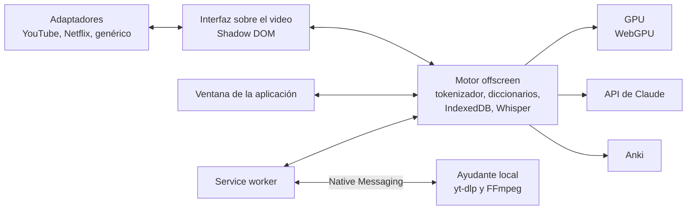

<p align="center">
  
</p>

<p align="center">
  
  
  
  
  <a href="LICENSE"></a>
</p>

<p align="center">
  <a href="README.md"></a>
  <a href="README.en.md"></a>
  
  <a href="https://github.com/Eliam4510/kotonoha/actions/workflows/ci.yml"></a>
  
  
</p>

<p align="center">
  <b>Extensión de navegador para aprender japonés con video y texto real.</b>
</p>

<p align="center">
  <a href="#instalación">Instalación</a> ·
  <a href="docs/guia.md">Guía de uso</a> ·
  <a href="docs/funciones.md">Funciones</a> ·
  <a href="docs/arquitectura.md">Arquitectura</a> ·
  <a href="docs/costos.md">Costos</a> ·
  <a href="AVISOS.md">Avisos</a>
</p>

<p align="center">
  
</p>

## Descripción

Kotonoha (言の葉, «hojas de palabras») superpone subtítulos interactivos sobre YouTube, Netflix y otros reproductores. Cada palabra muestra su furigana, su acento tonal y lo que se sabe de ella, y al pasar el ratón abre su entrada de diccionario, sin ningún coste. Un botón le pregunta a Claude qué significa en esa frase concreta. La extensión añade un diccionario, la creación de tarjetas para Anki o para un repaso integrado, y explicaciones en contexto generadas con la API de Claude. También funciona sobre páginas web, textos, libros EPUB y archivos de video propios.

El nombre procede del prólogo del *Kokin Wakashū* (c. 905): la poesía de Japón tiene por semilla el corazón humano, y de él brotan miríadas de hojas de palabras.

## Funciones

<table>
  <tr>
    <td width="33%" align="center"></td>
    <td width="33%" align="center"></td>
    <td width="33%" align="center"></td>
  </tr>
  <tr>
    <td valign="top"><b>Subtítulos para leer de verdad</b><br>Furigana, color por acento tonal, subrayado por estado de aprendizaje y puntos de gramática JLPT, con un porcentaje de comprensión estimado para cada video.</td>
    <td valign="top"><b>Diccionario primero, Claude si se pide</b><br>La ficha abre con el diccionario. Un botón le pregunta a Claude el sentido real de la palabra en esa frase, incluidos los usos figurados y literarios. También revisa las lecturas del furigana a medida que avanza el video.</td>
    <td valign="top"><b>Navegador de subtítulos</b><br>Todas las líneas a la vista, con filtros, marcadores, selección múltiple y sincronización con una o dos marcas. Las líneas corregidas conservan su texto original.</td>
  </tr>
  <tr>
    <td width="33%" align="center"></td>
    <td width="33%" align="center"></td>
    <td width="33%" align="center"></td>
  </tr>
  <tr>
    <td valign="top"><b>Traducir y corregir con Claude</b><br>Traducción al idioma de apoyo, empezando por el tramo que se está viendo. Corrección automática de los homófonos de los subtítulos generados, con el título y todo el texto como contexto, sin preguntar nada.</td>
    <td valign="top"><b>SRT de ida y vuelta</b><br>Importación y exportación en cualquier sitio: SRT, VTT, ASS y TTML. Lo importado queda guardado para ese título, y los subtítulos en japonés de Netflix se conservan aunque otra región no los ofrezca.</td>
    <td valign="top"><b>Transcripción local</b><br>Whisper en la tarjeta gráfica mediante WebGPU, sin que el audio salga del equipo: 30 minutos de video en unos 5, sin trabar el escritorio. Trabaja por tramos con descansos y se recupera si el controlador se reinicia.</td>
  </tr>
  <tr>
    <td width="33%" align="center"></td>
    <td width="33%" align="center"></td>
    <td width="33%" align="center"></td>
  </tr>
  <tr>
    <td valign="top"><b>El gasto a la vista</b><br>La pantalla de inicio muestra lo gastado este mes en Claude, con una gráfica por días y modelos, en qué tareas se fue y un registro de cada petición, con sus tokens. El <a href="docs/costos.md">estudio de costos</a> da cifras medidas.</td>
    <td valign="top"><b>Nada se paga dos veces</b><br>Cada respuesta se guarda por palabra y frase. Ir y venir entre palabras no gasta nada, y una respuesta interrumpida se termina y se guarda en lugar de perderse.</td>
    <td valign="top"><b>Subtítulos donde se quieran</b><br>Se arrastran desde cualquier punto a la altura y el lado que se prefiera, con imanes al centro y a su sitio. Cambian de línea sin parpadeos y acompañan al video al desplazar la página.</td>
  </tr>
  <tr>
    <td width="33%" align="center"></td>
    <td width="33%" align="center"></td>
    <td width="33%" align="center"></td>
  </tr>
  <tr>
    <td valign="top"><b>Aplicación completa</b><br>Inicio, diccionario con formas conjugadas, explorador de palabras por estado, evaluación de nivel, ajustes por tarea y prompts editables. Tema claro y oscuro.</td>
    <td valign="top"><b>Tarjetas de un clic</b><br>Con el audio y el fotograma del video, directas a Anki mediante AnkiConnect o al repaso integrado con FSRS.</td>
    <td valign="top"><b>Más allá del video</b><br>Consulta con <code>Shift</code> en cualquier página sin modificar su contenido, lector de texto, biblioteca EPUB, relatos a medida del nivel y reproductor de archivos propios con subtítulos de MKV.</td>
  </tr>
</table>

La lista completa, con la forma en que se verificó cada función, está en [docs/funciones.md](docs/funciones.md).

## Instalación

Requisito: Chrome o Edge 120 o posterior.

### Versión compilada

1. Descargar `kotonoha-<versión>-extension.zip` desde [Releases](https://github.com/Eliam4510/kotonoha/releases/latest).
2. Descomprimirlo en un sitio definitivo. Crea la carpeta `kotonoha`. El navegador deriva de esa ruta el identificador de la extensión, y con él guarda los datos: cambiarla de sitio equivale a empezar de cero.
3. Abrir `chrome://extensions` o `edge://extensions`.
4. Activar el modo de desarrollador.
5. Pulsar «Cargar descomprimida» y elegir la carpeta `kotonoha`.

Para actualizar, basta con descomprimir la versión nueva en el mismo sitio, encima de la anterior: la extensión lo detecta y se recarga sola en menos de un minuto, salvo que tenga un trabajo en marcha. Las pestañas abiertas avisan de que hay que recargarlas.

Si ya se usa una copia cargada desde otra carpeta, no conviene cargar esta a la vez: las dos actuarían sobre las mismas páginas.

### Desde el código

Requiere además Node.js 22 o posterior.

```bash
git clone https://github.com/Eliam4510/kotonoha.git
```

```bash
cd kotonoha
```

```bash
npm install
```

```bash
npm run build
```

Después se carga la carpeta `dist` igual que en los pasos anteriores. Al volver a compilar, la extensión detecta el cambio y se recarga sola. Una copia anterior a la versión 0.1.1 no sabe hacerlo: necesita que se pulse «Recargar» una vez.

## Primeros pasos

En **Ajustes**, dentro de la ventana de la extensión (`Alt+Shift+W`):

1. Instalar los diccionarios: JMdict en español e inglés, acento tonal y frecuencia.
2. Añadir una clave de la API de Claude, que se guarda solo en el navegador. Es opcional: sin ella funcionan los subtítulos, el diccionario, las tarjetas y Whisper.
3. Conectar con Anki, si se usa, mediante el complemento AnkiConnect.

Con eso, al abrir un video con subtítulos en japonés aparece la barra de Kotonoha. La [guía de uso](docs/guia.md) explica el resto.

### Ayudante para transcribir videos de internet

Es opcional. Sin él, un video de internet solo puede transcribirse mientras se reproduce. Con él, se transcribe entero sin reproducirlo. Es un programa local con [yt-dlp](https://github.com/yt-dlp/yt-dlp) y FFmpeg, al que solo la extensión puede llamar. Requiere Python y FFmpeg en Windows, y no se usa nunca en Netflix.

```bash
powershell -ExecutionPolicy Bypass -File herramientas\ayudante\instalar.ps1
```

Con la versión compilada se descarga aparte, en `kotonoha-<versión>-ayudante.zip`. Su archivo `LEEME.txt` explica la instalación, en la que hay que indicar el identificador de la extensión con `-Extension`.

## Atajos principales

| Atajo | Acción |
|---|---|
| `Q` | Crear una tarjeta de un clic |
| `E` | Enviar al creador de tarjetas |
| `N` | Ir a la siguiente palabra desconocida |
| `1` a `4` | Marcar la palabra: desconocida, rastreada, conocida, ignorada |
| `A`, `D` | Frase anterior y siguiente |
| `S` | Repetir la frase |
| `G` | Navegador de subtítulos |
| `Alt+R` | Permitir la captura de audio |
| `Shift` + ratón | Consultar una palabra en cualquier página |

## Rendimiento de la transcripción

Medido con una Radeon RX 9060 XT de 16 GB, 16 GB de RAM, un monitor 4K a 60 Hz y videos reales.

| Medida | Resultado |
|---|---|
| Velocidad en modo automático | 30 minutos de video en unos 5 minutos, entre 6,1 y 6,4 veces el tiempo real |
| Error por caracteres, en 126 frases reales | 8,8 % |
| Dos horas de audio seguidas | 19,7 minutos, sin reinicios del controlador y sin que crezca la memoria |
| Fluidez del escritorio durante la transcripción | Percentil 99 de 17,5 ms, sin fotogramas de más de 33 ms |
| Video a 1080p durante la transcripción | 0 fotogramas perdidos de 749 |

Las tablas completas, incluida la comparación de precisión entre modelos, están en [docs/arquitectura.md](docs/arquitectura.md#medidas-de-referencia).

## Arquitectura



El detalle de cada parte y de las decisiones técnicas está en [docs/arquitectura.md](docs/arquitectura.md).

## Desarrollo

```bash
npm run dev
```

```bash
npm test
```

```bash
npm run typecheck
```

```bash
npm run paquete
```

El último compila y deja en `release/` los ZIP de la extensión y del ayudante, con sus sumas SHA-256, listos para publicar.

| Prueba | Qué comprueba |
|---|---|
| `npm test` | La lógica pura de `src/nucleo` |
| `node pruebas/e2e.mjs` | La extensión de extremo a extremo en Edge |
| `node pruebas/subtitulos.mjs` | Traducir, corregir, exportar e importar, en páginas que imitan a Netflix y YouTube y con una API de Claude simulada |
| `node pruebas/experiencia.mjs` | Lo que se percibe sobre el video, fotograma a fotograma: parpadeos, temblores y arrastre. También cuenta las peticiones a Claude y comprueba el registro de gasto |
| `node pruebas/capturas.mjs` | Recorre todas las pantallas y guarda capturas |
| `node pruebas/tarjetas.mjs audio.wav` | Anki simulado, memoria y grabación |
| `node pruebas/captura-real.mjs` | El creador de tarjetas con la captura real de una pestaña: de qué tramo es el audio y qué sale en la imagen. Necesita un navegador visible y suena muy bajo |
| `node pruebas/medios.mjs audio.wav` | ffmpeg.wasm con un MKV de varias pistas |
| `node pruebas/ayudante.mjs video.mp4` | El ayudante local, con descarga desde el propio equipo |
| `node pruebas/ayudante-navegador.mjs video.mp4` | Todo el camino del ayudante, desde el panel hasta Whisper en la GPU |
| `node pruebas/whisper-comparar.mjs corpus` | Precisión de los modelos con frases reales |
| `node pruebas/whisper-carga.mjs video.mp4 pruebas/sonda-escritorio.ps1 turbo 0.75 9999` | Velocidad real y fluidez del escritorio |
| `node pruebas/whisper-larga.mjs turbo 120 60 audio.pcm` | Dos horas seguidas, para detectar degradación |
| `node pruebas/whisper-recuperacion.mjs audio.pcm` | Pérdida de la GPU: esperar, seguir y detenerse al segundo fallo |

Las pruebas con navegador usan una compilación con identificador fijo, que se crea con `KK_SALIDA=.dist-subs node build.mjs`. El video de prueba se genera con `node pruebas/fixtures/generar-video.mjs`.

## Estado del proyecto

La versión 0.2.3 es la vigente. Las pruebas automáticas cubren los flujos principales con Edge real, con Whisper en una GPU real y con simuladores de la API de Claude y de AnkiConnect. Los sitios de video no sirven subtítulos a un navegador automatizado, de modo que YouTube y Netflix se prueban con páginas que imitan la estructura de su reproductor. YouTube se ha comprobado además a mano con una sesión real, y queda pendiente hacerlo con Netflix y una validación prolongada. La interfaz está en español.

## Privacidad

- La clave de la API de Claude y todos los datos se guardan solo en el navegador.
- El audio que transcribe Whisper no sale del equipo. Tampoco el audio de las tarjetas ni el fotograma, salvo que se envíen a Anki.
- A la API de Claude solo se envían los textos necesarios para cada tarea: la frase, el guion de los subtítulos y el título del video.
- Las búsquedas de audio e imágenes de palabras van directamente a JapanesePod101, Wikimedia Commons y Openverse.
- La extensión no tiene servidor propio ni recoge estadísticas de uso.

## Licencia y créditos

El código se publica bajo la [licencia MIT](LICENSE). Los componentes de terceros, los datos que se descargan al usarla y las condiciones de uso responsable se detallan en [AVISOS.md](AVISOS.md).

- Diccionarios: [JMdict](https://www.edrdg.org/jmdict/j_jmdict.html) (EDRDG), [Kanjium](https://github.com/mifunetoshiro/kanjium) y [JPDB](https://jpdb.io), en formato Yomitan.
- Transcripción: [Whisper large-v3-turbo](https://huggingface.co/onnx-community/whisper-large-v3-turbo) con [Transformers.js](https://github.com/huggingface/transformers.js).
- Iconos: [Phosphor](https://phosphoricons.com). Tipografía: [Zen Maru Gothic](https://fonts.google.com/specimen/Zen+Maru+Gothic) y [Nunito](https://fonts.google.com/specimen/Nunito).

Proyecto independiente, sin afiliación con los servicios mencionados.
