

  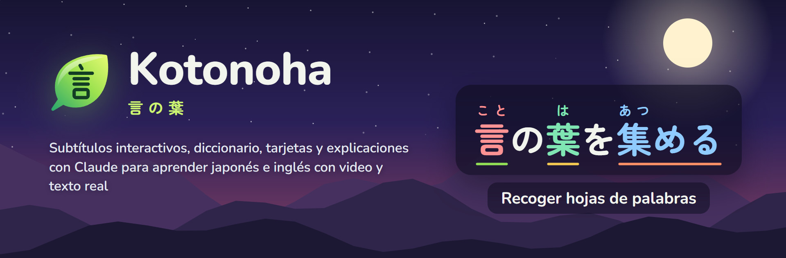

<h3 align="center">Aprende japonés, inglés y alemán con lo que ya ves y lees.</h3>

  Subtítulos interactivos sobre tus videos, una ficha que entiende cada palabra en su frase, libros, PDF y manga con ayuda de lectura, y tarjetas para Anki. Todo en el navegador, gratis y de código abierto.

  
  
  
  

  
  
  
  
  
  

  <a href="https://github.com/Eliam4510/kotonoha/releases/latest"><b>Descargar</b></a> ·
  <a href="#instalación">Instalación</a> ·
  <a href="docs/guia.md">Guía de uso</a> ·
  <a href="docs/funciones.md">Todas las funciones</a> ·
  <a href="CHANGELOG.md">Novedades</a> ·
  <a href="CONTRIBUTING.md">Contribuir</a>

  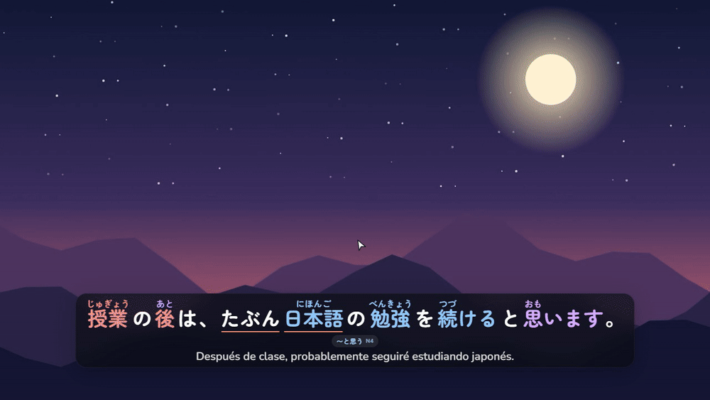

## Qué es Kotonoha

Kotonoha (言の葉, «hojas de palabras») es una extensión para Chrome y Edge que convierte lo que ya se ve y se lee en material de estudio: series y videos de YouTube o Netflix, artículos, chats, libros y mangas. Cada palabra muestra su lectura y lo que se sabe de ella, y al tocarla abre una ficha con su definición, su sentido en esa frase concreta y un botón para hacer una tarjeta.

Funciona en el propio equipo. El diccionario, el análisis, la transcripción de audio y el reconocimiento de texto de las páginas no salen del navegador. Claude, de Anthropic, solo interviene cuando se le pide una explicación o una traducción, y cada petición queda anotada con su coste.

<table>
  <tr><td><b>Ver</b></td><td>Subtítulos con furigana, acento tonal y el estado de cada palabra en YouTube, Netflix, Disney+, Crunchyroll, Prime Video y archivos propios.</td></tr>
  <tr><td><b>Leer</b></td><td>Cualquier página web, lo que se copia, y libros EPUB, PDF y manga, también escaneados o en carpetas de imágenes.</td></tr>
  <tr><td><b>Recordar</b></td><td>Tarjetas de un clic, con el audio y la imagen de la escena, para Anki o para el repaso integrado.</td></tr>
  <tr><td><b>Idiomas</b></td><td>Se estudia japonés, inglés o alemán. La interfaz está en español, inglés, alemán, chino, coreano y japonés.</td></tr>
</table>

## Cómo se aprende con Kotonoha

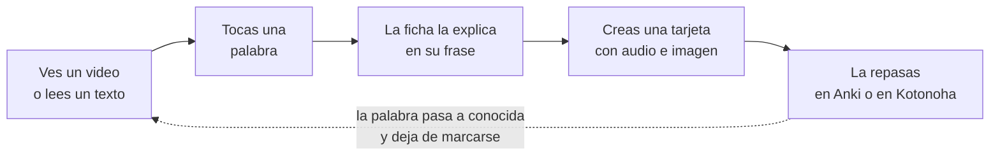

Cada palabra que se marca como conocida deja de resaltarse en todas partes, y el porcentaje de comprensión de cada video o texto sube con ella.

## Recorrido

### Subtítulos que se pueden leer

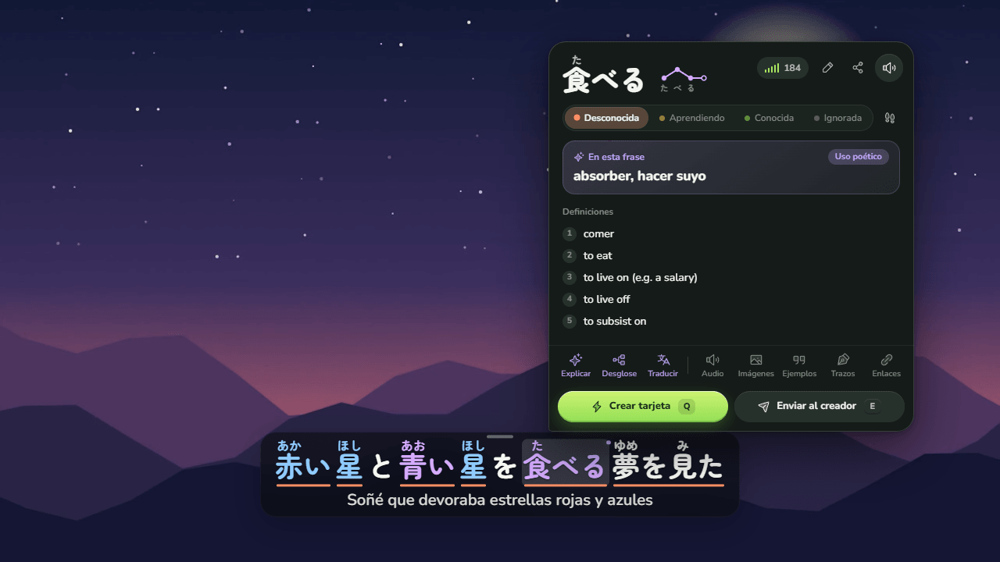

Sobre el reproductor aparecen los subtítulos con furigana, un color por acento tonal y un subrayado según el estado de cada palabra: nueva, en aprendizaje o conocida. Al pasar el ratón se abre la ficha con el diccionario, sin ningún coste. Claude añade el sentido de la palabra en esa frase, aunque sea figurado o poético, como el 食べる de la imagen.

- Una tarjeta con la frase, su audio y el fotograma se crea con `Q`, directa a Anki o al repaso integrado.
- Las líneas se recorren con `A` y `D`, y `S` repite la actual. El navegador de subtítulos (`G`) las muestra todas, con filtros y marcadores.
- Los subtítulos se traducen al idioma propio, y los automáticos se corrigen con el título y todo el guion como contexto.
- Lo que no trae subtítulos se transcribe en el propio equipo, con la tarjeta gráfica: 30 minutos de video en alrededor de un minuto.

### Cualquier página web

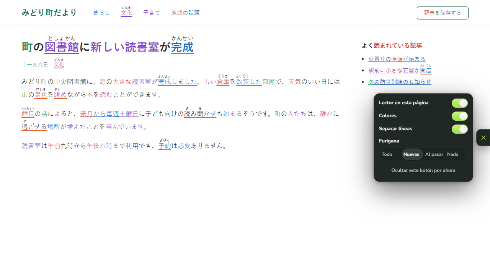

En noticias, blogs, wikis o en un chat como el de Claude, el texto japonés recibe los mismos colores y el mismo furigana, y un clic en una palabra abre su ficha. No cambia el contenido de la página: los enlaces y los botones siguen funcionando, y los sitios hechos con React no notan nada. Se ha probado en una treintena de sitios reales.

### Libros, PDF y manga

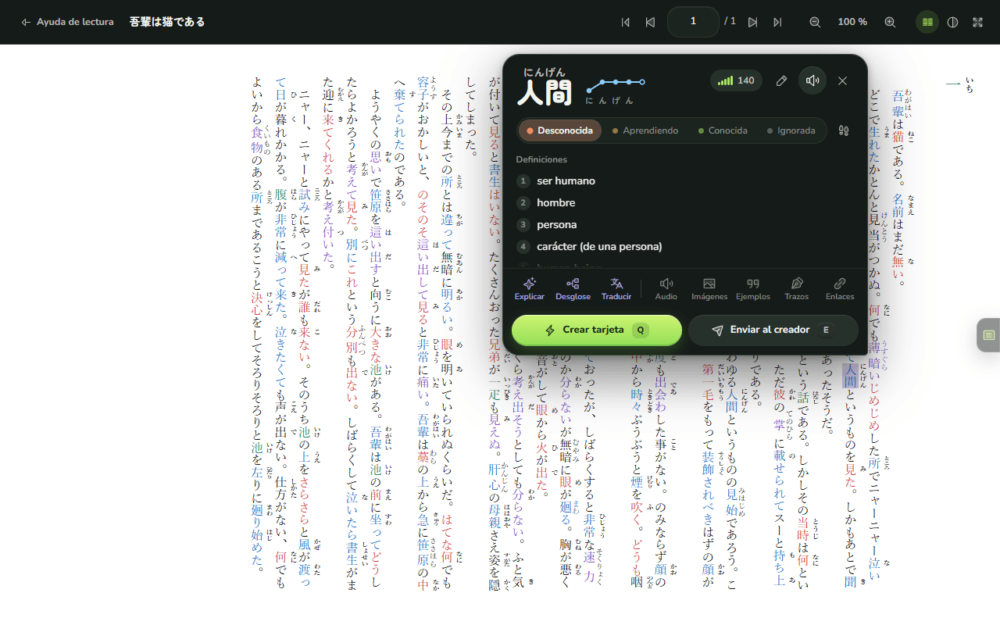

La **Ayuda de lectura** es un visor completo, como un lector de PDF: zoom, doble página, desplazamiento continuo, índice, miniaturas y la página donde se dejó cada libro. Un EPUB de texto, como una novela, se ve con su propio formato, su ruby y su escritura vertical, y con el lector de páginas encima: colores, furigana y fichas, como en una web. Un PDF que trae su texto se lee palabra a palabra sin hacer nada más. El manga que viene en carpetas de imágenes entra eligiendo la carpeta: cada tomo es un libro, con su portada delante y las dobles páginas a color enteras. La estantería agrupa los libros en colecciones, como una serie con sus tomos, con su portada y una descripción, y muestra cuánto se ha leído de cada libro y de cada colección. En el visor se marcan páginas, se resalta o subraya el texto con un comentario y se dejan notas sobre la página, como en un lector de PDF. Se busca una palabra en todo el libro, cada página se puede leer como texto, con la ayuda de lectura, y Claude puede revisar el texto que leyó el OCR comparándolo con la imagen de la página.

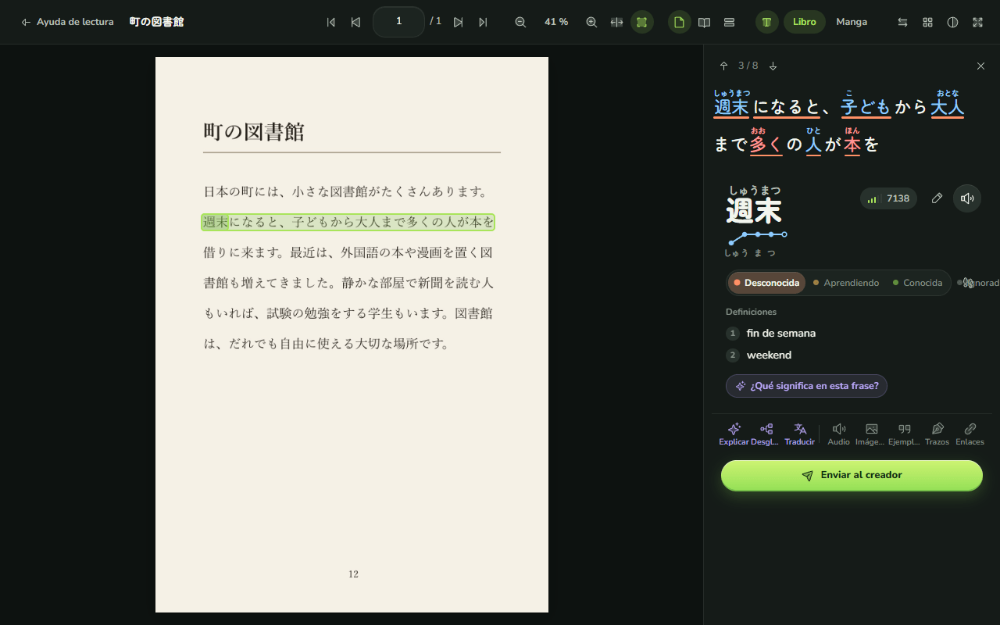

Las páginas que son imágenes, como los mangas, los libros escaneados y muchos PDF, se leen con reconocimiento de texto (OCR) en el propio equipo y con la tarjeta gráfica. Hay un modo para libros impresos y otro para manga, que lee los globos de texto vertical sin confundir el furigana con el texto. Al tocar una palabra en la página se abre su línea con furigana y su ficha. Cada página se lee una sola vez y queda guardada.

### Un cuaderno para escribir y leer

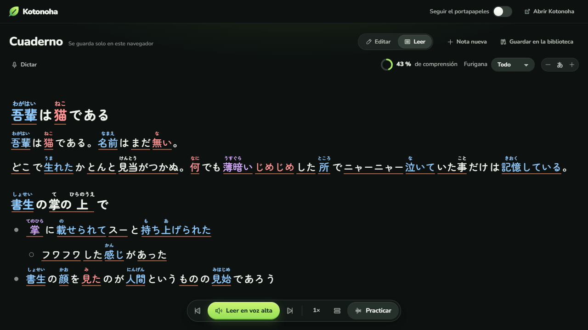

El **Cuaderno** es una página a todo lo ancho para escribir y pegar texto en la lengua que estudias, con títulos, listas y citas, y leerlo analizado y con furigana. **Organizar** le pone estructura a un texto pegado de corrido sin cambiar sus palabras, y cada nota se guarda en la biblioteca. Lee en voz alta a la velocidad que elijas, todo seguido, frase a frase o repitiendo una frase, y cualquier trozo seleccionado se escucha o se practica. También se le puede dictar: lo dicho al micrófono se transcribe en el equipo y entra como un párrafo más, con su grabación. Se abre además en una pestaña normal, en la vista dividida junto a la página que se esté leyendo, y recoge lo que copias en cualquier sitio.

### El acento, en voz alta

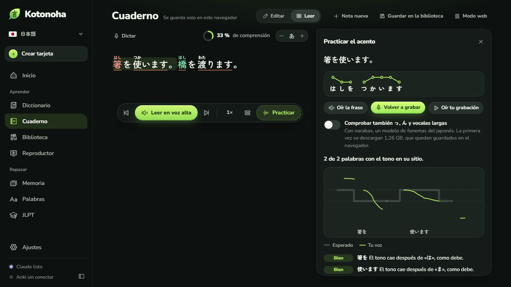

**Practicar** enseña el acento de cada palabra de la frase. Se lee en voz alta y Kotonoha pone la curva del tono de la voz sobre la esperada, dice en qué palabras cae el tono en otro sitio, señala las pausas largas y, si se quiere, las っ, ん y vocales largas que faltan o sobran. El tono se mide en el navegador y la grabación se transcribe en el equipo, sin salir de él. Con AivisSpeech o VOICEVOX abiertos, la voz modelo lee cada frase con el acento del diccionario, gratis y también sin salir del equipo.

### Dictado

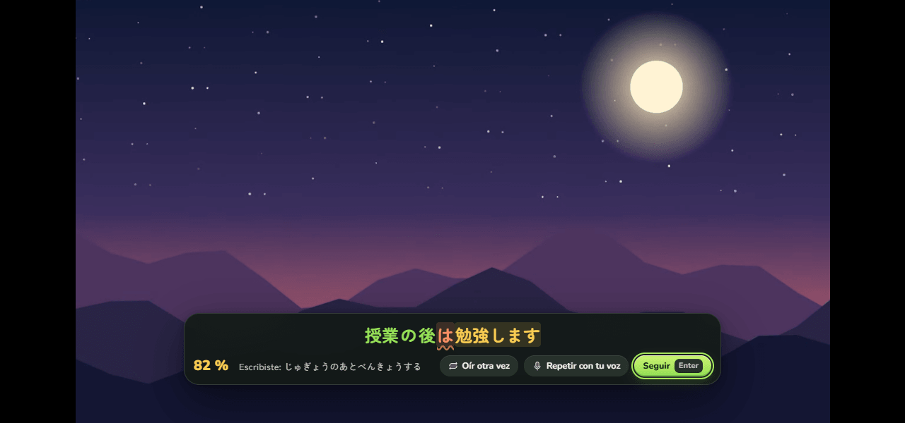

El modo **Dictado** oculta la frase mientras suena, pausa al terminarla y pide escribir lo que se oyó. Al comprobar, cada parte sale en verde si se oyó bien, en amarillo si a medias o subrayada si faltó, con la nota de la frase. En japonés se compara cómo se lee, así que vale escribir en kana. **Repetir con tu voz** abre la práctica del acento con esa misma frase, y `P` lo hace con cualquier subtítulo.

### La gramática que ya sabes

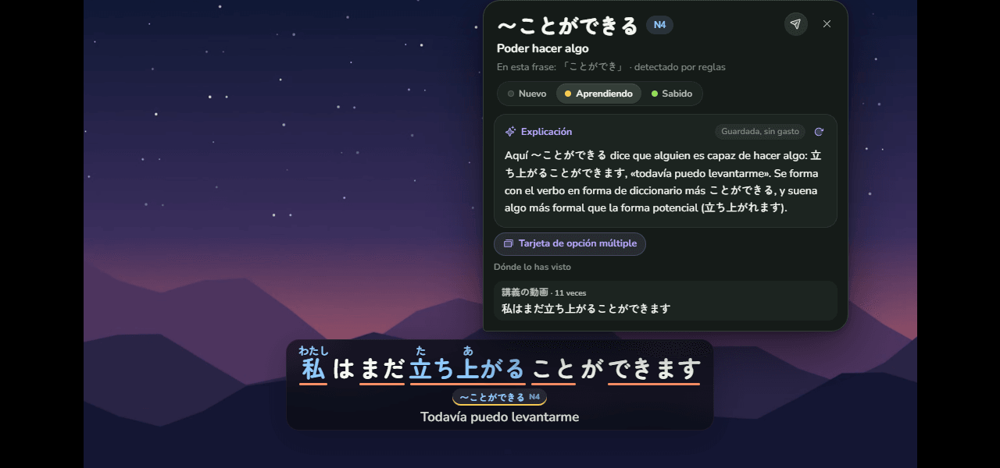

Bajo cada subtítulo salen los puntos de gramática que lleva la frase, con su nivel del JLPT. Al tocar uno se abre su globo: qué significa, la explicación de Claude para esa frase y dónde lo has visto antes. Cada punto se marca como **Nuevo**, **Aprendiendo** o **Sabido**; lo que se está aprendiendo lleva una raya amarilla y lo sabido deja de señalarse. Lo que ya se sabía se puede importar desde Anki, y **Tarjeta de opción múltiple** prepara una con tres opciones que se confunden con la buena.

### Cómo se escribe cada kanji

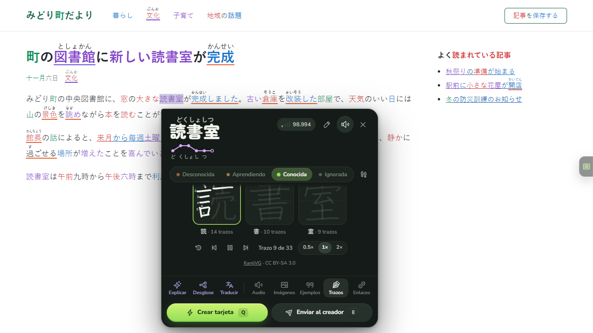

La ficha enseña el orden de los trazos de cada kanji de la palabra, uno a uno y en bucle, con sus números, y debajo, las palabras que ya conoces con ese mismo kanji.

### Para compartir lo que encuentras

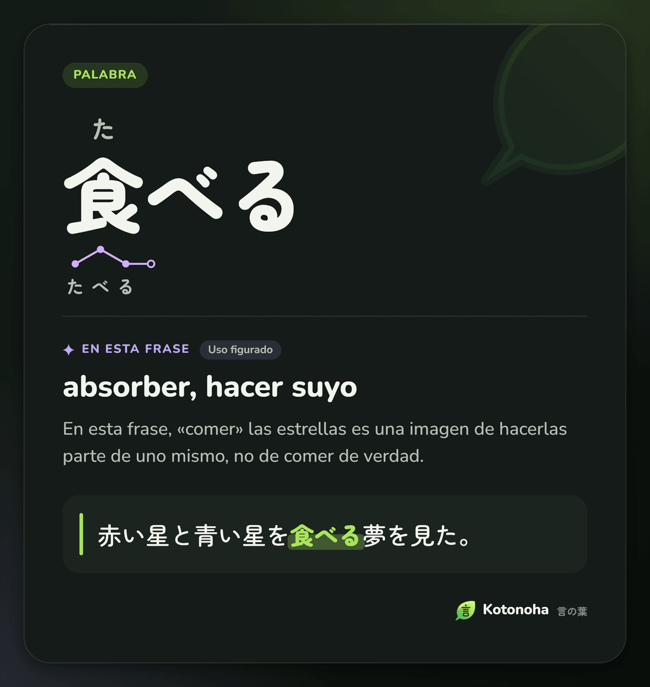

**Compartir como imagen**, en la ficha, convierte una palabra o un punto de gramática en una tarjeta con lo que significa en esa frase y la frase donde apareció, y la deja en el portapapeles para pegarla en cualquier chat con Ctrl+V. Sale en tinta o en papel, como los temas.

### El JLPT, nivel a nivel

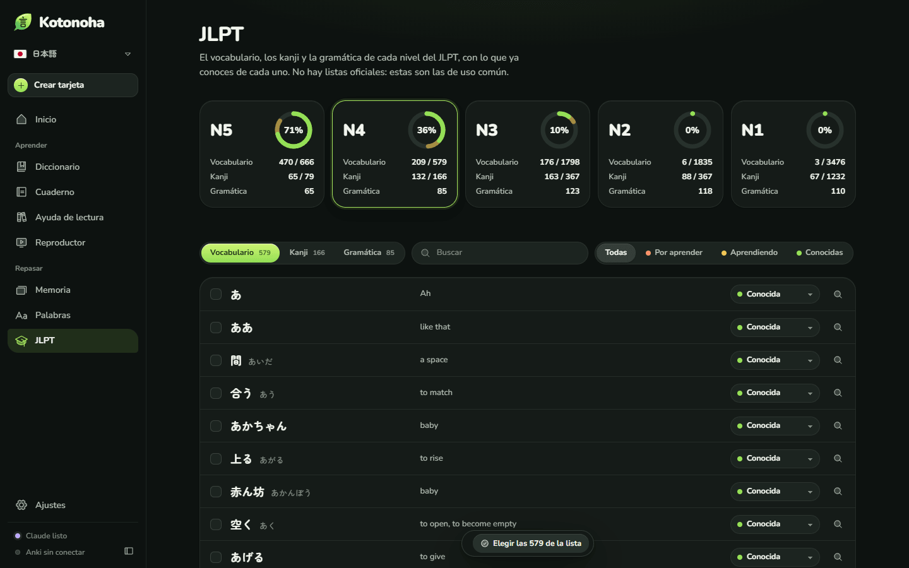

La pantalla **JLPT** reúne el vocabulario, los kanji y la gramática de cada nivel, de N5 a N1, y dice cuánto se conoce ya de cada uno, a partir de las palabras marcadas mientras se ve y se lee. Las que ya se saben se marcan de una vez, cada kanji enseña sus trazos y las palabras que lo llevan, y cada punto de gramática, las frases vistas en que apareció.

### Un diccionario para explorar

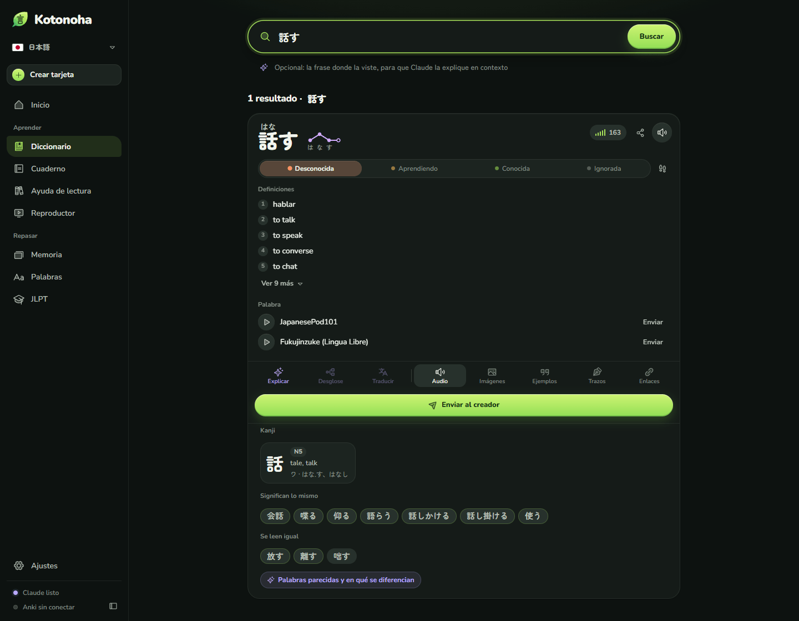

El diccionario busca también por significado, como «perro» → 犬, y encuentra la gramática por su forma o por su sentido. Debajo de cada palabra están sus kanji con su nivel; **Significan lo mismo**, con las de uso común del mismo significado, como 喋る o 会話 para 話す, y las que se leen igual, como 離す y 放す. Claude explica en qué se diferencian cuando se le pide. La portada reúne onomatopeyas, refranes, expresiones de cuatro kanji y palabras literarias, coloquiales y respetuosas.

### Inglés y alemán

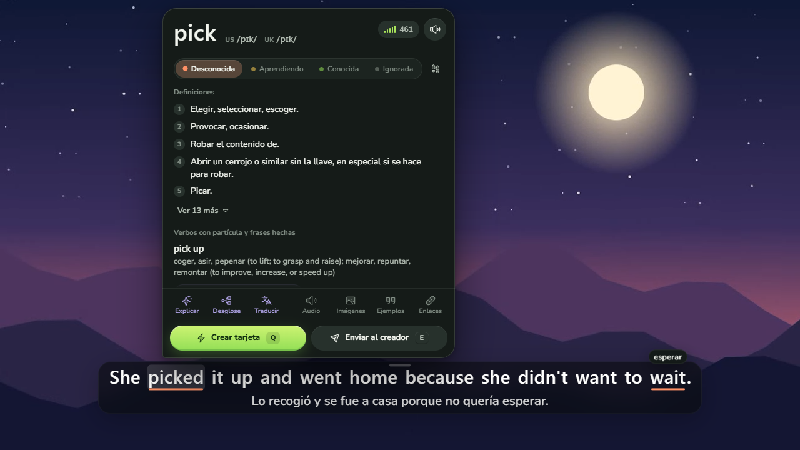

En inglés, la ficha da la pronunciación americana y británica en IPA, encuentra los verbos con partícula aunque vayan separados, como *picked it up*, y dice de qué palabra viene cada forma irregular. En alemán, dice de qué palabra sale cada forma conjugada o declinada, como *ging* de *gehen*, y encuentra los verbos separables aunque la partícula vaya al final. Los diccionarios salen de Wiktionary, en el idioma propio. Los cómics se leen globo a globo, de izquierda a derecha, y las frases suenan con voces neuronales en el propio equipo: Kokoro en inglés y Piper en alemán. Cada idioma guarda sus propias palabras, tarjetas y ajustes, y se cambia de uno a otro con un clic.

### Y además

- **Cómo suena de verdad el inglés.** La ficha enseña la frase como se dice al hablar seguido: *going to* → *gonna*, *meet you* → *meechu*, *turn off* → *tur‿noff*, con lo que pasa en cada caso.
- **Horas de inmersión.** Inicio cuenta el tiempo que escuchas y lees la lengua que estudias, con la racha de días seguidos.
- **El gasto, a la vista.** La pantalla de inicio muestra lo gastado este mes en Claude, por días, modelos y tareas, con un tope mensual. Nada se paga dos veces: cada respuesta se guarda. El [estudio de costos](docs/costos.md) da cifras medidas.
- **Repaso integrado.** Con el algoritmo FSRS, para quien no usa Anki.
- **Archivos propios.** Un reproductor para videos del equipo, con los subtítulos que traiga el MKV.
- **A medida.** Colores para daltonismo y de alto contraste, lecturas en kana o rōmaji, atajos que se pueden cambiar y sitios donde no actuar.

## Qué hace sin Claude, y qué con Claude

Kotonoha funciona sin ninguna clave. La de Claude, opcional, añade lo que necesita un modelo de lenguaje.

| Sin clave, gratis | Con una clave de Claude, pago por uso |
|---|---|
| Subtítulos con furigana, acento y estado de cada palabra | El sentido de una palabra en su frase |
| Diccionario, ficha, orden de trazos y pronunciación | Explicaciones de palabras, frases y gramática |
| Lector de páginas web, Cuaderno y Ayuda de lectura con OCR | Traducción y corrección de subtítulos |
| Transcripción de audio en el propio equipo | Revisión de las lecturas del furigana |
| Tarjetas para Anki y repaso integrado | Relatos a la medida del nivel |

El uso normal cuesta céntimos al mes. La clave se guarda solo en el navegador. Tarea por tarea, en lugar de Claude puede usarse OpenRouter, DeepSeek, OpenAI o un modelo del propio equipo con LM Studio u Ollama.

## Instalación

Requisito: Chrome o Edge 120 o posterior.

1. Descargar `kotonoha-<versión>-extension.zip` de la [última versión](https://github.com/Eliam4510/kotonoha/releases/latest) y descomprimirlo en un sitio definitivo.
2. Abrir `chrome://extensions` o `edge://extensions` y activar el **modo de desarrollador**.
3. Pulsar **Cargar descomprimida** y elegir la carpeta `kotonoha`.

En Windows también se puede empezar por el ayudante: `kotonoha-<versión>-ayudante.zip` trae `Instalar.cmd`, que con un doble clic instala el ayudante y, si no encuentra Kotonoha, también la extensión, con un identificador fijo. Después solo quedan los pasos 2 y 3.

La primera vez se abre una bienvenida que pregunta el idioma, el que se quiere estudiar y el nivel, e instala los diccionarios. Para actualizar, basta con descomprimir la versión nueva encima de la anterior: la extensión se recarga sola. Cuando hay una versión nueva, Kotonoha lo avisa en Inicio y, con el ayudante instalado, **Actualizar ahora** la pone con un clic. La [guía de uso](docs/guia.md) explica cada función, y [CONTRIBUTING.md](CONTRIBUTING.md), cómo compilarla desde el código.

## Atajos principales

| Atajo | Acción |
|---|---|
| `Q` | Crear una tarjeta de la frase |
| `E` | Enviar al creador de tarjetas |
| `1` a `4` | Marcar la palabra: desconocida, rastreada, conocida, ignorada |
| `A`, `D` y `S` | Frase anterior, siguiente y repetir |
| `G` | Navegador de subtítulos |
| `Alt+Shift+K` | Abrir la ventana de Kotonoha |

Todos los atajos sobre el video se pueden cambiar, y funcionan con cualquier distribución de teclado.

## Privacidad

- Los datos y la clave de Claude se guardan solo en el navegador. No hay servidor propio ni estadísticas de uso. La [política de privacidad](docs/privacidad.md) detalla qué se envía a cada servicio.
- El audio que se transcribe y las páginas que se reconocen no salen del equipo.
- A Claude solo se envía lo necesario para cada petición: la frase, el guion de los subtítulos y el título.
- Los diccionarios y los modelos se descargan una sola vez, de GitHub y de Hugging Face. [AVISOS.md](AVISOS.md) detalla cada fuente.

## Arquitectura

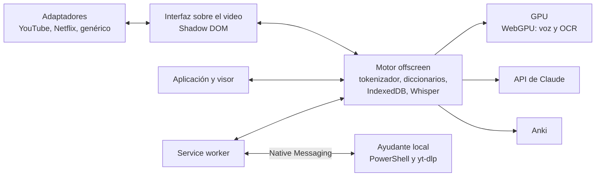

TypeScript, Preact, Dexie y esbuild, con ONNX Runtime y Transformers.js sobre WebGPU para la voz y el OCR. El detalle de cada parte, las decisiones técnicas y las medidas de rendimiento están en [docs/arquitectura.md](docs/arquitectura.md). Las pruebas cubren la lógica con más de 750 pruebas unitarias y los flujos principales de extremo a extremo con Edge real y la GPU; cómo se ejecutan está en [CONTRIBUTING.md](CONTRIBUTING.md).

## Estado del proyecto

Las versiones salen con sus pruebas y su documentación en los seis idiomas; las [novedades](CHANGELOG.md) resumen cada una. YouTube y el inglés se han comprobado también a mano con una sesión real. Las traducciones de la interfaz se escribieron con ayuda de IA y aún no han tenido una revisión nativa: cualquier corrección es bienvenida.

## Licencia y créditos

El código se publica bajo la [licencia MIT](LICENSE). Los componentes de terceros, los datos que se descargan al usarla y las condiciones de uso responsable se detallan en [AVISOS.md](AVISOS.md).

- Diccionarios: [JMdict](https://www.edrdg.org/jmdict/j_jmdict.html) (EDRDG), [Kanjium](https://github.com/mifunetoshiro/kanjium) y [JPDB](https://jpdb.io); para el inglés y el alemán, [Wiktionary](https://www.wiktionary.org) mediante [wiktionary-to-yomitan](https://github.com/yomidevs/wiktionary-to-yomitan) y [kaikki.org](https://kaikki.org).
- Voz: [Whisper large-v3-turbo](https://huggingface.co/onnx-community/whisper-large-v3-turbo), Haas-ja y Parakeet, con [Transformers.js](https://github.com/huggingface/transformers.js).
- Reconocimiento de texto: [PP-OCRv5 y PP-OCRv6](https://github.com/PaddlePaddle/PaddleOCR), [manga-ocr](https://github.com/kha-white/manga-ocr) y un [detector de globos de texto](https://huggingface.co/ogkalu/comic-text-and-bubble-detector).
- Orden de los trazos: [KanjiVG](https://kanjivg.tagaini.net), de Ulrich Apel, CC BY-SA 3.0.
- Iconos: [Phosphor](https://phosphoricons.com). Tipografía: [Zen Maru Gothic](https://fonts.google.com/specimen/Zen+Maru+Gothic) y [Nunito](https://fonts.google.com/specimen/Nunito).

El nombre procede del prólogo del *Kokin Wakashū* (c. 905): la poesía de Japón tiene por semilla el corazón humano, y de él brotan miríadas de hojas de palabras.

Proyecto independiente, sin afiliación con los servicios mencionados.
