

  

<h3 align="center">用你每天在看、在读的内容学日语和英语。</h3>

  视频上的交互式字幕，能结合句子理解每个词的单词面板，书籍、PDF 和漫画的阅读助手，以及可导入 Anki 的记忆卡片。全部在浏览器里完成，免费且开源。

  
  
  
  

  
  
  
  
  
  

  <a href="https://github.com/Eliam4510/kotonoha/releases/latest"><b>下载</b></a> ·
  <a href="#安装">安装</a> ·
  <a href="docs/zh/guide.md">使用指南</a> ·
  <a href="docs/zh/features.md">全部功能</a> ·
  <a href="CHANGELOG.md">更新内容</a> ·
  <a href="CONTRIBUTING.md">参与贡献</a>

## Kotonoha 是什么

Kotonoha（言の葉，“言语之叶”）是一款适用于 Chrome 和 Edge 的扩展，把你本来就在看、在读的内容变成学习材料：YouTube 和 Netflix 上的剧集与视频、文章、聊天、书籍和漫画。每个词都会显示读音和你的掌握程度，点一下就会打开单词面板，里面有释义、它在这句话里的具体含义，以及一个生成卡片的按钮。

一切都在你自己的电脑上运行。词典、文本分析、语音转写和书页上的文字识别都不会离开浏览器。只有当你请求讲解或翻译时，才会用到 Anthropic 的 Claude，每次请求都会记录费用。

<table>
  <tr><td><b>看</b></td><td>在 YouTube、Netflix、Disney+、Crunchyroll、Prime Video 和本地文件中，字幕带有振假名、音调重音和每个词的学习状态。</td></tr>
  <tr><td><b>读</b></td><td>任意网页、你复制的内容，以及 EPUB、PDF 和漫画书籍，扫描版和图片文件夹也可以。</td></tr>
  <tr><td><b>记</b></td><td>一键生成卡片，附带场景的音频和画面，可送往 Anki 或内置复习。</td></tr>
  <tr><td><b>语言</b></td><td>可以学习日语、英语或德语。界面提供简体中文、英语、西班牙语、德语、韩语和日语。</td></tr>
</table>

## 用 Kotonoha 学习的方式

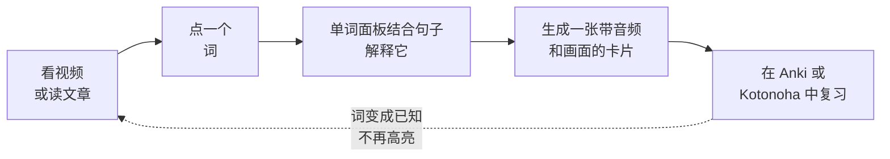

每个标记为已知的词都会在所有地方停止高亮，每个视频或文本的理解度也会随之提高。

## 功能一览

### 真正能读懂的字幕

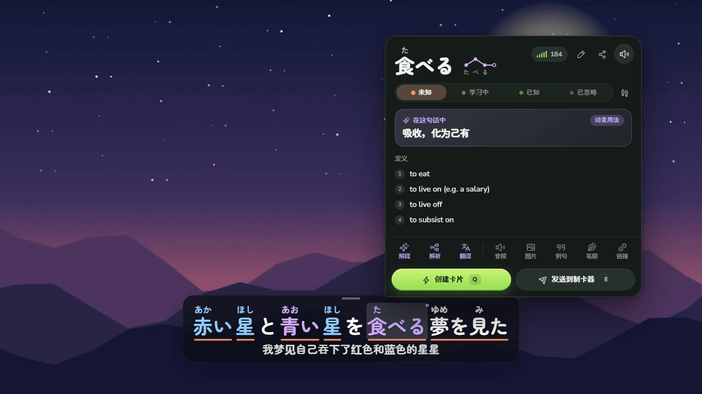

字幕显示在播放器上方，带有振假名、按音调重音区分的颜色，以及表示每个词学习状态的下划线：未知、学习中或已知。鼠标悬停即可打开带词典的单词面板，不产生任何费用。Claude 会补充这个词在这句话里的含义，即使是比喻或诗意的用法，比如图中的 食べる。

- 按 `Q` 用这句话、它的音频和视频画面生成卡片，直接送往 Anki 或内置复习。
- `A` 和 `D` 在台词之间移动，`S` 重复当前台词。字幕导航（`G`）列出全部台词，支持筛选和书签。
- 字幕可以翻译成你的语言，自动生成的字幕会结合标题和整个剧本进行纠正。
- 没有字幕的视频可以在你自己的电脑上用显卡转写：30 分钟的视频大约一分钟完成。

### 任意网页

在新闻、博客、百科或 Claude 这样的聊天页面里，日语文本同样会有颜色和振假名，点击一个词就能打开它的单词面板。网页内容不会被改动：链接和按钮照常工作，用 React 构建的网站也察觉不到。已在约三十个真实网站上测试。

### 书籍、PDF 和漫画

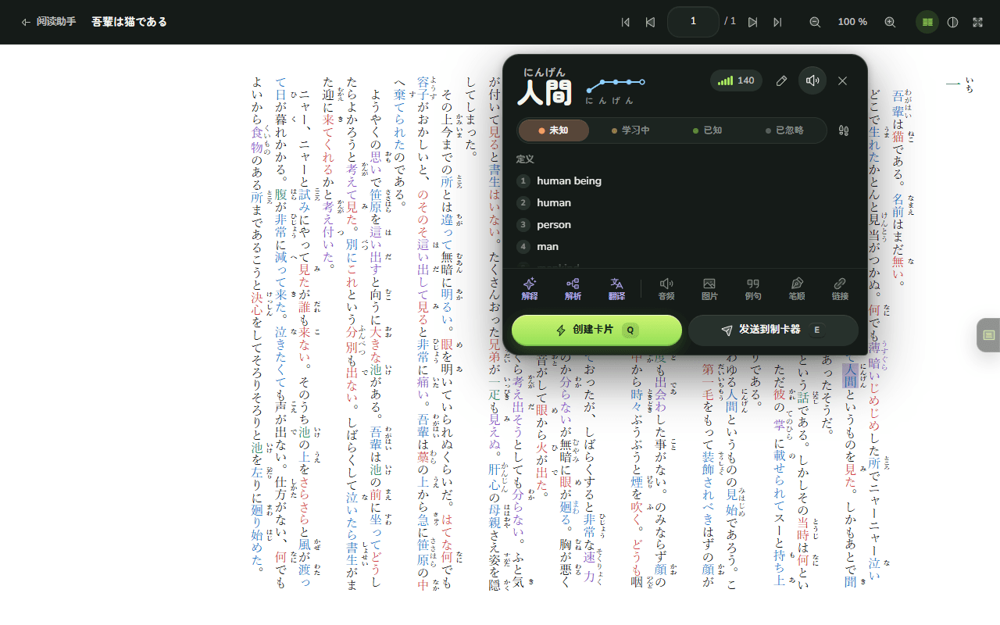

**阅读助手**是一个完整的阅读器，就像 PDF 阅读器一样：缩放、双页、连续滚动、目录、缩略图，并记住每本书读到的页码。像小说这样的文字版 EPUB 会保留原有的排版、注音和竖排，上面叠加网页阅读器：颜色、振假名和单词面板，和在网页上一样。带文字的 PDF 可以直接逐词阅读。图片文件夹形式的漫画只需选择文件夹即可导入：每一卷成为一本书，封面在前，彩色跨页完整显示。书架可以把书归入合集，例如一个系列及其各卷，并配上封面和描述，还会显示每本书和每个合集读了多少。在阅读器中可以给页面加书签、高亮或为文字加下划线并附评论，还能在页面上贴笔记，就像在 PDF 阅读器中一样。可以在整本书中搜索一个词，把每一页当作文字配合阅读辅助来读，还可以让 Claude 对照页面图像检查文字识别读出的文字。

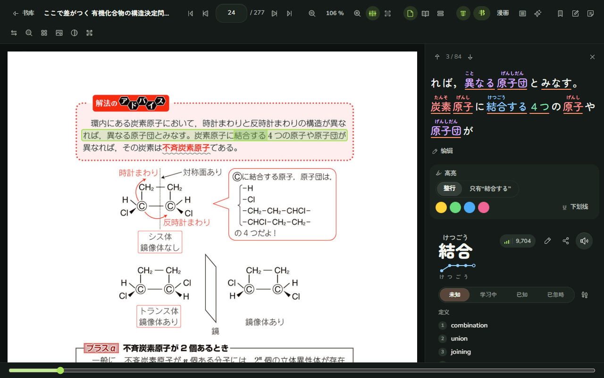

图片形式的页面，比如漫画、扫描书和许多 PDF，会在你自己的电脑上用显卡进行文字识别（OCR）。有印刷书籍模式，也有漫画模式；漫画模式能读取竖排对话框，而不会把振假名混进正文。在页面上点一个词，就会打开带振假名的那一行和它的单词面板。每一页只识别一次，并会保存下来。

### 用来书写和阅读的笔记本

**笔记本**是一个铺满整个宽度的页面，可以用所学语言书写和粘贴带标题、列表和引用的文本，并以分析过、带注音的形式阅读。**整理**能为一整块粘贴的文本加上结构而不改动字词，每条笔记都会保存在书库中。它可以按你选择的速度朗读：连续、逐句或重复一句；选中的任意部分都可以听或练习。还可以对它语音输入：对着麦克风说的话会在电脑上转录，作为新的段落加入，并附带录音。它也能在普通标签页中打开，在分屏视图中放在正在阅读的页面旁边，并收集你在任何地方复制的内容。

### 开口练习音调重音

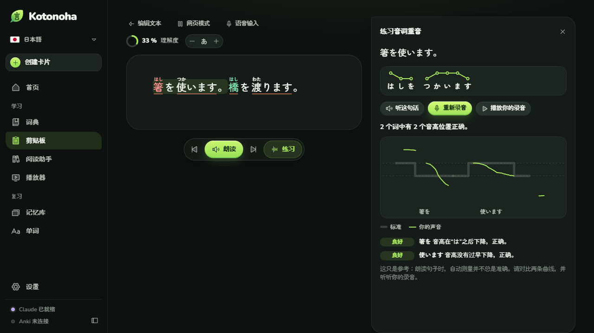

**练习**会显示句中每个词的重音。朗读之后，Kotonoha 会把你声音的音高曲线叠在标准曲线上，指出哪些词的音高下降位置不对，标出长停顿，还可以检查是否缺少或多出っ、ん和长音。音高在浏览器中测量，录音在电脑上转录，不会离开电脑。打开 AivisSpeech 或 VOICEVOX 后，示范语音会按词典的重音朗读每个句子，免费，同样不离开电脑。

### 听写

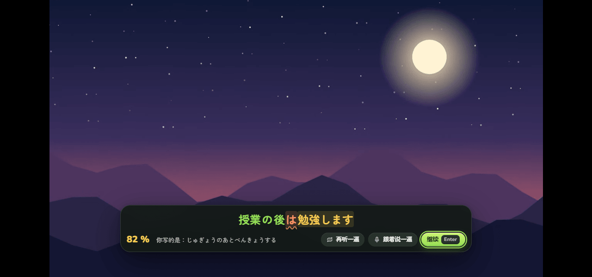

**听写**模式会在播放时隐藏这句台词，在句末暂停，让你写下听到的内容。检查时，听对的部分显示为绿色，听对一半的显示为黄色，漏掉的加下划线，并给出这句的得分。日语按读音比较，所以用假名输入也可以。**跟着说一遍**会用这句话打开音调重音练习，按 `P` 则可以练习任意字幕。

### 已经掌握的语法

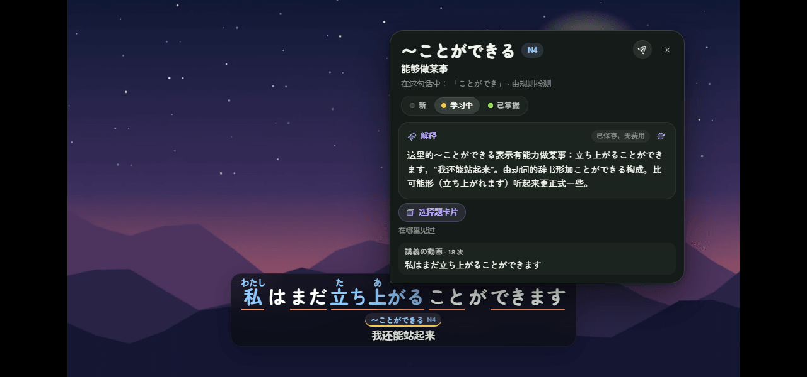

每条字幕下方会列出这句话里的语法点和它的 JLPT 级别。点一下就会打开气泡：它的意思、Claude 针对这句话的讲解，以及你之前在哪里见过。每个语法点可以标为**新**、**学习中**或**已掌握**；正在学的会加一条黄线，已掌握的不再标出。已经会的可以从 Anki 导入，**选择题卡片**会生成一张卡片，附三个容易和正确答案混淆的选项。

### 每个汉字怎么写

单词面板会逐笔、循环演示词中每个汉字的笔顺，并标出笔画编号；下方列出你已经认识、含有同一个汉字的词。

### 分享你发现的内容

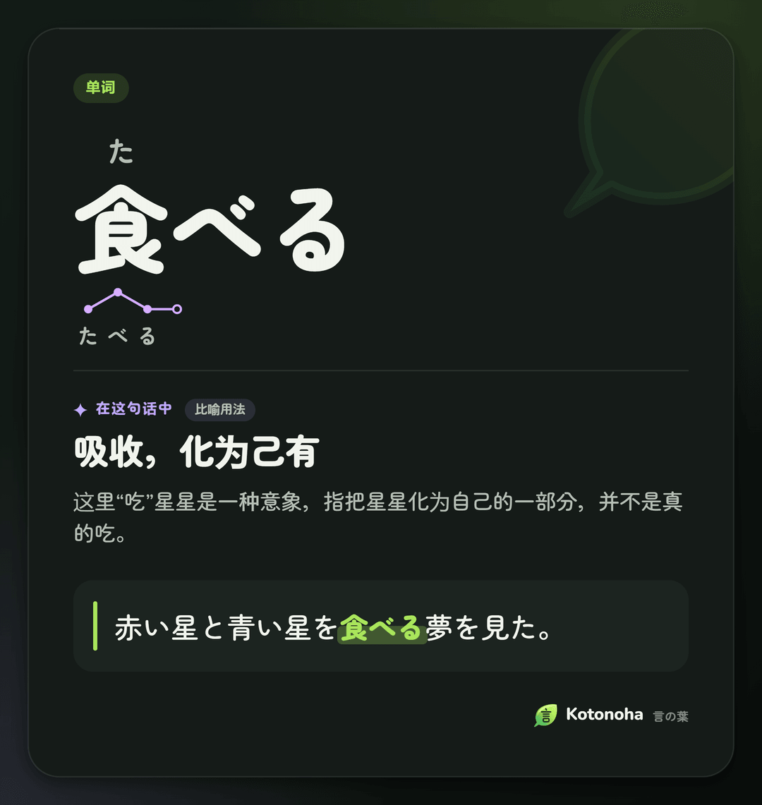

单词面板中的**以图片分享**会把一个单词或语法点做成卡片，写明它在这句话中的含义以及它出现的句子，并放进剪贴板，可用 Ctrl+V 粘贴到任何聊天中。卡片和主题一样，有墨色和纸张两种样式。

### 按级别学习 JLPT

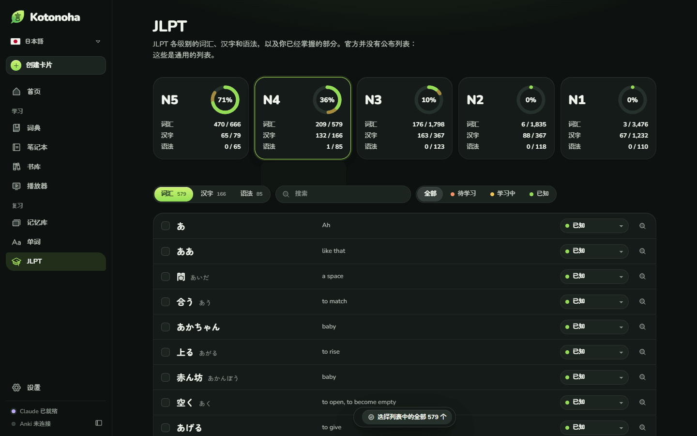

**JLPT** 页面汇集了从 N5 到 N1 每个级别的词汇、汉字和语法，并根据你在观看和阅读时标记的单词，显示每个级别已经掌握了多少。已经会的单词可以一次性标记，每个汉字都有笔顺和含有它的单词，每个语法点都会列出你看过的、出现它的句子。

### 可以浏览的词典

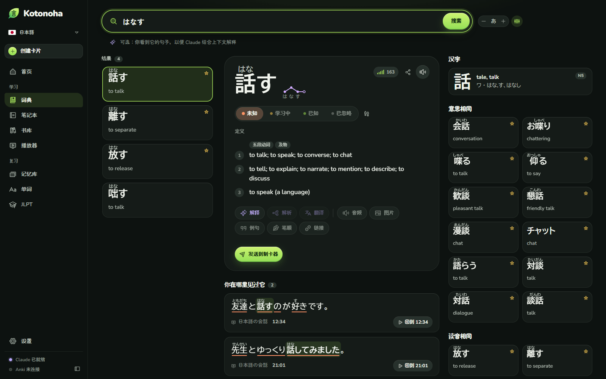

词典还能按意思搜索，比如“dog” → 犬，并能按形式或意思查找语法。每个单词下方有附级别的汉字、**意思相同**的常用词（比如 話す 对应的 喋る 和 会話）以及读音相同的词（比如 離す 和 放す）。需要时可以请 Claude 讲解它们的区别。首页汇集了拟声拟态词、谚语、四字熟语，以及书面语、口语和敬语。

### 也能学英语

学习英语时，单词面板会给出美式和英式的 IPA 发音，即使短语动词被拆开（如 *picked it up*）也能找到，并说明每个不规则形式来自哪个词。词典来自 Wiktionary，释义为中文。漫画按对话框从左到右逐个读取，句子由本机的神经网络语音朗读：英语用 Kokoro，德语用 Piper。每种语言分别保存自己的单词、卡片和设置，一键即可切换。

### 还有

- **英语的实际发音。** 单词面板会按连贯说话时的样子显示句子：*going to* → *gonna*、*meet you* → *meechu*、*turn off* → *tur‿noff*，并说明每种变化。
- **沉浸时长。** 首页统计你用所学语言听和读的时间，以及连续学习的天数。
- **费用一目了然。** 主页显示本月 Claude 的花费，按天、模型和任务分类，并可设置每月上限。不会重复付费：每个回答都会保存。[费用研究](docs/zh/costs.md)给出了实测数据。
- **内置复习。** 采用 FSRS 算法，适合不用 Anki 的人。
- **本地文件。** 可以播放电脑上的视频，并读取 MKV 中的字幕。
- **按需定制。** 色盲友好和高对比度配色、假名或罗马字读音、可修改的快捷键，以及可以停用的网站。

## 不用 Claude 能做什么，用 Claude 又能多做什么

Kotonoha 不需要任何密钥就能使用。可选的 Claude 密钥会增加需要语言模型的功能。

| 无需密钥，免费 | 使用 Claude 密钥，按用量付费 |
|---|---|
| 带振假名、音调重音和学习状态的字幕 | 一个词在句子里的含义 |
| 词典、单词面板、笔顺和发音 | 单词、句子和语法讲解 |
| 网页阅读器、笔记本和带 OCR 的阅读助手 | 字幕翻译和纠正 |
| 在本机进行语音转写 | 检查振假名读音 |
| Anki 卡片和内置复习 | 按你的水平写的故事 |

正常使用每月只需几美分。密钥只保存在浏览器中。也可以按任务改用 OpenRouter、DeepSeek、OpenAI，或通过 LM Studio、Ollama 使用自己电脑上的模型。

## 安装

要求：Chrome 或 Edge 120 及以上版本。

1. 从[最新版本](https://github.com/Eliam4510/kotonoha/releases/latest)下载 `kotonoha-<版本>-extension.zip`，解压到一个固定的位置。
2. 打开 `chrome://extensions` 或 `edge://extensions`，开启**开发者模式**。
3. 点击**加载已解压的扩展程序**，选择 `kotonoha` 文件夹。

在 Windows 上也可以先装助手：`kotonoha-<版本>-ayudante.zip` 里有 `Instalar.cmd`，双击即可安装助手；如果没找到 Kotonoha，还会以固定的标识符安装扩展。之后只剩第 2 步和第 3 步。

首次启动时，欢迎页面会询问你的语言、想学的语言和水平，并安装词典。更新时，只需把新版本解压覆盖旧版本：扩展会自动重新加载。有新版本时，Kotonoha 会在首页提示；安装了助手的话，点**立即更新**一下就能装好。[使用指南](docs/zh/guide.md)介绍了每项功能，[CONTRIBUTING.md](CONTRIBUTING.md) 介绍了如何从源代码构建。

## 主要快捷键

| 快捷键 | 操作 |
|---|---|
| `Q` | 用这句话创建卡片 |
| `E` | 发送到制卡器 |
| `1` 到 `4` | 标记单词：未知、追踪、已知、忽略 |
| `A`、`D` 和 `S` | 上一句、下一句和重复 |
| `G` | 字幕导航 |
| `Alt+Shift+K` | 打开 Kotonoha 窗口 |

视频上的所有快捷键都可以修改，并适用于任何键盘布局。

## 隐私

- 数据和 Claude 密钥只保存在浏览器中。没有自己的服务器，也不收集使用统计。[隐私政策](docs/privacidad.md#english)说明了会向每个服务发送什么。
- 转写的音频和识别的页面不会离开你的电脑。
- Claude 只会收到每次请求所需的内容：句子、字幕文本和标题。
- 词典和模型只下载一次，来自 GitHub 和 Hugging Face。[声明](docs/zh/notices.md)列出了每个来源。

## 架构

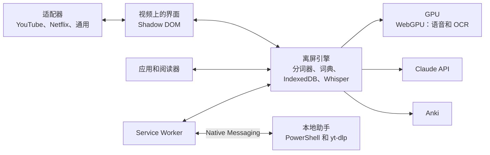

使用 TypeScript、Preact、Dexie 和 esbuild，并通过 WebGPU 上的 ONNX Runtime 和 Transformers.js 处理语音和 OCR。各部分的细节、技术决策和性能测量见 [docs/zh/architecture.md](docs/zh/architecture.md)。超过 750 个单元测试覆盖核心逻辑，端到端测试在真实的 Edge 和 GPU 上覆盖主要流程；[CONTRIBUTING.md](CONTRIBUTING.md) 说明了如何运行。

## 项目状态

每个版本都附带测试和六种语言的文档；[更新内容](CHANGELOG.md)对每个版本做了总结。YouTube 和英语还在真实会话中手动检查过。界面翻译借助 AI 完成，尚未经过母语者审校，欢迎指正。

## 许可与致谢

代码以 [MIT 许可](LICENSE)发布。第三方组件、使用时下载的数据以及负责任使用的条件详见[声明](docs/zh/notices.md)。

- 词典：[JMdict](https://www.edrdg.org/jmdict/j_jmdict.html)（EDRDG）、[Kanjium](https://github.com/mifunetoshiro/kanjium) 和 [JPDB](https://jpdb.io)；英语和德语使用 [Wiktionary](https://www.wiktionary.org)，经 [wiktionary-to-yomitan](https://github.com/yomidevs/wiktionary-to-yomitan) 和 [kaikki.org](https://kaikki.org) 整理。
- 语音：[Whisper large-v3-turbo](https://huggingface.co/onnx-community/whisper-large-v3-turbo)、Haas-ja 和 Parakeet，借助 [Transformers.js](https://github.com/huggingface/transformers.js)。
- 文字识别：[PP-OCRv5 和 PP-OCRv6](https://github.com/PaddlePaddle/PaddleOCR)、[manga-ocr](https://github.com/kha-white/manga-ocr) 和[对话框检测器](https://huggingface.co/ogkalu/comic-text-and-bubble-detector)。
- 笔顺：[KanjiVG](https://kanjivg.tagaini.net)，作者 Ulrich Apel，CC BY-SA 3.0。
- 图标：[Phosphor](https://phosphoricons.com)。字体：[Zen Maru Gothic](https://fonts.google.com/specimen/Zen+Maru+Gothic) 和 [Nunito](https://fonts.google.com/specimen/Nunito)。

名字出自《古今和歌集》假名序（约 905 年）：和歌以人心为种子，生出万千言语之叶。

独立项目，与文中提到的任何服务均无关联。
