<p align="center">
  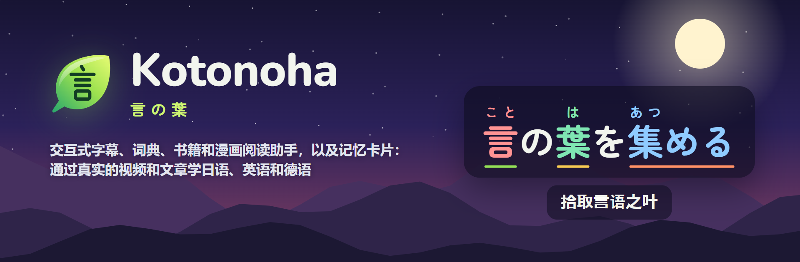
</p>

<p align="center">
  
  
  
  
  <a href="LICENSE"></a>
</p>

<p align="center">
  <a href="README.md"></a>
  <a href="README.en.md"></a>
  <a href="README.de.md"></a>
  <a href="README.zh.md"></a>
  <a href="README.ko.md"></a>
  <a href="README.ja.md"></a>
</p>

<p align="center">
  
  <a href="https://github.com/Eliam4510/kotonoha/actions/workflows/ci.yml"></a>
  
  
  
  
</p>

<p align="center">
  <b>一款通过真实视频和文章学习日语和英语的浏览器扩展。</b>
</p>

<p align="center">
  <a href="#安装">安装</a> ·
  <a href="docs/zh/guide.md">使用指南</a> ·
  <a href="docs/zh/features.md">功能</a> ·
  <a href="docs/zh/architecture.md">架构</a> ·
  <a href="docs/zh/costs.md">费用</a> ·
  <a href="docs/zh/notices.md">声明</a>
</p>

<p align="center">
  
</p>

## 简介

Kotonoha（言の葉，意为“言语之叶”）在 YouTube、Netflix 和其他播放器上叠加交互式字幕。每个单词都显示注音、音调重音和掌握程度，鼠标悬停即可打开词典条目，不产生任何费用。一个按钮可以询问 Claude 这个词在这句话中的含义。扩展还提供词典、为 Anki 或内置复习功能制作卡片，以及通过 Claude API 生成的结合上下文的解释。在任何网页上，它都能为日语文本着色、添加注音，并通过单击查词，也适用于 Claude 这样的聊天页面，不会破坏页面。它也支持文本、EPUB 书籍和本地视频文件。界面提供西班牙语、英语、德语、中文、韩语和日语。

从 0.4.0 版开始也可以学习英语：单词面板给出美式和英式的 IPA 发音，即使短语动词被拆开也能找到，并指出每个不规则形式来自哪个词。词典来自 Wiktionary，以界面语言提供。每种语言都保存自己的单词、词典、卡片和设置，单击即可切换。

名字出自《古今和歌集》的序文（约 905 年）：日本的诗歌以人心为种子，从中生出万千言语之叶。

## 功能

<table>
  <tr>
    <td width="33%" align="center">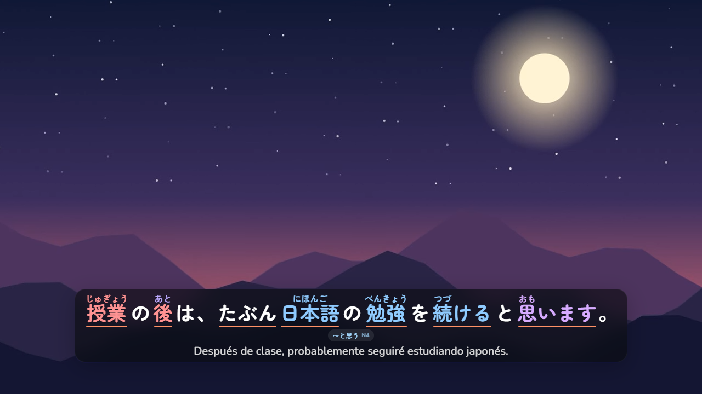</td>
    <td width="33%" align="center"></td>
    <td width="33%" align="center">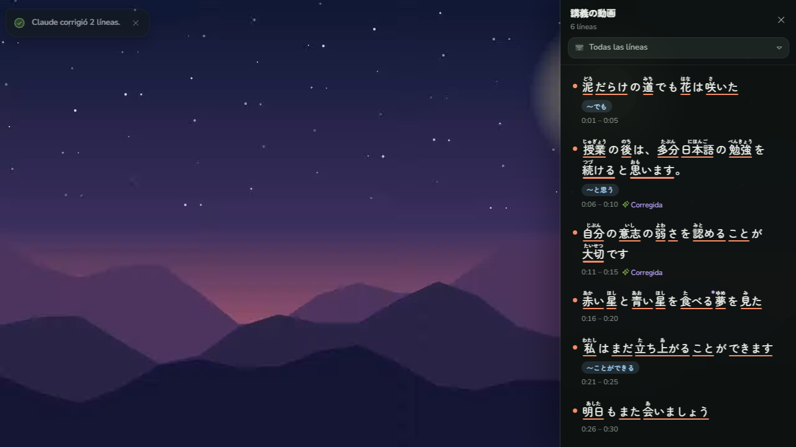</td>
  </tr>
  <tr>
    <td valign="top"><b>真正用来阅读的字幕</b><br>注音、按音调重音着色、按学习状态加下划线，以及 JLPT 语法点，并为每个视频估算理解度。</td>
    <td valign="top"><b>词典优先，Claude 按需</b><br>单词面板以词典打开。一个按钮可以询问 Claude 这个词在这句话中的真正含义，包括比喻和文学用法。视频播放时，它还会检查注音读音。</td>
    <td valign="top"><b>字幕导航</b><br>所有行一览无余，支持筛选、书签、多选，以及用一个或两个标记同步。已更正的行保留原文。</td>
  </tr>
  <tr>
    <td width="33%" align="center">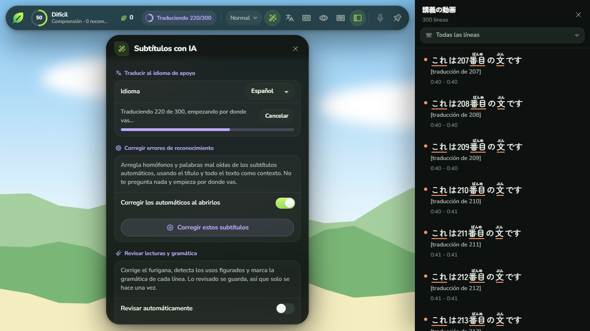</td>
    <td width="33%" align="center">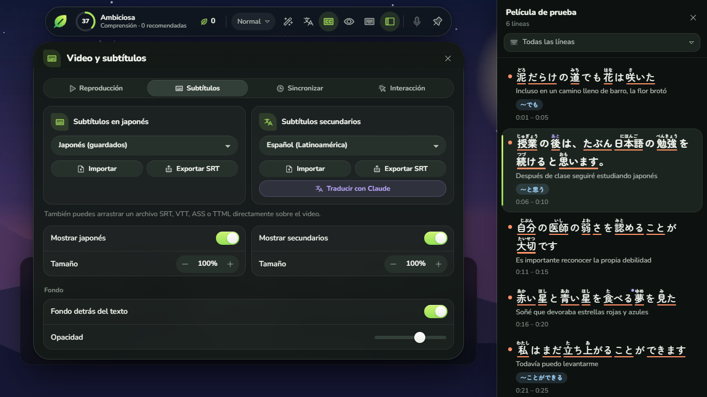</td>
    <td width="33%" align="center">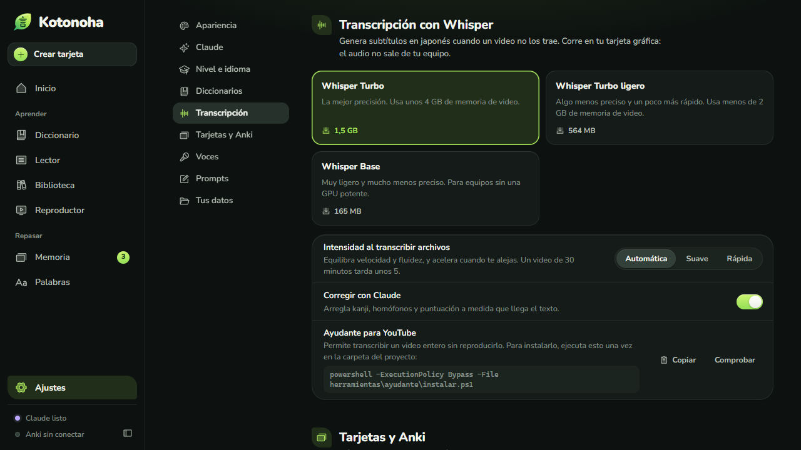</td>
  </tr>
  <tr>
    <td valign="top"><b>用 Claude 翻译和更正</b><br>翻译成辅助语言，从正在观看的部分开始。以标题和全文作为上下文，自动更正生成字幕中的同音词，无需询问。</td>
    <td valign="top"><b>SRT 导入导出</b><br>在任何网站都能导入和导出 SRT、VTT、ASS 和 TTML。导入的内容按标题保存；即使其他地区不提供，Netflix 的日语字幕也会保留。</td>
    <td valign="top"><b>本地转录</b><br>日语口语用 Haas-ja，歌曲和其他语言用 Whisper，通过 WebGPU 在显卡上运行，音频不会离开电脑：30 分钟的视频用 Haas-ja 约需 1 分钟，用 Whisper 约需 5 分钟，桌面不卡顿。它分段工作并适当休息，驱动程序重启后也能恢复。粘贴歌词后，Claude 会把它放到 Whisper 的时间上。</td>
  </tr>
  <tr>
    <td width="33%" align="center">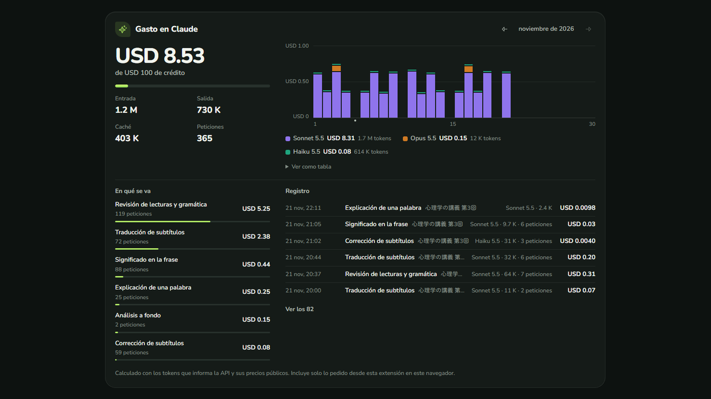</td>
    <td width="33%" align="center">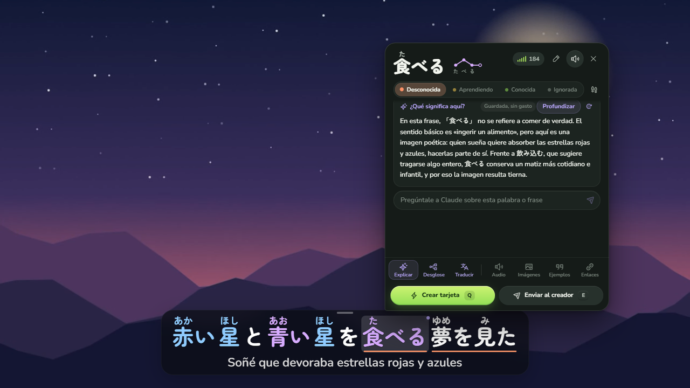</td>
    <td width="33%" align="center">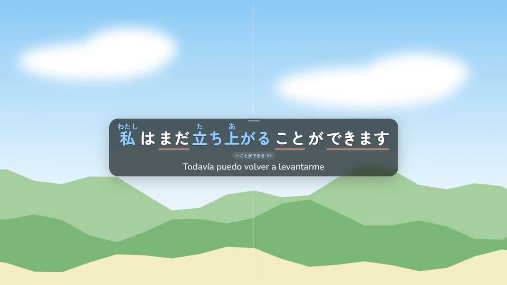</td>
  </tr>
  <tr>
    <td valign="top"><b>费用一目了然</b><br>首页显示本月 Claude 费用，包括按天和模型的图表、任务分布以及每次请求的日志和 token 数。<a href="docs/zh/costs.md">费用研究</a>提供了实测数据。</td>
    <td valign="top"><b>绝不重复付费</b><br>每个回答都按单词和句子保存。在单词之间来回切换不产生费用，中断的回答会继续完成并保存，而不会丢失。</td>
    <td valign="top"><b>字幕想放哪就放哪</b><br>可以从任意位置拖到喜欢的高度和位置，有吸附到中央和原位的磁性效果。换行不闪烁，页面滚动时跟随视频。</td>
  </tr>
  <tr>
    <td width="33%" align="center">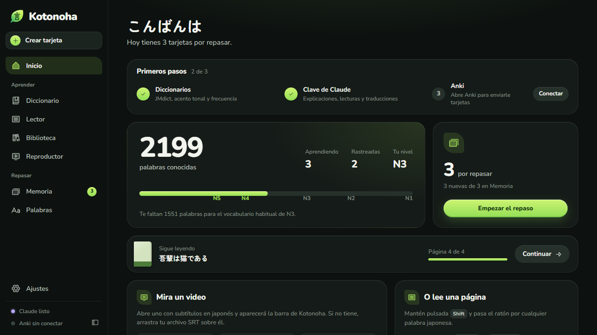</td>
    <td width="33%" align="center">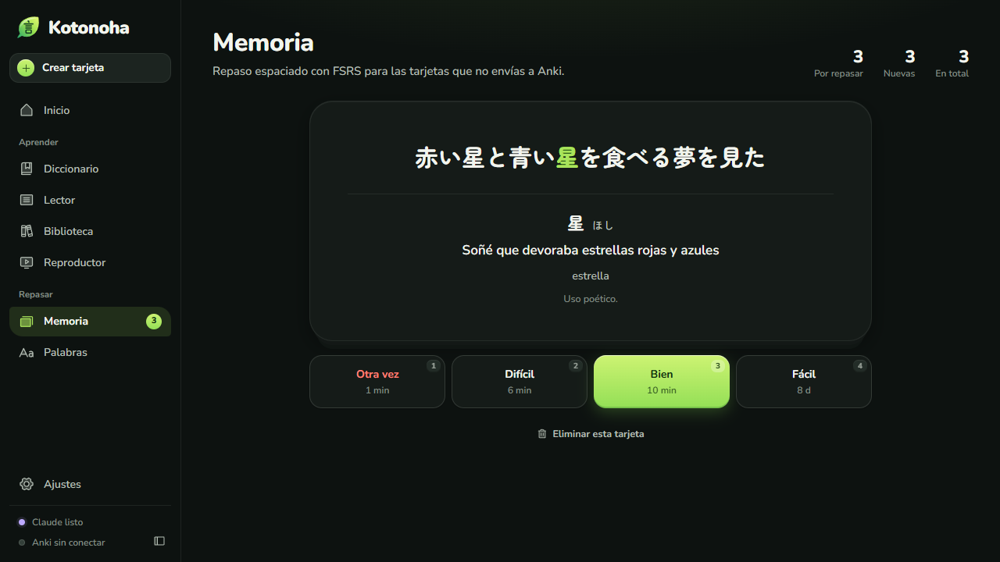</td>
    <td width="33%" align="center">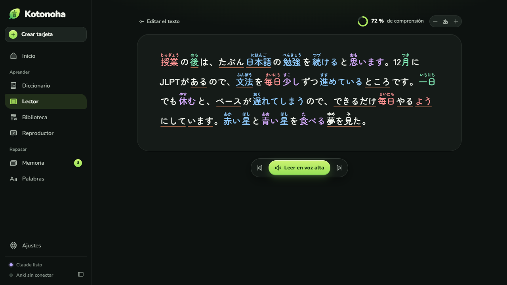</td>
  </tr>
  <tr>
    <td valign="top"><b>完整的应用</b><br>首页、支持活用形的词典、按状态浏览单词、水平评估、按任务设置和可编辑的提示词。明暗主题。</td>
    <td valign="top"><b>一键制卡</b><br>带视频的音频和画面，直接通过 AnkiConnect 发送到 Anki，或保存到使用 FSRS 的内置复习。</td>
    <td valign="top"><b>不止于视频</b><br>文本阅读器、EPUB 书库、按水平生成的故事，以及支持 MKV 字幕的本地文件播放器。</td>
  </tr>
  <tr>
    <td width="33%" align="center">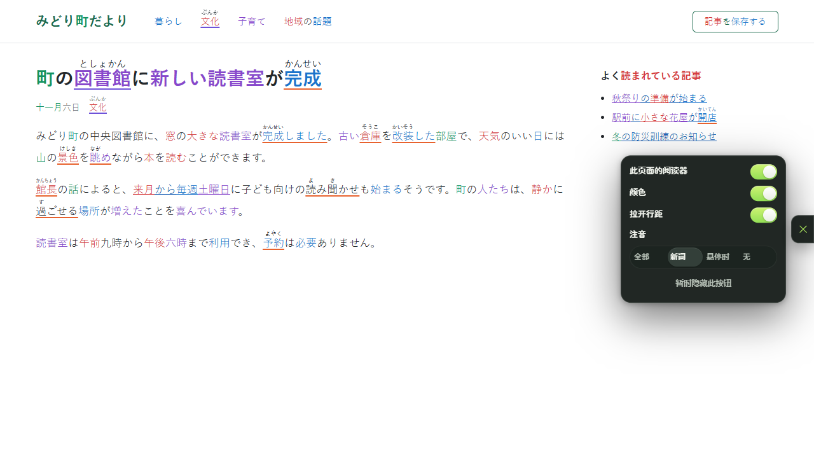</td>
    <td width="33%" align="center">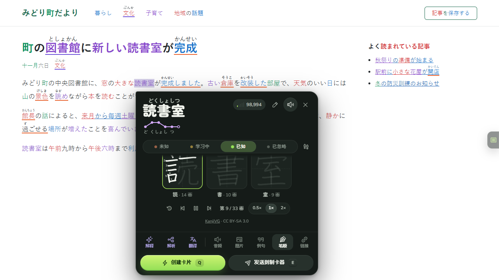</td>
    <td width="33%" align="center">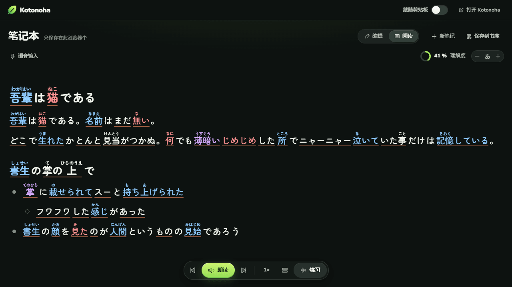</td>
  </tr>
  <tr>
    <td valign="top"><b>任何页面，不破坏布局</b><br>在新闻、文章和博客的日语上显示颜色和注音。单击单词打开单词面板；在链接和按钮上，鼠标停留即可。不向页面内容添加任何东西：唯一可能改动的是注音放不下处的行距，而且可以关闭。</td>
    <td valign="top"><b>怎么写</b><br>单词面板展示单词中每个汉字的笔画，逐笔循环播放并标有序号。可以暂停和逐笔查看。每个汉字只下载一次，然后保存在本地。</td>
    <td valign="top"><b>标签页中的阅读器</b><br>阅读器也可以在普通标签页中打开，用于浏览器的分屏视图，甚至可以直接放在正在查看的页面旁边。它可以跟随剪贴板：复制的内容会显示在那里。</td>
  </tr>
  <tr>
    <td width="33%" align="center">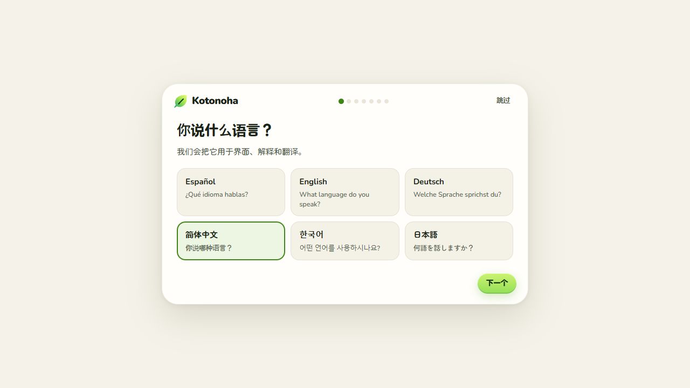</td>
    <td width="33%" align="center">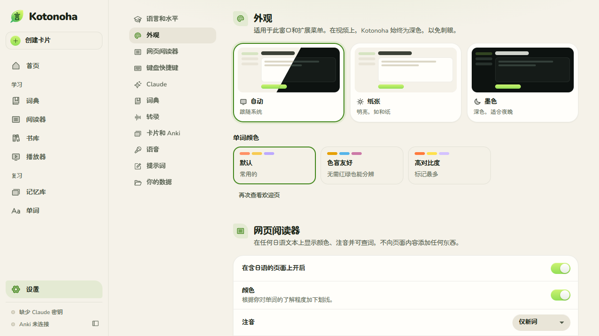</td>
    <td width="33%" align="center">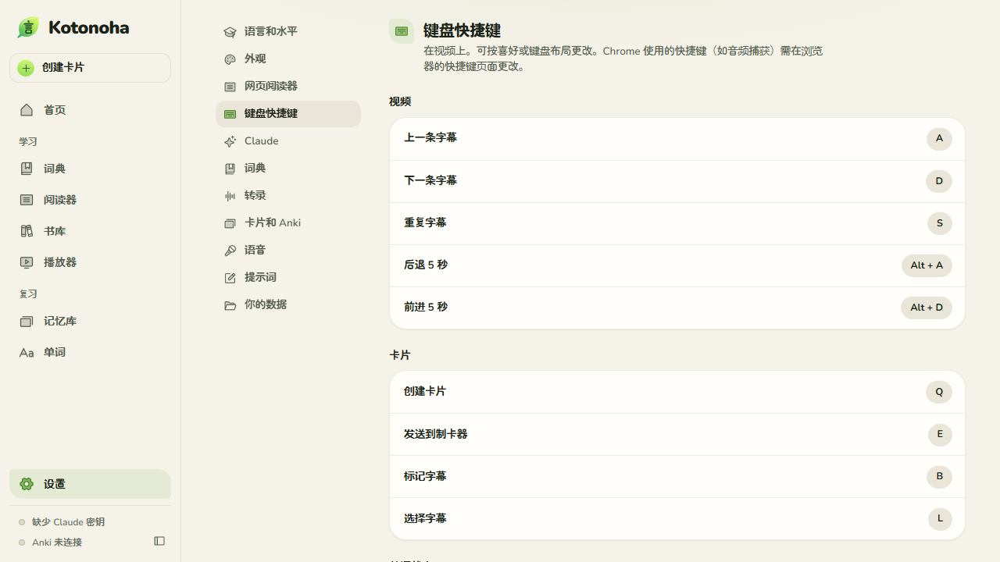</td>
  </tr>
  <tr>
    <td valign="top"><b>六种语言</b><br>界面提供西班牙语、英语、德语、中文、韩语和日语。欢迎页询问语言和水平，并给出合适的建议。Claude 的解释还可以使用葡萄牙语和法语。</td>
    <td valign="top"><b>按需调整</b><br>色盲友好和高对比度配色、假名或罗马字读音、每月费用上限，以及不启用的网站。从零基础到 N1。</td>
    <td valign="top"><b>自选快捷键</b><br>视频上的快捷键都可以更改，适用于任何键盘布局，也可在开启日语输入时使用。</td>
  </tr>
  <tr>
    <td width="33%" align="center">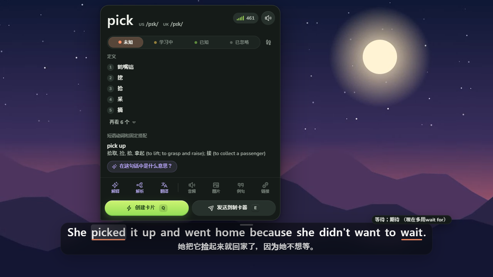</td>
    <td width="33%" align="center">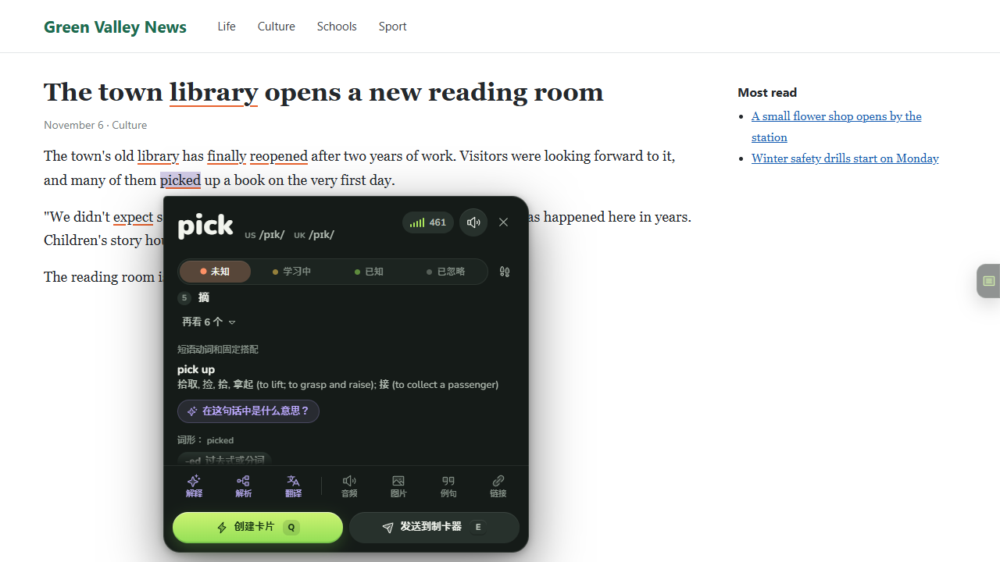</td>
    <td width="33%" align="center">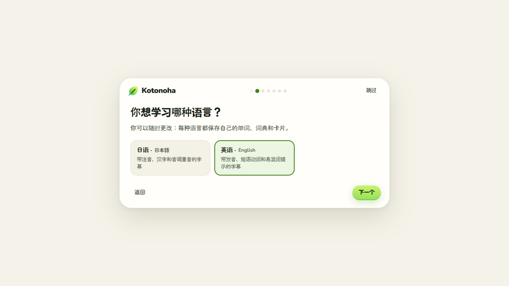</td>
  </tr>
  <tr>
    <td valign="top"><b>也能学英语</b><br>美式和英式的 IPA 发音、A1 到 C2 的语法，以及界面语言的 Wiktionary 词典。Whisper、Claude 和卡片的用法与日语相同。</td>
    <td valign="top"><b>短语动词</b><br>即使句子写的是 <i>picked it up</i>，面板也能找到 <i>pick up</i>，并说明 <i>went</i> 来自哪个词。因为英语几乎无处不在，网页阅读器默认关闭，可在扩展菜单中开启。</td>
    <td valign="top"><b>每种语言各自独立</b><br>可在欢迎页、设置或扩展菜单中选择。每种语言都保存自己的单词、词典、卡片和设置，切换回来时一切如旧。</td>
  </tr>
</table>

完整列表以及每项功能的验证方式见 [docs/zh/features.md](docs/zh/features.md)。

## 安装

要求：Chrome 或 Edge 120 及以上版本。

### 编译版本

1. 从 [Releases](https://github.com/Eliam4510/kotonoha/releases/latest) 下载 `kotonoha-<版本>-extension.zip`。
2. 解压到固定位置，会生成 `kotonoha` 文件夹。浏览器根据这个路径生成扩展的标识符，并以此保存数据：移动它就等于从头开始。
3. 打开 `chrome://extensions` 或 `edge://extensions`。
4. 开启开发者模式。
5. 点击“加载已解压的扩展程序”，选择 `kotonoha` 文件夹。

更新时，只需把新版本解压到同一位置覆盖旧版本：扩展会检测到并在一分钟内自动重新加载，除非有任务正在进行。打开的标签页会提示需要重新加载。

如果已经在使用从其他文件夹加载的副本，不要同时加载这一份：两者会作用于相同的页面。

### 从源代码

另外需要 Node.js 22 及以上版本。

```bash
git clone https://github.com/Eliam4510/kotonoha.git
```

```bash
cd kotonoha
```

```bash
npm install
```

```bash
npm run build
```

然后按上述步骤加载 `dist` 文件夹。重新编译时，扩展会检测到变化并自动重新加载。0.1.1 之前的版本做不到这一点，需要点击一次“重新加载”。

## 入门

首次使用时会打开欢迎页，询问语言、要学习的语言和水平，并建议：

1. 安装词典。日语：所用语言的 JMdict，如果还没有则使用英语版，以及音调重音和频率。英语：所用语言的 Wiktionary，以及发音和频率。
2. 添加 Claude API 密钥，它只保存在浏览器中。这是可选的：没有它，字幕、词典、颜色、卡片和 Whisper 也能使用。
3. 选择卡片保存到哪里：内置复习，或通过 AnkiConnect 插件发送到 Anki。

这些都可以跳过，之后可在扩展窗口（`Alt+Shift+K`）的**设置**中更改。

之后，打开带所学语言字幕的视频时会出现 Kotonoha 工具栏。任何含日语文本的页面都会显示颜色和注音；英语则需要先在扩展菜单中开启阅读器。其余内容见[使用指南](docs/zh/guide.md)。

### 转录网络视频的助手

这是可选的。没有它，网络视频只能在播放时转录。有了它，无需播放即可完整转录。它是一个使用 [yt-dlp](https://github.com/yt-dlp/yt-dlp) 和 FFmpeg 的本地程序，只有扩展可以调用。在 Windows 上需要 Python 和 FFmpeg，并且绝不用于 Netflix。

```bash
powershell -ExecutionPolicy Bypass -File herramientas\ayudante\instalar.ps1
```

使用编译版本时，它单独提供下载：`kotonoha-<版本>-ayudante.zip`。其中的 `LEEME.txt` 说明了安装方法，需要用 `-Extension` 指定扩展的标识符。

## 主要快捷键

| 快捷键 | 操作 |
|---|---|
| `Q`、`Alt+Q` | 一键制卡 |
| `E` | 发送到制卡器 |
| `N` | 转到下一个未知词 |
| `1` 至 `4` | 标记单词：未知、追踪、已知、忽略 |
| `A`、`D` | 上一句和下一句 |
| `S` | 重复句子 |
| `G` | 字幕导航 |
| `Alt+Shift+M` | 允许音频捕获 |
| 单击单词 | 查询它，适用于任何含所学语言文本的页面 |

## 转录性能

使用 16 GB 的 Radeon RX 9060 XT、16 GB 内存、60 Hz 的 4K 显示器和真实视频测得。

| 指标 | 结果 |
|---|---|
| 自动模式下的速度 | 30 分钟视频用 Haas-ja 约需 1 分钟，用 Whisper Turbo 约需 5 分钟，为实时的 6.1 至 6.4 倍 |
| 126 个真实句子的字符错误率 | 8.8% |
| 连续两小时音频 | 19.7 分钟，驱动程序未重启，内存未增长 |
| 转录时桌面的流畅度 | 第 99 百分位为 17.5 毫秒，没有超过 33 毫秒的帧 |
| 转录时播放 1080p 视频 | 749 帧中丢失 0 帧 |

完整表格（包括模型之间的准确度比较）见 [docs/zh/architecture.md](docs/zh/architecture.md#参考测量)。

## 架构

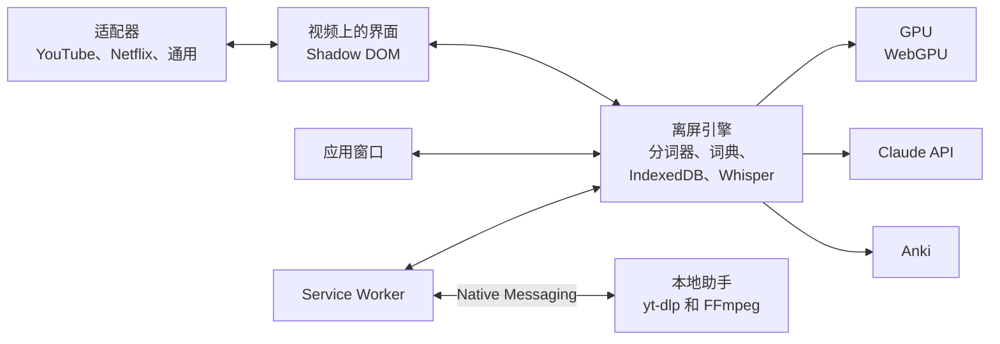

各部分的细节和技术决策见 [docs/zh/architecture.md](docs/zh/architecture.md)。

## 开发

```bash
npm run dev
```

```bash
npm test
```

```bash
npm run typecheck
```

```bash
npm run paquete
```

最后一条命令会编译，并在 `release/` 中生成扩展和助手的 ZIP 文件及其 SHA-256 校验和，可直接发布。

| 测试 | 检查内容 |
|---|---|
| `npm test` | `src/nucleo` 中的纯逻辑，以及翻译表是否完整 |
| `node herramientas/idiomas.mjs` | 每种语言缺少或多余的内容 |
| `node pruebas/lector.mjs` | 网页阅读器的疑难情况：没有任何移动、单击、链接、轮播、折叠面板、实时到达的文本、Shadow DOM 以及聊天那样的滚动框 |
| `node pruebas/lector-real.mjs` | 阅读器在约三十个公开网站上的表现，每个都有截图。使用 `KK_LENGUA=en` 时，在英语网站上运行 |
| `node pruebas/trazos-web.mjs` | 真实数据的笔顺、标签页中的阅读器、剪贴板和分屏视图 |
| `node pruebas/ingles.mjs` | 从头到尾学习英语：选择语言、安装词典、一个视频、一个网页，再回到日语，互不混淆 |
| `node pruebas/ingles-whisper.mjs voice.wav` | GPU 上的英语 Whisper，并模拟 Claude 的更正 |
| `node pruebas/letra.mjs voice.wav` | 把歌词放到转录的时间上：使用自动字幕轨；如果提供语音样本，则使用 GPU 上的 Whisper |
| `node pruebas/modelos-guardados.mjs` | 已保存模型列表：每个模型占用的空间，以及删除一个模型不会破坏与其共享文件的另一个模型 |
| `node pruebas/modelos-voz.mjs voice.wav` | 哪个模型转录什么：日语口语用 Haas-ja，歌曲用 Whisper Turbo，以及手动选择 |
| `node pruebas/ingles-grande.mjs` | 在干净的配置文件上测试最大的词典：安装、带着它启动、查询和删除。下载约 110 MB |
| `node pruebas/e2e.mjs` | 在 Edge 中端到端测试扩展 |
| `node pruebas/subtitulos.mjs` | 翻译、更正、导出和导入，在模仿 Netflix 和 YouTube 的页面上，使用模拟的 Claude API |
| `node pruebas/experiencia.mjs` | 视频上能感知到的内容，逐帧检查：闪烁、抖动和拖动。还会统计对 Claude 的请求并检查费用记录 |
| `node pruebas/capturas.mjs` | 遍历所有界面并保存截图 |
| `node pruebas/tarjetas.mjs audio.wav` | 模拟的 Anki、记忆库和录音 |
| `node pruebas/sin-gpu.mjs` | 没有硬件加速时界面的开销：处理器和丢帧 |
| `node pruebas/captura-real.mjs` | 使用真实标签页捕获的制卡器：音频来自哪一段，图像中显示什么。需要可见的浏览器，音量很低 |
| `node pruebas/medios.mjs audio.wav` | ffmpeg.wasm 处理多音轨 MKV |
| `node pruebas/ayudante.mjs video.mp4` | 本地助手，从本机下载 |
| `node pruebas/ayudante-navegador.mjs video.mp4` | 助手的完整流程，从面板到 GPU 上的 Whisper |
| `node pruebas/whisper-comparar.mjs corpus` | 用真实句子比较模型的准确度 |
| `node pruebas/whisper-carga.mjs video.mp4 pruebas/sonda-escritorio.ps1 turbo 0.75 9999` | 真实速度和桌面流畅度 |
| `node pruebas/whisper-larga.mjs turbo 120 60 audio.pcm` | 连续两小时，检测性能下降 |
| `node pruebas/whisper-recuperacion.mjs audio.pcm` | GPU 丢失：等待、继续，第二次失败时停止 |

浏览器测试使用具有固定标识符的编译版本，通过 `KK_SALIDA=.dist-subs node build.mjs` 创建。测试视频通过 `node pruebas/fixtures/generar-video.mjs` 生成。

## 项目状态

当前版本是 0.4.2。自动测试覆盖了主要流程，使用真实的 Edge、真实 GPU 上的 Whisper，以及 Claude API 和 AnkiConnect 的模拟器。视频网站不向自动化浏览器提供字幕，因此 YouTube 和 Netflix 在模仿其播放器结构的页面上测试。YouTube 还通过真实会话手动检查过，长时间验证尚待完成。网页阅读器已用自动化浏览器在约三十个真实的公开网站上试用，未登录。界面和本文档的翻译借助 AI 完成，尚未经过母语者审校。 英语已使用真实词典和 GPU 上的合成语音，在模仿 YouTube 的页面上测试过，网页阅读器也在 16 个真实的公开网站上测试过，但尚未在视频网站的真实会话中测试。

## 隐私

- Claude API 密钥和所有数据只保存在浏览器中。
- Whisper 转录的音频不会离开电脑。卡片的音频和画面也不会，除非发送到 Anki。
- 只向 Claude API 发送每项任务所需的文本：句子、字幕脚本和视频标题。如果粘贴了歌词，也包括歌词。
- 单词的音频和图片搜索直接发送到 JapanesePod101、Wikimedia Commons 和 Openverse，每个汉字的笔画从 jsDelivr 获取。
- 词典只下载一次：日语词典和英语频率表来自 GitHub，英语词典来自 Hugging Face。英语单词的音频来自 Wikimedia Commons 和 Lingua Libre。
- **跟随剪贴板**只在选项开启且标签页可见时读取，读取的内容不会离开电脑。
- 扩展没有自己的服务器，也不收集使用统计。

## 许可证和致谢

代码以 [MIT 许可证](LICENSE)发布。第三方组件、使用时下载的数据以及负责任使用的条件详见 [docs/zh/notices.md](docs/zh/notices.md)。

- 词典：[JMdict](https://www.edrdg.org/jmdict/j_jmdict.html)（EDRDG）、[Kanjium](https://github.com/mifunetoshiro/kanjium) 和 [JPDB](https://jpdb.io)，Yomitan 格式。
- 英语：释义和发音来自 [Wiktionary](https://www.wiktionary.org)，由 [wiktionary-to-yomitan](https://github.com/yomidevs/wiktionary-to-yomitan) 和 [kaikki.org](https://kaikki.org) 整理；频率来自 [FrequencyWords](https://github.com/hermitdave/FrequencyWords)；分析使用 [wink-nlp](https://github.com/winkjs/wink-nlp)。
- 转录：[Whisper large-v3-turbo](https://huggingface.co/onnx-community/whisper-large-v3-turbo)，使用 [Transformers.js](https://github.com/huggingface/transformers.js)。
- 笔顺：[KanjiVG](https://kanjivg.tagaini.net)，作者 Ulrich Apel，CC BY-SA 3.0。
- 图标：[Phosphor](https://phosphoricons.com)。字体：[Zen Maru Gothic](https://fonts.google.com/specimen/Zen+Maru+Gothic) 和 [Nunito](https://fonts.google.com/specimen/Nunito)。
