

  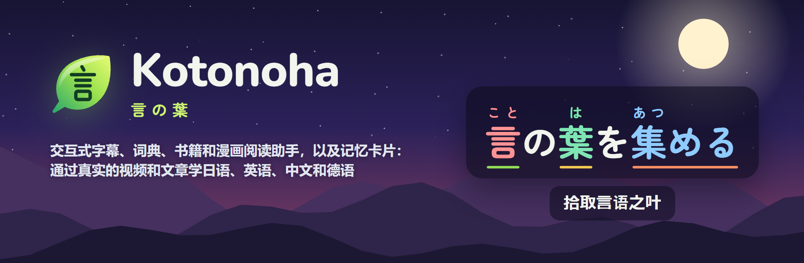

<h3 align="center">用你每天在看、在读、在唱的内容学日语和英语。</h3>

  剧集和视频上的交互式字幕，逐句跟唱的歌词，用 OCR 读懂的漫画和扫描书，能结合句子理解每个词的单词面板，以及可导入 Anki 的记忆卡片。语音、OCR 和文本分析都在你自己的电脑上用显卡完成。免费且开源。

  
  
  

  
  
  
  

  
  
  
  
  
  

  <a href="https://github.com/Eliam4510/kotonoha/releases/latest"><b>下载</b></a> ·
  <a href="#安装">安装</a> ·
  <a href="docs/zh/guide.md">使用指南</a> ·
  <a href="docs/zh/features.md">全部功能</a> ·
  <a href="#技术内幕">技术内幕</a> ·
  <a href="CHANGELOG.md">更新内容</a> ·
  <a href="CONTRIBUTING.md">参与贡献</a>

## Kotonoha 是什么

Kotonoha（言の葉，“言语之叶”）是一款适用于 Chrome 和 Edge 的扩展，把你本来就在看、在读、在听的内容变成学习材料：YouTube、Netflix 和哔哩哔哩上的剧集与视频、歌曲、文章、聊天、书籍和漫画。每个词都会显示读音和你的掌握程度，点一下就会打开单词面板，里面有释义、它在这句话里的具体含义，以及一个生成卡片的按钮。

一切都在你自己的电脑上运行。词典、文本分析、语音转写和书页上的文字识别都不会离开浏览器。只有当你请求讲解或翻译时，才会用到 Anthropic 的 Claude，每次请求都会记录费用。

<table>
  <tr><td><b>看</b></td><td>在 YouTube、Netflix、哔哩哔哩和本地文件中，字幕带有振假名、音调重音和每个词的学习状态。</td></tr>
  <tr><td><b>唱</b></td><td>把歌词原样粘贴进来，每一句都会在唱到时出现，就像卡拉 OK。</td></tr>
  <tr><td><b>读</b></td><td>任意网页、你复制的内容，以及 EPUB、PDF 和漫画书籍，扫描版和图片文件夹也可以：每一页的文字都在你自己的电脑上识别。</td></tr>
  <tr><td><b>说</b></td><td>大声朗读，Kotonoha 会把你的声音和每个词的音调重音对比，学中文时则对比声调。</td></tr>
  <tr><td><b>记</b></td><td>一键生成卡片，附带场景的音频和画面，可送往 Anki 或内置复习。</td></tr>
  <tr><td><b>语言</b></td><td>可以学习日语、英语、中文或德语。界面提供简体中文、英语、西班牙语、德语、韩语和日语。</td></tr>
</table>

## 用 Kotonoha 学习的方式

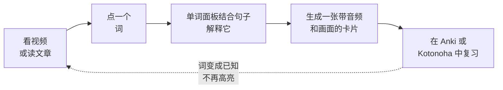

每个标记为已知的词都会在所有地方停止高亮，每个视频或文本的理解度也会随之提高。

## 功能一览

### 真正能读懂的字幕

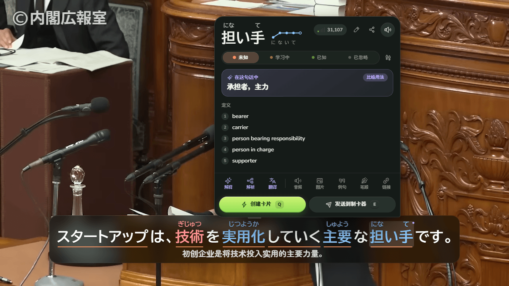

视频：[《第221回国会における高市内閣総理大臣施政方針演説》](https://www.youtube.com/watch?v=alk-cIHwTIU)（日本首相官邸 YouTube），附官方文本及英译（[首相官邸ホームページ](https://www.kantei.go.jp/jp/105/statement/2026/0220shiseihoshin.html)），采用与 CC BY 4.0 兼容的公共数据许可 [PDL 1.0](https://www.digital.go.jp/resources/open_data/public_data_license_v1.0)；已用 Kotonoha 的字幕和单词面板加工。听写、语法和卡片也使用这段视频。

字幕显示在播放器上方，带有振假名、按音调重音区分的颜色，以及表示每个词学习状态的下划线：未知、学习中或已知。鼠标悬停即可打开带词典的单词面板，不产生任何费用。Claude 会补充这个词在这句话里的含义，即使是比喻或诗意的用法，比如图中的 担い手：不是用肩膀扛东西的人，而是推动这件事的主力。

- 按 `Q` 用这句话、它的音频和视频画面生成卡片，直接送往 Anki 或内置复习。
- `A` 和 `D` 在台词之间移动，`S` 重复当前台词。字幕导航（`G`）列出全部台词，支持筛选和书签。
- 字幕可以翻译成你的语言，自动生成的字幕会结合标题和整个剧本进行纠正。
- 没有字幕的视频可以在你自己的电脑上用显卡转写：30 分钟的视频大约一分钟完成。

### 你的歌，像卡拉 OK 一样

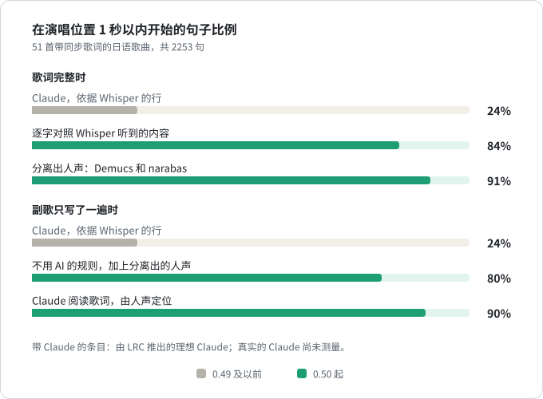

把一首歌的歌词粘贴到 **AI 字幕**面板的**歌词**中，每一句都会在唱到时出现，无论是在音乐视频上还是在**播放器**里。它们和其他字幕一样：带振假名、颜色和单词面板，可以翻译，每一句都能做成卡片。

难的是准确的时刻。Kotonoha 把工作拆开来做，而且全部在你自己的电脑上完成：

1. **Whisper Turbo** 听整首歌，大致说出听到了什么、在什么时候。
2. **Demucs** 用显卡把人声从伴奏中分离出来：一首四分钟的歌大约 20 秒。
3. 歌词与 Whisper 听到的内容**逐字对照**，每一句得到一个几秒宽的范围。
4. **narabas** 是一个音素模型，每 20 毫秒说出当前的声音像哪个音素；**强制对齐**在每个范围内按顺序走过歌词的音素：每一句都从它的第一个音素响起的地方开始。

Whisper 得去猜唱的是什么；Kotonoha 已经知道，因为它有歌词，只需找出歌词在哪里响起。所以一半的句子在离演唱位置不到 0.16 秒的地方开始。到 0.49 版为止，时间来自 Whisper 的行，即使 Claude 一点不出错，一半的句子也会差将近 3 秒。

网上找到的歌词很少是完整的：副歌只写一遍、“(サビ繰り返し)”、“[Chorus]”、“×2”、括号里的和声。Kotonoha 会按实际演唱把它们展开；打开**让 Claude 阅读歌词**后，Claude 会通读歌词，说出唱什么、按什么顺序。时间不是 Claude 定的，而是由人声决定。任何模型都听不懂的部分，可以用**标记时间**按空格键手动标记。

按人声定位适用于日语歌词；其他语言的歌词会与 Whisper 听到的内容逐字对照。用 51 首带同步歌词的日语歌曲（2253 句）测量：[工作原理与测量方法](docs/zh/architecture.md#歌词)。

### 你的视频和音频

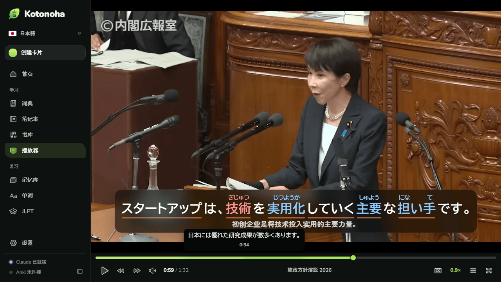

同一段《第221回国会における高市内閣総理大臣施政方針演説》视频，作为本地文件打开。

**播放器**可以打开你自己的视频和音频，或把整个文件夹作为播放列表打开，并带上每一集的字幕；文件名写着其他语言的字幕会作为翻译。它有自己的控件：速度、音量、在台词之间跳转，鼠标移到进度条上时还能看到那一刻说的那句话。全屏时字幕依然显示。它会记住每个文件看到哪里，**继续观看**一键就能再次打开。没有字幕的播客和有声书由 Whisper 在你的电脑上转写。

### 任意网页

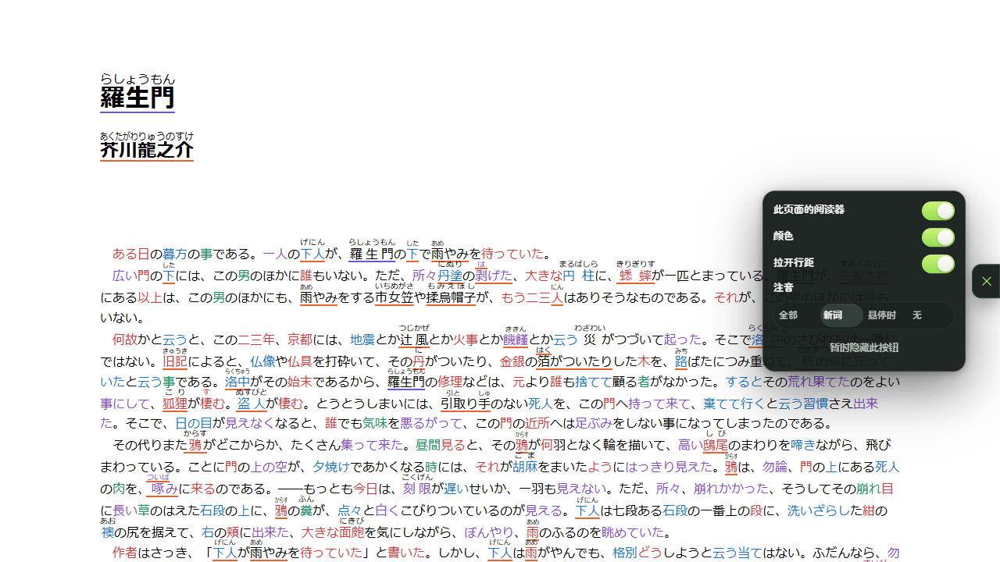

新闻：[「地球から1光日 259億キロ離れた宇宙を進むボイジャー1号の旅」](https://news.web.nhk/newsweb/na/nd-20261116de76380)，NHK ONE（2026 年 11 月 17 日；插图 NASA/JPL-Caltech）。仅用于展示网页阅读器，版权归 NHK 所有。

在新闻、博客、百科或 Claude 这样的聊天页面里，日语文本同样会有颜色和振假名，点击一个词就能打开它的单词面板。网页内容不会被改动：链接和按钮照常工作，用 React 构建的网站也察觉不到。已在约三十个真实网站上测试。

### 书籍、PDF 和漫画

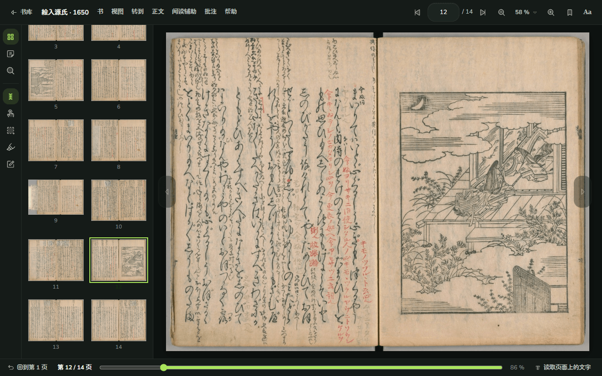

『源氏物語』1650 年（庆安 3 年）插图本第 1 卷，藏于[日本国立国会图书馆](https://dl.ndl.go.jp/pid/2579509)（公有领域）。

**书库**是一个完整的阅读器，就像 PDF 阅读器一样：缩放、双页、连续滚动、目录、缩略图，并记住每本书读到的页码。各项操作都放在有名称的菜单里，按 Ctrl+K 输入想做的事即可找到任何操作；还有抓手、荧光笔，以及只留下页面的阅读模式。页面上的每个词都可以带上注音和按状态的下划线，句子的译文会像字幕一样显示在句子下方，还可以跟随句子朗读，并把查过的词连同页面截图做成卡片。在页面上框出的区域可以单独用文字识别读取，文字版 EPUB 和书库中的文本也在同一个查看器中阅读，菜单相同。像小说这样的文字版 EPUB 会保留原有的排版、注音和竖排，上面叠加网页阅读器：颜色、振假名和单词面板，和在网页上一样。带文字的 PDF 可以直接逐词阅读。图片文件夹形式的漫画只需选择文件夹即可导入：每一卷成为一本书，封面在前，彩色跨页完整显示。书架可以把书归入合集，例如一个系列及其各卷，并配上封面和描述，还会显示每本书和每个合集读了多少。在阅读器中可以给页面加书签、高亮或为文字加下划线并附评论，还能在页面上贴笔记，就像在 PDF 阅读器中一样。可以在整本书中搜索一个词，把每一页当作文字配合阅读辅助来读，还可以让 Claude 对照页面图像检查文字识别读出的文字。

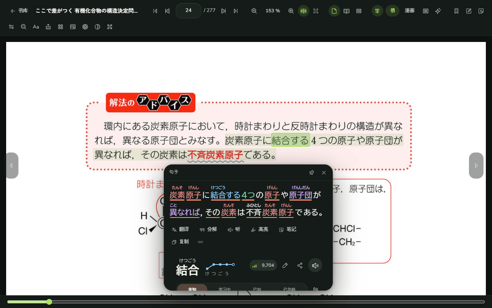

图片形式的页面，比如漫画、扫描书和许多 PDF，会在你自己的电脑上用显卡进行文字识别（OCR）。有印刷书籍模式，也有漫画模式；漫画模式能读取竖排对话框，而不会把振假名混进正文。在页面上点一个词，就会在浮动窗口中打开它所在的整句话，带振假名和单词面板，而且不会挡住还没读的文字；拖动可以选中任意一段，来翻译或解释。每一页只识别一次，并会保存下来。用**导出带文字的 PDF**，可以把书导出为叠着隐形文字的 PDF，在任何 PDF 阅读器中搜索和复制；对于低分辨率的扫描件，阅读器提供**清晰度**。

这不是普通的 OCR。读书时，PP-OCRv5 找出文字行，PP-OCRv6 识别它们，把印刷的振假名和正文分开，双栏页面按栏阅读；扫描版 PDF 直接按原有分辨率读取原始图像，而不是屏幕上绘制的页面：在以 180 dpi 扫描的化学书上，字符错误率为 0.2%。读漫画时，检测器找出对话框，manga-ocr 按分镜顺序识别，并略去水印和页码。

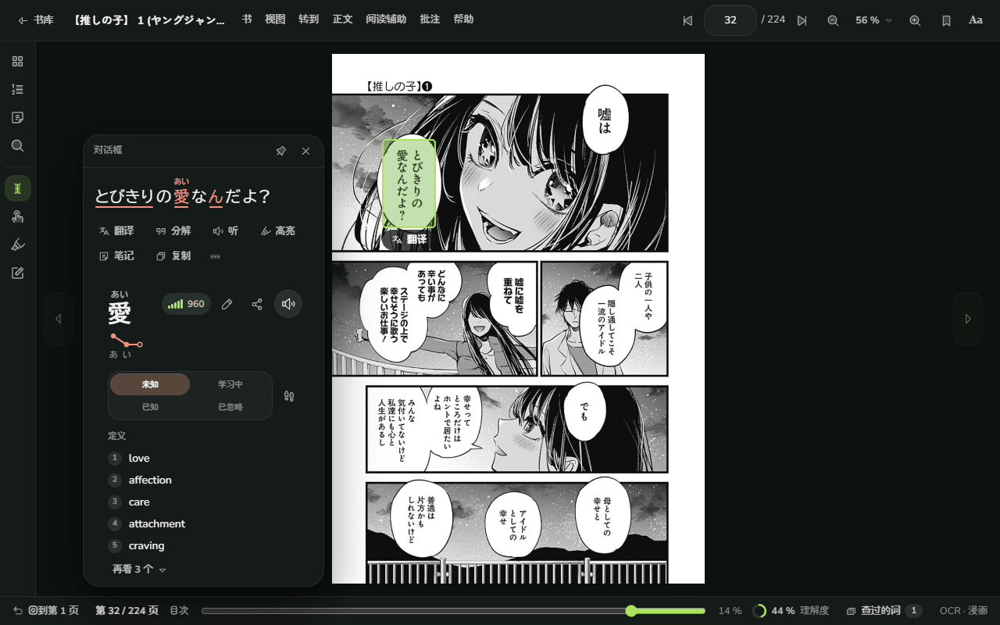

示例页面：『改訂版 ここで差がつく 有機化合物の構造決定問題の要点・演習』，西村能一、黒澤孝朋著（KADOKAWA，2024）；【推しの子】（《我推的孩子》）第 1 卷，赤坂アカ、横槍メンゴ著（集英社，2020）。每部作品只展示一页，用于说明阅读器；版权归作者和出版社所有。

### 读书之前，先看它的词汇

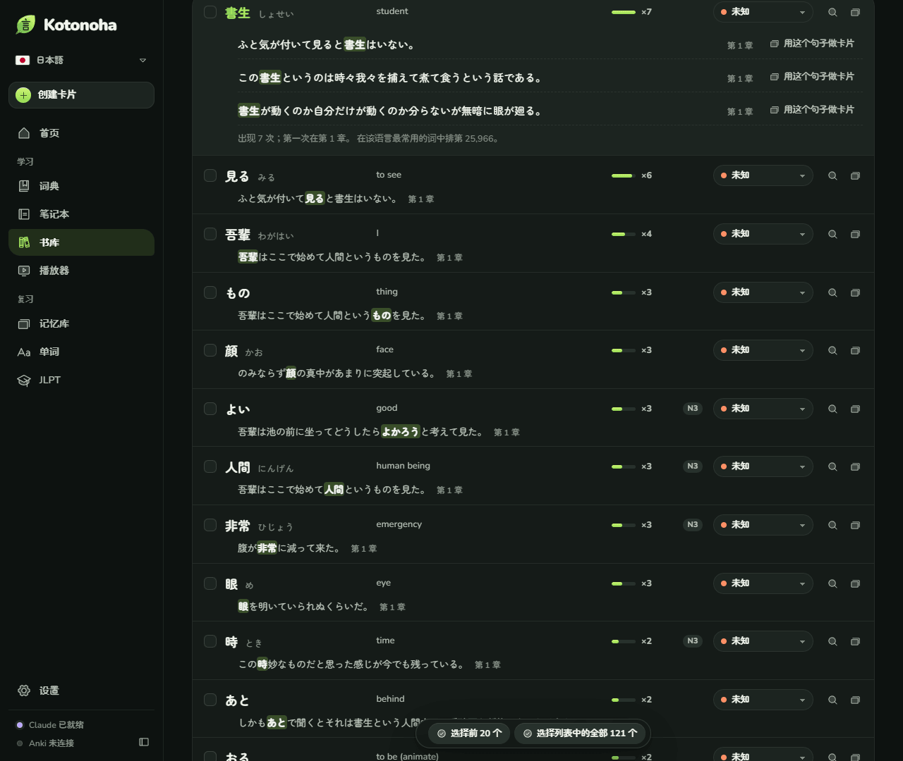

『源氏物語』「桐壺」，与谢野晶子译本，来自[青空文库](https://www.aozora.gr.jp/cards/000052/card5016.html)（公有领域）。

每本书和每个合集都有自己的**词汇**：统计其中的所有词，出现最多的排在前面，附读音、释义、JLPT 级别和书中最合适的句子。上方显示你已经理解多少，以及要理解 90%、95% 或 98% 还需要多少个词。可以直接在这里把词标为已知或学习中，选中的词会连同书中的句子一次性加入记忆库或 Anki。小说、PDF、文本和用文字识别读取的漫画都适用；在系列中，每一卷都会显示它带来多少新词。书中的语法也在这里，逐条列出。

### 用来书写和阅读的笔记本

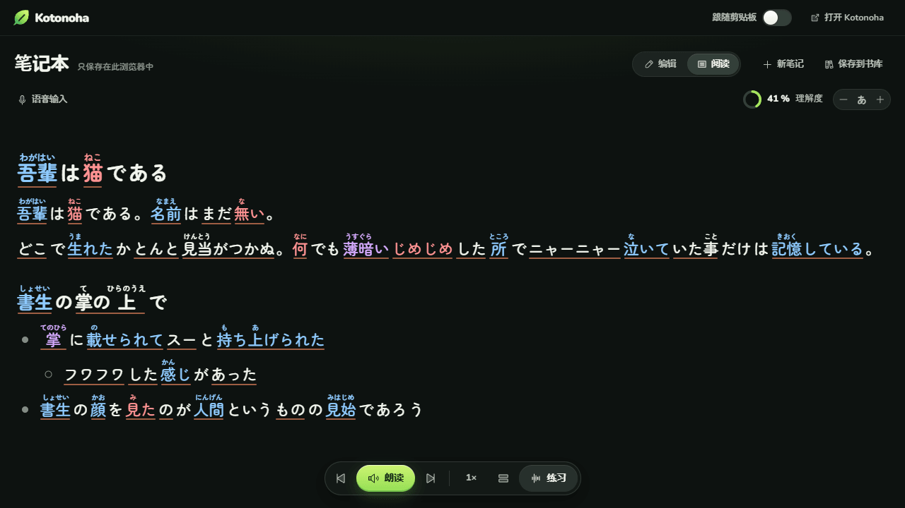

**笔记本**是一个铺满整个宽度的页面，可以用所学语言书写和粘贴带标题、列表和引用的文本，并以分析过、带注音的形式阅读。**整理**能为一整块粘贴的文本加上结构而不改动字词，每条笔记都会保存在书库中。它可以按你选择的速度朗读：连续、逐句或重复一句；选中的任意部分都可以听或练习。还可以对它语音输入：对着麦克风说的话会在电脑上转录，作为新的段落加入，并附带录音。它也能在普通标签页中打开，在分屏视图中放在正在阅读的页面旁边，并收集你在任何地方复制的内容。

### 开口练习音调重音

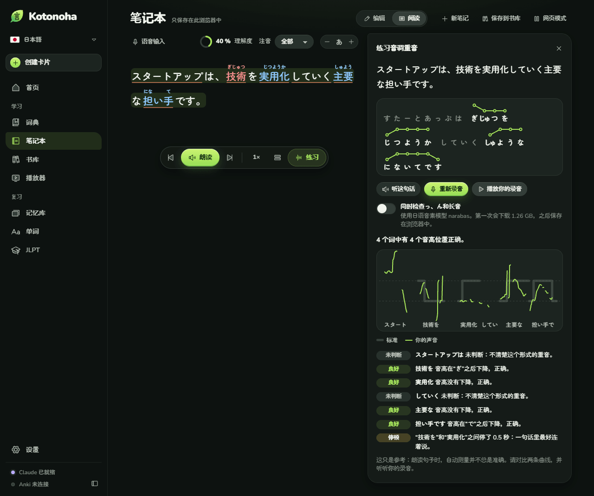

声音来自同一段国会演讲（日本首相官邸，PDL 1.0），从视频中截取，代替自己的录音。

**练习**会显示句中每个词的重音。朗读之后，Kotonoha 会把你声音的音高曲线叠在标准曲线上，指出哪些词的音高下降位置不对，标出长停顿，还可以检查是否缺少或多出っ、ん和长音。音高在浏览器中测量，录音在电脑上转录，不会离开电脑。示范语音会按词典的重音朗读每个句子，免费，同样不离开电脑：用安装在 Kotonoha 里的 AivisHub 语音，或打开的 AivisSpeech 或 VOICEVOX。

### 听写

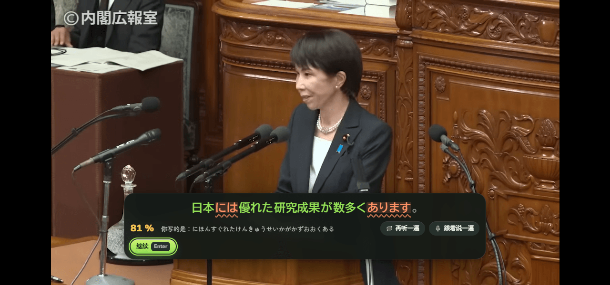

**听写**模式会在播放时隐藏这句台词，在句末暂停，让你写下听到的内容。检查时，听对的部分显示为绿色，听对一半的显示为黄色，漏掉的加下划线，并给出这句的得分。日语按读音比较，所以用假名输入也可以。**跟着说一遍**会用这句话打开音调重音练习，按 `P` 则可以练习任意字幕。

### 已经掌握的语法

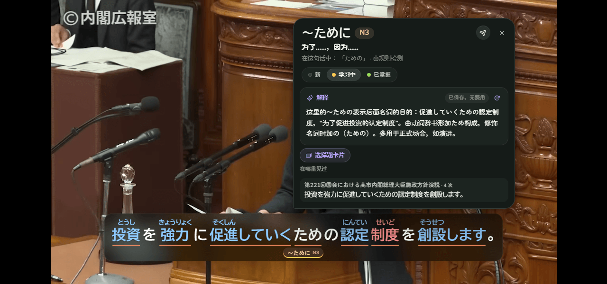

每条字幕下方会列出这句话里的语法点和它的 JLPT 级别。点一下就会打开气泡：它的意思、Claude 针对这句话的讲解，以及你之前在哪里见过。每个语法点可以标为**新**、**学习中**或**已掌握**；正在学的会加一条黄线，已掌握的不再标出。已经会的可以从 Anki 导入，**选择题卡片**会生成一张卡片，附三个容易和正确答案混淆的选项。

### 每个汉字怎么写

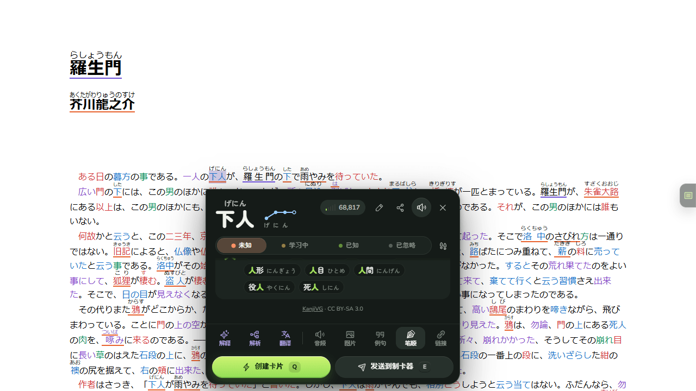

单词面板会逐笔、循环演示词中每个汉字的笔顺，并标出笔画编号；下方列出你已经认识、含有同一个汉字的词。

### 分享你发现的内容

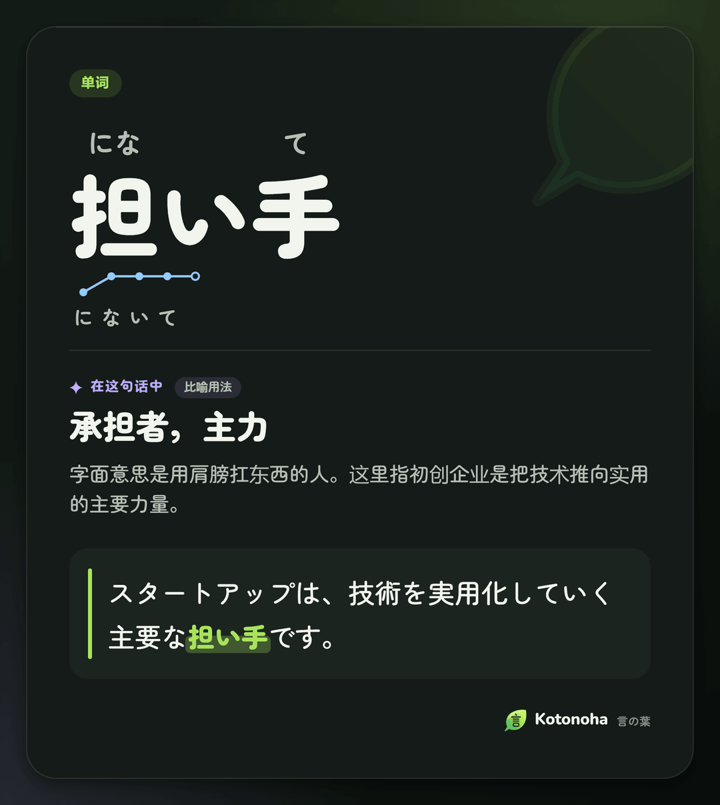

单词面板中的**以图片分享**会把一个单词或语法点做成卡片，写明它在这句话中的含义以及它出现的句子，并放进剪贴板，可用 Ctrl+V 粘贴到任何聊天中。卡片和主题一样，有墨色和纸张两种样式。

### 按级别学习 JLPT

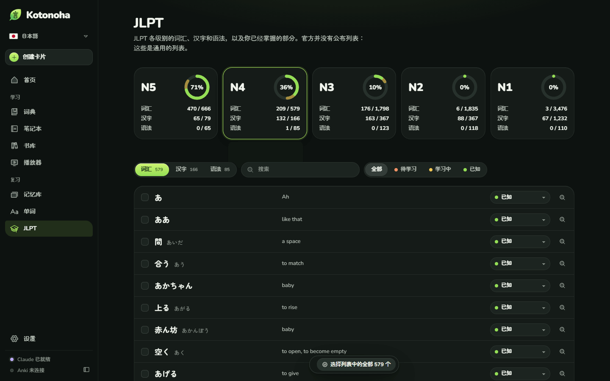

**JLPT** 页面汇集了从 N5 到 N1 每个级别的词汇、汉字和语法，并根据你在观看和阅读时标记的单词，显示每个级别已经掌握了多少。已经会的单词可以一次性标记，每个汉字都有笔顺和含有它的单词，每个语法点都会列出你看过的、出现它的句子。

### 完整的词典

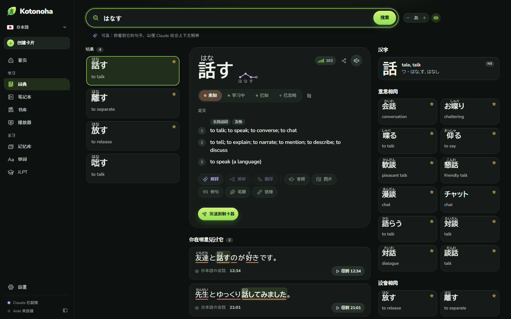

词典占满整个窗口：一侧是结果列表；中间是大字显示的词条，读音标在上方，每个义项都标出词性；另一侧是它的汉字、反义词、意思相同的常用词（比如 話す 对应的 喋る 和 会話）以及读音相同的词。下方列出你看过的视频里出现过它的句子，附出现的时间和一个回到那个时刻的按钮。词典还能按意思搜索，比如“dog” → 犬，并能按形式或意思查找语法。首页汇集了拟声拟态词、谚语、四字熟语，以及书面语、口语和敬语。文字大小和字体可以直接在页面上调整。

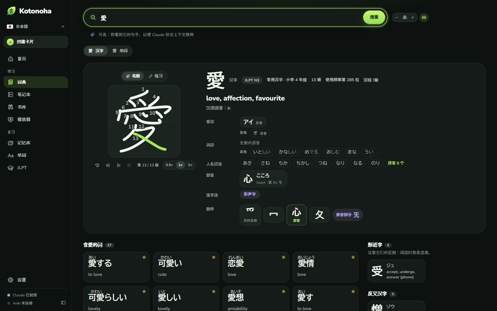

单个汉字有自己的专页：逐笔演示的写法；含义；全部读音，包括罕见读音和人名读法，并标明每个读音来自哪个时期；部首和部件，标出表音的部件以及同声旁的汉字；你已经认识的含有它的词、最常用的含有它的词，以及不按汉字读音来读的词，比如今日；形近字、反义汉字和旧字形；还有它的印刷体和手写体。

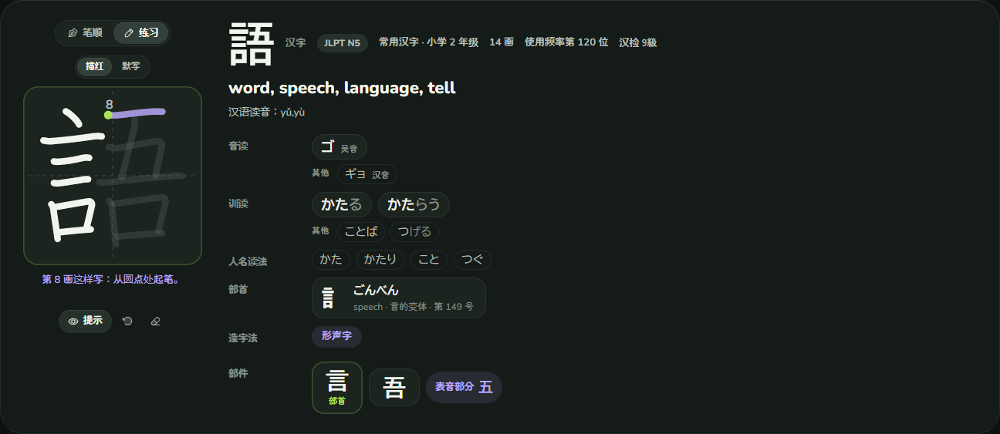

还可以直接在这里练习：用鼠标、手写笔或手指书写，可以描红，也可以默写，每一画在松开时判定。方向反了，或者写成了后面的某一画，都会指出来；点**提示**，这一画会自动演示。

### 也能学英语

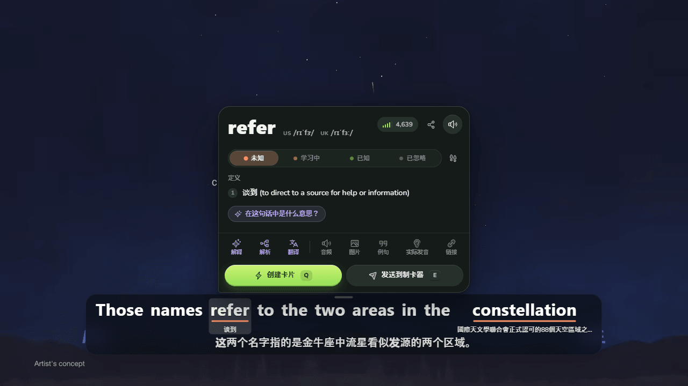

视频与字幕：[《What’s Up: November 2026 Skywatching Tips from NASA》](https://www.youtube.com/watch?v=PN-iD6VTmyc)，NASA/JPL-Caltech（公有领域）。

学习英语时，单词面板会给出美式和英式的 IPA 发音，即使短语动词被拆开（如 *picked it up*）也能找到，并说明每个不规则形式来自哪个词。词典来自 Wiktionary，释义为中文。漫画按对话框从左到右逐个读取，句子由本机的神经网络语音朗读：英语用 Kokoro，德语用 Piper。每种语言分别保存自己的单词、卡片和设置，一键即可切换。

### 也能学中文

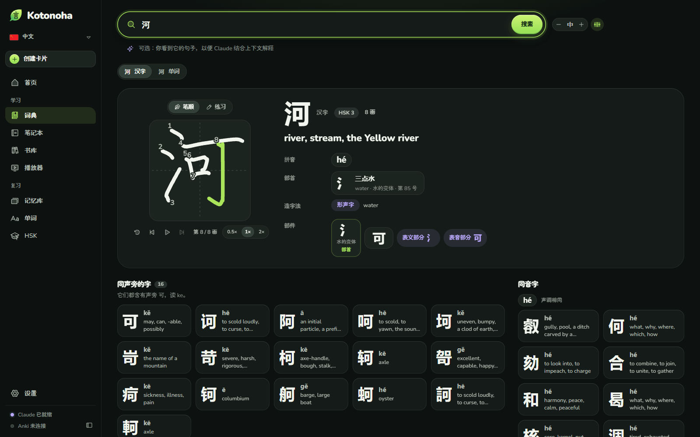

学中文时，文本即使没有空格也会自动分词，每个汉字上方标有拼音，采用词典声调；多音字（长：cháng 或 zhǎng）按句中的读音标注。词典是 CC-CEDICT，若有你所用语言的 Wiktionary 简短译文，会排在它前面；用汉字或拼音都能搜索，带不带声调都行。学习的是简体字：如果视频只有繁体字幕，会转成简体显示。等级采用 HSK 3.0，并有专门的页面：2025 年大纲各级的词汇、汉字和语法。搜索单个汉字会打开它的页面，显示部首、部件、造字法和笔顺，还可以像练习日本汉字一样练习书写。每个音节都带上声调的颜色；词卡里的**实际发音**会说明说话时声调怎么变（一、不、两个第三声相连），**练习**会把你的声音逐个音节地和声调形状比较，不用语音模型。

### 还有

- **英语的实际发音。** 单词面板会按连贯说话时的样子显示句子：*going to* → *gonna*、*meet you* → *meechu*、*turn off* → *tur‿noff*，并说明每种变化。
- **沉浸时长。** 首页统计你用所学语言听和读的时间，以及连续学习的天数。
- **费用一目了然。** 主页显示本月 Claude 的花费，按天、模型和任务分类，并可设置每月上限。不会重复付费：每个回答都会保存。[费用研究](docs/zh/costs.md)给出了实测数据。
- **内置复习。** 采用 FSRS 算法，适合不用 Anki 的人：复习时可以撤销、编辑和暂停，每天新卡片有上限，所有卡片一目了然，还有连续天数和图表显示的进度。
- **本地文件。** 可以播放电脑上的视频，并读取 MKV 中的字幕。
- **按需定制。** 色盲友好和高对比度配色、假名或罗马字读音、可修改的快捷键，以及可以停用的网站。

## 技术内幕

繁重的计算都在你自己的电脑上用 WebGPU 和 ONNX Runtime 完成：没有自己的服务器，也不需要账号。每个部件都用真实材料与其他方案对比测量后才选定，所有数字都能用仓库里的脚本复现。

| 做什么 | 用什么 | 测量结果 |
|---|---|---|
| 转写没有字幕的内容 | Haas-ja、Parakeet 和 Whisper Turbo，借助 Transformers.js | 30 分钟的视频约一分钟；日语口语的错误率为 3%，Whisper Turbo 为 9% |
| 放置歌词 | Demucs 分离人声，narabas 借助自研的 CTC 强制对齐把每个音素放到位 | 一半的句子离演唱位置不到 0.16 秒；用 Whisper 的时间则差将近 3 秒 |
| 判断哪里在唱 | YAMNet，在处理器上运行，把 GPU 留给 Whisper | 区分演唱和间奏的 AUC 为 0.9 |
| 读扫描书 | PP-OCRv5 找出文字行，PP-OCRv6 识别，振假名和分栏单独处理 | 以 180 dpi 扫描的化学书，字符错误率 0.2% |
| 读漫画 | 对话框检测器和 manga-ocr，按分镜顺序 | 五部作品的 18 页中错误率 2.8% |
| 朗读 | AivisHub 的语音在 WebGPU 上运行，配合 TypeScript 版的 OpenJTalk：yomi | 每个音拍的音高与 AivisSpeech 一致的比例为 92% |
| 统计一本书的词汇 | Kuromoji 和 IndexedDB 中的词典 | 一整部小说，约 13.5 万词，大约四秒 |
| 检查一切 | Vitest，以及在真实 Edge 和显卡上运行的 Playwright | 超过 1500 个单元测试和超过 40 个端到端流程 |

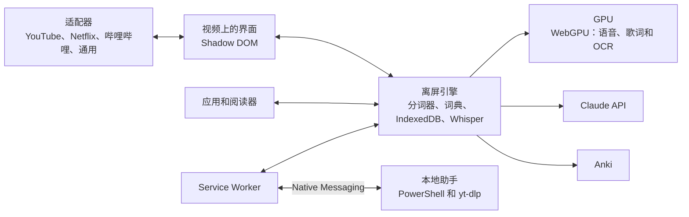

使用 TypeScript、Preact、Dexie 和 esbuild，并通过 WebGPU 上的 ONNX Runtime 和 Transformers.js 运行模型。各部分的细节、技术决策和每个数字的测量方法见 [docs/zh/architecture.md](docs/zh/architecture.md)；如何运行测试见 [CONTRIBUTING.md](CONTRIBUTING.md)。

## 不用 Claude 能做什么，用 Claude 又能多做什么

Kotonoha 不需要任何密钥就能使用。可选的 Claude 密钥会增加需要语言模型的功能。

| 无需密钥，免费 | 使用 Claude 密钥，按用量付费 |
|---|---|
| 带振假名、音调重音和学习状态的字幕 | 一个词在句子里的含义 |
| 词典、单词面板、笔顺和发音 | 单词、句子和语法讲解 |
| 网页阅读器、笔记本和带 OCR 的书库 | 字幕翻译和纠正 |
| 在本机进行语音转写 | 检查振假名读音 |
| Anki 卡片和内置复习 | 按你的水平写的故事 |
| 按人声放置的歌词 | 由 Claude 阅读带标记和重复的歌词 |

正常使用每月只需几美分。密钥只保存在浏览器中。也可以按任务改用 OpenRouter、DeepSeek、OpenAI，或通过 LM Studio、Ollama 使用自己电脑上的模型。

## 安装

要求：Chrome 或 Edge 120 及以上版本。转录、歌词和 OCR 在显卡上运行，有独立显卡会更快；没有也能用，只是更慢。

1. 从[最新版本](https://github.com/Eliam4510/kotonoha/releases/latest)下载 `kotonoha-<版本>-extension.zip`，解压到一个固定的位置。
2. 打开 `chrome://extensions` 或 `edge://extensions`，开启**开发者模式**。
3. 点击**加载已解压的扩展程序**，选择 `kotonoha` 文件夹。

在 Windows 上也可以先装助手：`kotonoha-<版本>-ayudante.zip` 里有 `Instalar.cmd`，双击即可安装助手；如果没找到 Kotonoha，还会以固定的标识符安装扩展。之后只剩第 2 步和第 3 步。

首次启动时，欢迎页面会询问你的语言、想学的语言和水平，安装词典，并显示各项功能在这台电脑上的运行情况。更新时，只需把新版本解压覆盖旧版本：扩展会自动重新加载。有新版本时，Kotonoha 会在首页提示；安装了助手的话，点**立即更新**一下就能装好。[使用指南](docs/zh/guide.md)介绍了每项功能，[CONTRIBUTING.md](CONTRIBUTING.md) 介绍了如何从源代码构建。

## 主要快捷键

| 快捷键 | 操作 |
|---|---|
| `Q` | 用这句话创建卡片 |
| `E` | 发送到制卡器 |
| `1` 到 `4` | 标记单词：未知、追踪、已知、忽略 |
| `A`、`D` 和 `S` | 上一句、下一句和重复 |
| `G` | 字幕导航 |
| `Alt+Shift+K` | 打开 Kotonoha 窗口 |

视频上的所有快捷键都可以修改，并适用于任何键盘布局。

## 隐私

- 数据和 Claude 密钥只保存在浏览器中。没有自己的服务器，也不收集使用统计。[隐私政策](docs/privacidad.md#english)说明了会向每个服务发送什么。
- 转写的音频和识别的页面不会离开你的电脑。
- Claude 只会收到每次请求所需的内容：句子、字幕文本和标题。
- 词典和模型只下载一次，来自 GitHub 和 Hugging Face。[声明](docs/zh/notices.md)列出了每个来源。

## 项目状态

每个版本都附带测试和六种语言的文档；[更新内容](CHANGELOG.md)对每个版本做了总结。它在 Windows 上的 Chrome 和 Edge 中使用和测试。YouTube 和英语还在真实会话中手动检查过。界面翻译借助 AI 完成，尚未经过母语者审校，欢迎指正。

## 许可与致谢

代码以 [MIT 许可](LICENSE)发布。第三方组件、使用时下载的数据以及负责任使用的条件详见[声明](docs/zh/notices.md)。

- 词典：[JMdict](https://www.edrdg.org/jmdict/j_jmdict.html) 和 KANJIDIC（EDRDG）、[Kanjium](https://github.com/mifunetoshiro/kanjium) 和 [JPDB](https://jpdb.io)；英语和德语使用 [Wiktionary](https://www.wiktionary.org)，经 [wiktionary-to-yomitan](https://github.com/yomidevs/wiktionary-to-yomitan) 和 [kaikki.org](https://kaikki.org) 整理；中文使用 [CC-CEDICT](https://www.mdbg.net/chinese/dictionary?page=cc-cedict)，经 [cc-cedict-yomitan](https://github.com/MarvNC/cc-cedict-yomitan) 整理。
- 语音：[Whisper large-v3-turbo](https://huggingface.co/onnx-community/whisper-large-v3-turbo)、Haas-ja 和 Parakeet，借助 [Transformers.js](https://github.com/huggingface/transformers.js)。
- 歌曲：Meta 的 [Demucs](https://github.com/facebookresearch/demucs)（htdemucs），使用 [timcsy 的 ONNX 转换](https://huggingface.co/timcsy/demucs-web-onnx)；darashi 的 [narabas](https://github.com/darashi/narabas)，以及 Google 的 [YAMNet](https://github.com/tensorflow/models/tree/master/research/audioset/yamnet)。
- 文字识别：[PP-OCRv5 和 PP-OCRv6](https://github.com/PaddlePaddle/PaddleOCR)、[manga-ocr](https://github.com/kha-white/manga-ocr) 和[对话框检测器](https://huggingface.co/ogkalu/comic-text-and-bubble-detector)。
- 笔顺：[KanjiVG](https://kanjivg.tagaini.net)，作者 Ulrich Apel，CC BY-SA 3.0；中文为源自 [Make Me a Hanzi](https://github.com/skishore/makemeahanzi) 的 [Hanzi Writer](https://github.com/chanind/hanzi-writer-data)，Arphic Public License。
- 图片内容：日本首相官邸的国会演讲（PDL 1.0）、NASA 的视频、日本国立国会图书馆的 1650 年插图本『源氏物語』、青空文库的与谢野晶子译『源氏物語』和『羅生門』，以及『吾輩は猫である』的开头；除演讲外均为公有领域。NHK ONE 的新闻和两本书的页面在图片下方注明出处。
- 图标：[Phosphor](https://phosphoricons.com)。字体：[Zen Maru Gothic](https://fonts.google.com/specimen/Zen+Maru+Gothic) 和 [Nunito](https://fonts.google.com/specimen/Nunito)。

名字出自《古今和歌集》假名序（约 905 年）：和歌以人心为种子，生出万千言语之叶。

独立项目，与文中提到的任何服务均无关联。
