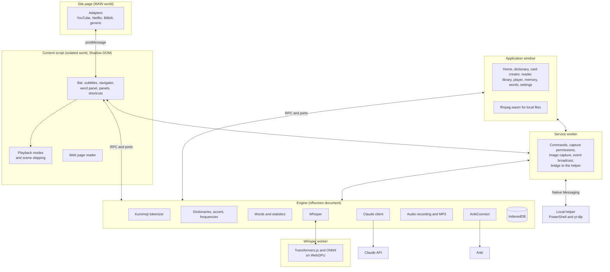
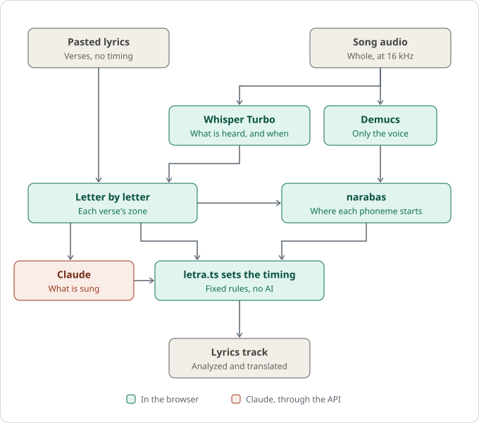
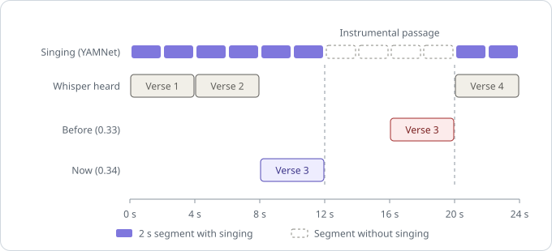

<p align="right"><a href="arquitectura.md">Español</a> · <b>English</b> · <a href="de/architecture.md">Deutsch</a> · <a href="zh/architecture.md">简体中文</a> · <a href="ko/architecture.md">한국어</a> · <a href="ja/architecture.md">日本語</a></p>

# Architecture

Kotonoha (言の葉, "leaves of words") is a Manifest V3 extension for learning Japanese from real video and text. This document describes how the work is divided among its parts, the main flows and the measurements behind the technical decisions. Code, identifiers and comments are in Spanish, so folder and file names are kept as they are.

## Overview



## Division of responsibilities

| Part | Responsibility | Reason |
|---|---|---|
| **Adapters (MAIN)** | Talking to each site's player: tracks, seeking, playback | `#movie_player`, `netflix` or Bilibili's `player` can only be reached from the page |
| **Content script** | The whole interface on top of the video | The isolated world and Shadow DOM prevent interference with the site in both directions |
| **Service worker** | APIs nothing else can use: commands, `tabCapture`, `captureVisibleTab`, `connectNative` | Chrome stops it when idle, so it holds no state |
| **Engine (offscreen)** | Tokenizer, database, Claude, Anki and recording | The heavy, long-running work. An offscreen document does not stop halfway through a response |
| **Whisper worker** | Loading the model and transcribing on the GPU | Very heavy, and it would block the engine. It is bundled separately and loaded only when used |
| **Local helper** | Downloading the audio of an online video and updating the extension | An extension cannot do this alone. Only the extension can call it, and it only accepts http or https addresses |
| **Application window** | Management screens and local player | A regular extension page that uses the same engine over RPC |
| **Core (`src/nucleo`)** | Pure logic: parsers, modes, statistics, synchronization, transcription and batches | No browser dependencies, tested with Vitest |
| **Language packages (`src/lenguas`)** | Everything that depends on the language being studied | The rest of the program only knows their interface |

## Flow of a subtitle

1. The adapter detects the video and lists its tracks.
2. The content script chooses the Japanese track and the secondary one. Imported tracks take priority, and hand-made ones are preferred over automatic ones.
3. The adapter downloads the text with the page's session. This matters on YouTube, where addresses are signed by the player. On Bilibili it is the list that needs the session; each subtitle file is requested without cookies, because its CDN answers anyone and with them the browser would reject the response.
4. The core converts the format (TTML, WebVTT, SRT, ASS or json3) into timed lines.
5. The engine tokenizes, joins conjugations, computes furigana, accent, frequency and status for each word, and detects grammar with rules.
6. For an automatic track, Claude first corrects its recognition errors: analyzing text with errors would be wasted effort.
7. Claude reviews each new line in the background: it corrects readings, flags figurative use and confirms grammar. The result is stored per line and requested only once.
8. The interface paints each word: the text color shows the accent, and the underline, the learning status.

## Translation and correction with Claude

A whole video takes time to process, but what matters is the part being watched. So the work is divided into batches, starting with the batch at the playback position (`src/nucleo/lotes.ts`).

| | Translation | Correction |
|---|---|---|
| Batch size | 80 lines | 120 lines |
| Claude's response | Every line | Only the lines that change, usually few |
| Context | Title and neighboring lines | Title and full text, in a prompt-cached block |
| First batch | In parallel with the others | Alone: it writes the cache the others reuse |
| If interrupted | What is translated is saved; translating again starts from scratch | What is corrected is saved, and it is marked complete at the end |

In translation, what Claude returns is checked before saving: only numbers from the batch, once each, with text and no apologies. If it does not translate a line, such as a verse of a song, the line stays empty and the final notice says how many there are; a batch the API refuses does not stop the others.

Correction never asks: Claude decides from the context and leaves doubtful lines as they are. If a line is a sentence invented by the recognizer, it returns it empty and the line disappears. Each correction keeps the original text, available in the subtitle navigator.

Generated tracks are stored per video and language, with their origin: Whisper, Claude, imported or saved. A track remembered from another Netflix region only appears if the current region lacks it.

## Whisper transcription

Claude does not transcribe audio, so this part runs on the local computer.

| Source | How the audio arrives | Speed |
|---|---|---|
| Local file | ffmpeg.wasm extracts the chosen track in the application window. The file is mounted without copying, so it works for whole films | Whatever the GPU allows |
| Online video, with the helper | yt-dlp downloads the audio to a temporary folder. With FFmpeg on the computer, the helper converts it and the engine reads the samples in parts through the service worker; without it, the engine receives the file and converts it with ffmpeg.wasm | Whatever the GPU allows |
| Online video, without the helper | Tab capture during playback. The player reports the video time four times per second, which maps samples to video time despite pauses or seeks | Real time |

Netflix is left out on purpose: it almost always has subtitles, and its audio cannot be processed in advance.

1. The audio is cut at silences before reaching Whisper's 30 s window. Stretches without speech are discarded, since that is where Whisper tends to invent text.
2. Whisper transcribes on the GPU. The text is cleaned of hallucinations and loops, and split into lines.
3. Each stretch of 6 s or more without text is transcribed again on its own. With background music, Whisper can end a chunk early, or start it late, and skip real speech. If the decoder gets stuck repeating itself, 10 s windows are tried. From these second passes only what is clearly a sentence is accepted, because most of those stretches contain only music.
4. Claude corrects homophones and kanji: at the end for files, and every ten lines in real time.

### Load control

Working without pauses keeps the GPU at 100 % for hours, which makes the desktop stutter and can restart the video driver.

| Measure | How it works |
|---|---|
| One chunk at a time | A two-hour film is never sent at once, and video memory does not grow with duration |
| Rest periods | After each chunk the GPU rests in proportion to how long it took. If another application is using the GPU, the chunk takes longer and the rest grows by itself |
| Automatic intensity | Busy 75 % of the time while the computer is in use and 90 % after two minutes idle. Gentle mode stays at 30 % |
| Pause | Frees the card at once and keeps the position |
| Watchdog | A hung chunk is aborted after 90 s |
| GPU loss | Waits 20 s, reloads the model and continues in gentle mode. On a second failure it stops, with the transcribed text saved |
| Resuming | A new transcription of the same file continues where it left off |

## Song lyrics

Pasted lyrics are placed on the audio by dividing the work, and each piece decides only what it knows how to do: Whisper hears what is sung and when, Demucs separates the voice from the music, narabas hears where each phoneme starts, YAMNet where there is singing, and `src/nucleo/letra.ts` calculates the timing. Claude only steps in if the lyrics barely match what is heard.

<p align="center"></p>

**Song or speech.** A video is treated as a song if it has lyrics waiting to be placed, if YouTube classifies it as music or if the title says so: MV, lyric video, official audio, karaoke and the like. It is then transcribed with Whisper Turbo, which hears singing over music better than the speech models.

**What Whisper hears.** Three things are added to what the previous section describes. Each chunk gets a little silence in front, because Whisper misses what sounds right at the start. A long line that, without its repetitions, shrinks below 40 % of its length is a loop and is discarded. And what a second pass recovers goes through a stricter filter: the short phrases typical over music and texts with fewer than 4 distinct characters are rejected as well, and if nothing passes, the stretch is taken as music. While lyrics are pending, the transcription is not corrected with Claude, because the text shown will be that of the lyrics.

**Where there is singing.** YAMNet, Google's sound classifier trained on AudioSet (521 classes), hears the same 60 s blocks as Whisper, in its own worker and on the CPU, so as not to compete for the GPU. For each 2 s segment, the score of the "Singing" class is kept. The threshold is 0.02, because the score is very low even during singing, and a single segment without singing between two with it counts as singing: it is almost never an instrumental passage. The score only exists when the song is transcribed whole from the start, with the helper or from a file; real-time transcription does not use it.

**Each verse's zone.** `src/nucleo/casarLetra.ts` matches the lyrics with what Whisper heard letter by letter, without AI. Both are turned into comparable letters (katakana into hiragana, without punctuation or spaces), and identical runs of at least two letters are looked for and chained in order: the heaviest chain is kept, with a Fenwick tree, where a kanji weighs 6, a kana 4 and a Latin letter 1, so that a chorus in English does not drag the Japanese verses along. Each verse that matches takes the moment its runs give it, the median: that is its zone. Without the voice, the timing comes from there.

**The voice alone.** Demucs (htdemucs, by Meta) separates the voice in a worker, with ONNX Runtime and WebGPU. The song's audio, which the engine keeps at 16 kHz, is raised to 44.1 kHz with a sinc filter and cut into 7.8 s chunks that overlap by a quarter. The model receives each chunk and its spectrogram (an STFT of 4096 samples with hops of 1024) and returns two branches, the time one and the frequency one; the latter is turned back into time (ISTFT) and added to the former. The voice is lowered back to 16 kHz and the chunks are joined with a triangular weight. `src/nucleo/demucs.ts` does that part, checked against the direct transform, and the GPU is only used if, with a fixed signal, it gives the same as the processor.

**The phonemes.** narabas, a wav2vec2 for Japanese phonemes, gives every 20 ms the probability of each of its 43 phonemes. The verses are turned into phonemes with Kuromoji's pronunciation, and a forced alignment (Viterbi over the CTC, in `src/nucleo/alineacionForzada.ts`) places all of the lyrics' phonemes, in order, over those probabilities. Each phoneme can only land in its verse's zone, with 2 s of margin on each side, or between its neighbours' zones if its verse did not match, such as a chorus repeated just like the verse next to it. A verse starts at the first frame of its first phoneme and ends 0.4 s after its last one.

**If they barely match, Claude.** If less than a quarter of the verses match, as with lyrics in rōmaji, Claude receives the lyrics and the transcription as two numbered lists, the second with its timing, which helps it see the instrumental passages. For each verse it returns `{v, de, a}`: the first and the last line of the transcription the verse sounds over. With -1, the verse is sung, but the transcription does not pick it up; with -2, it is not sung, like a section mark, a title or a credit. The prompt asks it to:

- compare by sound, not by spelling: in Japanese, 会いたい, 逢いたい and あいたい are the same; in English, "night" and "knight", and in German, "Meer" and "mehr";
- keep the order: `de` never goes back;
- match a line that resembles nothing by its position, since it is usually a misheard verse;
- repeat a chorus as many times as it is sung, and count choruses in parentheses as sung;
- ignore rōmaji and translations;
- return an empty list if the lyrics are not from that song.

The answer is small, follows a JSON schema and is cached: aligning the same lyrics over the same transcription is not paid for twice.

**The timing.** `aplicarAjuste` uses no AI: the same input always gives the same result.

1. The text comes from the lyrics, and the timing from the transcription. What Whisper misheard never reaches the screen.
2. Of Claude's entries, the longest non-decreasing subsequence is kept. An entry out of order loses its timing, but not its verse, and does not affect the rest: if each entry were compared only with the previous one, a single jump forward would invalidate all the following ones.
3. A verse Claude leaves out is still sung, so it goes in without timing, after where the previous one sounds.
4. Verses that share a line of the transcription split its duration according to what has to be sung in each, without counting spaces.
5. A verse without timing lasts 300 ms per character, between 1.5 and 8 s, and is placed right before the next verse with timing, which is where it leads. With YAMNet's score, only time with singing counts: if there is an instrumental passage right before the next verse, the verse goes before it. If the gap is too short to sing it, or has almost no singing, it is placed as without YAMNet, with the time its neighbors have to spare.
6. No line lasts less than 700 ms or stays on screen when the next one starts.

<p align="center"></p>

Measured with Japanese songs from official channels and their synced lyrics, YAMNet separates singing from instrumental passages with an AUC of 0.9. Of 164 verses Whisper did not hear, with YAMNet inside Kotonoha 21 end up more than a second closer to their place and 3 further away, and those more than 5 s off go from 32 to 28. The large errors left come from long passages Whisper does not hear: YAMNet knows there is singing there, but not which verse.

**What was measured.** With 51 Japanese songs and their synced lyrics (2253 verses), how far the start of each verse lands from where it is sung:

| How it is placed | Half, within | Nine in ten, within |
|---|---|---|
| Letter by letter with what Whisper heard | 0.34 s | 1.46 s |
| With the voice, on the mix | 0.19 s | 1.59 s |
| With the voice isolated | 0.16 s | 0.9 s |

The large errors that remain come from passages Whisper does not hear: the verse has no zone of its own, and narabas looks for it over a long stretch.

The result is a separate track, analyzed and translated like any other. The final notice says how many verses have an estimated time, and **Sync: this line is playing now**, in the navigator, fine-tunes the sync; with two marks it also corrects the speed.

## Technical decisions

| Decision | Choice | Reason |
|---|---|---|
| Interface | Preact and signals | Very light, which matters because it is injected into every video page |
| Bundling | esbuild with a custom script | Fast and explicit, with the manifest in plain view |
| Database | Dexie on IndexedDB | Indexes and queries without programming IndexedDB directly |
| Tokenizer | Kuromoji behind its own interface | Works in the browser and can be replaced without touching the rest |
| Dictionaries | Yomitan format: JMdict in Spanish and English, Kanjium accent, JPDB frequency | An open format, which also allows importing others from a file |
| AI | Official `@anthropic-ai/sdk` from the engine | The key never reaches scripts running in pages |
| Transcription | Whisper large-v3-turbo with Transformers.js and WebGPU, with a 16-bit encoder and a quantized decoder | The most accurate of those compared, with nothing to install |
| Singing detection | Google's YAMNet in ONNX, with ONNX Runtime on the CPU | With real songs it separates singing from instrumental passages with an AUC of 0.9. It takes 16 MB, and on the CPU it leaves the GPU to Whisper |
| Placing lyrics with the voice | narabas, a wav2vec2 for Japanese phonemes, with its own forced alignment over its CTC, in the zone given by what Whisper heard | It was already in the extension, for the pitch accent practice. It places each verse where its phonemes start: more precise than matching the text alone |
| Isolating the voice | Demucs (htdemucs) in ONNX, with ONNX Runtime and WebGPU; the STFT, the ISTFT and the resampling in JavaScript | With the voice alone, narabas makes far fewer mistakes. It takes 181 MB, and a four-minute song takes about 20 s |
| Audio from online videos | yt-dlp in a local PowerShell program, over Native Messaging, and FFmpeg if installed | The only way to process it without waiting for playback. It downloads to a temporary file instead of streaming, so it is read at the GPU's pace and nothing stalls |
| Local files | ffmpeg.wasm | Embedded subtitles and MKV audio tracks, without external programs |
| Flashcards | AnkiConnect and a built-in FSRS review | Integration with Anki, or review inside the application |
| Card audio | `tabCapture` and `MediaRecorder`, exported to MP3 | Works on any site without downloading the video |
| Web pages | CSS Custom Highlight API for colors, and a layer of its own, outside `<body>`, for readings | Adds nothing to the page's content and does not interfere with React applications and the like |
| Furigana in a scrolling box | One sheet per box, moved by `ScrollTimeline` and clipped by a frame | The browser scrolls those boxes without going through the main thread: repositioning readings from code would always leave them a frame behind the text, showing a trail. Linked to the scroll, they move together with the text, even when the page is busy |
| Line spacing | Inline, unitless `line-height`, only on multi-line text or rows packed together | With 15 px type and 21 px lines, 6 px remain for a 9 px reading and an underline. It is the only thing the reader touches on the page: it is reverted if the text would overflow a fixed-height box, and it can be turned off |
| Which word is under the pointer | `caretPositionFromPoint` with an index of text nodes | Resolves the click without wrapping each word in an element |
| Interface languages | One JSON table per language, with the Spanish text as the key, loaded separately | The content script runs on every page and must not carry six languages. Whole sentences, because word order changes in Korean, Japanese and German |
| Stroke order | [KanjiVG](https://kanjivg.tagaini.net), requested character by character from jsDelivr at a pinned version and, when it does not have the file, from the project's repository, and drawn as animated SVG | There are over 10,000 files: each kanji is downloaded when used and stays stored. jsDelivr only returns the ones it has already cached, because the repository exceeds its size limit, and answers 403 for the rest. SVG is sharp at any size and follows the theme, and only paths and their numbers are accepted from each file |
| Checking a handwritten stroke | Geometric comparison with the KanjiVG stroke (`nucleo/practicaTrazos.ts`): mean distance, endpoints, direction and shape, with the Fréchet distance on the normalized stroke | No handwriting recognition is needed: the expected stroke is known. If it matches another remaining stroke better, it says which one; if it matches reversed, it says that too. Short strokes are judged only by where they head, because in them the hand's tremor outweighs the shape. Tolerances were tuned with 1,413 strokes of 49 characters written with tremor |
| Dictionary index | The common words and those of each category, read in batches and saved in IndexedDB with the signature of the dictionaries | Walking almost a million rows with a cursor took 16 s at every start; in batches, 4.6 s, and reading the saved index, 0.2 s. It is only rebuilt when the dictionaries or the categories change |
| Reader in a tab | An extension page, `lector.html`, opened in a regular tab | The application window is of type `popup`, with no tabs, and cannot join split view. An extension page can, and needs no server. `chrome.tabs.create({ splitWithTabId })` places it next to the current tab from Chrome 155 |
| Following the clipboard | `execCommand('paste')` in the offscreen document | Without focus, `navigator.clipboard` refuses to read, and in split view the focus is on the other page. It only reads with the option on and the tab in view |
| Icons | Phosphor, duotone version | A consistent set, of which only what the code uses is bundled |
| Typography | Nunito for Latin and Zen Maru Gothic for Japanese | Both rounded. Loaded as data so that each site's security policy does not block them |

## Claude models

Each task uses `claude-sonnet-5-5` by default, and the model and effort can be changed per task in Settings. The "Go deeper" button on the word panel repeats the query with `claude-opus-5-5` and high effort. Requests enable `fallbacks: "default"`, so a safety refusal is retried on another model. This can be disabled in Settings. Structured responses use `output_config.format` with JSON schemas, and the full script, when sent, goes in a cached system block.

**Avoiding paying twice.** Every query has its own identity, made of what is being asked: task, model, level, language, template, word, reading and sentence. It leaves out the surrounding text, which changes as subtitles load. A request in flight is not cancelled when whoever asked for it leaves, because it is already paid for and cancelling it would mean paying again: it finishes in the background and is stored, and a second identical query attaches to it. The reading review advances in stretches of 120 lines from the playback position, and each batch in flight finishes and is stored even if the tab closes.

**Spending log.** After each request, `src/motor/ia.ts` writes to the `consumo` table the tokens reported by the API (`usage`), the model that answered and the task. The price is worked out in `src/nucleo/precios.ts`. Only what the API confirms is logged; an aborted request does not appear, even though the API may have billed part of it.

## Reference measurements

Computer: Radeon RX 9060 XT 16 GB, 16 GB of RAM, 4K 60 Hz monitor, Windows 11 and Edge. They can be reproduced with `pruebas/whisper-comparar.mjs`, `whisper-carga.mjs`, `whisper-video.mjs` and `whisper-larga.mjs`.

**Accuracy.** Character error rate on 126 real sentences from JSUT, Common Voice and ReazonSpeech, not counting punctuation or digits. Lower is better.

| Model | Total | JSUT | Common Voice | ReazonSpeech | Sentences with punctuation | Video memory |
|---|---|---|---|---|---|---|
| Whisper Turbo, 16-bit encoder | 8.8 | 5.5 | 6.5 | 15.0 | 36 of 126 | 3.7 GB |
| Whisper Turbo, quantized | 9.8 | 5.7 | 7.2 | 17.4 | 30 of 126 | 1.5 GB |
| Kotoba Whisper v2.2, quantized | 10.4 | 6.4 | 7.6 | 17.9 | 12 of 126 | 2.2 GB |
| Kotoba Whisper v2.2, 16-bit | 10.5 | 7.8 | 7.8 | 16.4 | 10 of 126 | 3.3 GB |

On real videos, Turbo's advantage was larger on homophones and proper nouns, and Kotoba tended to stretch lines over music.

**Speed on real videos**, with recovery of skipped stretches:

| Video | Length | Time | Speed | Equivalent for 30 minutes | Desktop 99th percentile |
|---|---|---|---|---|---|
| Conversation with background music | 23.1 min | 223 s | 6.1 times | 4.9 min | 17.4 ms |
| Spoken presentation | 13.3 min | 125 s | 6.4 times | 4.7 min | 17.5 ms |

At 75 % occupancy, with no frames over 33 ms and no driver restarts.

**Smoothness.** Time between desktop compositions, in milliseconds, measured with `DwmFlush` and an animated window. The norm at 60 Hz is 16.7.

| Occupancy | 99th percentile | Maximum | Frames over 33 ms |
|---|---|---|---|
| Without Whisper | 18.2 | 19.3 | 0 |
| 30 % | 18.6 | 19.5 | 0 |
| 60 % | 18.7 | 20.0 | 0 |
| 95 % | 19.1 | 20.5 | 0 |

While playing a 1080p video with Whisper running, at 90 % and 95 % occupancy: 0 dropped frames out of 749. Without Whisper, also 0 of 749.

**Long runs.** Two hours of real audio in a row, in automatic mode: 19.7 minutes, 6.1 times faster than real time.

| Minute | Progress | Video memory | Browser RAM | 99th percentile | Frames over 33 ms | Driver restarts |
|---|---|---|---|---|---|---|
| Before starting | | 5.28 GB | 1.11 GB | | | |
| 1.4 | 7 % | 7.50 GB | 5.64 GB | 18.6 | 0 | 0 |
| 6.4 | 33 % | 7.67 GB | 5.25 GB | 18.6 | 0 | 0 |
| 11.5 | 56 % | 7.51 GB | 3.11 GB | 18.7 | 0 | 0 |
| 16.5 | 84 % | 7.33 GB | 2.64 GB | 18.7 | 0 | 0 |

Memory does not grow over time, and the pace holds. Video memory includes the whole system's.

**Recovery.** Destroying the WebGPU device produces the same event as a driver restart. Whisper resumes work after 27 s, without losing or reordering what was transcribed, and on a second failure it stops with a notice.

### Morae in pitch accent practice

narabas, a wav2vec2 that gives the probability of each Japanese phoneme every 20 ms, was tried in two ways with minimal pairs (おばあさん and おばさん, きって and きて…) said by two AivisSpeech voices:

- **Aligning the expected reading**, with narabas’ forced alignment, and measuring how long each special mora lasts. A missing mora still received its slice of time, and duration did not separate it well from one that was said. Nor did it improve the pitch verdicts: with aligned morae it was right no more often than splitting each word into equal parts (61 of 76 verdicts), so pitch is judged as before.
- **What it hears on its own**, the most likely phoneme in each frame, compared with the reading by edit distance. This is what is used: it caught 17 of 22 missing morae and 10 of 10 extra ones, with no warnings on 22 of 24 sentences said correctly. A っ before s, sh, z, j, h or f is not judged: the model does not output its symbol even when it is said.

On the GPU it hears the same as ONNX Runtime on the processor, phoneme by phoneme. Before using it, the worker checks it with a fixed signal; with Kokoro, the same GPU gave impossible values.

PASQA, a model that scores the pronunciation of a whole sentence, was left out: converting it requires specific versions of Python, PyTorch and s3prl, and it could not be measured.

### AivisHub voices

AivisSpeech’s voices are ONNX models of Style-Bert-VITS2 JP-Extra (AIVMX) with a 653 MB Japanese BERT. On a Radeon RX 9060 XT, with the voice on the GPU, the audio comes out identical to the processor’s (correlation 1.0000 without noise); the BERT, however, is computed in fp16 on the GPU and changes the intonation somewhat, so it runs on the processor, where it gives the same result as in AivisSpeech. A 10 s sentence is thus read in about 1.4 s (0.44 s with everything on the GPU) and, without a GPU, in about 18 s. The text part, which in AivisSpeech is pyopenjtalk-plus, is here yomi, OpenJTalk in TypeScript, with three of pyopenjtalk-plus’s phrase-linking rules: with 210 sentences (60 modern ones and 150 from 『吾輩は猫である』), it reads 85 % the same and gives each mora AivisSpeech’s pitch in 91.6 % of cases; without the three rules, 90.6 %, and with what Kotonoha already had (Kanjium and the pitch accent practice), 73 %.

### Cost of the page reader

Main thread time, with every word unknown and furigana on all of them: the worst case. Measured in Edge at 1366×860 with `Performance.getMetrics`, with the reader already loaded.

| Page | Turn on | 6 s idle | Scroll 3.5 s, without reader | Scroll 3.5 s, with reader |
|---|---|---|---|---|
| Wikipedia, long article (16,000 elements) | 500 ms | 300 ms the first time, then 0 | 30 ms | 850 ms |
| Front page of a newspaper with ads | 340 ms | 160 ms (120 ms without reader) | 70-560 ms | 640-790 ms |

What costs is measuring and changing the DOM. Chromium rebuilds every highlight marker after any change to the document, so the reader groups what it writes. Therefore:

- The reading layer moves with the document, and a scrolling box's layer with that box: scrolling them leaves nothing to calculate.
- Each reading carries the effective `z-index` of its text, and the browser resolves what covers what without hit testing. Clipping is decided by comparing rectangles.
- If a block's box has not moved, neither have its readings: one box is checked instead of each word.
- What still needs `elementFromPoint` is done by lines, in idle time and with the page still.
- What moves away is removed in groups, and left alone if it comes back first.

## Language packages

Everything that depends on the language being studied lives in `src/lenguas/<language>`, and the rest of the program only knows the interfaces in `src/lenguas/tipos.ts`. There are four packages: Japanese, English, German and Chinese. Each package has two parts:

- **`PaqueteLengua`** is lightweight and used by every screen, including the content script: how the language is recognized in a text, how its readings are written, its levels, voices and links, and the interface sentences that name it.
- **`MotorLengua`** is only loaded in the engine and in the application window: the analyzer, grammar rules, prompts, transcription rules, dictionaries and audio.

Each language has its own database. The Japanese one keeps the original name, `kikitori`, and the others are called `kikitori-<language>`. This way, a word spelled the same in two languages is never mixed up, and existing data needs no migration. Claude spending does not depend on the language and is always stored in the original database.

The prompts of each package have their fingerprints pinned in the tests, because changing one invalidates the saved answers and would mean paying for them again.

The English package shows where languages differ:

| Aspect | Japanese | English |
|---|---|---|
| Analyzer | Kuromoji with IPADIC | wink-nlp with its small model, built separately (`ingles.js`) and loaded only when studying English |
| Reading | Part of the word: it tells homographs apart and goes into the key | It tells nothing apart: the key is the dictionary form, and the IPA is stored separately, per region |
| Accent | Pitch pattern by mora, from Kanjium | Stressed syllable, worked out from the IPA |
| Dictionaries | JMdict, Kanjium and JPDB | Wiktionary, through wiktionary-to-yomitan, and FrequencyWords |
| List of terms in memory | Analysis waits for it: without it, compounds would come out split | Analysis does not wait: it only serves to join hyphenated words |

Chinese does not separate words with spaces, and no analyzer that fits in the extension splits them well. It takes them from the dictionaries: when importing them, the engine stores each term’s readings (`lecturasDeDiccionario`, in the `lecturas` table), all in CC-CEDICT’s form (`normalizarLectura`: Wiktionary writes *nǐ hǎo* and CC-CEDICT *nǐhǎo*), and loads the frequency list. The analyzer picks the most probable split, as jieba does, and the dictionary reading; among several, the sentence’s according to pinyin-pro. Tracks in traditional characters and what Whisper transcribes are turned into simplified characters before analysis (`normalizarTexto`, with OpenCC), and among a video’s tracks the simplified ones are preferred (`pistasPreferidas`). pinyin-pro and the OpenCC tables go separately, in `chino.js`, like wink-nlp in `ingles.js`: they are only loaded when studying Chinese.

Tones need no accent dictionary: each piece of reading says its own, and the language gives the color syllable by syllable (`AcentoLengua.silaba`), painted on each character’s ruby and, on web pages, with a highlight of its own per character over the word’s. “How it sounds” applies the rules in `chino/sandhi.ts` to the analyzed sentence: a third tone before another becomes a second, from the last word to the first; 一 and 不 change according to the citation tone of the next syllable; the neutral tone is marked, and 儿 joins the syllable before. Tone practice (`nucleo/practicaTonos.ts`) does not transcribe, because the sentence is known: it shares the voice among its syllables with dynamic programming, with boundaries where the energy drops and a similar share of voice for each syllable, and judges the shape of each tone by its largest fall and largest rise, and by its height in the speaker’s range when the sentence has at least three syllables with a tone. The thresholds were calibrated tone by tone with 182 Lingua Libre words and checked with another 182 from different speakers: in sentences, 70 % of syllables said with their tone pass, and 19 % of those said with another.

Hanzi have their page and their strokes like kanji, with other data. The strokes are Hanzi Writer's (`hanzi-writer-data`, from Make Me a Hanzi), drawn on a 1024 canvas with y pointing up: `chino/hanzi.ts` moves each stroke's median onto KanjiVG's 109 canvas with a smooth curve, so they are animated and checked with the same code. The hanzi dictionary (`diccionarioCaracteres`) is Make Me a Hanzi's, which often brings a single reading per character, and not always the most used one; on install it is merged with the hanzi of the package's HSK lists (`datos/hsk/kanji.json`), whose readings come from CC-CEDICT, ordered by their use in HSK words. Those lists are generated by `herramientas/hsk.mjs` from the 2025 syllabus: with the dictionary reading (the syllabus applies the tone changes of 一 and 不), each word at the first level where it appears and, for grammar, an explanation of our own per category and per fixed pattern. The Chinese grammar rules sit at the syllabus level and match its points when compared without ellipses or commas.

Settings that depend on the language are stored in `porLengua` and restored when switching (`ajustesParaLengua`). The rest of the program keeps reading them in their usual place.

Dictionaries are decompressed one bank at a time, so memory does not depend on the size of the file, and are deleted in batches, because a single transaction with hundreds of thousands of rows does not finish. Measured with Wiktionary's English-English dictionary, 847,853 rows: 1.5 to 3 minutes to install including the download, about 220 MB on disk and lookups under 10 ms. Removing it takes about 3 minutes, during which lookups take 2 to 5 seconds.

## Folder structure

```
src/
  nucleo/       Pure, tested logic: subtitles, modes, synchronization, transcription, batches
  lenguas/      What depends on the language being studied: one package per language
  compartido/   Types, settings and RPC between contexts
  pagina/       MAIN world adapters
  contenido/    Interface on top of the video and web page reader (lector/)
  fondo/        Service worker
  motor/        Offscreen document: database, tokenizer, Claude, Anki, recording, Whisper
  app/          Application window
  lector/       The reader in a regular tab
  popup/        Extension icon menu
  ui/           Design system, word panel, icons and brand
idiomas/        Interface translation tables
herramientas/   Icon, brand and banner generators; texts to translate; local helper in ayudante/
pruebas/        Screenshot bench, end-to-end tests and simulated servers
docs/           Documentation: Spanish and English here, and German, Chinese, Korean and Japanese in subfolders
```
