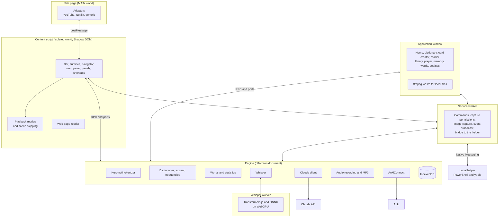

<p align="right"><a href="arquitectura.md">Español</a> · <b>English</b> · <a href="de/architecture.md">Deutsch</a> · <a href="zh/architecture.md">简体中文</a> · <a href="ko/architecture.md">한국어</a> · <a href="ja/architecture.md">日本語</a></p>

# Architecture

Kotonoha (言の葉, "leaves of words") is a Manifest V3 extension for learning Japanese from real video and text. This document describes how the work is divided among its parts, the main flows and the measurements behind the technical decisions. Code, identifiers and comments are in Spanish, so folder and file names are kept as they are.

## Overview



## Division of responsibilities

| Part | Responsibility | Reason |
|---|---|---|
| **Adapters (MAIN)** | Talking to each site's player: tracks, seeking, playback | `#movie_player` or `netflix` can only be reached from the page |
| **Content script** | The whole interface on top of the video | The isolated world and Shadow DOM prevent interference with the site in both directions |
| **Service worker** | APIs nothing else can use: commands, `tabCapture`, `captureVisibleTab`, `connectNative` | Chrome stops it when idle, so it holds no state |
| **Engine (offscreen)** | Tokenizer, database, Claude, Anki and recording | The heavy, long-running work. An offscreen document does not stop halfway through a response |
| **Whisper worker** | Loading the model and transcribing on the GPU | Very heavy, and it would block the engine. It is bundled separately and loaded only when used |
| **Local helper** | Downloading the audio of an online video and updating the extension | An extension cannot do this alone. Only the extension can call it, and it only accepts http or https addresses |
| **Application window** | Management screens and local player | A regular extension page that uses the same engine over RPC |
| **Core (`src/nucleo`)** | Pure logic: parsers, modes, statistics, synchronization, transcription and batches | No browser dependencies, tested with Vitest |
| **Language packages (`src/lenguas`)** | Everything that depends on the language being studied | The rest of the program only knows their interface |

## Flow of a subtitle

1. The adapter detects the video and lists its tracks.
2. The content script chooses the Japanese track and the secondary one. Imported tracks take priority, and hand-made ones are preferred over automatic ones.
3. The adapter downloads the text with the page's session. This matters on YouTube, where addresses are signed by the player.
4. The core converts the format (TTML, WebVTT, SRT, ASS or json3) into timed lines.
5. The engine tokenizes, joins conjugations, computes furigana, accent, frequency and status for each word, and detects grammar with rules.
6. For an automatic track, Claude first corrects its recognition errors: analyzing text with errors would be wasted effort.
7. Claude reviews each new line in the background: it corrects readings, flags figurative use and confirms grammar. The result is stored per line and requested only once.
8. The interface paints each word: the text color shows the accent, and the underline, the learning status.

## Translation and correction with Claude

A whole video takes time to process, but what matters is the part being watched. So the work is divided into batches, starting with the batch at the playback position (`src/nucleo/lotes.ts`).

| | Translation | Correction |
|---|---|---|
| Batch size | 80 lines | 120 lines |
| Claude's response | Every line | Only the lines that change, usually few |
| Context | Title and neighboring lines | Title and full text, in a prompt-cached block |
| First batch | In parallel with the others | Alone: it writes the cache the others reuse |
| If interrupted | What is translated is saved, and work continues with what is missing | What is corrected is saved, and it is marked complete at the end |

Correction never asks: Claude decides from the context and leaves doubtful lines as they are. If a line is a sentence invented by the recognizer, it returns it empty and the line disappears. Each correction keeps the original text, available in the subtitle navigator.

Generated tracks are stored per video and language, with their origin: Whisper, Claude, imported or saved. A track remembered from another Netflix region only appears if the current region lacks it.

## Whisper transcription

Claude does not transcribe audio, so this part runs on the local computer.

| Source | How the audio arrives | Speed |
|---|---|---|
| Local file | ffmpeg.wasm extracts the chosen track in the application window. The file is mounted without copying, so it works for whole films | Whatever the GPU allows |
| Online video, with the helper | yt-dlp downloads the audio to a temporary folder. With FFmpeg on the computer, the helper converts it and the engine reads the samples in parts through the service worker; without it, the engine receives the file and converts it with ffmpeg.wasm | Whatever the GPU allows |
| Online video, without the helper | Tab capture during playback. The player reports the video time four times per second, which maps samples to video time despite pauses or seeks | Real time |

Netflix is left out on purpose: it almost always has subtitles, and its audio cannot be processed in advance.

1. The audio is cut at silences before reaching Whisper's 30 s window. Stretches without speech are discarded, since that is where Whisper tends to invent text.
2. Whisper transcribes on the GPU. The text is cleaned of hallucinations and loops, and split into lines.
3. Each stretch of 6 s or more without text is transcribed again on its own. With background music, Whisper can end a chunk early, or start it late, and skip real speech. If the decoder gets stuck repeating itself, 10 s windows are tried. From these second passes only what is clearly a sentence is accepted, because most of those stretches contain only music.
4. Claude corrects homophones and kanji: at the end for files, and every ten lines in real time.

### Load control

Working without pauses keeps the GPU at 100 % for hours, which makes the desktop stutter and can restart the video driver.

| Measure | How it works |
|---|---|
| One chunk at a time | A two-hour film is never sent at once, and video memory does not grow with duration |
| Rest periods | After each chunk the GPU rests in proportion to how long it took. If another application is using the GPU, the chunk takes longer and the rest grows by itself |
| Automatic intensity | Busy 75 % of the time while the computer is in use and 90 % after two minutes idle. Gentle mode stays at 30 % |
| Pause | Frees the card at once and keeps the position |
| Watchdog | A hung chunk is aborted after 90 s |
| GPU loss | Waits 20 s, reloads the model and continues in gentle mode. On a second failure it stops, with the transcribed text saved |
| Resuming | A new transcription of the same file continues where it left off |

**Song lyrics.** `src/nucleo/letra.ts` places pasted lyrics on the timing of a track. Claude is asked, through a JSON schema, for a list of entries `{verse, first line, last line}` in the order the song is sung. Neither the words nor the timing come from it: the text is that of the lyrics and the timing that of the transcription, so it cannot alter either. The answer does not reproduce the lyrics, and it is small. Entries out of order lose their timing without affecting the rest (longest increasing subsequence), verses with no timing are estimated from their length, and verses that share a line split its duration.

## Technical decisions

| Decision | Choice | Reason |
|---|---|---|
| Interface | Preact and signals | Very light, which matters because it is injected into every video page |
| Bundling | esbuild with a custom script | Fast and explicit, with the manifest in plain view |
| Database | Dexie on IndexedDB | Indexes and queries without programming IndexedDB directly |
| Tokenizer | Kuromoji behind its own interface | Works in the browser and can be replaced without touching the rest |
| Dictionaries | Yomitan format: JMdict in Spanish and English, Kanjium accent, JPDB frequency | An open format, which also allows importing others from a file |
| AI | Official `@anthropic-ai/sdk` from the engine | The key never reaches scripts running in pages |
| Transcription | Whisper large-v3-turbo with Transformers.js and WebGPU, with a 16-bit encoder and a quantized decoder | The most accurate of those compared, with nothing to install |
| Audio from online videos | yt-dlp in a local PowerShell program, over Native Messaging, and FFmpeg if installed | The only way to process it without waiting for playback. It downloads to a temporary file instead of streaming, so it is read at the GPU's pace and nothing stalls |
| Local files | ffmpeg.wasm | Embedded subtitles and MKV audio tracks, without external programs |
| Flashcards | AnkiConnect and a built-in FSRS review | Integration with Anki, or review inside the application |
| Card audio | `tabCapture` and `MediaRecorder`, exported to MP3 | Works on any site without downloading the video |
| Web pages | CSS Custom Highlight API for colors, and a layer of its own, outside `<body>`, for readings | Adds nothing to the page's content and does not interfere with React applications and the like |
| Furigana in a scrolling box | One sheet per box, moved by `ScrollTimeline` and clipped by a frame | The browser scrolls those boxes without going through the main thread: repositioning readings from code would always leave them a frame behind the text, showing a trail. Linked to the scroll, they move together with the text, even when the page is busy |
| Line spacing | Inline, unitless `line-height`, only on multi-line text or rows packed together | With 15 px type and 21 px lines, 6 px remain for a 9 px reading and an underline. It is the only thing the reader touches on the page: it is reverted if the text would overflow a fixed-height box, and it can be turned off |
| Which word is under the pointer | `caretPositionFromPoint` with an index of text nodes | Resolves the click without wrapping each word in an element |
| Interface languages | One JSON table per language, with the Spanish text as the key, loaded separately | The content script runs on every page and must not carry six languages. Whole sentences, because word order changes in Korean, Japanese and German |
| Stroke order | [KanjiVG](https://kanjivg.tagaini.net), requested character by character from jsDelivr at a pinned version, and drawn as animated SVG | There are over 10,000 files: each kanji is downloaded when used and stays stored. SVG is sharp at any size and follows the theme, and only paths and their numbers are accepted from each file |
| Reader in a tab | An extension page, `lector.html`, opened in a regular tab | The application window is of type `popup`, with no tabs, and cannot join split view. An extension page can, and needs no server. `chrome.tabs.create({ splitWithTabId })` places it next to the current tab from Chrome 155 |
| Following the clipboard | `execCommand('paste')` in the offscreen document | Without focus, `navigator.clipboard` refuses to read, and in split view the focus is on the other page. It only reads with the option on and the tab in view |
| Icons | Phosphor, duotone version | A consistent set, of which only what the code uses is bundled |
| Typography | Nunito for Latin and Zen Maru Gothic for Japanese | Both rounded. Loaded as data so that each site's security policy does not block them |

## Claude models

Each task uses `claude-sonnet-5-5` by default, and the model and effort can be changed per task in Settings. The "Go deeper" button on the word panel repeats the query with `claude-opus-5-5` and high effort. Requests enable `fallbacks: "default"`, so a safety refusal is retried on another model. This can be disabled in Settings. Structured responses use `output_config.format` with JSON schemas, and the full script, when sent, goes in a cached system block.

**Avoiding paying twice.** Every query has its own identity, made of what is being asked: task, model, level, language, template, word, reading and sentence. It leaves out the surrounding text, which changes as subtitles load. A request in flight is not cancelled when whoever asked for it leaves, because it is already paid for and cancelling it would mean paying again: it finishes in the background and is stored, and a second identical query attaches to it. The reading review advances in stretches of 120 lines from the playback position, and each batch in flight finishes and is stored even if the tab closes.

**Spending log.** After each request, `src/motor/ia.ts` writes to the `consumo` table the tokens reported by the API (`usage`), the model that answered and the task. The price is worked out in `src/nucleo/precios.ts`. Only what the API confirms is logged; an aborted request does not appear, even though the API may have billed part of it.

## Reference measurements

Computer: Radeon RX 9060 XT 16 GB, 16 GB of RAM, 4K 60 Hz monitor, Windows 11 and Edge. They can be reproduced with `pruebas/whisper-comparar.mjs`, `whisper-carga.mjs`, `whisper-video.mjs` and `whisper-larga.mjs`.

**Accuracy.** Character error rate on 126 real sentences from JSUT, Common Voice and ReazonSpeech, not counting punctuation or digits. Lower is better.

| Model | Total | JSUT | Common Voice | ReazonSpeech | Sentences with punctuation | Video memory |
|---|---|---|---|---|---|---|
| Whisper Turbo, 16-bit encoder | 8.8 | 5.5 | 6.5 | 15.0 | 36 of 126 | 3.7 GB |
| Whisper Turbo, quantized | 9.8 | 5.7 | 7.2 | 17.4 | 30 of 126 | 1.5 GB |
| Kotoba Whisper v2.2, quantized | 10.4 | 6.4 | 7.6 | 17.9 | 12 of 126 | 2.2 GB |
| Kotoba Whisper v2.2, 16-bit | 10.5 | 7.8 | 7.8 | 16.4 | 10 of 126 | 3.3 GB |

On real videos, Turbo's advantage was larger on homophones and proper nouns, and Kotoba tended to stretch lines over music.

**Speed on real videos**, with recovery of skipped stretches:

| Video | Length | Time | Speed | Equivalent for 30 minutes | Desktop 99th percentile |
|---|---|---|---|---|---|
| Conversation with background music | 23.1 min | 223 s | 6.1 times | 4.9 min | 17.4 ms |
| Spoken presentation | 13.3 min | 125 s | 6.4 times | 4.7 min | 17.5 ms |

At 75 % occupancy, with no frames over 33 ms and no driver restarts.

**Smoothness.** Time between desktop compositions, in milliseconds, measured with `DwmFlush` and an animated window. The norm at 60 Hz is 16.7.

| Occupancy | 99th percentile | Maximum | Frames over 33 ms |
|---|---|---|---|
| Without Whisper | 18.2 | 19.3 | 0 |
| 30 % | 18.6 | 19.5 | 0 |
| 60 % | 18.7 | 20.0 | 0 |
| 95 % | 19.1 | 20.5 | 0 |

While playing a 1080p video with Whisper running, at 90 % and 95 % occupancy: 0 dropped frames out of 749. Without Whisper, also 0 of 749.

**Long runs.** Two hours of real audio in a row, in automatic mode: 19.7 minutes, 6.1 times faster than real time.

| Minute | Progress | Video memory | Browser RAM | 99th percentile | Frames over 33 ms | Driver restarts |
|---|---|---|---|---|---|---|
| Before starting | | 5.28 GB | 1.11 GB | | | |
| 1.4 | 7 % | 7.50 GB | 5.64 GB | 18.6 | 0 | 0 |
| 6.4 | 33 % | 7.67 GB | 5.25 GB | 18.6 | 0 | 0 |
| 11.5 | 56 % | 7.51 GB | 3.11 GB | 18.7 | 0 | 0 |
| 16.5 | 84 % | 7.33 GB | 2.64 GB | 18.7 | 0 | 0 |

Memory does not grow over time, and the pace holds. Video memory includes the whole system's.

**Recovery.** Destroying the WebGPU device produces the same event as a driver restart. Whisper resumes work after 27 s, without losing or reordering what was transcribed, and on a second failure it stops with a notice.

### Morae in pitch accent practice

narabas, a wav2vec2 that gives the probability of each Japanese phoneme every 20 ms, was tried in two ways with minimal pairs (おばあさん and おばさん, きって and きて…) said by two AivisSpeech voices:

- **Aligning the expected reading**, with narabas’ forced alignment, and measuring how long each special mora lasts. A missing mora still received its slice of time, and duration did not separate it well from one that was said. Nor did it improve the pitch verdicts: with aligned morae it was right no more often than splitting each word into equal parts (61 of 76 verdicts), so pitch is judged as before.
- **What it hears on its own**, the most likely phoneme in each frame, compared with the reading by edit distance. This is what is used: it caught 17 of 22 missing morae and 10 of 10 extra ones, with no warnings on 22 of 24 sentences said correctly. A っ before s, sh, z, j, h or f is not judged: the model does not output its symbol even when it is said.

On the GPU it hears the same as ONNX Runtime on the processor, phoneme by phoneme. Before using it, the worker checks it with a fixed signal; with Kokoro, the same GPU gave impossible values.

PASQA, a model that scores the pronunciation of a whole sentence, was left out: converting it requires specific versions of Python, PyTorch and s3prl, and it could not be measured.

### Cost of the page reader

Main thread time, with every word unknown and furigana on all of them: the worst case. Measured in Edge at 1366×860 with `Performance.getMetrics`, with the reader already loaded.

| Page | Turn on | 6 s idle | Scroll 3.5 s, without reader | Scroll 3.5 s, with reader |
|---|---|---|---|---|
| Wikipedia, long article (16,000 elements) | 500 ms | 300 ms the first time, then 0 | 30 ms | 850 ms |
| Front page of a newspaper with ads | 340 ms | 160 ms (120 ms without reader) | 70-560 ms | 640-790 ms |

What costs is measuring and changing the DOM. Chromium rebuilds every highlight marker after any change to the document, so the reader groups what it writes. Therefore:

- The reading layer moves with the document, and a scrolling box's layer with that box: scrolling them leaves nothing to calculate.
- Each reading carries the effective `z-index` of its text, and the browser resolves what covers what without hit testing. Clipping is decided by comparing rectangles.
- If a block's box has not moved, neither have its readings: one box is checked instead of each word.
- What still needs `elementFromPoint` is done by lines, in idle time and with the page still.
- What moves away is removed in groups, and left alone if it comes back first.

## Language packages

Everything that depends on the language being studied lives in `src/lenguas/<language>`, and the rest of the program only knows the interfaces in `src/lenguas/tipos.ts`. There are two packages: Japanese and English. Each package has two parts:

- **`PaqueteLengua`** is lightweight and used by every screen, including the content script: how the language is recognized in a text, how its readings are written, its levels, voices and links, and the interface sentences that name it.
- **`MotorLengua`** is only loaded in the engine and in the application window: the analyzer, grammar rules, prompts, transcription rules, dictionaries and audio.

Each language has its own database. The Japanese one keeps the original name, `kikitori`, and the others are called `kikitori-<language>`. This way, a word spelled the same in two languages is never mixed up, and existing data needs no migration. Claude spending does not depend on the language and is always stored in the original database.

The prompts of each package have their fingerprints pinned in the tests, because changing one invalidates the saved answers and would mean paying for them again.

The English package shows where languages differ:

| Aspect | Japanese | English |
|---|---|---|
| Analyzer | Kuromoji with IPADIC | wink-nlp with its small model, built separately (`ingles.js`) and loaded only when studying English |
| Reading | Part of the word: it tells homographs apart and goes into the key | It tells nothing apart: the key is the dictionary form, and the IPA is stored separately, per region |
| Accent | Pitch pattern by mora, from Kanjium | Stressed syllable, worked out from the IPA |
| Dictionaries | JMdict, Kanjium and JPDB | Wiktionary, through wiktionary-to-yomitan, and FrequencyWords |
| List of terms in memory | Analysis waits for it: without it, compounds would come out split | Analysis does not wait: it only serves to join hyphenated words |

Settings that depend on the language are stored in `porLengua` and restored when switching (`ajustesParaLengua`). The rest of the program keeps reading them in their usual place.

Dictionaries are decompressed one bank at a time, so memory does not depend on the size of the file, and are deleted in batches, because a single transaction with hundreds of thousands of rows does not finish. Measured with Wiktionary's English-English dictionary, 847,853 rows: 1.5 to 3 minutes to install including the download, about 220 MB on disk and lookups under 10 ms. Removing it takes about 3 minutes, during which lookups take 2 to 5 seconds.

## Folder structure

```
src/
  nucleo/       Pure, tested logic: subtitles, modes, synchronization, transcription, batches
  lenguas/      What depends on the language being studied: one package per language
  compartido/   Types, settings and RPC between contexts
  pagina/       MAIN world adapters
  contenido/    Interface on top of the video and web page reader (lector/)
  fondo/        Service worker
  motor/        Offscreen document: database, tokenizer, Claude, Anki, recording, Whisper
  app/          Application window
  lector/       The reader in a regular tab
  popup/        Extension icon menu
  ui/           Design system, word panel, icons and brand
idiomas/        Interface translation tables
herramientas/   Icon, brand and banner generators; texts to translate; local helper in ayudante/
pruebas/        Screenshot bench, end-to-end tests and simulated servers
docs/           Documentation: Spanish and English here, and German, Chinese, Korean and Japanese in subfolders
```
