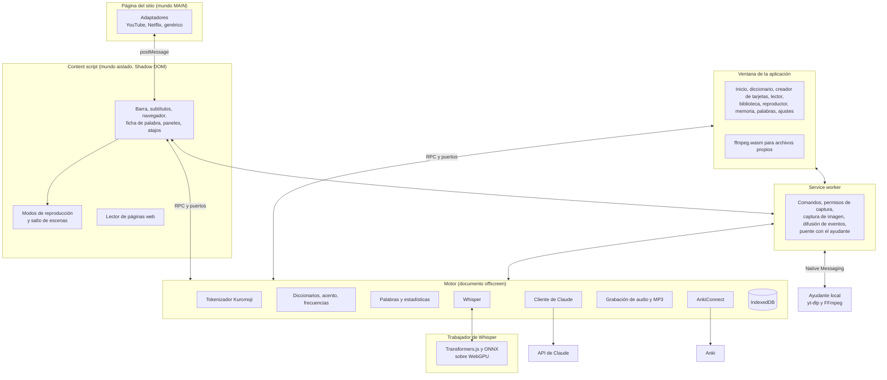

<p align="right"><b>Español</b> · <a href="architecture.md">English</a> · <a href="de/architecture.md">Deutsch</a> · <a href="zh/architecture.md">简体中文</a> · <a href="ko/architecture.md">한국어</a> · <a href="ja/architecture.md">日本語</a></p>

# Arquitectura

Kotonoha (言の葉, «hojas de palabras») es una extensión Manifest V3 para aprender japonés con video y texto real. Este documento describe cómo se reparte el trabajo entre sus partes, los flujos principales y las medidas que justifican las decisiones técnicas.

## Vista general



## Reparto de responsabilidades

| Parte | Responsabilidad | Motivo |
|---|---|---|
| **Adaptadores (MAIN)** | Hablar con el reproductor de cada sitio: pistas, salto, reproducción | Solo desde la página se puede acceder a `#movie_player` o a `netflix` |
| **Content script** | Toda la interfaz sobre el video | El mundo aislado y el Shadow DOM evitan interferencias en ambos sentidos con el sitio |
| **Service worker** | APIs que nadie más puede usar: comandos, `tabCapture`, `captureVisibleTab`, `connectNative` | Chrome lo detiene si está inactivo, así que no guarda estado |
| **Motor (offscreen)** | Tokenizador, base de datos, Claude, Anki y grabación | Es lo pesado y de larga duración. Un documento offscreen no se detiene a mitad de una respuesta |
| **Trabajador de Whisper** | Cargar el modelo y transcribir en la GPU | Es muy pesado y bloquearía el motor. Se empaqueta aparte y solo se carga si se usa |
| **Ayudante local** | Descargar el audio de un video de internet | Una extensión no puede hacerlo sola. Solo la extensión puede llamarlo, y solo acepta direcciones http o https |
| **Ventana de la aplicación** | Pantallas de gestión y reproductor local | Es una página normal de la extensión, que usa el mismo motor por RPC |
| **Núcleo (`src/nucleo`)** | Lógica pura: analizadores, modos, estadísticas, sincronía, transcripción y lotes | Sin dependencias del navegador, se prueba con Vitest |
| **Paquetes de lengua (`src/lenguas`)** | Todo lo que depende de la lengua que se estudia | El resto del programa solo conoce su interfaz |

## Flujo de un subtítulo

1. El adaptador detecta el video y lista sus pistas.
2. El content script elige la pista en japonés y la secundaria. Las importadas tienen prioridad, y las hechas a mano se prefieren a las automáticas.
3. El adaptador descarga el texto con la sesión de la página. Esto importa en YouTube, donde las direcciones van firmadas por el reproductor.
4. El núcleo convierte el formato (TTML, WebVTT, SRT, ASS o json3) en líneas con tiempos.
5. El motor tokeniza, une las conjugaciones, calcula furigana, acento, frecuencia y estado de cada palabra, y detecta gramática con reglas.
6. Si la pista es automática, Claude corrige antes sus errores de reconocimiento: analizar un texto con errores sería un gasto inútil.
7. Claude revisa en segundo plano cada línea nueva: corrige lecturas, señala usos figurados y confirma la gramática. El resultado se guarda por línea y solo se solicita una vez.
8. La interfaz pinta cada palabra: el color del texto indica el acento, y el subrayado, el estado de aprendizaje.

## Traducción y corrección con Claude

Un video entero tarda en procesarse, pero lo que importa es la parte que se está viendo. Por eso el trabajo se reparte en lotes y comienza por el lote del punto de reproducción (`src/nucleo/lotes.ts`).

| | Traducción | Corrección |
|---|---|---|
| Tamaño del lote | 80 líneas | 120 líneas |
| Respuesta de Claude | Todas las líneas | Solo las que cambian, normalmente pocas |
| Contexto | Título y líneas vecinas | Título y texto completo, en un bloque con caché de prompts |
| Primer lote | En paralelo con los demás | En solitario: escribe la caché que reutilizan los demás |
| Si se interrumpe | Lo traducido se guarda y se continúa por lo que falta | Lo corregido se guarda, y al terminar se marca como completo |

La corrección nunca pregunta: Claude decide con el contexto y deja las líneas dudosas como están. Si una línea es una frase inventada por el reconocimiento, la devuelve vacía y desaparece. Cada corrección conserva el texto original, consultable en el navegador de subtítulos.

Las pistas generadas se guardan por video e idioma, con su origen: Whisper, Claude, importados o guardados. Lo recordado de otra región de Netflix solo aparece si la región actual no trae esa pista.

## Transcripción con Whisper

Claude no transcribe audio, así que esta parte se ejecuta en el equipo local.

| Fuente | Cómo llega el audio | Velocidad |
|---|---|---|
| Archivo propio | ffmpeg.wasm extrae la pista elegida en la ventana de la aplicación. El archivo se monta sin copiarlo, de modo que sirve para películas enteras | La que permita la GPU |
| Video de internet, con el ayudante | yt-dlp baja el audio y FFmpeg lo convierte a un archivo temporal, que el motor lee por partes a través del service worker | La que permita la GPU |
| Video de internet, sin el ayudante | Captura de la pestaña durante la reproducción. El reproductor informa cuatro veces por segundo del tiempo del video, lo que traduce muestras a tiempo de video aunque haya pausas o saltos | Tiempo real |

Netflix queda fuera a propósito: casi siempre trae subtítulos, y su audio no se puede procesar por adelantado.

1. El audio se corta por los silencios antes de llegar a los 30 s de la ventana de Whisper. Los tramos sin voz se descartan, porque es donde Whisper tiende a inventar.
2. Whisper transcribe en la GPU. El texto se limpia de alucinaciones y bucles, y se parte en líneas.
3. Cada tramo de 6 s o más sin texto se vuelve a transcribir por separado. Con música de fondo, Whisper puede dar por terminado un trozo, o empezarlo tarde, y saltarse voz real. Si el decodificador se atasca repitiendo lo mismo, se prueba con ventanas de 10 s. De estas segundas pasadas solo se acepta lo que claramente es una frase, porque la mayoría de esos tramos solo contienen música.
4. Claude corrige homófonos y kanji: al final en los archivos, y cada diez líneas en tiempo real.

### Control de carga

Trabajar sin pausas deja la GPU al 100 % durante horas, lo que traba el escritorio y puede reiniciar el controlador de video.

| Medida | Funcionamiento |
|---|---|
| Un trozo a la vez | Una película de dos horas nunca se envía de golpe, y la memoria de video no crece con la duración |
| Descansos | Tras cada trozo se descansa en proporción a lo que tardó. Si otra aplicación ocupa la GPU, el trozo tarda más y el descanso crece solo |
| Intensidad automática | Ocupa el 75 % del tiempo con el equipo en uso y el 90 % tras dos minutos sin uso. El modo Suave se queda en el 30 % |
| Pausa | Libera la tarjeta al instante y conserva la posición |
| Vigilante | Un trozo colgado se aborta a los 90 s |
| Pérdida de la GPU | Espera 20 s, recarga el modelo y sigue en modo Suave. Al segundo fallo se detiene, con lo transcrito guardado |
| Reanudación | Una nueva transcripción del mismo archivo continúa por donde quedó |

## Decisiones técnicas

| Decisión | Elección | Razón |
|---|---|---|
| Interfaz | Preact y señales | Muy ligero, importante porque se inyecta en cada página de video |
| Empaquetado | esbuild con un script propio | Rápido y explícito, con el manifiesto a la vista |
| Base de datos | Dexie sobre IndexedDB | Índices y consultas sin programar directamente sobre IndexedDB |
| Tokenizador | Kuromoji detrás de una interfaz propia | Funciona en el navegador y se puede sustituir sin tocar el resto |
| Diccionarios | Formato Yomitan: JMdict en español e inglés, acento de Kanjium, frecuencia de JPDB | Formato abierto, que también permite importar otros desde archivo |
| IA | SDK oficial `@anthropic-ai/sdk` desde el motor | La clave nunca llega a los scripts que corren en páginas |
| Transcripción | Whisper large-v3-turbo con Transformers.js y WebGPU, con el codificador en 16 bits y el decodificador cuantizado | El más preciso de los comparados, y sin instalar nada |
| Audio de videos de internet | yt-dlp y FFmpeg en un programa local, por Native Messaging | Es la única forma de procesarlo sin esperar a reproducirlo. Baja a un archivo temporal en lugar de transmitir, de modo que se lee al ritmo de la GPU y nada se atasca |
| Archivos propios | ffmpeg.wasm | Subtítulos incrustados y pistas de audio de MKV, sin programas externos |
| Tarjetas | AnkiConnect y un repaso interno con FSRS | Integración con Anki, o repaso dentro de la aplicación |
| Audio de tarjetas | `tabCapture` y `MediaRecorder`, exportado a MP3 | Funciona en cualquier sitio sin descargar el video |
| Páginas web | CSS Custom Highlight API para los colores, y una capa propia, fuera de `<body>`, para las lecturas | No añade nada al contenido de la página y no interfiere con aplicaciones React y similares |
| Furigana en una caja con scroll | Una hoja por caja, movida por `ScrollTimeline` y recortada por un marco | El navegador desplaza esas cajas sin pasar por el hilo principal: recolocar las lecturas desde el código las dejaría siempre un fotograma por detrás del texto, y se vería una estela. Enlazadas al scroll se mueven a la vez que el texto, aunque la página esté ocupada |
| Interlineado | `line-height` en línea, sin unidad, solo en texto de varias líneas o filas pegadas | Con 15 px de letra y 21 de línea quedan 6 para una lectura de 9 y un subrayado. Es lo único que el lector toca en la página: se revierte si el texto se saldría de una caja de alto fijo, y se puede desactivar |
| Qué palabra hay bajo el ratón | `caretPositionFromPoint` con un índice de los nodos de texto | Resuelve el clic sin envolver cada palabra en un elemento |
| Idiomas de la interfaz | Una tabla JSON por idioma, con el texto en español como clave, que se carga aparte | El content script corre en todas las páginas y no debe arrastrar seis idiomas. Con frases enteras, porque el orden de las palabras cambia en coreano, japonés y alemán |
| Orden de los trazos | [KanjiVG](https://kanjivg.tagaini.net), pedido carácter a carácter a jsDelivr con la versión fijada, y dibujado como SVG animado | Son más de 10.000 archivos: cada kanji se descarga al usarlo y queda guardado. El SVG se ve nítido a cualquier tamaño y sigue el tema, y de cada archivo solo se aceptan los trazados y sus números |
| Lector en una pestaña | Una página de la extensión, `lector.html`, abierta en una pestaña normal | La ventana de la aplicación es de tipo `popup`, sin pestañas, y no puede entrar en la vista dividida. Una página de la extensión sí, y no necesita servidor. `chrome.tabs.create({ splitWithTabId })` la coloca junto a la pestaña actual desde Chrome 155 |
| Seguir el portapapeles | `execCommand('paste')` en el documento offscreen | Sin el foco, `navigator.clipboard` no deja leer, y en la vista dividida el foco está en la otra página. Solo se lee con la opción encendida y la pestaña a la vista |
| Iconos | Phosphor en versión duotono | Conjunto consistente, del que solo se empaqueta lo que el código usa |
| Tipografía | Nunito para el latín y Zen Maru Gothic para el japonés | Ambas redondeadas. Se cargan como datos para que la política de seguridad de cada sitio no las bloquee |

## Modelos de Claude

Cada tarea usa `claude-sonnet-5-5` por omisión, y el modelo y el esfuerzo se pueden cambiar por tarea en Ajustes. El botón «Profundizar» de la ficha repite la consulta con `claude-opus-5-5` y esfuerzo alto. Las peticiones activan `fallbacks: "default"`, de modo que un rechazo de seguridad se reintenta en otro modelo. Se puede desactivar en Ajustes. Las respuestas estructuradas usan `output_config.format` con esquemas JSON, y el guion completo, cuando se envía, va en un bloque de sistema con caché.

**Evitar pagar dos veces.** Cada consulta tiene una identidad propia, formada por lo que se pregunta: tarea, modelo, nivel, idioma, plantilla, palabra, lectura y frase. No incluye el texto de alrededor, que cambia a medida que se cargan los subtítulos. Una petición en marcha no se cancela aunque quien la pidió se vaya, porque ya está pagada y cancelarla obligaría a pagarla otra vez: termina en segundo plano, se guarda, y una segunda consulta igual se engancha a ella. La revisión de lecturas avanza por tramos de 120 líneas según el punto de reproducción, y cada lote en marcha termina y se guarda aunque se cierre la pestaña.

**Registro de gasto.** Tras cada petición, `src/motor/ia.ts` anota en la tabla `consumo` los tokens que informa la API (`usage`), el modelo que respondió y la tarea. El precio se calcula en `src/nucleo/precios.ts`. Solo se registra lo que la API confirma; una petición abortada no aparece, aunque la API haya podido facturar parte de ella.

## Medidas de referencia

Equipo: Radeon RX 9060 XT de 16 GB, 16 GB de RAM, monitor 4K a 60 Hz, Windows 11 y Edge. Se reproducen con `pruebas/whisper-comparar.mjs`, `whisper-carga.mjs`, `whisper-video.mjs` y `whisper-larga.mjs`.

**Precisión.** Porcentaje de error por caracteres en 126 frases reales de JSUT, Common Voice y ReazonSpeech, sin contar puntuación ni cifras. Un valor menor es mejor.

| Modelo | Total | JSUT | Common Voice | ReazonSpeech | Frases con puntuación | Memoria de video |
|---|---|---|---|---|---|---|
| Whisper Turbo, codificador en 16 bits | 8,8 | 5,5 | 6,5 | 15,0 | 36 de 126 | 3,7 GB |
| Whisper Turbo, cuantizado | 9,8 | 5,7 | 7,2 | 17,4 | 30 de 126 | 1,5 GB |
| Kotoba Whisper v2.2, cuantizado | 10,4 | 6,4 | 7,6 | 17,9 | 12 de 126 | 2,2 GB |
| Kotoba Whisper v2.2, en 16 bits | 10,5 | 7,8 | 7,8 | 16,4 | 10 de 126 | 3,3 GB |

Con videos reales, la diferencia a favor de Turbo fue mayor en homófonos y nombres propios, y Kotoba tendía a estirar las líneas sobre la música.

**Velocidad con videos reales**, con la recuperación de tramos omitidos:

| Video | Duración | Tiempo | Velocidad | Equivale, para 30 minutos | Percentil 99 del escritorio |
|---|---|---|---|---|---|
| Conversación con música de fondo | 23,1 min | 223 s | 6,1 veces | 4,9 min | 17,4 ms |
| Exposición hablada | 13,3 min | 125 s | 6,4 veces | 4,7 min | 17,5 ms |

Con el 75 % de ocupación, sin fotogramas de más de 33 ms ni reinicios del controlador.

**Fluidez.** Tiempo entre composiciones del escritorio, en milisegundos, medido con `DwmFlush` y una ventana animada. Lo normal a 60 Hz son 16,7.

| Ocupación | Percentil 99 | Máximo | Fotogramas de más de 33 ms |
|---|---|---|---|
| Sin Whisper | 18,2 | 19,3 | 0 |
| 30 % | 18,6 | 19,5 | 0 |
| 60 % | 18,7 | 20,0 | 0 |
| 95 % | 19,1 | 20,5 | 0 |

Durante la reproducción de un video a 1080p con Whisper en marcha, a 90 % y a 95 % de ocupación: 0 fotogramas perdidos de 749. Sin Whisper, también 0 de 749.

**Larga duración.** Dos horas de audio real seguidas, en modo automático: 19,7 minutos, 6,1 veces más rápido que el tiempo real.

| Minuto | Avance | Memoria de video | RAM del navegador | Percentil 99 | Fotogramas de más de 33 ms | Reinicios del controlador |
|---|---|---|---|---|---|---|
| Antes de empezar | | 5,28 GB | 1,11 GB | | | |
| 1,4 | 7 % | 7,50 GB | 5,64 GB | 18,6 | 0 | 0 |
| 6,4 | 33 % | 7,67 GB | 5,25 GB | 18,6 | 0 | 0 |
| 11,5 | 56 % | 7,51 GB | 3,11 GB | 18,7 | 0 | 0 |
| 16,5 | 84 % | 7,33 GB | 2,64 GB | 18,7 | 0 | 0 |

La memoria no crece con el tiempo, y el ritmo se mantiene. La memoria de video incluye la de todo el sistema.

**Recuperación.** Destruir el dispositivo WebGPU produce el mismo evento que un reinicio del controlador. Whisper retoma el trabajo a los 27 s, sin perder ni desordenar lo transcrito, y al segundo fallo se detiene con un aviso.

### Coste del lector de páginas

Tiempo del hilo principal, con todas las palabras desconocidas y furigana en todas: el peor caso. Medido en Edge a 1366×860 con `Performance.getMetrics`, con el lector ya cargado.

| Página | Encender | 6 s quieta | Bajar 3,5 s, sin lector | Bajar 3,5 s, con lector |
|---|---|---|---|---|
| Wikipedia, artículo largo (16.000 elementos) | 500 ms | 300 ms la primera vez, luego 0 | 30 ms | 850 ms |
| Portada de un periódico con anuncios | 340 ms | 160 ms (120 ms sin lector) | 70-560 ms | 640-790 ms |

Lo caro es medir y cambiar el DOM. Chromium reconstruye todos los marcadores de resaltado tras cualquier cambio en el documento, de modo que el lector agrupa lo que escribe. Por eso:

- La capa de lecturas va con el documento, y la de una caja con scroll, con esa caja: al desplazarlas no hay nada que calcular.
- Cada lectura lleva el `z-index` efectivo de su texto, y el navegador resuelve qué tapa a qué sin hacer pruebas de impacto. Lo recortado se decide comparando rectángulos.
- Si la caja de un bloque no se ha movido, sus lecturas tampoco: se comprueba una caja en vez de cada palabra.
- Lo que aún necesita `elementFromPoint` se hace por líneas, en ratos libres y con la página quieta.
- Lo que se aleja se retira en grupo, y si vuelve antes no se toca.

## Paquetes de lengua

Todo lo que depende de la lengua que se estudia vive en `src/lenguas/<lengua>`, y el resto del programa solo conoce las interfaces de `src/lenguas/tipos.ts`. Hay dos paquetes: japonés e inglés. Cada paquete tiene dos partes:

- **`PaqueteLengua`** es ligero y lo usan todas las pantallas, incluido el content script: cómo se reconoce la lengua en un texto, cómo se escriben sus lecturas, sus niveles, voces y enlaces, y las frases de la interfaz que la nombran.
- **`MotorLengua`** solo se carga en el motor y en la ventana de la aplicación: el analizador, las reglas de gramática, los prompts, las reglas de transcripción, los diccionarios y el audio.

Cada lengua tiene su propia base de datos. La del japonés conserva el nombre original, `kikitori`, y las demás se llaman `kikitori-<lengua>`. Así, una palabra que se escribe igual en dos lenguas nunca se mezcla, y los datos existentes no necesitan migración. El gasto en Claude no depende de la lengua y se guarda siempre en la base original.

Los prompts de cada paquete tienen sus huellas fijadas en las pruebas, porque cambiar uno invalida las respuestas guardadas y obligaría a pagarlas otra vez.

El paquete del inglés muestra en qué difieren las lenguas:

| Aspecto | Japonés | Inglés |
|---|---|---|
| Analizador | Kuromoji con IPADIC | wink-nlp con su modelo pequeño, compilado aparte (`ingles.js`) y cargado solo al estudiar inglés |
| Lectura | Forma parte de la palabra: distingue homógrafos y entra en su clave | No distingue nada: la clave es la forma de diccionario, y la IPA se guarda aparte, por zona |
| Acento | Patrón tonal por moras, de Kanjium | Sílaba tónica, deducida de la IPA |
| Diccionarios | JMdict, Kanjium y JPDB | Wiktionary, con wiktionary-to-yomitan, y FrequencyWords |
| Lista de términos en memoria | Se espera a tenerla: sin ella, los compuestos saldrían partidos | No se espera: solo sirve para unir palabras con guion |

Los ajustes que dependen de la lengua se guardan en `porLengua` y se restauran al cambiar de una a otra (`ajustesParaLengua`). El resto del programa sigue leyéndolos en su sitio de siempre.

Los diccionarios se descomprimen banco a banco, para que la memoria no dependa del tamaño del archivo, y se borran por tandas, porque una sola transacción con cientos de miles de filas no llega a terminar. Medido con el inglés-inglés de Wiktionary, de 847.853 filas: entre 1,5 y 3 minutos de instalación con la descarga incluida, unos 220 MB en disco y consultas de menos de 10 ms. Quitarlo lleva unos 3 minutos, durante los cuales las consultas tardan de 2 a 5 segundos.

## Estructura de carpetas

```
src/
  nucleo/       Lógica pura y probada: subtítulos, modos, sincronía, transcripción, lotes
  lenguas/      Lo que depende de la lengua que se estudia: un paquete por lengua
  compartido/   Tipos, ajustes y RPC entre contextos
  pagina/       Adaptadores del mundo MAIN
  contenido/    Interfaz sobre el video y lector de páginas web (lector/)
  fondo/        Service worker
  motor/        Documento offscreen: base de datos, tokenizador, Claude, Anki, grabación, Whisper
  app/          Ventana de la aplicación
  lector/       El lector en una pestaña normal
  popup/        Menú del icono de la extensión
  ui/           Sistema de diseño, ficha de palabra, iconos y marca
idiomas/        Tablas de traducción de la interfaz
herramientas/   Generadores de iconos, marca y banner; textos a traducir; ayudante local en ayudante/
pruebas/        Banco de capturas, pruebas de extremo a extremo y servidores simulados
docs/           Documentación: español e inglés aquí, y alemán, chino, coreano y japonés en subcarpetas
```
