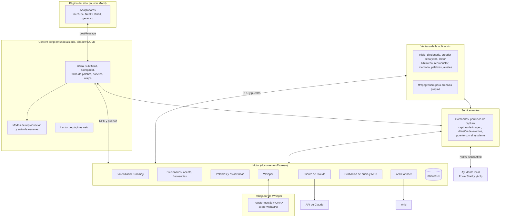
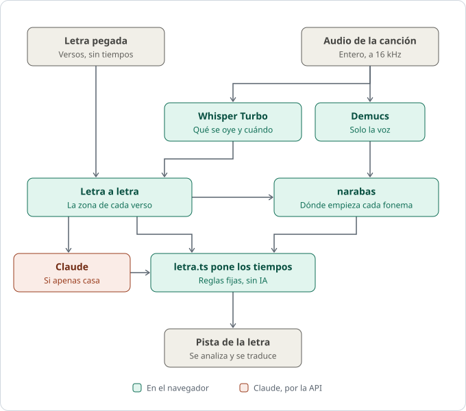
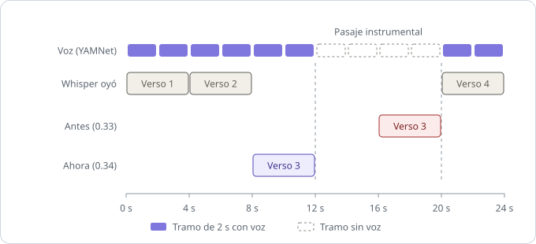

<p align="right"><b>Español</b> · <a href="architecture.md">English</a> · <a href="de/architecture.md">Deutsch</a> · <a href="zh/architecture.md">简体中文</a> · <a href="ko/architecture.md">한국어</a> · <a href="ja/architecture.md">日本語</a></p>

# Arquitectura

Kotonoha (言の葉, «hojas de palabras») es una extensión Manifest V3 para aprender japonés con video y texto real. Este documento describe cómo se reparte el trabajo entre sus partes, los flujos principales y las medidas que justifican las decisiones técnicas.

## Vista general



## Reparto de responsabilidades

| Parte | Responsabilidad | Motivo |
|---|---|---|
| **Adaptadores (MAIN)** | Hablar con el reproductor de cada sitio: pistas, salto, reproducción | Solo desde la página se puede acceder a `#movie_player`, a `netflix` o al `player` de Bilibili |
| **Content script** | Toda la interfaz sobre el video | El mundo aislado y el Shadow DOM evitan interferencias en ambos sentidos con el sitio |
| **Service worker** | APIs que nadie más puede usar: comandos, `tabCapture`, `captureVisibleTab`, `connectNative` | Chrome lo detiene si está inactivo, así que no guarda estado |
| **Motor (offscreen)** | Tokenizador, base de datos, Claude, Anki y grabación | Es lo pesado y de larga duración. Un documento offscreen no se detiene a mitad de una respuesta |
| **Trabajador de Whisper** | Cargar el modelo y transcribir en la GPU | Es muy pesado y bloquearía el motor. Se empaqueta aparte y solo se carga si se usa |
| **Ayudante local** | Descargar el audio de un video de internet y actualizar la extensión | Una extensión no puede hacerlo sola. Solo la extensión puede llamarlo, y solo acepta direcciones http o https |
| **Ventana de la aplicación** | Pantallas de gestión y reproductor local | Es una página normal de la extensión, que usa el mismo motor por RPC |
| **Núcleo (`src/nucleo`)** | Lógica pura: analizadores, modos, estadísticas, sincronía, transcripción y lotes | Sin dependencias del navegador, se prueba con Vitest |
| **Paquetes de lengua (`src/lenguas`)** | Todo lo que depende de la lengua que se estudia | El resto del programa solo conoce su interfaz |

## Flujo de un subtítulo

1. El adaptador detecta el video y lista sus pistas.
2. El content script elige la pista en japonés y la secundaria. Las importadas tienen prioridad, y las hechas a mano se prefieren a las automáticas.
3. El adaptador descarga el texto con la sesión de la página. Esto importa en YouTube, donde las direcciones van firmadas por el reproductor. En Bilibili es la lista la que necesita la sesión; el archivo de cada subtítulo se pide sin cookies, porque su CDN responde a cualquiera y con ellas el navegador rechazaría la respuesta.
4. El núcleo convierte el formato (TTML, WebVTT, SRT, ASS o json3) en líneas con tiempos.
5. El motor tokeniza, une las conjugaciones, calcula furigana, acento, frecuencia y estado de cada palabra, y detecta gramática con reglas.
6. Si la pista es automática, Claude corrige antes sus errores de reconocimiento: analizar un texto con errores sería un gasto inútil.
7. Claude revisa en segundo plano cada línea nueva: corrige lecturas, señala usos figurados y confirma la gramática. El resultado se guarda por línea y solo se solicita una vez.
8. La interfaz pinta cada palabra: el color del texto indica el acento, y el subrayado, el estado de aprendizaje.

## Traducción y corrección con Claude

Un video entero tarda en procesarse, pero lo que importa es la parte que se está viendo. Por eso el trabajo se reparte en lotes y comienza por el lote del punto de reproducción (`src/nucleo/lotes.ts`).

| | Traducción | Corrección |
|---|---|---|
| Tamaño del lote | 80 líneas | 120 líneas |
| Respuesta de Claude | Todas las líneas | Solo las que cambian, normalmente pocas |
| Contexto | Título y líneas vecinas | Título y texto completo, en un bloque con caché de prompts |
| Primer lote | En paralelo con los demás | En solitario: escribe la caché que reutilizan los demás |
| Si se interrumpe | Lo traducido se guarda; volver a traducir empieza desde cero | Lo corregido se guarda, y al terminar se marca como completo |

En la traducción, lo que devuelve Claude se revisa antes de guardarlo: solo números del lote, una vez cada uno, con texto y sin disculpas. Si no traduce una línea, como un verso de una canción, queda vacía y el aviso final dice cuántas son; un lote que la API rechaza no detiene a los demás.

La corrección nunca pregunta: Claude decide con el contexto y deja las líneas dudosas como están. Si una línea es una frase inventada por el reconocimiento, la devuelve vacía y desaparece. Cada corrección conserva el texto original, consultable en el navegador de subtítulos.

Las pistas generadas se guardan por video e idioma, con su origen: Whisper, Claude, importados o guardados. Lo recordado de otra región de Netflix solo aparece si la región actual no trae esa pista.

## Transcripción con Whisper

Claude no transcribe audio, así que esta parte se ejecuta en el equipo local.

| Fuente | Cómo llega el audio | Velocidad |
|---|---|---|
| Archivo propio | ffmpeg.wasm extrae la pista elegida en la ventana de la aplicación. El archivo se monta sin copiarlo, de modo que sirve para películas enteras | La que permita la GPU |
| Video de internet, con el ayudante | yt-dlp baja el audio a una carpeta temporal. Con FFmpeg en el equipo, el ayudante lo convierte y el motor lee las muestras por partes a través del service worker; sin él, el motor recibe el archivo y lo convierte con ffmpeg.wasm | La que permita la GPU |
| Video de internet, sin el ayudante | Captura de la pestaña durante la reproducción. El reproductor informa cuatro veces por segundo del tiempo del video, lo que traduce muestras a tiempo de video aunque haya pausas o saltos | Tiempo real |

Netflix queda fuera a propósito: casi siempre trae subtítulos, y su audio no se puede procesar por adelantado.

1. El audio se corta por los silencios antes de llegar a los 30 s de la ventana de Whisper. Los tramos sin voz se descartan, porque es donde Whisper tiende a inventar.
2. Whisper transcribe en la GPU. El texto se limpia de alucinaciones y bucles, y se parte en líneas.
3. Cada tramo de 6 s o más sin texto se vuelve a transcribir por separado. Con música de fondo, Whisper puede dar por terminado un trozo, o empezarlo tarde, y saltarse voz real. Si el decodificador se atasca repitiendo lo mismo, se prueba con ventanas de 10 s. De estas segundas pasadas solo se acepta lo que claramente es una frase, porque la mayoría de esos tramos solo contienen música.
4. Claude corrige homófonos y kanji: al final en los archivos, y cada diez líneas en tiempo real.

### Control de carga

Trabajar sin pausas deja la GPU al 100 % durante horas, lo que traba el escritorio y puede reiniciar el controlador de video.

| Medida | Funcionamiento |
|---|---|
| Un trozo a la vez | Una película de dos horas nunca se envía de golpe, y la memoria de video no crece con la duración |
| Descansos | Tras cada trozo se descansa en proporción a lo que tardó. Si otra aplicación ocupa la GPU, el trozo tarda más y el descanso crece solo |
| Intensidad automática | Ocupa el 75 % del tiempo con el equipo en uso y el 90 % tras dos minutos sin uso. El modo Suave se queda en el 30 % |
| Pausa | Libera la tarjeta al instante y conserva la posición |
| Vigilante | Un trozo colgado se aborta a los 90 s |
| Pérdida de la GPU | Espera 20 s, recarga el modelo y sigue en modo Suave. Al segundo fallo se detiene, con lo transcrito guardado |
| Reanudación | Una nueva transcripción del mismo archivo continúa por donde quedó |

## Letras de canciones

Una letra pegada se coloca sobre el audio repartiendo el trabajo, y cada pieza decide solo lo que sabe hacer: Whisper oye qué se canta y cuándo, Demucs separa la voz de la música, narabas oye dónde empieza cada fonema, YAMNet dónde se canta, y `src/nucleo/letra.ts` calcula los tiempos. Claude solo entra si la letra apenas casa con lo que se oye.

<p align="center"></p>

**Canción o voz hablada.** Un video se trata como canción si tiene una letra pendiente de colocar, si YouTube lo clasifica como música o si el título lo indica: MV, lyric video, official audio, karaoke y similares. En ese caso se transcribe con Whisper Turbo, que oye el canto sobre la música mejor que los modelos de voz hablada.

**Lo que oye Whisper.** A lo descrito en la sección anterior se suman tres cosas. Cada trozo lleva un poco de silencio delante, porque Whisper pierde lo que suena justo al empezar. Una línea larga que, sin sus repeticiones, se queda en menos del 40 % de su longitud es un bucle y se descarta. Y lo recuperado en una segunda pasada pasa un filtro más estricto: tampoco se aceptan las frases cortas típicas sobre música ni los textos con menos de 4 caracteres distintos, y si nada lo pasa, el tramo se da por música. Mientras hay una letra pendiente, la transcripción no se corrige con Claude, porque el texto que se mostrará es el de la letra.

**Dónde se canta.** YAMNet, el clasificador de sonidos de Google entrenado con AudioSet (521 clases), oye los mismos bloques de 60 s que Whisper, en su propio trabajador y en el procesador, para no competir por la GPU. De cada tramo de 2 s se guarda la puntuación de la clase «Singing» (canto). El umbral es 0,02, porque la puntuación es muy baja incluso cuando se canta, y un único tramo sin voz entre dos con voz cuenta como voz: casi nunca es un pasaje instrumental. La puntuación solo existe cuando la canción se transcribe entera desde el principio, con el ayudante o desde un archivo; la transcripción en tiempo real no la usa.

**La zona de cada verso.** `src/nucleo/casarLetra.ts` casa la letra con lo que oyó Whisper letra a letra, sin IA. Las dos se pasan a letras comparables (los katakana, a hiragana; sin signos ni espacios) y se buscan tramos iguales de al menos dos letras, encadenados en orden: se queda la cadena de más peso, con un árbol de Fenwick, y un kanji pesa 6, un kana 4 y una letra latina 1, para que un estribillo en inglés no arrastre a los versos japoneses. Cada verso que casa toma el momento que le dan sus tramos, la mediana: esa es su zona. Sin la voz, los tiempos salen de ahí.

**La voz sola.** Demucs (htdemucs, de Meta) separa la voz en un trabajador, con ONNX Runtime y WebGPU. El audio de la canción, que el motor guarda a 16 kHz, se sube a 44,1 kHz con un filtro sinc y se parte en trozos de 7,8 s que se solapan una cuarta parte. El modelo recibe cada trozo y su espectrograma (STFT de 4096 muestras con saltos de 1024) y devuelve dos ramas, la del tiempo y la de las frecuencias; esta se vuelve al tiempo (ISTFT) y se suma a la otra. La voz se baja otra vez a 16 kHz y los trozos se juntan con un peso en triángulo. `src/nucleo/demucs.ts` hace esa parte, comprobada contra la transformada directa, y la GPU solo se usa si con una señal fija da lo mismo que el procesador.

**Los fonemas.** narabas, un wav2vec2 de fonemas del japonés, da cada 20 ms la probabilidad de cada uno de sus 43 fonemas. Los versos se pasan a fonemas con la pronunciación de Kuromoji, y una alineación forzada (Viterbi sobre el CTC, en `src/nucleo/alineacionForzada.ts`) coloca todos los de la letra, en orden, sobre esas probabilidades. Cada fonema solo puede caer en la zona de su verso, con 2 s de margen a cada lado, o entre las de sus vecinos si su verso no casó, como un estribillo repetido igual que el verso de al lado. Un verso empieza en el primer marco de su primer fonema y acaba 0,4 s después del último.

**Si apenas casa, Claude.** Si casa menos de una cuarta parte de los versos, como con una letra en rōmaji, Claude recibe la letra y la transcripción como dos listas numeradas, la segunda con sus tiempos, que le ayudan a ver los pasajes instrumentales. Por cada verso devuelve `{v, de, a}`: la primera y la última línea de la transcripción sobre las que suena. Con -1, el verso se canta, pero la transcripción no lo recoge; con -2, no se canta, como una marca de sección, un título o un crédito. El prompt pide:

- comparar por sonido y no por escritura: en japonés, 会いたい, 逢いたい y あいたい son lo mismo; en inglés, «night» y «knight», y en alemán, «Meer» y «mehr»;
- respetar el orden: `de` nunca retrocede;
- emparejar por su posición una línea que no se parece a nada, porque suele ser un verso mal oído;
- repetir un estribillo tantas veces como suena, y contar como cantados los coros entre paréntesis;
- ignorar el rōmaji y las traducciones;
- devolver una lista vacía si la letra no es de esa canción.

La respuesta ocupa poco, sigue un esquema JSON y queda en caché: ajustar la misma letra sobre la misma transcripción no se paga dos veces.

**Los tiempos.** `aplicarAjuste` no usa IA: la misma entrada da siempre el mismo resultado.

1. El texto sale de la letra, y los tiempos, de la transcripción. Lo que Whisper oyó mal no llega a la pantalla.
2. De las entradas de Claude se conserva la subsecuencia no decreciente más larga. Una entrada fuera de orden pierde su tiempo, pero no su verso, y no afecta a las demás: si cada entrada se comparara solo con la anterior, un único salto hacia delante invalidaría todas las siguientes.
3. Un verso que Claude omite se sigue cantando, así que entra sin tiempo, detrás de donde suena el anterior.
4. Los versos que comparten una línea de la transcripción se reparten su duración según lo que hay que cantar en cada uno, sin contar los espacios.
5. Un verso sin tiempo dura 300 ms por carácter, entre 1,5 y 8 s, y se coloca justo antes del siguiente verso con tiempo, que es adonde lleva. Con la puntuación de YAMNet solo cuenta el tiempo con voz: si justo antes del verso siguiente hay un pasaje instrumental, el verso va antes de él. Si el hueco no da para cantarlo, o casi no tiene voz, se coloca como sin YAMNet, con el tiempo que les sobra a sus vecinos.
6. Ninguna línea dura menos de 700 ms ni sigue en pantalla cuando empieza la siguiente.

<p align="center"></p>

Medido con canciones japonesas de canales oficiales y su letra sincronizada, YAMNet separa lo cantado de lo instrumental con un AUC de 0,9. De 164 versos que Whisper no oyó, con YAMNet dentro de Kotonoha 21 quedan más de un segundo más cerca de su sitio y 3 más lejos, y los que quedan a más de 5 s pasan de 32 a 28. Los errores grandes que quedan vienen de pasajes largos que Whisper no oye: YAMNet sabe que ahí se canta, pero no qué verso.

**Lo medido.** Con 51 canciones japonesas y su letra sincronizada (2253 versos), lo que se aparta el principio de cada verso de donde se canta:

| Cómo se coloca | La mitad, a menos de | Nueve de cada diez, a menos de |
|---|---|---|
| Letra a letra con lo que oyó Whisper | 0,34 s | 1,46 s |
| Con la voz, sobre la mezcla | 0,19 s | 1,59 s |
| Con la voz aislada | 0,16 s | 0,9 s |

Los errores grandes que quedan vienen de pasajes que Whisper no oye: el verso no tiene zona propia, y narabas lo busca en un tramo largo.

El resultado es una pista aparte, que se analiza y se traduce como cualquier otra. El aviso final indica cuántos versos llevan un tiempo estimado, y **Sincronizar: esta línea suena ahora**, en el navegador, afina la sincronía; con dos marcas corrige también la velocidad.

## Decisiones técnicas

| Decisión | Elección | Razón |
|---|---|---|
| Interfaz | Preact y señales | Muy ligero, importante porque se inyecta en cada página de video |
| Empaquetado | esbuild con un script propio | Rápido y explícito, con el manifiesto a la vista |
| Base de datos | Dexie sobre IndexedDB | Índices y consultas sin programar directamente sobre IndexedDB |
| Tokenizador | Kuromoji detrás de una interfaz propia | Funciona en el navegador y se puede sustituir sin tocar el resto |
| Diccionarios | Formato Yomitan: JMdict en español e inglés, acento de Kanjium, frecuencia de JPDB | Formato abierto, que también permite importar otros desde archivo |
| IA | SDK oficial `@anthropic-ai/sdk` desde el motor | La clave nunca llega a los scripts que corren en páginas |
| Transcripción | Whisper large-v3-turbo con Transformers.js y WebGPU, con el codificador en 16 bits y el decodificador cuantizado | El más preciso de los comparados, y sin instalar nada |
| Detección del canto | YAMNet de Google, en ONNX, con ONNX Runtime en el procesador | Con canciones reales separa lo cantado de lo instrumental con un AUC de 0,9. Pesa 16 MB y, en el procesador, deja la GPU a Whisper |
| Colocar la letra con la voz | narabas, un wav2vec2 de fonemas del japonés, con una alineación forzada propia sobre su CTC, en la zona que da lo que oyó Whisper | Ya estaba en la extensión, para la práctica del acento. Pone cada verso donde empiezan sus fonemas: más justo que casar solo el texto |
| Aislar la voz | Demucs (htdemucs) en ONNX, con ONNX Runtime y WebGPU; la STFT, la ISTFT y el cambio de frecuencia, en JavaScript | Con la voz sola, narabas se equivoca bastante menos. Pesa 181 MB, y una canción de cuatro minutos tarda unos 20 s |
| Audio de videos de internet | yt-dlp en un programa local en PowerShell, por Native Messaging, y FFmpeg si está instalado | Es la única forma de procesarlo sin esperar a reproducirlo. Baja a un archivo temporal en lugar de transmitir, de modo que se lee al ritmo de la GPU y nada se atasca |
| Archivos propios | ffmpeg.wasm | Subtítulos incrustados y pistas de audio de MKV, sin programas externos |
| Tarjetas | AnkiConnect y un repaso interno con FSRS | Integración con Anki, o repaso dentro de la aplicación |
| Audio de tarjetas | `tabCapture` y `MediaRecorder`, exportado a MP3 | Funciona en cualquier sitio sin descargar el video |
| Páginas web | CSS Custom Highlight API para los colores, y una capa propia, fuera de `<body>`, para las lecturas | No añade nada al contenido de la página y no interfiere con aplicaciones React y similares |
| Furigana en una caja con scroll | Una hoja por caja, movida por `ScrollTimeline` y recortada por un marco | El navegador desplaza esas cajas sin pasar por el hilo principal: recolocar las lecturas desde el código las dejaría siempre un fotograma por detrás del texto, y se vería una estela. Enlazadas al scroll se mueven a la vez que el texto, aunque la página esté ocupada |
| Interlineado | `line-height` en línea, sin unidad, solo en texto de varias líneas o filas pegadas | Con 15 px de letra y 21 de línea quedan 6 para una lectura de 9 y un subrayado. Es lo único que el lector toca en la página: se revierte si el texto se saldría de una caja de alto fijo, y se puede desactivar |
| Qué palabra hay bajo el ratón | `caretPositionFromPoint` con un índice de los nodos de texto | Resuelve el clic sin envolver cada palabra en un elemento |
| Idiomas de la interfaz | Una tabla JSON por idioma, con el texto en español como clave, que se carga aparte | El content script corre en todas las páginas y no debe arrastrar seis idiomas. Con frases enteras, porque el orden de las palabras cambia en coreano, japonés y alemán |
| Orden de los trazos | [KanjiVG](https://kanjivg.tagaini.net), pedido carácter a carácter a jsDelivr con la versión fijada y, si no lo tiene, al repositorio del proyecto, y dibujado como SVG animado | Son más de 10.000 archivos: cada kanji se descarga al usarlo y queda guardado. jsDelivr solo da los que ya tiene guardados, porque el repositorio pasa de su límite de tamaño, y de los demás responde 403. El SVG se ve nítido a cualquier tamaño y sigue el tema, y de cada archivo solo se aceptan los trazados y sus números |
| Corregir un trazo escrito a mano | Comparación geométrica con el trazo de KanjiVG (`nucleo/practicaTrazos.ts`): distancia media, extremos, dirección y forma, con la distancia de Fréchet sobre el trazo normalizado | No hace falta reconocer escritura: se sabe qué trazo toca. Si encaja mejor con otro de los que faltan, se dice cuál; si encaja al revés, también. Los trazos cortos solo se juzgan por hacia dónde van, porque en ellos el temblor de la mano pesa más que la forma. Las tolerancias se ajustaron con 1413 trazos de 49 caracteres escritos con temblor |
| Índice del diccionario | Las palabras de uso común y las de cada categoría, leídas por tandas y guardadas en IndexedDB con la firma de los diccionarios | Recorrer casi un millón de filas con un cursor tardaba 16 s en cada arranque; por tandas, 4,6 s, y leer el índice guardado, 0,2 s. Solo se rehace si cambian los diccionarios o las categorías |
| Lector en una pestaña | Una página de la extensión, `lector.html`, abierta en una pestaña normal | La ventana de la aplicación es de tipo `popup`, sin pestañas, y no puede entrar en la vista dividida. Una página de la extensión sí, y no necesita servidor. `chrome.tabs.create({ splitWithTabId })` la coloca junto a la pestaña actual desde Chrome 155 |
| Seguir el portapapeles | `execCommand('paste')` en el documento offscreen | Sin el foco, `navigator.clipboard` no deja leer, y en la vista dividida el foco está en la otra página. Solo se lee con la opción encendida y la pestaña a la vista |
| Iconos | Phosphor en versión duotono | Conjunto consistente, del que solo se empaqueta lo que el código usa |
| Tipografía | Nunito para el latín y Zen Maru Gothic para el japonés | Ambas redondeadas. Se cargan como datos para que la política de seguridad de cada sitio no las bloquee |

## Modelos de Claude

Cada tarea usa `claude-sonnet-5-5` por omisión, y el modelo y el esfuerzo se pueden cambiar por tarea en Ajustes. El botón «Profundizar» de la ficha repite la consulta con `claude-opus-5-5` y esfuerzo alto. Las peticiones activan `fallbacks: "default"`, de modo que un rechazo de seguridad se reintenta en otro modelo. Se puede desactivar en Ajustes. Las respuestas estructuradas usan `output_config.format` con esquemas JSON, y el guion completo, cuando se envía, va en un bloque de sistema con caché.

**Evitar pagar dos veces.** Cada consulta tiene una identidad propia, formada por lo que se pregunta: tarea, modelo, nivel, idioma, plantilla, palabra, lectura y frase. No incluye el texto de alrededor, que cambia a medida que se cargan los subtítulos. Una petición en marcha no se cancela aunque quien la pidió se vaya, porque ya está pagada y cancelarla obligaría a pagarla otra vez: termina en segundo plano, se guarda, y una segunda consulta igual se engancha a ella. La revisión de lecturas avanza por tramos de 120 líneas según el punto de reproducción, y cada lote en marcha termina y se guarda aunque se cierre la pestaña.

**Registro de gasto.** Tras cada petición, `src/motor/ia.ts` anota en la tabla `consumo` los tokens que informa la API (`usage`), el modelo que respondió y la tarea. El precio se calcula en `src/nucleo/precios.ts`. Solo se registra lo que la API confirma; una petición abortada no aparece, aunque la API haya podido facturar parte de ella.

## Medidas de referencia

Equipo: Radeon RX 9060 XT de 16 GB, 16 GB de RAM, monitor 4K a 60 Hz, Windows 11 y Edge. Se reproducen con `pruebas/whisper-comparar.mjs`, `whisper-carga.mjs`, `whisper-video.mjs` y `whisper-larga.mjs`.

**Precisión.** Porcentaje de error por caracteres en 126 frases reales de JSUT, Common Voice y ReazonSpeech, sin contar puntuación ni cifras. Un valor menor es mejor.

| Modelo | Total | JSUT | Common Voice | ReazonSpeech | Frases con puntuación | Memoria de video |
|---|---|---|---|---|---|---|
| Whisper Turbo, codificador en 16 bits | 8,8 | 5,5 | 6,5 | 15,0 | 36 de 126 | 3,7 GB |
| Whisper Turbo, cuantizado | 9,8 | 5,7 | 7,2 | 17,4 | 30 de 126 | 1,5 GB |
| Kotoba Whisper v2.2, cuantizado | 10,4 | 6,4 | 7,6 | 17,9 | 12 de 126 | 2,2 GB |
| Kotoba Whisper v2.2, en 16 bits | 10,5 | 7,8 | 7,8 | 16,4 | 10 de 126 | 3,3 GB |

Con videos reales, la diferencia a favor de Turbo fue mayor en homófonos y nombres propios, y Kotoba tendía a estirar las líneas sobre la música.

**Velocidad con videos reales**, con la recuperación de tramos omitidos:

| Video | Duración | Tiempo | Velocidad | Equivale, para 30 minutos | Percentil 99 del escritorio |
|---|---|---|---|---|---|
| Conversación con música de fondo | 23,1 min | 223 s | 6,1 veces | 4,9 min | 17,4 ms |
| Exposición hablada | 13,3 min | 125 s | 6,4 veces | 4,7 min | 17,5 ms |

Con el 75 % de ocupación, sin fotogramas de más de 33 ms ni reinicios del controlador.

**Fluidez.** Tiempo entre composiciones del escritorio, en milisegundos, medido con `DwmFlush` y una ventana animada. Lo normal a 60 Hz son 16,7.

| Ocupación | Percentil 99 | Máximo | Fotogramas de más de 33 ms |
|---|---|---|---|
| Sin Whisper | 18,2 | 19,3 | 0 |
| 30 % | 18,6 | 19,5 | 0 |
| 60 % | 18,7 | 20,0 | 0 |
| 95 % | 19,1 | 20,5 | 0 |

Durante la reproducción de un video a 1080p con Whisper en marcha, a 90 % y a 95 % de ocupación: 0 fotogramas perdidos de 749. Sin Whisper, también 0 de 749.

**Larga duración.** Dos horas de audio real seguidas, en modo automático: 19,7 minutos, 6,1 veces más rápido que el tiempo real.

| Minuto | Avance | Memoria de video | RAM del navegador | Percentil 99 | Fotogramas de más de 33 ms | Reinicios del controlador |
|---|---|---|---|---|---|---|
| Antes de empezar | | 5,28 GB | 1,11 GB | | | |
| 1,4 | 7 % | 7,50 GB | 5,64 GB | 18,6 | 0 | 0 |
| 6,4 | 33 % | 7,67 GB | 5,25 GB | 18,6 | 0 | 0 |
| 11,5 | 56 % | 7,51 GB | 3,11 GB | 18,7 | 0 | 0 |
| 16,5 | 84 % | 7,33 GB | 2,64 GB | 18,7 | 0 | 0 |

La memoria no crece con el tiempo, y el ritmo se mantiene. La memoria de video incluye la de todo el sistema.

**Recuperación.** Destruir el dispositivo WebGPU produce el mismo evento que un reinicio del controlador. Whisper retoma el trabajo a los 27 s, sin perder ni desordenar lo transcrito, y al segundo fallo se detiene con un aviso.

### Moras de la práctica del acento

narabas, un wav2vec2 que da cada 20 ms la probabilidad de cada fonema del japonés, se probó de dos maneras con pares mínimos (おばあさん y おばさん, きって y きて…) dichos por dos voces de AivisSpeech:

- **Alinear la lectura esperada**, con el alineamiento forzado de narabas, y medir lo que dura cada mora especial. Una mora que faltaba recibía igualmente su trozo de tiempo, y la duración no la separaba bien de una dicha. Tampoco mejoró el juicio del tono: con las moras alineadas no acertó más que repartiendo cada palabra a partes iguales (61 de 76 veredictos), así que el tono se juzga como antes.
- **Lo que oye por su cuenta**, el fonema más probable de cada marco, comparado con la lectura por la distancia de edición. Es lo que se usa: vio 17 de 22 moras que faltaban y 10 de 10 de más, sin avisos en 22 de 24 frases bien dichas. La っ delante de s, sh, z, j, h o f no se juzga: el modelo no da su símbolo ni dicha bien.

En la GPU oye lo mismo que ONNX Runtime en el procesador, fonema a fonema. Antes de usarla, el trabajador la comprueba con una señal fija; con Kokoro, la misma GPU daba valores imposibles.

PASQA, un modelo que puntúa la pronunciación de una frase entera, quedó fuera: convertirlo exige una versión concreta de Python, de PyTorch y de s3prl, y no se pudo medir.

### Voces de AivisHub

Las voces de AivisSpeech son modelos ONNX de Style-Bert-VITS2 JP-Extra (AIVMX) con un BERT japonés de 653 MB. En una Radeon RX 9060 XT, con la voz en la GPU, el audio sale idéntico al del procesador (correlación 1,0000 sin ruido); el BERT, en cambio, se calcula en fp16 en la GPU y cambia algo la entonación, así que va en el procesador, donde da lo mismo que en AivisSpeech. Así, una frase de 10 s se lee en unos 1,4 s (0,44 s con todo en la GPU) y, sin GPU, en unos 18 s. La parte de texto, que en AivisSpeech es pyopenjtalk-plus, aquí es yomi, OpenJTalk en TypeScript, con tres reglas de enlace de frase de pyopenjtalk-plus: con 210 frases (60 actuales y 150 de 『吾輩は猫である』), lee igual el 85 % y da a cada mora el tono de AivisSpeech en el 91,6 %; sin las tres reglas, en el 90,6 %, y con lo que ya tenía Kotonoha (Kanjium y la práctica del acento), en el 73 %.

### Coste del lector de páginas

Tiempo del hilo principal, con todas las palabras desconocidas y furigana en todas: el peor caso. Medido en Edge a 1366×860 con `Performance.getMetrics`, con el lector ya cargado.

| Página | Encender | 6 s quieta | Bajar 3,5 s, sin lector | Bajar 3,5 s, con lector |
|---|---|---|---|---|
| Wikipedia, artículo largo (16.000 elementos) | 500 ms | 300 ms la primera vez, luego 0 | 30 ms | 850 ms |
| Portada de un periódico con anuncios | 340 ms | 160 ms (120 ms sin lector) | 70-560 ms | 640-790 ms |

Lo caro es medir y cambiar el DOM. Chromium reconstruye todos los marcadores de resaltado tras cualquier cambio en el documento, de modo que el lector agrupa lo que escribe. Por eso:

- La capa de lecturas va con el documento, y la de una caja con scroll, con esa caja: al desplazarlas no hay nada que calcular.
- Cada lectura lleva el `z-index` efectivo de su texto, y el navegador resuelve qué tapa a qué sin hacer pruebas de impacto. Lo recortado se decide comparando rectángulos.
- Si la caja de un bloque no se ha movido, sus lecturas tampoco: se comprueba una caja en vez de cada palabra.
- Lo que aún necesita `elementFromPoint` se hace por líneas, en ratos libres y con la página quieta.
- Lo que se aleja se retira en grupo, y si vuelve antes no se toca.

## Paquetes de lengua

Todo lo que depende de la lengua que se estudia vive en `src/lenguas/<lengua>`, y el resto del programa solo conoce las interfaces de `src/lenguas/tipos.ts`. Hay cuatro paquetes: japonés, inglés, alemán y chino. Cada paquete tiene dos partes:

- **`PaqueteLengua`** es ligero y lo usan todas las pantallas, incluido el content script: cómo se reconoce la lengua en un texto, cómo se escriben sus lecturas, sus niveles, voces y enlaces, y las frases de la interfaz que la nombran.
- **`MotorLengua`** solo se carga en el motor y en la ventana de la aplicación: el analizador, las reglas de gramática, los prompts, las reglas de transcripción, los diccionarios y el audio.

Cada lengua tiene su propia base de datos. La del japonés conserva el nombre original, `kikitori`, y las demás se llaman `kikitori-<lengua>`. Así, una palabra que se escribe igual en dos lenguas nunca se mezcla, y los datos existentes no necesitan migración. El gasto en Claude no depende de la lengua y se guarda siempre en la base original.

Los prompts de cada paquete tienen sus huellas fijadas en las pruebas, porque cambiar uno invalida las respuestas guardadas y obligaría a pagarlas otra vez.

El paquete del inglés muestra en qué difieren las lenguas:

| Aspecto | Japonés | Inglés |
|---|---|---|
| Analizador | Kuromoji con IPADIC | wink-nlp con su modelo pequeño, compilado aparte (`ingles.js`) y cargado solo al estudiar inglés |
| Lectura | Forma parte de la palabra: distingue homógrafos y entra en su clave | No distingue nada: la clave es la forma de diccionario, y la IPA se guarda aparte, por zona |
| Acento | Patrón tonal por moras, de Kanjium | Sílaba tónica, deducida de la IPA |
| Diccionarios | JMdict, Kanjium y JPDB | Wiktionary, con wiktionary-to-yomitan, y FrequencyWords |
| Lista de términos en memoria | Se espera a tenerla: sin ella, los compuestos saldrían partidos | No se espera: solo sirve para unir palabras con guion |

El chino no separa las palabras con espacios, y ningún analizador que quepa en la extensión las corta bien. Las saca de los diccionarios: al importarlos, el motor guarda las lecturas de cada término (`lecturasDeDiccionario`, en la tabla `lecturas`), todas con la forma de CC-CEDICT (`normalizarLectura`: Wiktionary escribe *nǐ hǎo* y CC-CEDICT *nǐhǎo*), y carga la lista de frecuencia. El analizador elige el corte más probable, como jieba, y la lectura del diccionario; entre varias, la de la frase según pinyin-pro. Las pistas en caracteres tradicionales y lo que transcribe Whisper se pasan a simplificados antes de analizarlos (`normalizarTexto`, con OpenCC), y entre las pistas de un video se prefieren las simplificadas (`pistasPreferidas`). pinyin-pro y las tablas de OpenCC van aparte, en `chino.js`, como wink-nlp en `ingles.js`: solo se cargan al estudiar chino.

Los tonos no necesitan diccionario de acento: cada trozo de lectura dice el suyo, y la lengua da el color sílaba a sílaba (`AcentoLengua.silaba`), que se pinta en el ruby de cada carácter y, en las páginas, con un resaltado propio por carácter encima del de la palabra. «Cómo suena» aplica a la frase analizada las reglas de `chino/sandhi.ts`: un tercer tono ante otro pasa al segundo, de la última palabra a la primera; 一 y 不 cambian según el tono de cita de la sílaba siguiente; el tono neutro se señala, y el 儿 se pega a la sílaba de antes. La práctica de los tonos (`nucleo/practicaTonos.ts`) no transcribe, porque la frase se conoce: reparte la voz entre sus sílabas con programación dinámica, con fronteras donde baja la energía y una parte de la voz parecida para cada sílaba, y juzga la forma de cada tono por su mayor caída y su mayor subida, y por su altura en el registro de quien habla cuando la frase tiene al menos tres sílabas con tono. Los umbrales se calibraron tono a tono con 182 palabras de Lingua Libre y se comprobaron con otras 182 de hablantes distintos: en frases, el 70 % de las sílabas dichas con su tono sale bien, y el 19 % de las dichas con otro.

Los hanzi tienen su página y sus trazos como los kanji, con otros datos. Los trazos son los de Hanzi Writer (`hanzi-writer-data`, de Make Me a Hanzi), que dibuja en un lienzo de 1024 con la y hacia arriba: `chino/hanzi.ts` pasa la línea central de cada trazo al lienzo de 109 de KanjiVG con una curva suave, así que se animan y se corrigen con el mismo código. El diccionario de hanzi (`diccionarioCaracteres`) es el de Make Me a Hanzi, que trae a menudo una sola lectura por carácter, y no siempre la más usada; al instalarlo se junta con los hanzi de las listas del HSK del paquete (`datos/hsk/kanji.json`), cuyas lecturas salen de CC-CEDICT ordenadas por su uso en las palabras del HSK. Esas listas las genera `herramientas/hsk.mjs` a partir del temario de 2025: con la lectura del diccionario (la del temario lleva los cambios de tono de 一 y 不), cada palabra en el primer nivel en que sale y, en la gramática, una explicación propia por categoría y por estructura. Las reglas de gramática del chino van en el nivel del temario y casan con sus puntos al compararlos sin puntos suspensivos ni comas.

Los ajustes que dependen de la lengua se guardan en `porLengua` y se restauran al cambiar de una a otra (`ajustesParaLengua`). El resto del programa sigue leyéndolos en su sitio de siempre.

Los diccionarios se descomprimen banco a banco, para que la memoria no dependa del tamaño del archivo, y se borran por tandas, porque una sola transacción con cientos de miles de filas no llega a terminar. Medido con el inglés-inglés de Wiktionary, de 847.853 filas: entre 1,5 y 3 minutos de instalación con la descarga incluida, unos 220 MB en disco y consultas de menos de 10 ms. Quitarlo lleva unos 3 minutos, durante los cuales las consultas tardan de 2 a 5 segundos.

## Estructura de carpetas

```
src/
  nucleo/       Lógica pura y probada: subtítulos, modos, sincronía, transcripción, lotes
  lenguas/      Lo que depende de la lengua que se estudia: un paquete por lengua
  compartido/   Tipos, ajustes y RPC entre contextos
  pagina/       Adaptadores del mundo MAIN
  contenido/    Interfaz sobre el video y lector de páginas web (lector/)
  fondo/        Service worker
  motor/        Documento offscreen: base de datos, tokenizador, Claude, Anki, grabación, Whisper
  app/          Ventana de la aplicación
  lector/       El lector en una pestaña normal
  popup/        Menú del icono de la extensión
  ui/           Sistema de diseño, ficha de palabra, iconos y marca
idiomas/        Tablas de traducción de la interfaz
herramientas/   Generadores de iconos, marca y banner; textos a traducir; ayudante local en ayudante/
pruebas/        Banco de capturas, pruebas de extremo a extremo y servidores simulados
docs/           Documentación: español e inglés aquí, y alemán, chino, coreano y japonés en subcarpetas
```
