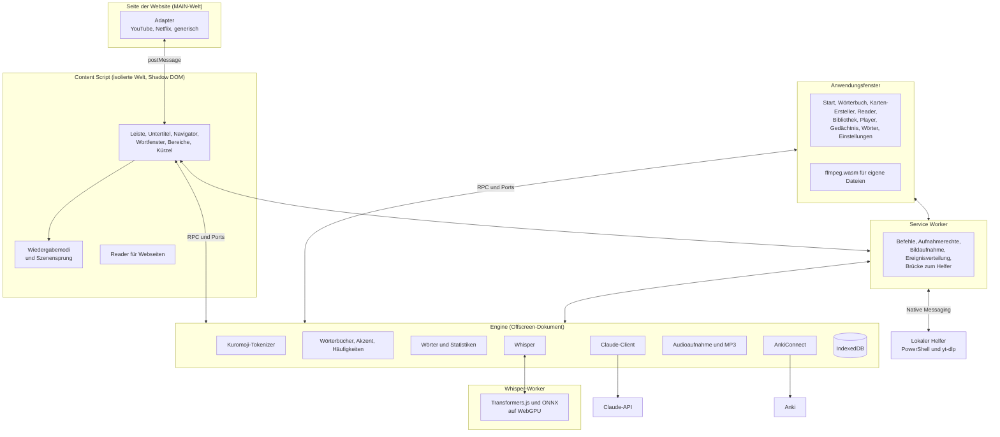

<p align="right"><a href="../arquitectura.md">Español</a> · <a href="../architecture.md">English</a> · <b>Deutsch</b> · <a href="../zh/architecture.md">简体中文</a> · <a href="../ko/architecture.md">한국어</a> · <a href="../ja/architecture.md">日本語</a></p>

# Architektur

Kotonoha (言の葉, „Blätter aus Worten“) ist eine Manifest-V3-Erweiterung, um Japanisch mit echten Videos und Texten zu lernen. Dieses Dokument beschreibt, wie sich die Arbeit auf die Teile verteilt, die wichtigsten Abläufe und die Messungen, die die technischen Entscheidungen begründen.

## Überblick



## Verteilung der Aufgaben

| Teil | Aufgabe | Grund |
|---|---|---|
| **Adapter (MAIN)** | Mit dem Player jeder Website sprechen: Spuren, Sprung, Wiedergabe | Nur aus der Seite heraus ist `#movie_player` oder `netflix` zugänglich |
| **Content Script** | Die gesamte Oberfläche über dem Video | Die isolierte Welt und das Shadow DOM verhindern Störungen in beide Richtungen |
| **Service Worker** | APIs, die sonst niemand nutzen kann: Befehle, `tabCapture`, `captureVisibleTab`, `connectNative` | Chrome hält ihn bei Inaktivität an, daher speichert er keinen Zustand |
| **Engine (Offscreen)** | Tokenizer, Datenbank, Claude, Anki und Aufnahme | Das ist das Schwere und Langlaufende. Ein Offscreen-Dokument wird nicht mitten in einer Antwort angehalten |
| **Whisper-Worker** | Das Modell laden und auf der GPU transkribieren | Sehr schwer, würde die Engine blockieren. Wird separat gepackt und nur bei Bedarf geladen |
| **Lokaler Helfer** | Das Audio eines Internetvideos herunterladen und die Erweiterung aktualisieren | Eine Erweiterung kann das nicht allein. Nur die Erweiterung kann ihn aufrufen, und er akzeptiert nur http- oder https-Adressen |
| **Anwendungsfenster** | Verwaltungsseiten und lokaler Player | Eine normale Seite der Erweiterung, die dieselbe Engine per RPC nutzt |
| **Kern (`src/nucleo`)** | Reine Logik: Parser, Modi, Statistiken, Synchronisierung, Transkription und Stapel | Ohne Browser-Abhängigkeiten, getestet mit Vitest |
| **Sprachpakete (`src/lenguas`)** | Alles, was von der gelernten Sprache abhängt | Der Rest des Programms kennt nur ihre Schnittstelle |

## Ablauf eines Untertitels

1. Der Adapter erkennt das Video und listet seine Spuren auf.
2. Das Content Script wählt die japanische Spur und die Zweituntertitel. Importierte haben Vorrang, von Hand erstellte werden automatischen vorgezogen.
3. Der Adapter lädt den Text mit der Sitzung der Seite herunter. Das ist bei YouTube wichtig, wo die Adressen vom Player signiert werden.
4. Der Kern wandelt das Format (TTML, WebVTT, SRT, ASS oder json3) in Zeilen mit Zeiten um.
5. Die Engine tokenisiert, fügt Konjugationen zusammen, berechnet Furigana, Akzent, Häufigkeit und Status jedes Wortes und erkennt Grammatik mit Regeln.
6. Ist die Spur automatisch, korrigiert Claude zuvor ihre Erkennungsfehler: Einen fehlerhaften Text zu analysieren wäre eine unnötige Ausgabe.
7. Claude prüft im Hintergrund jede neue Zeile: Es korrigiert Lesungen, weist auf übertragenen Gebrauch hin und bestätigt die Grammatik. Das Ergebnis wird pro Zeile gespeichert und nur einmal angefragt.
8. Die Oberfläche zeichnet jedes Wort: Die Textfarbe zeigt den Akzent, die Unterstreichung den Lernstand.

## Übersetzung und Korrektur mit Claude

Ein ganzes Video braucht Zeit, aber wichtig ist der Teil, der gerade läuft. Deshalb wird die Arbeit in Stapel aufgeteilt und beginnt mit dem Stapel an der Abspielposition (`src/nucleo/lotes.ts`).

| | Übersetzung | Korrektur |
|---|---|---|
| Stapelgröße | 80 Zeilen | 120 Zeilen |
| Antwort von Claude | Alle Zeilen | Nur die geänderten, normalerweise wenige |
| Kontext | Titel und benachbarte Zeilen | Titel und Gesamttext, in einem Block mit Prompt-Cache |
| Erster Stapel | Parallel zu den anderen | Allein: Er schreibt den Cache, den die anderen wiederverwenden |
| Bei Unterbrechung | Das Übersetzte wird gespeichert und beim Fehlenden fortgesetzt | Das Korrigierte wird gespeichert und am Ende als vollständig markiert |

Die Korrektur fragt nie nach: Claude entscheidet anhand des Kontexts und lässt zweifelhafte Zeilen, wie sie sind. Ist eine Zeile eine Erfindung der Spracherkennung, gibt Claude sie leer zurück, und sie verschwindet. Jede Korrektur bewahrt den Originaltext, der im Untertitel-Navigator einsehbar ist.

Erzeugte Spuren werden pro Video und Sprache gespeichert, mit ihrer Herkunft: Whisper, Claude, importiert oder gespeichert. Das Gemerkte aus einer anderen Netflix-Region erscheint nur, wenn die aktuelle Region diese Spur nicht anbietet.

## Transkription mit Whisper

Claude transkribiert kein Audio, daher läuft dieser Teil auf dem lokalen Computer.

| Quelle | Wie das Audio ankommt | Geschwindigkeit |
|---|---|---|
| Eigene Datei | ffmpeg.wasm extrahiert die gewählte Spur im Anwendungsfenster. Die Datei wird ohne Kopie eingebunden, sodass auch ganze Filme funktionieren | So schnell wie die GPU erlaubt |
| Internetvideo mit dem Helfer | yt-dlp lädt das Audio in einen temporären Ordner. Mit FFmpeg auf dem Rechner wandelt der Helfer es um, und die Engine liest die Samples stückweise über den Service Worker; ohne FFmpeg erhält die Engine die Datei und wandelt sie mit ffmpeg.wasm um | So schnell wie die GPU erlaubt |
| Internetvideo ohne den Helfer | Tab-Aufnahme während der Wiedergabe. Der Player meldet viermal pro Sekunde die Videozeit, die Samples auch bei Pausen und Sprüngen in Videozeit übersetzt | Echtzeit |

Netflix bleibt absichtlich außen vor: Es hat fast immer Untertitel, und sein Audio lässt sich nicht vorab verarbeiten.

1. Das Audio wird an Stillen geschnitten, bevor das 30-s-Fenster von Whisper erreicht ist. Abschnitte ohne Stimme werden verworfen, denn dort neigt Whisper zum Erfinden.
2. Whisper transkribiert auf der GPU. Der Text wird von Halluzinationen und Schleifen bereinigt und in Zeilen aufgeteilt.
3. Jeder Abschnitt von 6 s oder mehr ohne Text wird separat erneut transkribiert. Bei Hintergrundmusik kann Whisper ein Stück für beendet erklären oder spät beginnen und echte Sprache auslassen. Bleibt der Decoder in einer Wiederholung hängen, werden 10-s-Fenster versucht. Von diesen zweiten Durchgängen wird nur angenommen, was klar ein Satz ist, denn die meisten dieser Abschnitte enthalten nur Musik.
4. Claude korrigiert Homophone und Kanji: bei Dateien am Ende und in Echtzeit alle zehn Zeilen.

### Laststeuerung

Pausenloses Arbeiten hält die GPU stundenlang bei 100 %, was den Desktop ausbremst und den Grafiktreiber zum Neustart zwingen kann.

| Maßnahme | Funktionsweise |
|---|---|
| Ein Stück auf einmal | Ein zweistündiger Film wird nie auf einmal gesendet, und der Grafikspeicher wächst nicht mit der Dauer |
| Pausen | Nach jedem Stück wird im Verhältnis zur benötigten Zeit pausiert. Belegt eine andere Anwendung die GPU, dauert das Stück länger, und die Pause wächst von selbst |
| Automatische Intensität | Belegt 75 % der Zeit bei Benutzung des Computers und 90 % nach zwei Minuten ohne Benutzung. Der Modus Sanft bleibt bei 30 % |
| Pause | Gibt die Karte sofort frei und behält die Position |
| Wächter | Ein hängendes Stück wird nach 90 s abgebrochen |
| Verlust der GPU | Wartet 20 s, lädt das Modell neu und arbeitet im Modus Sanft weiter. Beim zweiten Ausfall hält es an, das Transkribierte bleibt gespeichert |
| Fortsetzung | Eine neue Transkription derselben Datei setzt dort fort, wo sie aufgehört hat |

**Liedtexte.** `src/nucleo/letra.ts` legt einen eingefügten Liedtext auf die Zeiten einer Spur. Claude wird über ein JSON-Schema um eine Liste von Einträgen `{Vers, erste Zeile, letzte Zeile}` in der Reihenfolge des Gesangs gebeten. Weder die Wörter noch die Zeiten stammen von ihm: Der Text ist der des Liedes, die Zeiten sind die der Transkription, sodass es beides nicht verändern kann. Die Antwort gibt den Liedtext nicht wieder und ist klein. Einträge außerhalb der Reihenfolge verlieren ihre Zeit, ohne die übrigen zu beeinflussen (längste aufsteigende Teilfolge), Verse ohne Zeit werden nach ihrer Länge geschätzt, und Verse, die sich eine Zeile teilen, teilen sich deren Dauer.

## Technische Entscheidungen

| Entscheidung | Wahl | Grund |
|---|---|---|
| Oberfläche | Preact und Signals | Sehr leicht, wichtig, weil es in jede Videoseite eingefügt wird |
| Bundling | esbuild mit eigenem Skript | Schnell und explizit, mit dem Manifest im Blick |
| Datenbank | Dexie auf IndexedDB | Indizes und Abfragen, ohne direkt auf IndexedDB zu programmieren |
| Tokenizer | Kuromoji hinter einer eigenen Schnittstelle | Läuft im Browser und lässt sich ersetzen, ohne den Rest anzufassen |
| Wörterbücher | Yomitan-Format: JMdict auf Spanisch und Englisch, Akzent von Kanjium, Häufigkeit von JPDB | Offenes Format, das auch den Import anderer aus einer Datei erlaubt |
| KI | Offizielles SDK `@anthropic-ai/sdk` aus der Engine | Der Schlüssel erreicht nie die Skripte, die auf Seiten laufen |
| Transkription | Whisper large-v3-turbo mit Transformers.js und WebGPU, Encoder in 16 Bit und quantisierter Decoder | Das genaueste der verglichenen, und nichts zu installieren |
| Audio von Internetvideos | yt-dlp in einem lokalen PowerShell-Programm, über Native Messaging, und FFmpeg, falls installiert | Die einzige Möglichkeit, es zu verarbeiten, ohne auf die Wiedergabe zu warten. Es lädt in eine temporäre Datei statt zu streamen, sodass im Tempo der GPU gelesen wird und nichts staut |
| Eigene Dateien | ffmpeg.wasm | Eingebettete Untertitel und Audiospuren von MKV, ohne externe Programme |
| Karten | AnkiConnect und eine interne Wiederholung mit FSRS | Anbindung an Anki oder Wiederholung in der Anwendung |
| Audio der Karten | `tabCapture` und `MediaRecorder`, als MP3 exportiert | Funktioniert auf jeder Website, ohne das Video herunterzuladen |
| Webseiten | CSS Custom Highlight API für die Farben und eine eigene Ebene außerhalb von `<body>` für die Lesungen | Fügt dem Inhalt der Seite nichts hinzu und stört React-Anwendungen und ähnliche nicht |
| Furigana in einer scrollenden Box | Eine Ebene pro Box, bewegt durch `ScrollTimeline` und von einem Rahmen zugeschnitten | Der Browser scrollt solche Boxen ohne den Haupt-Thread: Lesungen per Code neu zu setzen, ließe sie immer ein Bild hinter dem Text zurück, und es wäre ein Nachzieheffekt zu sehen. Mit dem Scrollen verknüpft bewegen sie sich zusammen mit dem Text, auch wenn die Seite beschäftigt ist |
| Zeilenabstand | `line-height` inline und ohne Einheit, nur bei mehrzeiligem Text oder eng aneinanderliegenden Zeilen | Bei 15 px Schrift und 21 px Zeilenhöhe bleiben 6 px für eine Lesung von 9 px und eine Unterstreichung. Es ist das Einzige, was der Reader auf der Seite berührt: Es wird zurückgenommen, wenn der Text aus einer Box mit fester Höhe ragen würde, und lässt sich abschalten |
| Welches Wort unter der Maus liegt | `caretPositionFromPoint` mit einem Index der Textknoten | Löst den Klick, ohne jedes Wort in ein Element zu packen |
| Sprachen der Oberfläche | Eine JSON-Tabelle pro Sprache, mit dem spanischen Text als Schlüssel, die separat geladen wird | Das Content Script läuft auf allen Seiten und soll keine sechs Sprachen mitschleppen. Mit ganzen Sätzen, denn die Wortstellung ändert sich im Koreanischen, Japanischen und Deutschen |
| Strichfolge | [KanjiVG](https://kanjivg.tagaini.net), Zeichen für Zeichen bei jsDelivr mit fester Version angefragt und als animiertes SVG gezeichnet | Es sind über 10.000 Dateien: Jedes Kanji wird bei Bedarf heruntergeladen und bleibt gespeichert. Das SVG ist in jeder Größe scharf und folgt dem Design, und aus jeder Datei werden nur die Pfade und ihre Nummern übernommen |
| Reader in einem Tab | Eine Seite der Erweiterung, `lector.html`, in einem normalen Tab geöffnet | Das Anwendungsfenster ist vom Typ `popup`, ohne Tabs, und kann nicht in die geteilte Ansicht. Eine Seite der Erweiterung schon, und sie braucht keinen Server. `chrome.tabs.create({ splitWithTabId })` setzt sie ab Chrome 155 neben den aktuellen Tab |
| Zwischenablage folgen | `execCommand('paste')` im Offscreen-Dokument | Ohne Fokus lässt `navigator.clipboard` nicht lesen, und in der geteilten Ansicht liegt der Fokus auf der anderen Seite. Gelesen wird nur bei eingeschalteter Option und sichtbarem Tab |
| Symbole | Phosphor in der Duotone-Variante | Einheitlicher Satz, von dem nur das gepackt wird, was der Code nutzt |
| Schrift | Nunito für Latein und Zen Maru Gothic für Japanisch | Beide abgerundet. Sie werden als Daten geladen, damit die Sicherheitsrichtlinie einer Website sie nicht blockiert |

## Claude-Modelle

Jede Aufgabe verwendet standardmäßig `claude-sonnet-5-5`, und Modell und Aufwand lassen sich in den Einstellungen pro Aufgabe ändern. Die Schaltfläche „Vertiefen“ im Wortfenster wiederholt die Anfrage mit `claude-opus-5-5` und hohem Aufwand. Die Anfragen aktivieren `fallbacks: "default"`, sodass eine Sicherheitsablehnung mit einem anderen Modell wiederholt wird. Das lässt sich in den Einstellungen abschalten. Strukturierte Antworten verwenden `output_config.format` mit JSON-Schemas, und das vollständige Skript geht, wenn es gesendet wird, in einem System-Block mit Cache.

**Nicht zweimal bezahlen.** Jede Anfrage hat eine eigene Identität, die sich aus dem Gefragten ergibt: Aufgabe, Modell, Niveau, Sprache, Vorlage, Wort, Lesung und Satz. Der umgebende Text gehört nicht dazu, da er sich beim Laden der Untertitel ändert. Eine laufende Anfrage wird nicht abgebrochen, auch wenn der Anfragende weggeht, denn sie ist bereits bezahlt und ein Abbruch würde erneutes Bezahlen erzwingen: Sie läuft im Hintergrund zu Ende, wird gespeichert, und eine zweite gleiche Anfrage hängt sich an sie an. Die Prüfung der Lesungen schreitet in Abschnitten von 120 Zeilen mit der Abspielposition voran, und jeder laufende Stapel wird beendet und gespeichert, auch wenn der Tab geschlossen wird.

**Kostenprotokoll.** Nach jeder Anfrage trägt `src/motor/ia.ts` in die Tabelle `consumo` die von der API gemeldeten Tokens (`usage`), das antwortende Modell und die Aufgabe ein. Der Preis wird in `src/nucleo/precios.ts` berechnet. Es wird nur protokolliert, was die API bestätigt; eine abgebrochene Anfrage erscheint nicht, auch wenn die API einen Teil davon berechnet haben könnte.

## Referenzmessungen

Computer: Radeon RX 9060 XT mit 16 GB, 16 GB RAM, 4K-Monitor mit 60 Hz, Windows 11 und Edge. Nachvollziehbar mit `pruebas/whisper-comparar.mjs`, `whisper-carga.mjs`, `whisper-video.mjs` und `whisper-larga.mjs`.

**Genauigkeit.** Zeichenfehlerrate in Prozent bei 126 echten Sätzen aus JSUT, Common Voice und ReazonSpeech, ohne Satzzeichen und Ziffern. Niedriger ist besser.

| Modell | Gesamt | JSUT | Common Voice | ReazonSpeech | Sätze mit Satzzeichen | Grafikspeicher |
|---|---|---|---|---|---|---|
| Whisper Turbo, Encoder in 16 Bit | 8,8 | 5,5 | 6,5 | 15,0 | 36 von 126 | 3,7 GB |
| Whisper Turbo, quantisiert | 9,8 | 5,7 | 7,2 | 17,4 | 30 von 126 | 1,5 GB |
| Kotoba Whisper v2.2, quantisiert | 10,4 | 6,4 | 7,6 | 17,9 | 12 von 126 | 2,2 GB |
| Kotoba Whisper v2.2, in 16 Bit | 10,5 | 7,8 | 7,8 | 16,4 | 10 von 126 | 3,3 GB |

Bei echten Videos war der Vorsprung von Turbo bei Homophonen und Eigennamen größer, und Kotoba neigte dazu, Zeilen über die Musik zu dehnen.

**Geschwindigkeit bei echten Videos**, mit Wiederherstellung ausgelassener Abschnitte:

| Video | Dauer | Zeit | Geschwindigkeit | Entspricht für 30 Minuten | 99. Perzentil des Desktops |
|---|---|---|---|---|---|
| Gespräch mit Hintergrundmusik | 23,1 min | 223 s | 6,1-fach | 4,9 min | 17,4 ms |
| Gesprochener Vortrag | 13,3 min | 125 s | 6,4-fach | 4,7 min | 17,5 ms |

Bei 75 % Auslastung, ohne Bilder über 33 ms und ohne Treiber-Neustarts.

**Flüssigkeit.** Zeit zwischen Desktop-Kompositionen in Millisekunden, gemessen mit `DwmFlush` und einem animierten Fenster. Normal bei 60 Hz sind 16,7.

| Auslastung | 99. Perzentil | Maximum | Bilder über 33 ms |
|---|---|---|---|
| Ohne Whisper | 18,2 | 19,3 | 0 |
| 30 % | 18,6 | 19,5 | 0 |
| 60 % | 18,7 | 20,0 | 0 |
| 95 % | 19,1 | 20,5 | 0 |

Bei der Wiedergabe eines 1080p-Videos mit laufendem Whisper bei 90 % und 95 % Auslastung: 0 von 749 Bildern verloren. Ohne Whisper ebenfalls 0 von 749.

**Langzeitlauf.** Zwei Stunden echtes Audio am Stück im automatischen Modus: 19,7 Minuten, 6,1-mal schneller als Echtzeit.

| Minute | Fortschritt | Grafikspeicher | Browser-RAM | 99. Perzentil | Bilder über 33 ms | Treiber-Neustarts |
|---|---|---|---|---|---|---|
| Vor dem Start | | 5,28 GB | 1,11 GB | | | |
| 1,4 | 7 % | 7,50 GB | 5,64 GB | 18,6 | 0 | 0 |
| 6,4 | 33 % | 7,67 GB | 5,25 GB | 18,6 | 0 | 0 |
| 11,5 | 56 % | 7,51 GB | 3,11 GB | 18,7 | 0 | 0 |
| 16,5 | 84 % | 7,33 GB | 2,64 GB | 18,7 | 0 | 0 |

Der Speicher wächst nicht mit der Zeit, und das Tempo bleibt erhalten. Der Grafikspeicher umfasst den des gesamten Systems.

**Wiederherstellung.** Das Zerstören des WebGPU-Geräts löst dasselbe Ereignis aus wie ein Treiber-Neustart. Whisper nimmt die Arbeit nach 27 s wieder auf, ohne Transkribiertes zu verlieren oder durcheinanderzubringen, und hält beim zweiten Ausfall mit einem Hinweis an.

### Moren in der Akzentübung

narabas, ein wav2vec2, das alle 20 ms die Wahrscheinlichkeit jedes japanischen Phonems liefert, wurde auf zwei Arten mit Minimalpaaren (おばあさん und おばさん, きって und きて …) getestet, gesprochen von zwei AivisSpeech-Stimmen:

- **Die erwartete Lesung ausrichten**, mit der erzwungenen Ausrichtung von narabas, und messen, wie lange jede besondere Mora dauert. Eine fehlende Mora bekam trotzdem ihr Zeitstück, und die Dauer trennte sie nicht gut von einer gesprochenen. Auch die Tonhöhenbewertung wurde nicht besser: Mit ausgerichteten Moren lag sie nicht öfter richtig als mit gleichmäßig aufgeteilten Wörtern (61 von 76 Bewertungen), daher wird die Tonhöhe wie bisher beurteilt.
- **Was es selbst hört**, das wahrscheinlichste Phonem jedes Rahmens, verglichen mit der Lesung über die Editierdistanz. Das wird verwendet: Es fand 17 von 22 fehlenden Moren und 10 von 10 überzähligen, ohne Hinweise bei 22 von 24 richtig gesprochenen Sätzen. Ein っ vor s, sh, z, j, h oder f wird nicht beurteilt: Das Modell gibt sein Symbol auch dann nicht aus, wenn es gesprochen wird.

Auf der GPU hört es dasselbe wie ONNX Runtime auf dem Prozessor, Phonem für Phonem. Bevor der Worker sie nutzt, prüft er sie mit einem festen Signal; mit Kokoro lieferte dieselbe GPU unmögliche Werte.

PASQA, ein Modell, das die Aussprache eines ganzen Satzes bewertet, blieb außen vor: Die Umwandlung verlangt bestimmte Versionen von Python, PyTorch und s3prl, und es ließ sich nicht messen.

### Kosten des Seiten-Readers

Zeit im Haupt-Thread, mit allen Wörtern unbekannt und Furigana bei allen: der schlimmste Fall. Gemessen in Edge bei 1366×860 mit `Performance.getMetrics`, bei bereits geladenem Reader.

| Seite | Einschalten | 6 s Ruhe | 3,5 s scrollen, ohne Reader | 3,5 s scrollen, mit Reader |
|---|---|---|---|---|
| Wikipedia, langer Artikel (16.000 Elemente) | 500 ms | 300 ms beim ersten Mal, danach 0 | 30 ms | 850 ms |
| Startseite einer Zeitung mit Werbung | 340 ms | 160 ms (120 ms ohne Reader) | 70–560 ms | 640–790 ms |

Teuer sind das Messen und das Ändern des DOM. Chromium baut nach jeder Änderung im Dokument alle Highlight-Marker neu auf, daher fasst der Reader seine Schreibvorgänge zusammen. Deshalb:

- Die Ebene der Lesungen liegt im Dokument und die einer scrollenden Box in dieser Box: Beim Scrollen gibt es nichts zu berechnen.
- Jede Lesung trägt den effektiven `z-index` ihres Textes, und der Browser löst ohne Trefferprüfungen, was was verdeckt. Abgeschnittenes wird durch den Vergleich von Rechtecken entschieden.
- Hat sich die Box eines Blocks nicht bewegt, haben sich auch seine Lesungen nicht bewegt: Geprüft wird eine Box statt jedes Wortes.
- Was noch `elementFromPoint` braucht, geschieht zeilenweise, in freien Momenten und bei ruhender Seite.
- Was sich entfernt, wird gesammelt entfernt, und kehrt es vorher zurück, wird es nicht angefasst.

## Sprachpakete

Alles, was von der gelernten Sprache abhängt, liegt in `src/lenguas/<Sprache>`, und der Rest des Programms kennt nur die Schnittstellen in `src/lenguas/tipos.ts`. Es gibt zwei Pakete: Japanisch und Englisch. Jedes Paket besteht aus zwei Teilen:

- **`PaqueteLengua`** ist leichtgewichtig und wird von allen Ansichten genutzt, auch vom Content Script: wie die Sprache in einem Text erkannt wird, wie ihre Lesungen geschrieben werden, ihre Stufen, Stimmen und Links sowie die Sätze der Oberfläche, die sie benennen.
- **`MotorLengua`** wird nur in der Engine und im Anwendungsfenster geladen: Analysator, Grammatikregeln, Prompts, Transkriptionsregeln, Wörterbücher und Audio.

Jede Sprache hat ihre eigene Datenbank. Die japanische behält den ursprünglichen Namen `kikitori`, die anderen heißen `kikitori-<Sprache>`. So wird ein Wort, das in zwei Sprachen gleich geschrieben wird, nie vermischt, und vorhandene Daten müssen nicht migriert werden. Die Kosten für Claude hängen nicht von der Sprache ab und werden immer in der ursprünglichen Datenbank gespeichert.

Die Prompts jedes Pakets sind mit ihren Prüfsummen in den Tests festgelegt, denn eine Änderung entwertet die gespeicherten Antworten, die dann erneut bezahlt werden müssten.

Das Paket für Englisch zeigt, worin sich die Sprachen unterscheiden:

| Aspekt | Japanisch | Englisch |
|---|---|---|
| Analysator | Kuromoji mit IPADIC | wink-nlp mit seinem kleinen Modell, separat kompiliert (`ingles.js`) und nur beim Lernen von Englisch geladen |
| Lesung | Teil des Wortes: Sie unterscheidet Homographen und gehört zum Schlüssel | Sie unterscheidet nichts: Der Schlüssel ist die Wörterbuchform, die IPA wird getrennt nach Region gespeichert |
| Akzent | Tonmuster nach Moren, von Kanjium | Betonte Silbe, aus der IPA abgeleitet |
| Wörterbücher | JMdict, Kanjium und JPDB | Wiktionary über wiktionary-to-yomitan und FrequencyWords |
| Liste der Begriffe im Speicher | Die Analyse wartet darauf: Ohne sie würden Komposita getrennt | Die Analyse wartet nicht: Sie dient nur dazu, Wörter mit Bindestrich zu verbinden |

Einstellungen, die von der Sprache abhängen, werden in `porLengua` gespeichert und beim Wechsel wiederhergestellt (`ajustesParaLengua`). Der Rest des Programms liest sie weiterhin an ihrem gewohnten Ort.

Wörterbücher werden Bank für Bank entpackt, damit der Speicherbedarf nicht von der Dateigröße abhängt, und in Etappen gelöscht, weil eine einzige Transaktion mit Hunderttausenden Zeilen nicht fertig wird. Gemessen mit dem Englisch-Englisch-Wörterbuch aus Wiktionary mit 847.853 Zeilen: 1,5 bis 3 Minuten Installation einschließlich Download, etwa 220 MB Speicherplatz und Abfragen unter 10 ms. Das Entfernen dauert etwa 3 Minuten, währenddessen Abfragen 2 bis 5 Sekunden brauchen.

## Ordnerstruktur

```
src/
  nucleo/       Reine, getestete Logik: Untertitel, Modi, Synchronisierung, Transkription, Stapel
  lenguas/      Was von der gelernten Sprache abhängt: ein Paket pro Sprache
  compartido/   Typen, Einstellungen und RPC zwischen Kontexten
  pagina/       Adapter der MAIN-Welt
  contenido/    Oberfläche über dem Video und Seiten-Reader (lector/)
  fondo/        Service Worker
  motor/        Offscreen-Dokument: Datenbank, Tokenizer, Claude, Anki, Aufnahme, Whisper
  app/          Anwendungsfenster
  lector/       Der Reader in einem normalen Tab
  popup/        Menü des Erweiterungssymbols
  ui/           Designsystem, Wortfenster, Symbole und Marke
idiomas/        Übersetzungstabellen der Oberfläche
herramientas/   Generatoren für Symbole, Marke und Banner; zu übersetzende Texte; lokaler Helfer in ayudante/
pruebas/        Screenshot-Prüfstand, End-to-End-Tests und simulierte Server
docs/           Dokumentation: Spanisch und Englisch hier, Deutsch, Chinesisch, Koreanisch und Japanisch in Unterordnern
```
