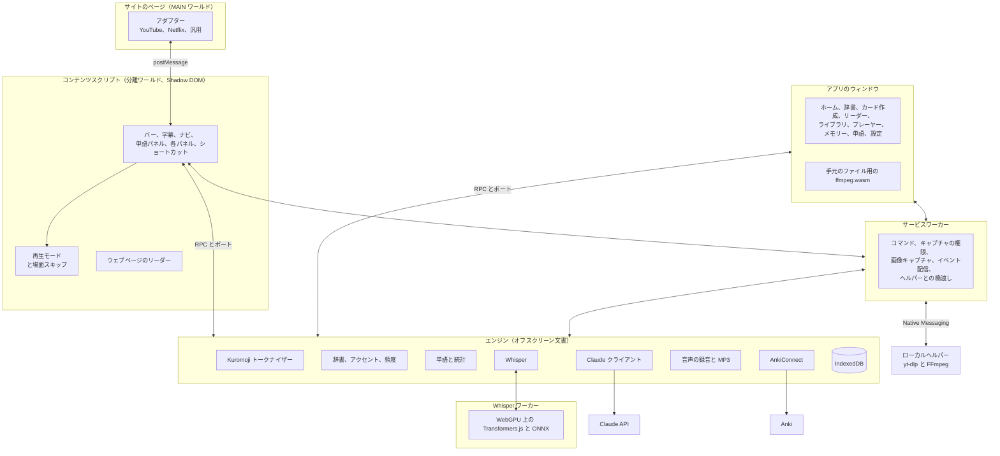

<p align="right"><a href="../arquitectura.md">Español</a> · <a href="../architecture.md">English</a> · <a href="../de/architecture.md">Deutsch</a> · <a href="../zh/architecture.md">简体中文</a> · <a href="../ko/architecture.md">한국어</a> · <b>日本語</b></p>

# アーキテクチャ

Kotonoha（言の葉）は、本物の動画と文章で日本語を学ぶための Manifest V3 拡張機能です。この文書では、各部分の役割分担、主な流れ、技術的な判断の根拠となった測定を説明します。

## 全体像



## 役割分担

| 部分 | 役割 | 理由 |
|---|---|---|
| **アダプター（MAIN）** | 各サイトのプレーヤーとのやり取り：トラック、シーク、再生 | ページの中からしか `#movie_player` や `netflix` にアクセスできません |
| **コンテンツスクリプト** | 動画の上の画面すべて | 分離ワールドと Shadow DOM がサイトとの双方向の干渉を防ぎます |
| **サービスワーカー** | 他では使えない API：コマンド、`tabCapture`、`captureVisibleTab`、`connectNative` | アイドル時に Chrome が止めるので、状態を保存しません |
| **エンジン（オフスクリーン）** | トークナイザー、データベース、Claude、Anki、録音 | 重く長時間かかる処理です。オフスクリーン文書は回答の途中で止まりません |
| **Whisper ワーカー** | モデルの読み込みと GPU での文字起こし | とても重く、エンジンを止めてしまいます。別にパッケージし、使うときだけ読み込みます |
| **ローカルヘルパー** | ネット動画の音声のダウンロード | 拡張機能だけではできません。拡張機能だけが呼び出せ、http または https のアドレスだけを受け付けます |
| **アプリのウィンドウ** | 管理画面とローカルプレーヤー | 同じエンジンを RPC で使う、拡張機能の通常のページです |
| **コア（`src/nucleo`）** | 純粋なロジック：パーサー、モード、統計、同期、文字起こし、バッチ | ブラウザに依存せず、Vitest でテストします |
| **言語パッケージ（`src/lenguas`）** | 学習する言語によって変わるものすべて | プログラムの他の部分はそのインターフェースだけを知っています |

## 字幕の流れ

1. アダプターが動画を検出し、トラックを一覧にします。
2. コンテンツスクリプトが日本語のトラックと第2字幕を選びます。読み込んだものを優先し、人が作ったものを自動より優先します。
3. アダプターがページのセッションでテキストをダウンロードします。アドレスにプレーヤーの署名が付く YouTube で重要です。
4. コアが形式（TTML、WebVTT、SRT、ASS、json3）を時間付きの行に変換します。
5. エンジンがトークン化し、活用をまとめ、各単語のふりがな、アクセント、頻度、状態を計算し、規則で文法を検出します。
6. 自動トラックなら、先に Claude が認識の誤りを修正します。誤りのあるテキストを分析しても無駄な出費になるからです。
7. Claude がバックグラウンドで新しい行を確認します。読み方を直し、比喩的な用法を指摘し、文法を確かめます。結果は行ごとに保存され、一度しか要求しません。
8. 画面が各単語を描きます。文字の色はアクセントを、下線は学習状態を示します。

## Claude による翻訳と修正

動画全体の処理には時間がかかりますが、大事なのは今見ている部分です。そのため作業をバッチに分け、再生位置のバッチから始めます（`src/nucleo/lotes.ts`）。

| | 翻訳 | 修正 |
|---|---|---|
| バッチの大きさ | 80 行 | 120 行 |
| Claude の回答 | すべての行 | 変更した行だけ、通常は少数 |
| 文脈 | タイトルと近くの行 | タイトルと全文、プロンプトキャッシュのブロック |
| 最初のバッチ | 他と並行 | 単独：他が再利用するキャッシュを書き込みます |
| 中断時 | 翻訳済みを保存し、足りない部分から続行 | 修正済みを保存し、終わると完了の印を付けます |

修正は決して質問しません。Claude は文脈で判断し、疑わしい行はそのままにします。認識が作り出した文なら空で返し、その行は消えます。修正のたびに元の文を残し、字幕ナビで確認できます。

生成したトラックは動画と言語ごとに、由来（Whisper、Claude、読み込み、保存済み）とともに保存します。他の Netflix の地域から記憶したものは、現在の地域にそのトラックがないときだけ表示します。

## Whisper による文字起こし

Claude は音声を文字起こししないので、この部分は手元のパソコンで実行します。

| ソース | 音声の届き方 | 速度 |
|---|---|---|
| 手元のファイル | ffmpeg.wasm がアプリのウィンドウで選んだトラックを取り出します。ファイルをコピーせずにマウントするので、映画全体にも使えます | GPU が許す速さ |
| ネット動画、ヘルパーあり | yt-dlp が音声をダウンロードし、FFmpeg が一時ファイルに変換し、エンジンがサービスワーカーを通じて少しずつ読みます | GPU が許す速さ |
| ネット動画、ヘルパーなし | 再生中のタブのキャプチャ。プレーヤーが動画の時間を毎秒 4 回知らせ、一時停止やシークがあってもサンプルを動画の時間に変換します | 実時間 |

Netflix は意図的に対象外です。ほとんどの作品に字幕があり、音声を事前に処理できません。

1. Whisper の 30 秒の窓に届く前に、無音で音声を切ります。声のない区間は捨てます。Whisper が作り出しやすい場所だからです。
2. Whisper が GPU で文字起こしします。幻覚とループを取り除き、テキストを行に分けます。
3. テキストのない 6 秒以上の区間は別に文字起こしし直します。背景音楽があると、Whisper は区間を早く終えたり遅く始めたりして実際の音声を飛ばすことがあります。デコーダーが繰り返しに陥ったら 10 秒の窓で試します。こうした区間のほとんどは音楽だけなので、2 回目の結果は明らかに文であるものだけを受け入れます。
4. Claude が同音異義語と漢字を修正します。ファイルは最後に、実時間では 10 行ごとに行います。

### 負荷の制御

休まず動かすと GPU は何時間も 100% のままで、デスクトップが重くなり、グラフィックドライバーが再起動することがあります。

| 対策 | 仕組み |
|---|---|
| 一度に 1 つの断片 | 2 時間の映画を一度に送ることはなく、ビデオメモリは長さに応じて増えません |
| 休止 | 各断片の後、かかった時間に比例して休みます。他のアプリが GPU を使っていると断片に時間がかかり、休止も自動で増えます |
| 自動の強度 | パソコンの使用中は時間の 75%、未使用が 2 分続くと 90% を使います。控えめモードは 30% です |
| 一時停止 | カードをすぐに解放し、位置を保ちます |
| 監視 | 止まった断片は 90 秒で中止します |
| GPU の喪失 | 20 秒待ち、モデルを読み込み直し、控えめモードで続けます。2 回目の失敗で止まり、文字起こしした分は保存されます |
| 再開 | 同じファイルをもう一度文字起こしすると、止まったところから続けます |

## 技術的な判断

| 判断 | 選択 | 理由 |
|---|---|---|
| 画面 | Preact とシグナル | とても軽量で、すべての動画ページに注入するので重要です |
| バンドル | esbuild と独自のスクリプト | 速く明示的で、マニフェストが見えます |
| データベース | IndexedDB 上の Dexie | IndexedDB を直接扱わずにインデックスとクエリを使えます |
| トークナイザー | 独自のインターフェースの裏の Kuromoji | ブラウザで動き、他に触らず置き換えられます |
| 辞書 | Yomitan 形式：スペイン語と英語の JMdict、Kanjium のアクセント、JPDB の頻度 | オープンな形式で、ファイルから他の辞書も読み込めます |
| AI | エンジンから公式 SDK `@anthropic-ai/sdk` | キーがページで動くスクリプトに届きません |
| 文字起こし | Transformers.js と WebGPU の Whisper large-v3-turbo、16 ビットのエンコーダーと量子化デコーダー | 比較した中で最も正確で、何もインストールしません |
| ネット動画の音声 | ローカルプログラムの yt-dlp と FFmpeg、Native Messaging | 再生を待たずに処理できる唯一の方法です。ストリーミングではなく一時ファイルにダウンロードするので、GPU の速さで読み、詰まりません |
| 手元のファイル | ffmpeg.wasm | 外部プログラムなしで MKV の内蔵字幕と音声トラックを扱います |
| カード | AnkiConnect と FSRS の内部の復習 | Anki との連携、またはアプリ内での復習 |
| カードの音声 | `tabCapture` と `MediaRecorder`、MP3 に書き出し | 動画をダウンロードせずにどのサイトでも動作します |
| ウェブページ | 色分けに CSS Custom Highlight API、読み方に `<body>` の外の独自レイヤー | ページの内容に何も加えず、React などのアプリの邪魔もしません |
| スクロールするボックスのふりがな | ボックスごとに 1 つのレイヤーを `ScrollTimeline` で動かし、枠で切り取る | ブラウザはこうしたボックスをメインスレッドを通さずにスクロールします。コードで読み方を動かすと必ず文字より 1 フレーム遅れ、残像が見えます。スクロールに連動させれば、ページが忙しくても文字と一緒に動きます |
| 行間 | 単位なしのインライン `line-height`、複数行のテキストや詰まった行だけ | 文字 15 px、行 21 px では、9 px の読み方と下線に 6 px しか残りません。リーダーがページで触れるのはこれだけで、テキストが高さ固定のボックスからはみ出すなら元に戻し、オフにもできます |
| マウスの下の単語 | `caretPositionFromPoint` とテキストノードのインデックス | 各単語を要素で包まずにクリックを解決します |
| 表示言語 | 言語ごとの JSON 表、スペイン語のテキストをキーに、別に読み込み | コンテンツスクリプトはすべてのページで動くので、6 言語を抱えるべきではありません。韓国語、日本語、ドイツ語では語順が変わるので、文全体を使います |
| 書き順 | [KanjiVG](https://kanjivg.tagaini.net)、バージョンを固定して jsDelivr に文字ごとに要求し、SVG のアニメーションで描画 | ファイルは 1 万を超えます。各漢字は使うときにダウンロードし、保存します。SVG はどの大きさでも鮮明でテーマに従い、各ファイルからパスと番号だけを受け入れます |
| タブのリーダー | 拡張機能のページ `lector.html` を通常のタブで開く | アプリのウィンドウは `popup` タイプでタブがなく、分割表示に入れません。拡張機能のページなら入れ、サーバーも不要です。Chrome 155 以降は `chrome.tabs.create({ splitWithTabId })` で現在のタブの横に置きます |
| クリップボードを追う | オフスクリーン文書の `execCommand('paste')` | フォーカスがないと `navigator.clipboard` は読めず、分割表示ではフォーカスは他のページにあります。オプションがオンでタブが表示されているときだけ読みます |
| アイコン | Phosphor のデュオトーン | 統一されたセットで、コードが使うものだけをパッケージします |
| フォント | ラテン文字に Nunito、日本語に Zen Maru Gothic | どちらも丸ゴシックです。サイトのセキュリティポリシーでブロックされないよう、データとして読み込みます |

## Claude のモデル

各作業は既定で `claude-sonnet-5-5` を使い、モデルと労力は設定で作業ごとに変更できます。単語パネルの「深掘り」ボタンは `claude-opus-5-5` と高い労力で問い合わせ直します。リクエストは `fallbacks: "default"` を有効にするので、安全上の拒否は別のモデルで再試行され、設定でオフにできます。構造化された回答は JSON スキーマ付きの `output_config.format` を使い、台本全体は送るときにキャッシュ付きのシステムブロックに入れます。

**二重に払わない。** 各問い合わせには、尋ねる内容からなる固有の同一性があります。作業、モデル、レベル、言語、テンプレート、単語、読み方、文です。字幕の読み込みで変わる周囲のテキストは含みません。進行中のリクエストは、頼んだ側が離れてもキャンセルしません。すでに支払い済みで、キャンセルすると再度払うことになるからです。バックグラウンドで終わって保存され、2 回目の同じ問い合わせはそれに合流します。読み方の確認は再生位置に従って 120 行の区間で進み、進行中のバッチはタブを閉じても終わって保存されます。

**費用の記録。** リクエストのたびに、`src/motor/ia.ts` が `consumo` テーブルに API の報告するトークン（`usage`）、回答したモデル、作業を記録します。価格は `src/nucleo/precios.ts` で計算します。API が確認したものだけを記録するので、中止したリクエストは、API が一部を請求した可能性があっても表示されません。

## 参考測定

環境：16 GB の Radeon RX 9060 XT、16 GB の RAM、60 Hz の 4K モニター、Windows 11、Edge。`pruebas/whisper-comparar.mjs`、`whisper-carga.mjs`、`whisper-video.mjs`、`whisper-larga.mjs` で再現できます。

**精度。** JSUT、Common Voice、ReazonSpeech の実際の文 126 件の文字誤り率（%）で、句読点と数字は数えません。低いほど良好です。

| モデル | 全体 | JSUT | Common Voice | ReazonSpeech | 句読点のある文 | ビデオメモリ |
|---|---|---|---|---|---|---|
| Whisper Turbo、16 ビットエンコーダー | 8.8 | 5.5 | 6.5 | 15.0 | 126 件中 36 件 | 3.7 GB |
| Whisper Turbo、量子化 | 9.8 | 5.7 | 7.2 | 17.4 | 126 件中 30 件 | 1.5 GB |
| Kotoba Whisper v2.2、量子化 | 10.4 | 6.4 | 7.6 | 17.9 | 126 件中 12 件 | 2.2 GB |
| Kotoba Whisper v2.2、16 ビット | 10.5 | 7.8 | 7.8 | 16.4 | 126 件中 10 件 | 3.3 GB |

実際の動画では、同音異義語と固有名詞で Turbo の優位がさらに大きく、Kotoba は音楽の上で行を伸ばす傾向がありました。

**実際の動画の速度**、飛ばした区間の回復を含む：

| 動画 | 長さ | 時間 | 速度 | 30 分あたり | デスクトップの 99 パーセンタイル |
|---|---|---|---|---|---|
| 背景音楽のある会話 | 23.1 分 | 223 秒 | 6.1 倍 | 4.9 分 | 17.4 ms |
| 講演 | 13.3 分 | 125 秒 | 6.4 倍 | 4.7 分 | 17.5 ms |

占有率 75% で、33 ms を超えるフレームやドライバーの再起動はありませんでした。

**滑らかさ。** `DwmFlush` と動くウィンドウで測ったデスクトップの合成間隔（ミリ秒）です。60 Hz の正常値は 16.7 です。

| 占有率 | 99 パーセンタイル | 最大 | 33 ms を超えるフレーム |
|---|---|---|---|
| Whisper なし | 18.2 | 19.3 | 0 |
| 30% | 18.6 | 19.5 | 0 |
| 60% | 18.7 | 20.0 | 0 |
| 95% | 19.1 | 20.5 | 0 |

Whisper を動かしながら 1080p の動画を再生すると、占有率 90% と 95% で 749 フレーム中 0 フレーム欠落。Whisper なしでも 749 フレーム中 0 フレームでした。

**長時間。** 自動モードで実際の音声 2 時間連続：19.7 分、実時間の 6.1 倍です。

| 分 | 進行 | ビデオメモリ | ブラウザの RAM | 99 パーセンタイル | 33 ms を超えるフレーム | ドライバーの再起動 |
|---|---|---|---|---|---|---|
| 開始前 | | 5.28 GB | 1.11 GB | | | |
| 1.4 | 7% | 7.50 GB | 5.64 GB | 18.6 | 0 | 0 |
| 6.4 | 33% | 7.67 GB | 5.25 GB | 18.6 | 0 | 0 |
| 11.5 | 56% | 7.51 GB | 3.11 GB | 18.7 | 0 | 0 |
| 16.5 | 84% | 7.33 GB | 2.64 GB | 18.7 | 0 | 0 |

メモリは時間とともに増えず、ペースも保たれます。ビデオメモリはシステム全体の使用量です。

**復旧。** WebGPU デバイスの破棄はドライバーの再起動と同じイベントを発生させます。Whisper は 27 秒後に、文字起こしした内容を失ったり乱したりせずに作業を再開し、2 回目の失敗で通知とともに止まります。

### ページリーダーの負荷

すべての単語が未知で、すべてにふりがなを付けた最悪の場合のメインスレッドの時間です。Edge で 1366×860 で `Performance.getMetrics` を使い、リーダーを読み込んだ状態で測定しました。

| ページ | オンにする | 6 秒静止 | 3.5 秒スクロール、リーダーなし | 3.5 秒スクロール、リーダーあり |
|---|---|---|---|---|
| Wikipedia の長い記事（16,000 要素） | 500 ms | 初回 300 ms、その後 0 | 30 ms | 850 ms |
| 広告のある新聞のトップページ | 340 ms | 160 ms（リーダーなしで 120 ms） | 70〜560 ms | 640〜790 ms |

高くつくのは測定と DOM の変更です。Chromium は文書が少しでも変わるとすべてのハイライトマーカーを作り直すので、リーダーは書き込みをまとめます。そのため：

- 読み方のレイヤーは文書と、スクロールするボックスのレイヤーはそのボックスと一緒に動きます。スクロールしても計算することはありません。
- 各読み方はテキストの実効 `z-index` を持ち、ブラウザがヒットテストなしで重なりを決めます。切り取りは矩形の比較で判断します。
- ブロックのボックスが動いていなければ、読み方も動いていません。単語ごとではなくボックスを 1 つ確認します。
- まだ `elementFromPoint` が必要なものは、行ごとに、空き時間にページが止まっているときに処理します。
- 遠ざかるものはまとめて取り除き、その前に戻れば触りません。

## 言語パッケージ

学習する言語によって変わるものはすべて `src/lenguas/<言語>` にあり、プログラムの他の部分は `src/lenguas/tipos.ts` のインターフェースだけを知っています。パッケージは日本語と英語の 2 つです。各パッケージは二つの部分に分かれます。

- **`PaqueteLengua`** は軽量で、コンテンツスクリプトを含むすべての画面で使います。文章の中でその言語を見分ける方法、読みの書き方、レベル、音声、リンク、そしてその言語に触れる画面上の文を持ちます。
- **`MotorLengua`** はエンジンとアプリのウィンドウでのみ読み込みます。解析器、文法の規則、プロンプト、文字起こしの規則、辞書、音声を持ちます。

言語ごとに専用のデータベースがあります。日本語のものは元の名前 `kikitori` のままで、他の言語は `kikitori-<言語>` という名前になります。これにより、二つの言語で同じ書き方をする単語が混ざることはなく、既存のデータを移行する必要もありません。Claude の費用は言語に関係しないため、常に元のデータベースに保存します。

各パッケージのプロンプトは、テストの中で指紋として固定しています。プロンプトを変更すると保存済みの回答が使えなくなり、もう一度費用がかかるためです。

英語のパッケージは、言語による違いを示しています。

| 観点 | 日本語 | 英語 |
|---|---|---|
| 解析器 | Kuromoji と IPADIC | wink-nlp とその小さなモデル。別にコンパイルし（`ingles.js`）、英語を学ぶときだけ読み込みます |
| 読み | 単語の一部で、同形語を区別し、キーに含まれます | 何も区別しません。キーは辞書形で、IPA は地域別に別に保存します |
| アクセント | モーラごとの音調パターン、Kanjium | 強勢のある音節、IPA から導出 |
| 辞書 | JMdict、Kanjium、JPDB | wiktionary-to-yomitan を通じた Wiktionary と FrequencyWords |
| メモリ上の語のリスト | 分析はこれを待ちます。なければ複合語が分かれてしまいます | 分析は待ちません。ハイフンでつながる語を結ぶためだけに使います |

言語によって変わる設定は `porLengua` に保存され、切り替え時に復元されます（`ajustesParaLengua`）。プログラムの他の部分はこれまでどおりの場所から読み取ります。

辞書はバンクごとに展開するので、メモリ使用量はファイルサイズに左右されません。また、数十万行を 1 つのトランザクションで処理すると完了しないため、分割して削除します。Wiktionary の英英辞書（847,853 行）で測定した結果、ダウンロードを含むインストールは 1.5〜3 分、ディスクは約 220 MB、検索は 10 ms 未満でした。削除には約 3 分かかり、その間の検索には 2〜5 秒かかります。

## フォルダ構成

```
src/
  nucleo/       テスト済みの純粋なロジック：字幕、モード、同期、文字起こし、バッチ
  lenguas/      学習する言語によって変わるもの：言語ごとに一つのパッケージ
  compartido/   型、設定、コンテキスト間の RPC
  pagina/       MAIN ワールドのアダプター
  contenido/    動画の上の画面とページリーダー（lector/）
  fondo/        サービスワーカー
  motor/        オフスクリーン文書：データベース、トークナイザー、Claude、Anki、録音、Whisper
  app/          アプリのウィンドウ
  lector/       通常のタブのリーダー
  popup/        拡張機能のアイコンのメニュー
  ui/           デザインシステム、単語パネル、アイコン、ブランド
idiomas/        表示の翻訳表
herramientas/   アイコン、ブランド、バナーの生成；翻訳するテキスト；ayudante/ のローカルヘルパー
pruebas/        スクリーンショットの仕組み、エンドツーエンドのテスト、模擬サーバー
docs/           文書：ここにスペイン語と英語、サブフォルダにドイツ語、中国語、韓国語、日本語
```
