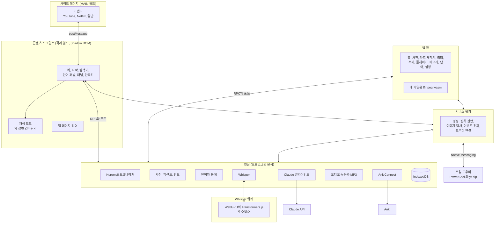

<p align="right"><a href="../arquitectura.md">Español</a> · <a href="../architecture.md">English</a> · <a href="../de/architecture.md">Deutsch</a> · <a href="../zh/architecture.md">简体中文</a> · <b>한국어</b> · <a href="../ja/architecture.md">日本語</a></p>

# 아키텍처

Kotonoha(言の葉, ‘말의 잎’)는 실제 영상과 글로 일본어를 배우는 Manifest V3 확장 프로그램입니다. 이 문서는 각 부분의 역할 분담, 주요 흐름, 기술적 결정의 근거가 된 측정값을 설명합니다.

## 전체 구조



## 역할 분담

| 부분 | 역할 | 이유 |
|---|---|---|
| **어댑터(MAIN)** | 각 사이트의 플레이어와 통신: 트랙, 건너뛰기, 재생 | 페이지 안에서만 `#movie_player`나 `netflix`에 접근할 수 있습니다 |
| **콘텐츠 스크립트** | 영상 위 인터페이스 전체 | 격리 월드와 Shadow DOM이 사이트와의 양방향 간섭을 막습니다 |
| **서비스 워커** | 다른 곳에서 쓸 수 없는 API: 명령, `tabCapture`, `captureVisibleTab`, `connectNative` | Chrome이 유휴 상태에서 멈추므로 상태를 저장하지 않습니다 |
| **엔진(오프스크린)** | 토크나이저, 데이터베이스, Claude, Anki, 녹음 | 무겁고 오래 걸리는 작업입니다. 오프스크린 문서는 답변 도중에 멈추지 않습니다 |
| **Whisper 워커** | 모델 로드와 GPU 전사 | 매우 무거워 엔진을 막을 수 있습니다. 따로 패키징하며 쓸 때만 로드합니다 |
| **로컬 도우미** | 인터넷 영상의 오디오 다운로드와 확장 프로그램 업데이트 | 확장 프로그램 혼자서는 할 수 없습니다. 확장 프로그램만 호출할 수 있고 http 또는 https 주소만 받습니다 |
| **앱 창** | 관리 화면과 로컬 플레이어 | 같은 엔진을 RPC로 쓰는 일반 확장 프로그램 페이지입니다 |
| **코어(`src/nucleo`)** | 순수 로직: 파서, 모드, 통계, 동기화, 전사, 배치 | 브라우저 의존성이 없어 Vitest로 테스트합니다 |
| **언어 패키지(`src/lenguas`)** | 학습하는 언어에 따라 달라지는 모든 것 | 프로그램의 나머지 부분은 인터페이스만 압니다 |

## 자막의 흐름

1. 어댑터가 영상을 감지하고 트랙을 나열합니다.
2. 콘텐츠 스크립트가 일본어 트랙과 보조 자막을 고릅니다. 가져온 자막이 우선이고, 사람이 만든 자막을 자동 자막보다 우선합니다.
3. 어댑터가 페이지의 세션으로 텍스트를 내려받습니다. 주소를 플레이어가 서명하는 YouTube에서 중요합니다.
4. 코어가 형식(TTML, WebVTT, SRT, ASS, json3)을 시간이 있는 줄로 변환합니다.
5. 엔진이 토큰화하고, 활용을 합치고, 각 단어의 후리가나, 악센트, 빈도, 상태를 계산하고, 규칙으로 문법을 찾습니다.
6. 자동 트랙이면 Claude가 먼저 인식 오류를 수정합니다. 오류가 있는 텍스트를 분석하는 것은 낭비이기 때문입니다.
7. Claude가 백그라운드에서 새 줄을 검토합니다. 읽는 법을 고치고, 비유적 용법을 표시하고, 문법을 확인합니다. 결과는 줄별로 저장되고 한 번만 요청합니다.
8. 인터페이스가 각 단어를 그립니다. 글자 색은 악센트를, 밑줄은 학습 상태를 나타냅니다.

## Claude 번역과 수정

영상 전체를 처리하려면 시간이 걸리지만 중요한 것은 지금 보는 부분입니다. 그래서 작업을 배치로 나누고 재생 위치의 배치부터 시작합니다(`src/nucleo/lotes.ts`).

| | 번역 | 수정 |
|---|---|---|
| 배치 크기 | 80줄 | 120줄 |
| Claude의 답변 | 모든 줄 | 바뀐 줄만, 보통 적음 |
| 맥락 | 제목과 주변 줄 | 제목과 전체 텍스트, 프롬프트 캐시 블록 |
| 첫 배치 | 다른 배치와 병렬 | 단독: 다른 배치가 재사용할 캐시를 씁니다 |
| 중단 시 | 번역한 내용을 저장하고 빠진 부분을 이어서 진행 | 수정한 내용을 저장하고 끝나면 완료로 표시 |

수정은 절대 묻지 않습니다. Claude가 맥락으로 판단하고 애매한 줄은 그대로 둡니다. 인식 과정에서 지어낸 문장이면 빈 줄로 돌려주어 사라집니다. 수정할 때마다 원문을 보존하며 자막 탐색기에서 볼 수 있습니다.

생성된 트랙은 영상과 언어별로 출처(Whisper, Claude, 가져오기, 저장됨)와 함께 저장됩니다. 다른 Netflix 지역에서 기억한 트랙은 현재 지역에 그 트랙이 없을 때만 나타납니다.

## Whisper 전사

Claude는 오디오를 전사하지 않으므로 이 부분은 로컬 컴퓨터에서 실행합니다.

| 출처 | 오디오가 오는 방법 | 속도 |
|---|---|---|
| 내 파일 | ffmpeg.wasm이 앱 창에서 선택한 트랙을 추출합니다. 파일을 복사하지 않고 마운트하므로 영화 전체에도 쓸 수 있습니다 | GPU가 허용하는 만큼 |
| 인터넷 영상, 도우미 사용 | yt-dlp가 오디오를 임시 폴더에 내려받습니다. 컴퓨터에 FFmpeg가 있으면 도우미가 변환하고 엔진이 서비스 워커를 통해 샘플을 조금씩 읽으며, 없으면 엔진이 파일을 받아 ffmpeg.wasm으로 변환합니다 | GPU가 허용하는 만큼 |
| 인터넷 영상, 도우미 없음 | 재생 중 탭 캡처. 플레이어가 초당 네 번 영상 시간을 알려 주어, 일시정지나 건너뛰기가 있어도 샘플을 영상 시간으로 변환합니다 | 실시간 |

Netflix는 일부러 제외합니다. 대부분 자막이 있고, 오디오를 미리 처리할 수 없기 때문입니다.

1. Whisper의 30초 창에 닿기 전에 무음에서 오디오를 자릅니다. 음성이 없는 구간은 버립니다. Whisper가 지어내기 쉬운 곳이기 때문입니다.
2. Whisper가 GPU에서 전사합니다. 환각과 반복을 지운 뒤 텍스트를 줄로 나눕니다.
3. 텍스트가 없는 6초 이상의 구간은 따로 다시 전사합니다. 배경 음악이 있으면 Whisper가 구간을 일찍 끝내거나 늦게 시작해 실제 음성을 건너뛸 수 있습니다. 디코더가 반복에 걸리면 10초 창으로 시도합니다. 이런 구간은 대부분 음악뿐이므로 두 번째 결과는 분명한 문장만 받아들입니다.
4. Claude가 동음이의어와 한자를 수정합니다. 파일은 마지막에, 실시간은 열 줄마다 합니다.

### 부하 제어

쉬지 않고 일하면 GPU가 몇 시간 동안 100%에 머물러 바탕 화면이 버벅이고 그래픽 드라이버가 다시 시작될 수 있습니다.

| 조치 | 동작 |
|---|---|
| 한 번에 한 조각 | 두 시간짜리 영화를 한꺼번에 보내지 않으며 비디오 메모리가 길이에 따라 늘지 않습니다 |
| 휴식 | 각 조각 뒤에 걸린 시간에 비례해 쉽니다. 다른 앱이 GPU를 쓰면 조각이 더 오래 걸리고 휴식도 저절로 늘어납니다 |
| 자동 강도 | 컴퓨터 사용 중에는 시간의 75%, 2분간 미사용 후에는 90%를 씁니다. 부드러움 모드는 30%입니다 |
| 일시정지 | 카드를 즉시 비우고 위치를 유지합니다 |
| 감시 | 멈춘 조각은 90초 후 중단합니다 |
| GPU 손실 | 20초 기다린 뒤 모델을 다시 불러와 부드러움 모드로 계속합니다. 두 번째 실패에서 멈추고 전사한 내용은 저장됩니다 |
| 재개 | 같은 파일을 다시 전사하면 멈춘 곳에서 이어 갑니다 |

**노래 가사.** `src/nucleo/letra.ts`는 붙여넣은 가사를 트랙의 시간에 배치합니다. Claude에게는 JSON 스키마로 노래 순서에 따른 항목 목록 `{소절, 첫 줄, 마지막 줄}`을 요청합니다. 단어도 시간도 Claude에게서 오지 않습니다. 텍스트는 가사의 것이고 시간은 전사의 것이므로 어느 쪽도 바꿀 수 없습니다. 응답은 가사를 재현하지 않으며 크기도 작습니다. 순서가 어긋난 항목은 나머지에 영향을 주지 않고 시간만 잃으며(최장 증가 부분 수열), 시간이 없는 소절은 길이로 추정하고, 한 줄을 공유하는 소절은 그 시간을 나눠 갖습니다.

## 기술적 결정

| 결정 | 선택 | 이유 |
|---|---|---|
| 인터페이스 | Preact와 시그널 | 매우 가볍습니다. 모든 영상 페이지에 주입되므로 중요합니다 |
| 번들링 | esbuild와 자체 스크립트 | 빠르고 명시적이며 매니페스트가 한눈에 보입니다 |
| 데이터베이스 | IndexedDB 위의 Dexie | IndexedDB를 직접 다루지 않고 색인과 쿼리를 씁니다 |
| 토크나이저 | 자체 인터페이스 뒤의 Kuromoji | 브라우저에서 실행되고 나머지를 건드리지 않고 교체할 수 있습니다 |
| 사전 | Yomitan 형식: 스페인어와 영어 JMdict, Kanjium 악센트, JPDB 빈도 | 파일에서 다른 사전도 가져올 수 있는 열린 형식입니다 |
| AI | 엔진에서 공식 SDK `@anthropic-ai/sdk` | 키가 페이지에서 실행되는 스크립트에 닿지 않습니다 |
| 전사 | Transformers.js와 WebGPU를 쓰는 Whisper large-v3-turbo, 16비트 인코더와 양자화 디코더 | 비교한 것 중 가장 정확하고 아무것도 설치하지 않습니다 |
| 인터넷 영상의 오디오 | PowerShell로 만든 로컬 프로그램의 yt-dlp, Native Messaging. FFmpeg는 설치되어 있으면 사용 | 재생을 기다리지 않고 처리하는 유일한 방법입니다. 스트리밍 대신 임시 파일로 내려받아 GPU 속도로 읽으므로 막히지 않습니다 |
| 내 파일 | ffmpeg.wasm | 외부 프로그램 없이 MKV 내장 자막과 오디오 트랙을 씁니다 |
| 카드 | AnkiConnect와 FSRS 내부 복습 | Anki 연동 또는 앱 안에서 복습합니다 |
| 카드 오디오 | `tabCapture`와 `MediaRecorder`, MP3로 내보내기 | 영상을 내려받지 않고 어느 사이트에서나 작동합니다 |
| 웹 페이지 | 색상에는 CSS Custom Highlight API, 읽는 법에는 `<body>` 밖의 자체 레이어 | 페이지 내용에 아무것도 추가하지 않고 React 앱 등을 방해하지 않습니다 |
| 스크롤 상자의 후리가나 | 상자마다 레이어 하나, `ScrollTimeline`으로 움직이고 틀로 자름 | 브라우저는 이런 상자를 메인 스레드를 거치지 않고 스크롤합니다. 코드로 읽는 법을 옮기면 항상 글보다 한 프레임 늦어 잔상이 보입니다. 스크롤에 연결하면 페이지가 바빠도 글과 함께 움직입니다 |
| 줄 간격 | 단위 없는 인라인 `line-height`, 여러 줄 글이나 붙어 있는 줄에만 | 글자 15px, 줄 21px이면 9px 읽는 법과 밑줄에 6px만 남습니다. 리더가 페이지에서 건드리는 유일한 부분이며, 글이 고정 높이 상자를 벗어나면 되돌리고, 끌 수 있습니다 |
| 마우스 아래의 단어 | `caretPositionFromPoint`와 텍스트 노드 색인 | 단어마다 요소로 감싸지 않고 클릭을 처리합니다 |
| 인터페이스 언어 | 언어별 JSON 표, 스페인어 텍스트를 키로, 따로 로드 | 콘텐츠 스크립트는 모든 페이지에서 실행되므로 여섯 언어를 끌고 다니면 안 됩니다. 한국어, 일본어, 독일어는 어순이 달라 문장 전체를 씁니다 |
| 획순 | [KanjiVG](https://kanjivg.tagaini.net), 고정된 버전으로 jsDelivr에 글자별 요청, SVG 애니메이션으로 그림 | 파일이 1만 개가 넘습니다. 한자마다 쓸 때 내려받아 저장합니다. SVG는 어떤 크기에서도 선명하고 테마를 따르며, 각 파일에서 경로와 번호만 받아들입니다 |
| 탭의 리더 | 확장 프로그램 페이지 `lector.html`을 일반 탭에서 열기 | 앱 창은 탭이 없는 `popup` 유형이라 분할 화면에 들어갈 수 없습니다. 확장 프로그램 페이지는 가능하고 서버가 필요 없습니다. Chrome 155부터 `chrome.tabs.create({ splitWithTabId })`로 현재 탭 옆에 둡니다 |
| 클립보드 따라가기 | 오프스크린 문서의 `execCommand('paste')` | 포커스가 없으면 `navigator.clipboard`로 읽을 수 없고, 분할 화면에서는 포커스가 다른 페이지에 있습니다. 옵션이 켜져 있고 탭이 보일 때만 읽습니다 |
| 아이콘 | Phosphor 듀오톤 | 일관된 세트이며 코드가 쓰는 것만 패키징합니다 |
| 글꼴 | 라틴 문자는 Nunito, 일본어는 Zen Maru Gothic | 둘 다 둥근 글꼴입니다. 사이트의 보안 정책에 막히지 않도록 데이터로 로드합니다 |

## Claude 모델

각 작업은 기본으로 `claude-sonnet-5-5`를 쓰며, 모델과 노력 수준은 설정에서 작업별로 바꿀 수 있습니다. 단어 패널의 ‘더 알아보기’ 버튼은 `claude-opus-5-5`와 높은 노력 수준으로 다시 요청합니다. 요청은 `fallbacks: "default"`를 켜므로 안전 거부는 다른 모델로 재시도되며, 설정에서 끌 수 있습니다. 구조화된 답변은 JSON 스키마와 함께 `output_config.format`을 쓰고, 전체 대본은 보낼 때 캐시되는 시스템 블록에 넣습니다.

**두 번 내지 않기.** 각 요청에는 묻는 내용으로 이루어진 고유한 정체가 있습니다. 작업, 모델, 수준, 언어, 템플릿, 단어, 읽는 법, 문장입니다. 자막이 로드되면서 바뀌는 주변 텍스트는 포함하지 않습니다. 진행 중인 요청은 요청한 쪽이 떠나도 취소하지 않습니다. 이미 지불했고 취소하면 다시 내야 하기 때문입니다. 백그라운드에서 끝나 저장되고, 같은 두 번째 요청은 거기에 붙습니다. 읽는 법 검토는 재생 위치에 따라 120줄 단위로 진행되며, 진행 중인 배치는 탭을 닫아도 끝나서 저장됩니다.

**비용 기록.** 요청이 끝날 때마다 `src/motor/ia.ts`가 `consumo` 표에 API가 보고한 토큰(`usage`), 답한 모델, 작업을 기록합니다. 가격은 `src/nucleo/precios.ts`에서 계산합니다. API가 확인한 것만 기록하므로, 중단된 요청은 API가 일부를 청구했을 수 있어도 나타나지 않습니다.

## 참고 측정값

장비: 16GB Radeon RX 9060 XT, 16GB RAM, 60Hz 4K 모니터, Windows 11, Edge. `pruebas/whisper-comparar.mjs`, `whisper-carga.mjs`, `whisper-video.mjs`, `whisper-larga.mjs`로 재현할 수 있습니다.

**정확도.** JSUT, Common Voice, ReazonSpeech의 실제 문장 126개에 대한 문자 오류율(%)이며 문장 부호와 숫자는 제외합니다. 낮을수록 좋습니다.

| 모델 | 전체 | JSUT | Common Voice | ReazonSpeech | 문장 부호가 있는 문장 | 비디오 메모리 |
|---|---|---|---|---|---|---|
| Whisper Turbo, 16비트 인코더 | 8.8 | 5.5 | 6.5 | 15.0 | 126개 중 36개 | 3.7GB |
| Whisper Turbo, 양자화 | 9.8 | 5.7 | 7.2 | 17.4 | 126개 중 30개 | 1.5GB |
| Kotoba Whisper v2.2, 양자화 | 10.4 | 6.4 | 7.6 | 17.9 | 126개 중 12개 | 2.2GB |
| Kotoba Whisper v2.2, 16비트 | 10.5 | 7.8 | 7.8 | 16.4 | 126개 중 10개 | 3.3GB |

실제 영상에서는 동음이의어와 고유 명사에서 Turbo의 우위가 더 컸고, Kotoba는 음악 위로 줄을 늘이는 경향이 있었습니다.

**실제 영상의 속도**, 누락 구간 복구 포함:

| 영상 | 길이 | 시간 | 속도 | 30분 환산 | 바탕 화면 99번째 백분위수 |
|---|---|---|---|---|---|
| 배경 음악이 있는 대화 | 23.1분 | 223초 | 6.1배 | 4.9분 | 17.4ms |
| 강연 | 13.3분 | 125초 | 6.4배 | 4.7분 | 17.5ms |

점유율 75%에서 33ms를 넘는 프레임이나 드라이버 재시작이 없었습니다.

**부드러움.** `DwmFlush`와 움직이는 창으로 측정한 바탕 화면 합성 간격(밀리초)입니다. 60Hz에서 정상값은 16.7입니다.

| 점유율 | 99번째 백분위수 | 최대 | 33ms 초과 프레임 |
|---|---|---|---|
| Whisper 없음 | 18.2 | 19.3 | 0 |
| 30% | 18.6 | 19.5 | 0 |
| 60% | 18.7 | 20.0 | 0 |
| 95% | 19.1 | 20.5 | 0 |

Whisper를 실행하며 1080p 영상을 재생할 때 점유율 90%와 95%에서 749프레임 중 0프레임 손실. Whisper 없이도 749프레임 중 0프레임입니다.

**장시간 실행.** 자동 모드로 실제 오디오 2시간 연속: 19.7분, 실시간의 6.1배입니다.

| 분 | 진행 | 비디오 메모리 | 브라우저 RAM | 99번째 백분위수 | 33ms 초과 프레임 | 드라이버 재시작 |
|---|---|---|---|---|---|---|
| 시작 전 | | 5.28GB | 1.11GB | | | |
| 1.4 | 7% | 7.50GB | 5.64GB | 18.6 | 0 | 0 |
| 6.4 | 33% | 7.67GB | 5.25GB | 18.6 | 0 | 0 |
| 11.5 | 56% | 7.51GB | 3.11GB | 18.7 | 0 | 0 |
| 16.5 | 84% | 7.33GB | 2.64GB | 18.7 | 0 | 0 |

메모리는 시간이 지나도 늘지 않고 속도는 유지됩니다. 비디오 메모리는 시스템 전체의 사용량입니다.

**복구.** WebGPU 장치를 제거하면 드라이버 재시작과 같은 이벤트가 발생합니다. Whisper는 27초 후 전사한 내용을 잃거나 뒤섞지 않고 작업을 재개하며, 두 번째 실패에서 알림과 함께 멈춥니다.

### 고저 악센트 연습의 모라

narabas는 20ms마다 일본어 각 음소의 확률을 내는 wav2vec2입니다. AivisSpeech 목소리 두 개로 말한 최소 대립쌍(おばあさん과 おばさん, きって와 きて 등)으로 두 가지 방법을 시험했습니다.

- **기대하는 읽기를 정렬**: narabas의 강제 정렬로 각 특수 모라의 길이를 쟀습니다. 빠진 모라도 시간 조각을 받았고, 길이로는 말한 모라와 잘 구별되지 않았습니다. 음높이 판정도 나아지지 않았습니다. 모라를 정렬해도 각 단어를 똑같이 나눈 것보다 더 맞히지 못했으므로(판정 76개 중 61개), 음높이는 전과 같이 판정합니다.
- **스스로 듣는 내용**: 프레임마다 가장 확률이 높은 음소를 편집 거리로 읽기와 비교합니다. 지금 쓰는 방법이며, 빠진 모라 22개 중 17개와 더해진 모라 10개 중 10개를 찾았고, 바르게 말한 문장 24개 중 22개에서는 알림이 없었습니다. s, sh, z, j, h, f 앞의 っ는 판단하지 않습니다. 바르게 말해도 모델이 그 기호를 내지 않기 때문입니다.

GPU에서도 프로세서의 ONNX Runtime과 음소 하나하나까지 같은 결과를 냅니다. 워커는 GPU를 쓰기 전에 고정된 신호로 확인합니다. 같은 GPU가 Kokoro에서는 불가능한 값을 냈습니다.

문장 전체의 발음에 점수를 매기는 모델 PASQA는 넣지 않았습니다. 변환하려면 특정 버전의 Python, PyTorch, s3prl이 필요해 측정할 수 없었습니다.

### 페이지 리더의 비용

모든 단어가 모르는 단어이고 전부 후리가나를 단 최악의 경우의 메인 스레드 시간입니다. Edge에서 1366×860으로 `Performance.getMetrics`를 사용해, 리더가 이미 로드된 상태로 측정했습니다.

| 페이지 | 켜기 | 6초 정지 | 3.5초 스크롤, 리더 없음 | 3.5초 스크롤, 리더 있음 |
|---|---|---|---|---|
| Wikipedia 긴 문서(요소 16,000개) | 500ms | 처음 300ms, 이후 0 | 30ms | 850ms |
| 광고가 있는 신문 첫 페이지 | 340ms | 160ms(리더 없이 120ms) | 70–560ms | 640–790ms |

비싼 것은 측정과 DOM 변경입니다. Chromium은 문서가 조금이라도 바뀌면 모든 강조 표시 마커를 다시 만들므로 리더는 쓰기를 묶어서 합니다. 그래서:

- 읽는 법 레이어는 문서와, 스크롤 상자의 레이어는 그 상자와 함께 움직입니다. 스크롤할 때 계산할 것이 없습니다.
- 각 읽는 법에는 해당 텍스트의 실제 `z-index`가 있어, 브라우저가 히트 테스트 없이 가림 관계를 정합니다. 잘림은 사각형을 비교해 판단합니다.
- 블록의 상자가 움직이지 않았다면 읽는 법도 움직이지 않았습니다. 단어마다 확인하는 대신 상자 하나를 확인합니다.
- 여전히 `elementFromPoint`가 필요한 것은 줄 단위로, 여유 시간에 페이지가 멈췄을 때 처리합니다.
- 멀어지는 것은 묶어서 제거하고, 그 전에 돌아오면 건드리지 않습니다.

## 언어 패키지

학습하는 언어에 따라 달라지는 모든 것은 `src/lenguas/<언어>`에 있으며, 프로그램의 나머지 부분은 `src/lenguas/tipos.ts`의 인터페이스만 압니다. 패키지는 일본어와 영어 두 가지입니다. 각 패키지는 두 부분으로 나뉩니다.

- **`PaqueteLengua`** 는 가벼우며 콘텐츠 스크립트를 포함한 모든 화면에서 사용합니다. 텍스트에서 해당 언어를 알아보는 방법, 읽기 표기, 수준, 음성, 링크, 그리고 인터페이스에서 해당 언어를 가리키는 문장을 담습니다.
- **`MotorLengua`** 는 엔진과 애플리케이션 창에서만 불러옵니다. 분석기, 문법 규칙, 프롬프트, 전사 규칙, 사전, 오디오를 담습니다.

언어마다 자체 데이터베이스가 있습니다. 일본어 데이터베이스는 원래 이름인 `kikitori`를 유지하고, 다른 언어는 `kikitori-<언어>`라는 이름을 씁니다. 덕분에 두 언어에서 표기가 같은 단어가 섞이지 않으며, 기존 데이터를 옮길 필요도 없습니다. Claude 비용은 언어와 무관하므로 항상 원래 데이터베이스에 저장합니다.

각 패키지의 프롬프트는 테스트에 지문으로 고정되어 있습니다. 프롬프트를 바꾸면 저장된 답변을 쓸 수 없게 되어 다시 비용을 내야 하기 때문입니다.

영어 패키지는 언어 간의 차이를 보여 줍니다.

| 항목 | 일본어 | 영어 |
|---|---|---|
| 분석기 | Kuromoji와 IPADIC | wink-nlp와 작은 모델. 별도로 컴파일하며(`ingles.js`) 영어를 공부할 때만 로드합니다 |
| 읽는 법 | 단어의 일부입니다. 동형어를 구분하고 키에 들어갑니다 | 아무것도 구분하지 않습니다. 키는 사전형이고, IPA는 지역별로 따로 저장합니다 |
| 악센트 | 모라별 고저 패턴, Kanjium | 강세 음절, IPA에서 도출 |
| 사전 | JMdict, Kanjium, JPDB | wiktionary-to-yomitan을 통한 Wiktionary, FrequencyWords |
| 메모리의 용어 목록 | 분석이 기다립니다. 없으면 복합어가 나뉘어 나옵니다 | 분석이 기다리지 않습니다. 하이픈으로 연결된 단어를 잇는 데만 쓰입니다 |

언어에 따라 달라지는 설정은 `porLengua`에 저장되고 언어를 바꿀 때 복원됩니다(`ajustesParaLengua`). 프로그램의 나머지 부분은 평소 위치에서 그대로 읽습니다.

사전은 뱅크별로 압축을 풀기 때문에 메모리 사용량이 파일 크기에 좌우되지 않으며, 수십만 행을 한 트랜잭션으로 처리하면 끝나지 않으므로 나누어 삭제합니다. Wiktionary 영영 사전(847,853행)으로 측정한 결과, 다운로드를 포함한 설치 1.5~3분, 디스크 약 220MB, 조회 10ms 미만입니다. 삭제에는 약 3분이 걸리며, 그동안 조회에는 2~5초가 걸립니다.

## 폴더 구조

```
src/
  nucleo/       테스트된 순수 로직: 자막, 모드, 동기화, 전사, 배치
  lenguas/      학습하는 언어에 따라 달라지는 것: 언어마다 패키지 하나
  compartido/   타입, 설정, 컨텍스트 간 RPC
  pagina/       MAIN 월드 어댑터
  contenido/    영상 위 인터페이스와 페이지 리더(lector/)
  fondo/        서비스 워커
  motor/        오프스크린 문서: 데이터베이스, 토크나이저, Claude, Anki, 녹음, Whisper
  app/          앱 창
  lector/       일반 탭의 리더
  popup/        확장 프로그램 아이콘 메뉴
  ui/           디자인 시스템, 단어 패널, 아이콘, 브랜드
idiomas/        인터페이스 번역 표
herramientas/   아이콘, 브랜드, 배너 생성기; 번역할 텍스트; ayudante/의 로컬 도우미
pruebas/        스크린샷 도구, 엔드투엔드 테스트, 모의 서버
docs/           문서: 여기에 스페인어와 영어, 하위 폴더에 독일어, 중국어, 한국어, 일본어
```
