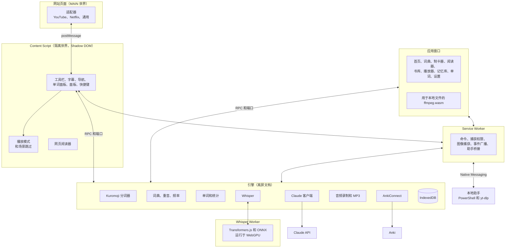

<p align="right"><a href="../arquitectura.md">Español</a> · <a href="../architecture.md">English</a> · <a href="../de/architecture.md">Deutsch</a> · <b>简体中文</b> · <a href="../ko/architecture.md">한국어</a> · <a href="../ja/architecture.md">日本語</a></p>

# 架构

Kotonoha（言の葉，意为“言语之叶”）是一款 Manifest V3 扩展，用于通过真实的视频和文章学习日语。本文档介绍各部分如何分工、主要流程，以及支撑技术决策的测量结果。

## 总览



## 职责分工

| 部分 | 职责 | 原因 |
|---|---|---|
| **适配器（MAIN）** | 与各网站的播放器通信：字幕轨、跳转、播放 | 只有在页面内才能访问 `#movie_player` 或 `netflix` |
| **Content Script** | 视频上的全部界面 | 隔离世界和 Shadow DOM 避免了与网站的双向干扰 |
| **Service Worker** | 其他部分无法使用的 API：命令、`tabCapture`、`captureVisibleTab`、`connectNative` | Chrome 会在其闲置时停止它，因此不保存状态 |
| **引擎（离屏）** | 分词器、数据库、Claude、Anki 和录音 | 这些是繁重且长时间运行的工作。离屏文档不会在回答中途被停止 |
| **Whisper Worker** | 加载模型并在 GPU 上转录 | 非常繁重，会阻塞引擎。单独打包，只在使用时加载 |
| **本地助手** | 下载网络视频的音频，并更新扩展 | 扩展无法独自完成。只有扩展可以调用它，且只接受 http 或 https 地址 |
| **应用窗口** | 管理页面和本地播放器 | 普通的扩展页面，通过 RPC 使用同一个引擎 |
| **核心（`src/nucleo`）** | 纯逻辑：解析器、模式、统计、同步、转录和批次 | 不依赖浏览器，用 Vitest 测试 |
| **语言包（`src/lenguas`）** | 所有取决于所学语言的内容 | 程序的其余部分只了解其接口 |

## 字幕的流程

1. 适配器检测视频并列出字幕轨。
2. Content Script 选择日语字幕轨和第二字幕。导入的优先，人工字幕优先于自动字幕。
3. 适配器使用页面的会话下载文本。这对 YouTube 很重要，其地址由播放器签名。
4. 核心把格式（TTML、WebVTT、SRT、ASS 或 json3）转换为带时间的行。
5. 引擎进行分词，合并活用形，计算每个单词的注音、重音、频率和状态，并用规则检测语法。
6. 如果是自动字幕轨，Claude 会先更正识别错误：分析有错误的文本是无谓的花费。
7. Claude 在后台检查每个新行：更正读音，指出比喻用法，并确认语法。结果按行保存，只请求一次。
8. 界面绘制每个单词：文字颜色表示重音，下划线表示学习状态。

## 用 Claude 翻译和更正

处理整部视频需要时间，但重要的是正在观看的部分。因此工作被分成批次，并从播放位置所在的批次开始（`src/nucleo/lotes.ts`）。

| | 翻译 | 更正 |
|---|---|---|
| 批次大小 | 80 行 | 120 行 |
| Claude 的回答 | 所有行 | 只有变化的行，通常很少 |
| 上下文 | 标题和相邻行 | 标题和全文，放在带提示词缓存的区块中 |
| 第一批 | 与其他批次并行 | 单独进行：写入其他批次复用的缓存 |
| 中断时 | 保存已翻译的内容，继续处理缺少的部分 | 保存已更正的内容，完成时标记为完整 |

更正从不提问：Claude 根据上下文决定，有疑问的行保持原样。如果某行是识别系统编造的句子，它返回空行，该行随之消失。每次更正都保留原文，可在字幕导航中查看。

生成的字幕轨按视频和语言保存，并记录来源：Whisper、Claude、导入或已保存。从其他 Netflix 地区记住的字幕，只在当前地区没有这条字幕轨时才出现。

## 用 Whisper 转录

Claude 不转录音频，因此这部分在本机运行。

| 来源 | 音频如何到达 | 速度 |
|---|---|---|
| 本地文件 | ffmpeg.wasm 在应用窗口中提取所选音轨。文件无需复制即可挂载，因此适用于整部电影 | GPU 允许的速度 |
| 网络视频，使用助手 | yt-dlp 把音频下载到临时文件夹。电脑上有 FFmpeg 时由助手转换，引擎通过 Service Worker 分块读取样本；没有时引擎收到文件，用 ffmpeg.wasm 转换 | GPU 允许的速度 |
| 网络视频，不使用助手 | 播放时捕获标签页。播放器每秒报告四次视频时间，即使有暂停或跳转，也能把采样换算为视频时间 | 实时 |

Netflix 被有意排除在外：它几乎都有字幕，其音频也无法提前处理。

1. 在达到 Whisper 的 30 秒窗口之前，按静音切分音频。没有语音的片段会被丢弃，因为 Whisper 容易在那里编造内容。
2. Whisper 在 GPU 上转录。清除幻听和循环后，把文本分成多行。
3. 每段 6 秒或更长且没有文本的片段都会单独重新转录。在背景音乐下，Whisper 可能提前结束或延迟开始一段，从而漏掉真实语音。如果解码器卡在重复内容上，则尝试 10 秒的窗口。这些第二轮结果只接受明确是句子的内容，因为这类片段大多只有音乐。
4. Claude 更正同音词和汉字：文件在最后进行，实时转录每十行进行一次。

### 负载控制

不间断工作会让 GPU 长时间保持 100%，导致桌面卡顿，并可能使显卡驱动程序重启。

| 措施 | 工作方式 |
|---|---|
| 一次一段 | 两小时的电影绝不会一次发送，显存不随时长增长 |
| 休息 | 每段之后按其耗时比例休息。如果其他应用占用 GPU，这一段耗时更长，休息也会自动增加 |
| 自动强度 | 使用电脑时占用 75% 的时间，闲置两分钟后占用 90%。柔和模式保持在 30% |
| 暂停 | 立即释放显卡并保留位置 |
| 看门狗 | 卡住的片段在 90 秒后中止 |
| GPU 丢失 | 等待 20 秒，重新加载模型，并以柔和模式继续。第二次失败时停止，已转录的内容会保留 |
| 继续 | 对同一文件重新转录时，从上次停止的位置继续 |

**歌词。** `src/nucleo/letra.ts` 把粘贴的歌词放到字幕轨的时间上。通过 JSON 模式向 Claude 请求一个按演唱顺序排列的条目列表 `{句子, 起始行, 结束行}`。词语和时间都不来自 Claude：文字来自歌词，时间来自转录，因此它无法改动二者。回答不会复述歌词，而且很短。顺序错误的条目会失去时间，但不影响其他条目（最长递增子序列）；没有时间的句子按长度估算；共用一行的句子按长度分配其时长。

## 技术决策

| 决策 | 选择 | 理由 |
|---|---|---|
| 界面 | Preact 和 signals | 非常轻量，这很重要，因为它会注入每个视频页面 |
| 打包 | esbuild 和自有脚本 | 快速且明确，清单一目了然 |
| 数据库 | 基于 IndexedDB 的 Dexie | 提供索引和查询，无需直接操作 IndexedDB |
| 分词器 | 封装在自有接口后的 Kuromoji | 可在浏览器中运行，替换时不影响其他部分 |
| 词典 | Yomitan 格式：西班牙语和英语的 JMdict、Kanjium 的重音、JPDB 的频率 | 开放格式，也可以从文件导入其他词典 |
| AI | 从引擎调用官方 SDK `@anthropic-ai/sdk` | 密钥绝不会到达在页面上运行的脚本 |
| 转录 | Whisper large-v3-turbo，使用 Transformers.js 和 WebGPU，16 位编码器和量化解码器 | 比较过的模型中最准确，且无需安装任何东西 |
| 网络视频的音频 | 用 PowerShell 写的本地程序中的 yt-dlp，通过 Native Messaging；有 FFmpeg 时也用它 | 这是无需等待播放就能处理的唯一方法。下载到临时文件而不是流式传输，因此按 GPU 的节奏读取，不会堵塞 |
| 本地文件 | ffmpeg.wasm | MKV 内嵌字幕和音轨，无需外部程序 |
| 卡片 | AnkiConnect 和使用 FSRS 的内置复习 | 与 Anki 集成，或在应用内复习 |
| 卡片音频 | `tabCapture` 和 `MediaRecorder`，导出为 MP3 | 适用于任何网站，无需下载视频 |
| 网页 | 颜色使用 CSS Custom Highlight API，读音使用 `<body>` 之外的自有图层 | 不向页面内容添加任何东西，也不会干扰 React 等应用 |
| 滚动框中的注音 | 每个框一个图层，由 `ScrollTimeline` 移动，并由边框裁剪 | 浏览器滚动这些框时不经过主线程：用代码重新定位读音总会比文字慢一帧，产生拖影。与滚动关联后，它们与文字同时移动，即使页面正忙 |
| 行距 | 内联且无单位的 `line-height`，只用于多行文字或紧贴的行 | 字号 15 px、行高 21 px 时，只剩 6 px 放 9 px 的读音和下划线。这是阅读器唯一改动页面的地方：如果文字会超出固定高度的框则撤销，也可以关闭 |
| 鼠标下是哪个单词 | `caretPositionFromPoint` 和文本节点索引 | 无需把每个单词包进元素就能处理单击 |
| 界面语言 | 每种语言一个 JSON 表，以西班牙语文本为键，单独加载 | Content Script 在所有页面运行，不应携带六种语言。使用完整句子，因为韩语、日语和德语的语序不同 |
| 笔顺 | [KanjiVG](https://kanjivg.tagaini.net)，以固定版本按字符从 jsDelivr 请求，绘制为 SVG 动画 | 共有一万多个文件：每个汉字在使用时下载并保存。SVG 在任何尺寸下都清晰且跟随主题，每个文件只接受路径及其序号 |
| 标签页中的阅读器 | 扩展页面 `lector.html`，在普通标签页中打开 | 应用窗口是 `popup` 类型，没有标签页，无法进入分屏视图。扩展页面可以，而且不需要服务器。`chrome.tabs.create({ splitWithTabId })` 从 Chrome 155 起可把它放在当前标签页旁边 |
| 跟随剪贴板 | 离屏文档中的 `execCommand('paste')` | 没有焦点时 `navigator.clipboard` 无法读取，而在分屏视图中焦点在另一个页面。只在选项开启且标签页可见时读取 |
| 图标 | Phosphor 双色版 | 风格一致，只打包代码用到的部分 |
| 字体 | 拉丁文使用 Nunito，日语使用 Zen Maru Gothic | 都是圆体。以数据形式加载，避免被网站的安全策略阻止 |

## Claude 模型

每项任务默认使用 `claude-sonnet-5-5`，模型和力度可在设置中按任务更改。单词面板的“深入了解”按钮使用 `claude-opus-5-5` 和高力度重新查询。请求启用 `fallbacks: "default"`，因此安全拒绝会在其他模型上重试，可在设置中关闭。结构化回答使用带 JSON 模式的 `output_config.format`，完整脚本在发送时放在带缓存的系统区块中。

**避免重复付费。** 每次查询都有由所问内容构成的身份：任务、模型、水平、语言、模板、单词、读音和句子。不包括周围的文本，因为它会随字幕加载而变化。进行中的请求不会取消，即使发起者已离开，因为它已经付费，取消意味着要再付一次：它在后台完成并保存，第二个相同的查询会接上它。读音检查按播放位置以 120 行为单位推进，进行中的批次即使关闭标签页也会完成并保存。

**费用记录。** 每次请求后，`src/motor/ia.ts` 在 `consumo` 表中记录 API 报告的 token（`usage`）、回答的模型和任务。价格在 `src/nucleo/precios.ts` 中计算。只记录 API 确认的内容；被中止的请求不会出现，尽管 API 可能已对其部分计费。

## 参考测量

设备：16 GB 的 Radeon RX 9060 XT、16 GB 内存、60 Hz 的 4K 显示器、Windows 11 和 Edge。可用 `pruebas/whisper-comparar.mjs`、`whisper-carga.mjs`、`whisper-video.mjs` 和 `whisper-larga.mjs` 复现。

**准确度。** 在 JSUT、Common Voice 和 ReazonSpeech 的 126 个真实句子上的字符错误率（百分比），不计标点和数字。数值越小越好。

| 模型 | 总计 | JSUT | Common Voice | ReazonSpeech | 带标点的句子 | 显存 |
|---|---|---|---|---|---|---|
| Whisper Turbo，16 位编码器 | 8.8 | 5.5 | 6.5 | 15.0 | 126 中 36 | 3.7 GB |
| Whisper Turbo，量化 | 9.8 | 5.7 | 7.2 | 17.4 | 126 中 30 | 1.5 GB |
| Kotoba Whisper v2.2，量化 | 10.4 | 6.4 | 7.6 | 17.9 | 126 中 12 | 2.2 GB |
| Kotoba Whisper v2.2，16 位 | 10.5 | 7.8 | 7.8 | 16.4 | 126 中 10 | 3.3 GB |

在真实视频上，Turbo 在同音词和专有名词上的优势更大，而 Kotoba 倾向于在音乐上拉长字幕行。

**真实视频的速度**，包含恢复被遗漏的片段：

| 视频 | 时长 | 耗时 | 速度 | 折合 30 分钟 | 桌面第 99 百分位 |
|---|---|---|---|---|---|
| 带背景音乐的对话 | 23.1 分钟 | 223 秒 | 6.1 倍 | 4.9 分钟 | 17.4 毫秒 |
| 口头讲解 | 13.3 分钟 | 125 秒 | 6.4 倍 | 4.7 分钟 | 17.5 毫秒 |

占用率 75%，没有超过 33 毫秒的帧，驱动程序也未重启。

**流畅度。** 桌面合成之间的时间（毫秒），用 `DwmFlush` 和动画窗口测量。60 Hz 下的正常值为 16.7。

| 占用率 | 第 99 百分位 | 最大值 | 超过 33 毫秒的帧 |
|---|---|---|---|
| 无 Whisper | 18.2 | 19.3 | 0 |
| 30% | 18.6 | 19.5 | 0 |
| 60% | 18.7 | 20.0 | 0 |
| 95% | 19.1 | 20.5 | 0 |

在 Whisper 运行时播放 1080p 视频，占用率 90% 和 95% 时：749 帧中丢失 0 帧。无 Whisper 时同样是 749 帧中丢失 0 帧。

**长时间运行。** 自动模式下连续两小时真实音频：19.7 分钟，是实时的 6.1 倍。

| 分钟 | 进度 | 显存 | 浏览器内存 | 第 99 百分位 | 超过 33 毫秒的帧 | 驱动程序重启 |
|---|---|---|---|---|---|---|
| 开始前 | | 5.28 GB | 1.11 GB | | | |
| 1.4 | 7% | 7.50 GB | 5.64 GB | 18.6 | 0 | 0 |
| 6.4 | 33% | 7.67 GB | 5.25 GB | 18.6 | 0 | 0 |
| 11.5 | 56% | 7.51 GB | 3.11 GB | 18.7 | 0 | 0 |
| 16.5 | 84% | 7.33 GB | 2.64 GB | 18.7 | 0 | 0 |

内存不随时间增长，节奏保持稳定。显存包括整个系统的用量。

**恢复。** 销毁 WebGPU 设备会产生与驱动程序重启相同的事件。Whisper 在 27 秒后恢复工作，不会丢失或打乱已转录的内容，第二次失败时停止并给出提示。

### 音调重音练习中的音拍

narabas 是一个 wav2vec2 模型，每 20 毫秒给出日语每个音素的概率。我们用两个 AivisSpeech 语音说出的最小对立词（おばあさん 和 おばさん、きって 和 きて……）试了两种做法：

- **对齐预期读音**：用 narabas 的强制对齐，测量每个特殊音拍的时长。缺少的音拍照样分到一段时间，时长无法把它和说出来的音拍很好地区分开。它也没有改进音高判断：对齐音拍后的正确率并不比把每个词平均分割更高（76 个判断中 61 个），所以音高仍按原来的方式判断。
- **它自己听到的内容**：每一帧最可能的音素，按编辑距离与读音比较。这就是现在的做法：发现了 22 个缺少的音拍中的 17 个、10 个多余的音拍中的 10 个，24 个说对的句子中有 22 个没有提示。s、sh、z、j、h、f 前面的っ不判断：即使说出来了，模型也不会给出它的符号。

在 GPU 上，它听到的内容与处理器上的 ONNX Runtime 逐个音素完全一致。工作线程在使用 GPU 之前，会先用固定信号检查；同一块 GPU 运行 Kokoro 时曾给出不可能的数值。

PASQA 是给整句发音打分的模型，没有纳入：转换它需要特定版本的 Python、PyTorch 和 s3prl，因此无法测量。

### 网页阅读器的开销

主线程时间，所有单词都未知且全部显示注音：最坏情况。在 Edge 中以 1366×860 用 `Performance.getMetrics` 测量，阅读器已加载。

| 页面 | 开启 | 静止 6 秒 | 滚动 3.5 秒，无阅读器 | 滚动 3.5 秒，有阅读器 |
|---|---|---|---|---|
| 维基百科长条目（16,000 个元素） | 500 毫秒 | 首次 300 毫秒，之后 0 | 30 毫秒 | 850 毫秒 |
| 带广告的报纸首页 | 340 毫秒 | 160 毫秒（无阅读器 120 毫秒） | 70–560 毫秒 | 640–790 毫秒 |

开销大的是测量和更改 DOM。文档发生任何变化后，Chromium 都会重建所有高亮标记，因此阅读器会把写入合并。所以：

- 读音图层随文档移动，滚动框的图层随该框移动：滚动时无需计算。
- 每个读音都带有其文本的实际 `z-index`，浏览器无需命中测试就能决定遮挡关系。裁剪通过比较矩形决定。
- 如果区块的框没有移动，其读音也没有移动：检查一个框而不是每个单词。
- 仍需 `elementFromPoint` 的部分按行处理，在空闲时且页面静止时进行。
- 远离的内容成组移除，如果在此之前返回则不做改动。

## 语言包

所有取决于所学语言的内容都位于 `src/lenguas/<语言>`，程序的其余部分只了解 `src/lenguas/tipos.ts` 中的接口。目前有两个语言包：日语和英语。每个包分为两部分：

- **`PaqueteLengua`** 很轻量，所有界面都会使用，包括内容脚本：如何在文本中识别该语言、如何书写读音、级别、语音和链接，以及界面中提到该语言的句子。
- **`MotorLengua`** 只在引擎和应用窗口中加载：分析器、语法规则、提示词、转录规则、词典和音频。

每种语言都有自己的数据库。日语数据库保留原来的名称 `kikitori`，其他语言则命名为 `kikitori-<语言>`。这样，在两种语言中写法相同的词绝不会混淆，现有数据也无需迁移。Claude 的费用与语言无关，始终保存在原来的数据库中。

每个包的提示词都在测试中固定了指纹，因为更改提示词会使已保存的回答失效，需要重新付费。

英语包展示了语言之间的差异：

| 方面 | 日语 | 英语 |
|---|---|---|
| 分析器 | Kuromoji 和 IPADIC | wink-nlp 及其小模型，单独编译（`ingles.js`），只在学习英语时加载 |
| 读音 | 是单词的一部分：区分同形词，并进入键 | 不区分任何内容：键是词典形式，IPA 按地区单独保存 |
| 重音 | 按音拍的音调模式，来自 Kanjium | 重读音节，由 IPA 推导 |
| 词典 | JMdict、Kanjium 和 JPDB | 通过 wiktionary-to-yomitan 获取的 Wiktionary，以及 FrequencyWords |
| 内存中的词条列表 | 分析会等待它：没有它，复合词会被拆开 | 分析不等待：它只用于连接带连字符的词 |

取决于语言的设置保存在 `porLengua` 中，切换时恢复（`ajustesParaLengua`）。程序的其余部分仍在原来的位置读取它们。

词典逐个数据库解压，因此内存占用不取决于文件大小；删除时分批进行，因为包含数十万行的单个事务无法完成。使用 Wiktionary 的英英词典（847,853 行）测得：安装耗时 1.5 至 3 分钟（含下载），磁盘占用约 220 MB，查询耗时不到 10 毫秒。删除约需 3 分钟，其间查询耗时 2 至 5 秒。

## 文件夹结构

```
src/
  nucleo/       经过测试的纯逻辑：字幕、模式、同步、转录、批次
  lenguas/      取决于所学语言的内容：每种语言一个包
  compartido/   类型、设置和上下文之间的 RPC
  pagina/       MAIN 世界的适配器
  contenido/    视频上的界面和网页阅读器（lector/）
  fondo/        Service Worker
  motor/        离屏文档：数据库、分词器、Claude、Anki、录音、Whisper
  app/          应用窗口
  lector/       普通标签页中的阅读器
  popup/        扩展图标的菜单
  ui/           设计系统、单词面板、图标和标识
idiomas/        界面翻译表
herramientas/   图标、标识和横幅的生成器；待翻译文本；ayudante/ 中的本地助手
pruebas/        截图工具、端到端测试和模拟服务器
docs/           文档：此处为西班牙语和英语，德语、中文、韩语和日语在子文件夹中
```
